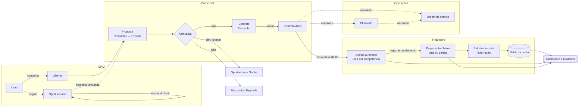

# 01 — Visão geral do Nexus ERP

> Público: desenvolvedores que estão começando com Laravel e vão estudar este código.
> Objetivo deste arquivo: entender **o que** o sistema faz, **para quem**, e como as peças de negócio se encaixam — antes de mergulhar no código.

## Sumário

1. [Objetivo do sistema](#1-objetivo-do-sistema)
2. [Público e perfis de acesso](#2-público-e-perfis-de-acesso)
3. [Stack tecnológica em uma frase por item](#3-stack-tecnológica-em-uma-frase-por-item)
4. [Os 13 módulos](#4-os-13-módulos)
5. [Fluxo de negócio ponta a ponta](#5-fluxo-de-negócio-ponta-a-ponta)
6. [Rotinas automáticas (o que acontece sem ninguém clicar)](#6-rotinas-automáticas-o-que-acontece-sem-ninguém-clicar)
7. [Glossário](#7-glossário)
8. [Próximos passos de leitura](#8-próximos-passos-de-leitura)

---

## 1. Objetivo do sistema

O **Nexus ERP** é um sistema de gestão (ERP — *Enterprise Resource Planning*) para **empresas de serviços** — por exemplo, uma empresa de TI que vende contratos de suporte mensais. Ele cobre o ciclo completo:

- **atrair e vender**: leads, funil de vendas (Kanban), propostas comerciais;
- **formalizar**: contratos com cobrança recorrente;
- **entregar**: ordens de serviço (OS) e chamados de atendimento;
- **receber e pagar**: contas a receber e a pagar, baixas (pagamentos), estornos, contas bancárias com extrato, transferências, fluxo de caixa;
- **acompanhar**: dashboard com indicadores e 9 relatórios exportáveis (CSV/PDF).

Ele é **multiempresa** (*multi-tenant*): várias empresas usam a mesma instalação e o mesmo banco de dados, mas **cada uma só enxerga os próprios dados**. Um mesmo usuário pode trabalhar em mais de uma empresa, com um perfil de acesso diferente em cada uma (seletor de empresa no topo da tela).

> **Importante:** o Nexus ERP **não** movimenta dinheiro de verdade nem se conecta a bancos. "Registrar um pagamento" significa **anotar** que o dinheiro entrou/saiu (a tela de baixa avisa: *"Registro manual: o Nexus ERP não processa pagamentos nem se comunica com bancos."*).

## 2. Público e perfis de acesso

Quem usa o sistema no dia a dia e o que cada um faz. Os perfis abaixo são criados automaticamente para cada nova empresa a partir de [`config/permissions.php`](../config/permissions.php) (chave `roles`) pela Action [`ProvisionCompanyDefaults`](../app/Actions/Companies/ProvisionCompanyDefaults.php):

| Perfil (slug) | Nome na tela | Para quem | Resumo do acesso |
|---|---|---|---|
| `company-admin` | Administrador da empresa | Dono/gestor da empresa | Todas as permissões (`'*'`) |
| `manager` | Gerente | Gestão operacional | Comercial, operações e financeiro, sem administrar usuários/perfis |
| `sales` | Comercial | Vendedores | Clientes, CRM, propostas e criação de contratos |
| `finance` | Financeiro | Equipe financeira | Contas a receber/pagar, contas financeiras, estornos, fluxo de caixa |
| `support` | Atendimento | Suporte | Chamados, OS e consulta de clientes/contratos |
| `collaborator` | Colaborador | Técnicos de campo | Execução de OS e atendimento básico |

Além dos perfis, existe o **superadministrador** da plataforma: não é um perfil, é a coluna `users.is_super_admin`. Ele tem acesso total a qualquer empresa (via `Gate::before` em [`AppServiceProvider`](../app/Providers/AppServiceProvider.php)) e é o único que vê o menu **Plataforma › Empresas**.

Cada empresa pode ajustar as permissões dos perfis ou criar perfis próprios em **Gestão › Perfis de acesso**. As permissões têm o formato `recurso.ação` (ex.: `customers.view`, `receivables.settle`).

## 3. Stack tecnológica em uma frase por item

| Peça | Para que serve aqui |
|---|---|
| **Laravel 13** (PHP 8.4) | Framework do back-end: rotas, Eloquent ORM, filas, agendador, validação, autorização. |
| **Livewire 4** (componentes em classe) | Telas de listagem reativas (busca, filtros, ordenação sem recarregar a página). |
| **Alpine.js** (vem com o Livewire) | Pequenas interações no navegador: máscara de dinheiro, editor de itens, toasts, gráficos. |
| **Tailwind CSS 4** | Estilos. |
| **Chart.js** | Gráficos do dashboard. |
| **Laravel Fortify** | Back-end de autenticação (login, recuperação de senha, verificação de e-mail). |
| **Laravel Sanctum** | Tokens de acesso para a API REST `/api/v1`. |
| **PostgreSQL 17** | Banco de dados (usa recursos específicos: índices UNIQUE parciais, `CHECK`, `FILTER`, `ILIKE`). |
| **Redis** | Cache/filas (ambiente Docker). |
| **Pest** | Testes automatizados (banco isolado `nexus_erp_testing`). |

## 4. Os 13 módulos

O menu lateral é montado em [`resources/views/layouts/partials/navigation.blade.php`](../resources/views/layouts/partials/navigation.blade.php). Cada item só aparece se o usuário tiver a permissão correspondente — mas, como o próprio arquivo avisa, *esconder um link não impede o acesso direto pela URL*: a proteção real está nas Policies.

| # | Módulo | Onde está no menu | O que faz | URL principal | Permissão para ver |
|---|---|---|---|---|---|
| 1 | **Dashboard** | Topo (sem seção) | Indicadores (KPIs) e gráficos do período; visão consolidada de várias empresas | `/dashboard` | `dashboard.view` |
| 2 | **Clientes** | Comercial › Clientes | Cadastro de PF/PJ com CPF/CNPJ validado, endereços, contatos, histórico, anexos, resumo financeiro; exportação CSV | `/clientes` | `customers.view` |
| 3 | **Fornecedores** | Financeiro › Fornecedores | Mesmo cadastro dos clientes, usado nas contas a pagar e despesas recorrentes | `/fornecedores` | `suppliers.view` |
| 4 | **CRM** | Comercial › Leads, Funil de vendas, Tarefas | Leads (com conversão em cliente), oportunidades em Kanban com etapas configuráveis, interações (ligações, reuniões) e tarefas de acompanhamento | `/crm/leads`, `/crm/funil`, `/tarefas` | `leads.view`, `opportunities.view` |
| 5 | **Catálogo** | Comercial › Catálogo | Produtos e serviços com código, unidade e preço, usados nos itens de propostas/contratos | `/catalogo` | `catalog.view` |
| 6 | **Propostas** | Comercial › Propostas | Propostas com itens, descontos e totais calculados no servidor; ciclo de status; PDF; conversão em contrato | `/propostas` | `proposals.view` |
| 7 | **Contratos** | Comercial › Contratos | Contratos com periodicidade e dia de cobrança; ativação, suspensão, renovação, cancelamento; geração de cobranças | `/contratos` | `contracts.view` |
| 8 | **Ordens de serviço** | Operações › Ordens de serviço | OS com prioridade, prazo, responsável, registro de atividades (minutos) e ciclo de status | `/ordens-de-servico` | `service_orders.view` |
| 9 | **Chamados** | Operações › Chamados | Atendimento com mensagens públicas e comentários internos, categorias, primeira resposta, resolução | `/chamados` | `tickets.view` |
| 10 | **Financeiro** | Financeiro › Contas a receber, Contas a pagar, Contas financeiras, Fluxo de caixa | Títulos a receber/pagar, baixas parciais, estornos, cancelamentos, contas bancárias com extrato (livro-razão), transferências, lançamentos avulsos, despesas recorrentes, categorias e centros de custo | `/financeiro/...` | `receivables.view`, `payables.view`, `accounts.view`, `cash_flow.view` |
| 11 | **Relatórios** | Gestão › Relatórios | 9 relatórios (comercial, financeiro, operacional) com filtros e exportação CSV/PDF | `/relatorios` | `reports.commercial` / `reports.financial` / `reports.operational` |
| 12 | **Administração da empresa** | Gestão › Usuários, Perfis de acesso, Unidades, Auditoria, Configurações | Usuários e convites, perfis e permissões, unidades (filiais), trilha de auditoria, configurações (prefixos de numeração, prazos, notificações, logotipo) | `/configuracoes/...` | `users.view`, `roles.view`, `units.view`, `audit.view`, `settings.manage` |
| 13 | **Plataforma** | Plataforma › Empresas (somente superadministrador) | Cadastro das empresas (tenants) da instalação | `/admin/empresas` | `is_super_admin` |

Algumas telas secundárias não aparecem no menu, mas são acessadas por botões dentro dos módulos:

- **Despesas recorrentes** (`/financeiro/despesas-recorrentes`): botão em *Contas a pagar* e em *Contas financeiras*.
- **Categorias e centros de custo** (`/financeiro/configuracoes`): botão em *Contas financeiras*.
- **Oportunidades em tabela** (`/crm/oportunidades`): botão "Ver em tabela" no Funil.
- **Configurações do CRM** (`/crm/configuracoes`), **categorias de chamados** (`/chamados/categorias`) e **categorias do catálogo** (`/catalogo/categorias`).

Recursos **transversais** (usados por vários módulos): autenticação e perfil do usuário (Fortify, `/perfil`), notificações internas (sino no topo), anexos privados, histórico de status, auditoria e a **API REST** `/api/v1` (mesmas regras da interface web; veja [`routes/api.php`](../routes/api.php)).

## 5. Fluxo de negócio ponta a ponta

### 5.1 A história contada em passos

Imagine a empresa "Vértice TI" (uma das empresas dos dados de demonstração) vendendo um contrato de suporte mensal:

1. **Lead** — Alguém preenche um formulário no site. O vendedor cadastra um **lead** (contato ainda não qualificado) com a origem "Site".
2. **Oportunidade** — O vendedor cria uma **oportunidade** no funil (etapa "Prospecção") e a arrasta pelas colunas conforme a negociação avança. Cada etapa tem uma probabilidade padrão (10%, 25%, 50%...).
3. **Cliente** — Quando o lead se mostra real, ele é **convertido em cliente** ([`ConvertLeadToCustomer`](../app/Actions/Crm/ConvertLeadToCustomer.php)). O lead não é apagado: fica "Convertido" e aponta para o cliente; as oportunidades dele passam a apontar para o cliente também.
4. **Proposta** — O vendedor emite uma **proposta** (número `PROP-2026-00001`) com itens do catálogo, quantidades e descontos. Os totais são calculados **no servidor**. A proposta nasce como *Rascunho*, é *Enviada* ao cliente e depois *Aprovada* ou *Recusada* (ou *Expira* sozinha quando a validade passa).
5. **Aprovação** — Ao aprovar uma proposta vinculada a uma oportunidade, um **Listener** ([`MarkOpportunityAsWon`](../app/Listeners/MarkOpportunityAsWon.php)) move automaticamente a oportunidade para a etapa "Ganha". O responsável pela proposta é notificado se outra pessoa aprovou/recusou.
6. **Contrato** — A proposta aprovada é **convertida em contrato** ([`ConvertProposalToContract`](../app/Actions/Proposals/ConvertProposalToContract.php)): cliente, itens e valor vêm da proposta; o usuário só informa início, periodicidade e dia de cobrança. Uma proposta gera **no máximo um** contrato.
7. **Ativação** — O contrato nasce como *Rascunho*. Ao ser **ativado**, o sistema calcula a data da primeira cobrança (`next_billing_date`).
8. **Cobranças recorrentes** — Todo dia, às 06:00, a rotina automática gera as **contas a receber** dos contratos ativos cujo próximo vencimento esteja dentro da janela de antecedência da empresa (padrão: 10 dias). Cada cobrança tem uma **competência** (mês de referência) e o banco impede cobrar duas vezes a mesma competência.
9. **Pagamento** — Quando o cliente paga, o financeiro **registra o recebimento** (pode ser parcial) escolhendo a conta bancária de destino ([`RecordPayment`](../app/Actions/Finance/RecordPayment.php)). O título muda para *Pago parcialmente* ou *Quitado*.
10. **Saldo e dashboard** — O recebimento gera um **lançamento no extrato** da conta (livro-razão) e atualiza o **saldo** da conta ([`LedgerService`](../app/Services/Finance/LedgerService.php)). O dashboard passa a mostrar a receita recebida no período, o saldo consolidado e a redução dos valores em aberto.

Em paralelo, na entrega do serviço:

- **Chamados** — O cliente reporta um problema; o atendimento abre um **chamado** e pode vinculá-lo ao **contrato** do cliente e a uma **OS**. O sistema valida que o contrato e a OS pertencem ao **mesmo cliente** ([`TicketRequest`](../app/Http/Requests/Operations/TicketRequest.php)).
- **Ordens de serviço** — Para trabalho técnico, abre-se uma **OS** (também podendo vincular o contrato do cliente, validado em [`ServiceOrderRequest`](../app/Http/Requests/Operations/ServiceOrderRequest.php)). O técnico registra atividades com minutos gastos e conclui a OS informando a solução aplicada.

### 5.2 Diagrama do fluxo



### 5.3 O lado das despesas

O fluxo de saída de dinheiro é simétrico:

- **Fornecedor** → **Despesa recorrente** (ex.: aluguel todo dia 5) → a rotina diária gera **Contas a pagar** por competência ([`GenerateRecurringExpenses`](../app/Actions/Finance/GenerateRecurringExpenses.php)) → o financeiro **registra o pagamento** escolhendo a conta de origem → o extrato registra uma **saída** e o saldo diminui (o sistema **não permite** deixar a conta negativa).
- Contas a pagar também podem ser lançadas avulsas (sem recorrência).

## 6. Rotinas automáticas (o que acontece sem ninguém clicar)

Configuradas no **Scheduler** do Laravel em [`routes/console.php`](../routes/console.php):

| Horário | Comando | O que faz |
|---|---|---|
| 05:30 | `php artisan finance:verify-balances` | Confere se o saldo gravado de cada conta bate com o extrato; divergências são registradas no log `finance` e o comando termina com erro ([`VerifyAccountBalances`](../app/Console/Commands/VerifyAccountBalances.php)). |
| 06:00 | `php artisan erp:daily-routines` | Para **cada empresa ativa**, enfileira 4 Jobs ([`RunDailyRoutines`](../app/Console/Commands/RunDailyRoutines.php)): expira propostas e processa vigência de contratos; gera cobranças recorrentes; gera despesas recorrentes; avisa a equipe sobre contas vencidas. |
| diário | `auth:clear-resets` | Remove tokens de redefinição de senha expirados. |
| diário | `sanctum:prune-expired --hours=48` | Remove tokens de API expirados. |

Para rodar as rotinas na hora, sem fila (útil em desenvolvimento):

```bash
php artisan erp:daily-routines --sync
php artisan erp:daily-routines --sync --company=1   # só uma empresa
```

## 7. Glossário

Termos de negócio e técnicos usados no código e nesta documentação.

| Termo | Significado no Nexus ERP | Onde aparece no código |
|---|---|---|
| **Tenant / empresa** | Cada empresa cliente da plataforma. Os dados de uma nunca aparecem para outra. | `companies`, `company_id`, [`CurrentCompany`](../app/Support/Tenancy/CurrentCompany.php) |
| **Empresa ativa** | A empresa em que o usuário está trabalhando *nesta requisição* (escolhida no seletor). Todas as consultas são filtradas por ela. | `users.current_company_id`, [`SetCurrentCompany`](../app/Http/Middleware/SetCurrentCompany.php) |
| **Perfil (role)** | Conjunto de permissões de um usuário **dentro de uma empresa**. | `roles`, `company_user.role_id` |
| **Permissão** | Ação permitida, no formato `recurso.ação`. | [`config/permissions.php`](../config/permissions.php) |
| **Lead** | Contato comercial ainda não convertido em cliente. | [`Lead`](../app/Models/Lead.php) |
| **Oportunidade** | Negociação em andamento, posicionada numa etapa do funil, com valor estimado e probabilidade. | [`Opportunity`](../app/Models/Opportunity.php) |
| **Funil / pipeline** | Sequência de etapas configuráveis (Kanban). Etapas de "ganho" e "perda" encerram a oportunidade. | [`PipelineStage`](../app/Models/PipelineStage.php) |
| **Proposta** | Oferta comercial com itens, descontos e validade. | [`Proposal`](../app/Models/Proposal.php) |
| **Contrato** | Acordo de prestação de serviços com valor periódico e cobrança recorrente. | [`Contract`](../app/Models/Contract.php) |
| **Periodicidade** | De quanto em quanto tempo o contrato é cobrado: mensal (1), trimestral (3), semestral (6) ou anual (12 meses). | [`BillingFrequency`](../app/Enums/BillingFrequency.php) |
| **Título** | Um documento financeiro a receber ou a pagar (uma "conta"). | [`Receivable`](../app/Models/Receivable.php), [`Payable`](../app/Models/Payable.php) |
| **Competência** | Mês de referência de um título, gravado como o 1º dia do mês (ex.: `2026-10-01` = "10/2026"). Para cobranças de contrato, é o mês do vencimento. | `receivables.competence`, [`BillingSchedule::competenceFor()`](../app/Support/Billing/BillingSchedule.php) |
| **Baixa** | Registro de que um título foi pago, total ou parcialmente. Gera um `Payment`. | [`RecordPayment`](../app/Actions/Finance/RecordPayment.php) |
| **Baixa parcial** | Pagamento de parte do valor; o título fica "Pago parcialmente" e o restante continua em aberto. | `BillStatus::Partial` |
| **Estorno** | Desfazer uma operação financeira **sem apagar nada**: cria-se um movimento inverso e o original fica marcado como estornado. | [`ReversePayment`](../app/Actions/Finance/ReversePayment.php), [`LedgerService::reverse()`](../app/Services/Finance/LedgerService.php) |
| **Cancelamento de título** | Invalida um título sem pagamentos. Títulos nunca são excluídos. | [`CancelBill`](../app/Actions/Finance/CancelBill.php) |
| **Vencido** | Título em aberto ou parcial cujo vencimento já passou. **Não é um status gravado**: é calculado na hora. | `IsBill::isOverdue()`, `scopeOverdue()` |
| **Conta financeira** | Conta bancária, caixa ou carteira digital interna da empresa, com saldo e extrato. | [`FinancialAccount`](../app/Models/FinancialAccount.php) |
| **Livro-razão / extrato** | Lista imutável de lançamentos (entradas e saídas) de uma conta. Todo movimento de saldo passa por ele. | [`FinancialTransaction`](../app/Models/FinancialTransaction.php), [`LedgerService`](../app/Services/Finance/LedgerService.php) |
| **Saldo materializado** | O saldo atual guardado na própria conta (`current_balance_cents`), atualizado junto com cada lançamento e conferido diariamente contra o extrato. | `financial_accounts.current_balance_cents` |
| **Lançamento avulso** | Entrada/saída no extrato sem título associado (tarifa bancária, rendimento, aporte). | [`RecordManualTransaction`](../app/Actions/Finance/RecordManualTransaction.php) |
| **Centavos** | Todo valor monetário é guardado como inteiro em centavos (R$ 1.234,56 = `123456`). | [`Money`](../app/Support/Money.php), colunas `*_cents` |
| **MRR** | *Monthly Recurring Revenue* — receita recorrente mensal: valor periódico do contrato ÷ meses da periodicidade, somado nos contratos ativos. | [`DashboardMetrics`](../app/Services/Dashboard/DashboardMetrics.php), [`ContractsReport`](../app/Reports/ContractsReport.php) |
| **Idempotência** | Garantia de que repetir a mesma operação (duplo clique, reenvio, *retry* da API) não a executa duas vezes. Implementada com uma `idempotency_key` (UUID) única por empresa. | `payments.idempotency_key`, `transfers.idempotency_key` |
| **Janela de antecedência** | Quantos dias antes do vencimento a cobrança/despesa recorrente é gerada. | `company_settings.billing_days_in_advance` |
| **Numeração sequencial** | Número legível por empresa, tipo e ano: `PROP-2026-00001`, `CTR-...`, `OS-...`, `CHM-...`. | [`DocumentNumberGenerator`](../app/Services/DocumentNumberGenerator.php) |
| **Máquina de estados** | Regras de quais mudanças de status são permitidas (ex.: contrato cancelado não volta a ficar ativo). | `transitions()` nos Enums, [`HasStateMachine`](../app/Enums/Concerns/HasStateMachine.php) |
| **Soft delete** | Exclusão lógica: o registro ganha `deleted_at` e some das consultas, mas continua no banco. | trait `SoftDeletes` |
| **Auditoria** | Trilha de quem fez o quê, quando, com valores antigos e novos. | [`AuditLogger`](../app/Services/AuditLogger.php), tabela `audit_logs` |
| **Action** | Classe com **uma** operação de negócio (ex.: `RecordPayment`). Usada por Controllers, Livewire, API, Jobs e Seeders. | `app/Actions/**` |
| **Superadministrador** | Usuário da plataforma com acesso total a todas as empresas. | `users.is_super_admin`, `Gate::before` |

## 8. Próximos passos de leitura

- [02 — Arquitetura](02-arquitetura.md): camadas do Laravel e onde colocar cada tipo de código.
- [03 — Banco de dados](03-banco-de-dados.md): diagrama ER, tabelas e decisões de modelagem.
- [04 — Fluxo de uma requisição](04-fluxo-de-uma-requisicao.md): o caminho real de um clique até o banco.
- [05 — Eloquent ORM](05-eloquent-orm.md): como os Models são usados no projeto.
- [06 — Regras de negócio](06-regras-de-negocio.md): todas as regras e fórmulas, com referência ao código.
