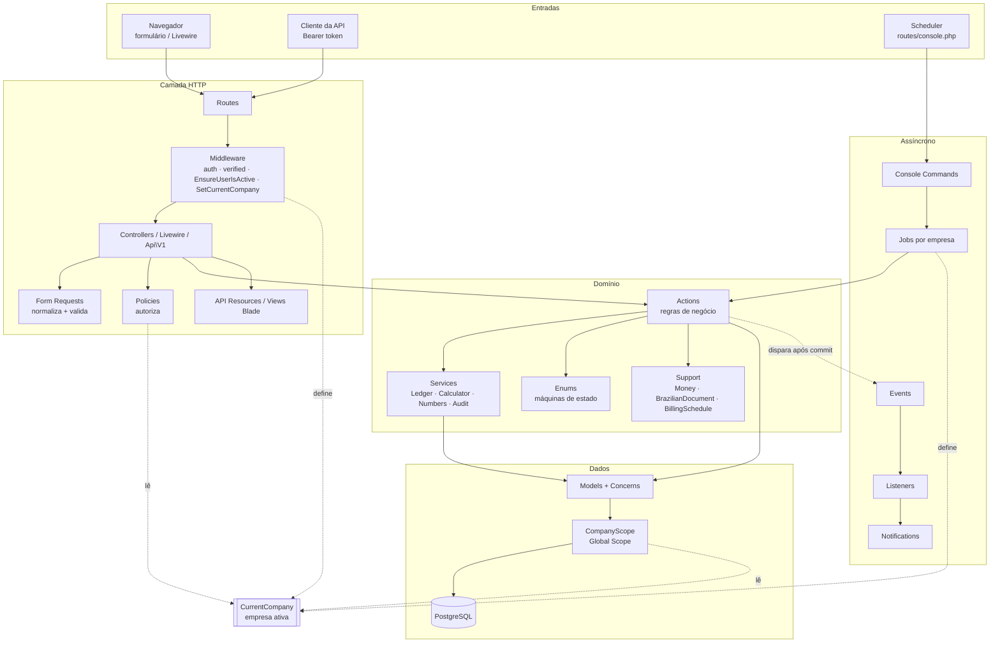
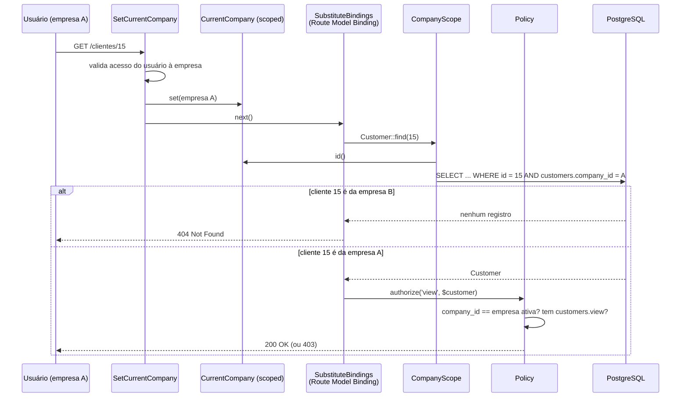

# 02 — Arquitetura

> Como o código do Nexus ERP está organizado, qual é a responsabilidade de cada camada do Laravel, onde colocar código novo e como funciona o isolamento entre empresas (multiempresa).

## Sumário

1. [Estilo arquitetural: monólito modular](#1-estilo-arquitetural-monólito-modular)
2. [Mapa de pastas](#2-mapa-de-pastas)
3. [As camadas, uma a uma (com exemplos reais)](#3-as-camadas-uma-a-uma-com-exemplos-reais)
4. [Diagrama das camadas](#4-diagrama-das-camadas)
5. [Onde colocar cada tipo de código](#5-onde-colocar-cada-tipo-de-código)
6. [Estratégia multiempresa (tenancy)](#6-estratégia-multiempresa-tenancy)
7. [Autorização: permissões, Gate e Policies](#7-autorização-permissões-gate-e-policies)
8. [Tratamento de erros de negócio](#8-tratamento-de-erros-de-negócio)

---

## 1. Estilo arquitetural: monólito modular

O Nexus ERP é **um único aplicativo Laravel** (um monólito): um só repositório, um só deploy, um só banco PostgreSQL. Dentro dele, o código é dividido por **camada** (pastas padrão do Laravel: `Http/Controllers`, `Models`, `Policies`...) e, dentro de cada camada, por **módulo de negócio** (`Customers`, `Crm`, `Commercial`, `Operations`, `Finance`, `Settings`, `Admin`).

```
app/Http/Controllers/Finance/PaymentController.php     ← camada "Controller", módulo "Finance"
app/Http/Requests/Finance/RecordPaymentRequest.php     ← camada "Form Request", módulo "Finance"
app/Actions/Finance/RecordPayment.php                  ← camada "Action", módulo "Finance"
```

**Por que monólito?** Um ERP tem módulos muito interligados (uma proposta vira contrato, que gera cobranças, que viram pagamentos, que mudam saldos). Em um monólito, essas operações acontecem dentro de **uma única transação de banco** — se algo falha no meio, nada é gravado. Com microsserviços, isso exigiria mensageria e compensações, uma complexidade que não se paga aqui.

**Por que "modular"?** Para que você encontre rapidamente tudo de um assunto (procure por `Finance` em qualquer camada) e para que as regras de um módulo fiquem em classes próprias, e não espalhadas.

**Por que manter as pastas padrão do Laravel?** Para que o que você aprender na [documentação oficial](https://laravel.com/docs) valha diretamente aqui. As únicas pastas "extras" são `Actions`, `Services`, `Reports` e `Support`, explicadas abaixo.

## 2. Mapa de pastas

```text
app/
├── Actions/            Regras de negócio: uma classe = uma operação (RecordPayment, SaveProposal...)
│   ├── Attachments/ Companies/ Contracts/ Crm/ Finance/ Fortify/
│   └── Parties/ Proposals/ Roles/ ServiceOrders/ Tickets/ Users/
├── Console/Commands/   Comandos Artisan (erp:daily-routines, finance:verify-balances)
├── Enums/              Status e tipos (com rótulos, cores e máquinas de estado)
│   └── Concerns/       EnumHelpers, HasStateMachine
├── Events/             Fatos de negócio (PaymentRecorded, ProposalStatusChanged...)
├── Exceptions/         BusinessRuleException
├── Http/
│   ├── Controllers/    Recebem a requisição, autorizam, delegam e respondem
│   │   └── Api/V1/     Controllers da API REST
│   ├── Middleware/     EnsureUserIsActive, SetCurrentCompany
│   ├── Requests/       Form Requests (validação e normalização da entrada)
│   └── Resources/V1/   API Resources (formato JSON da API)
├── Jobs/               Trabalho em fila (rotinas diárias por empresa)
├── Listeners/          Reações a eventos (descobertos automaticamente)
├── Livewire/           Componentes de tela reativos (listagens, dashboard, Kanban)
├── Models/             Eloquent Models
│   ├── Concerns/       Traits de Model (BelongsToCompany, Auditable, IsBill...)
│   └── Scopes/         Global Scopes (CompanyScope)
├── Notifications/      Notificações (banco + e-mail)
├── Policies/           Autorização por recurso
├── Providers/          AppServiceProvider, FortifyServiceProvider
├── Reports/            Os 9 relatórios (classes que DESCREVEM filtros, colunas e consultas)
├── Rules/              Regras de validação customizadas (CpfCnpj)
├── Services/           Serviços reutilizáveis sem "uma única operação" (LedgerService, LineItemCalculator...)
└── Support/            Utilitários puros (Money, BrazilianDocument, CurrentCompany, BillingSchedule...)

bootstrap/app.php       Registro de rotas, middleware e tratamento de exceções
config/permissions.php  Catálogo de permissões e perfis padrão
database/               migrations, factories, seeders
resources/views/        Blade (layouts, componentes, telas) — resources/js/app.js (Alpine, Chart.js)
routes/                 web.php, api.php, console.php (Scheduler)
tests/                  Pest (Unit e Feature)
```

## 3. As camadas, uma a uma (com exemplos reais)

### 3.1 Routes — "qual URL chama qual código"

Arquivos: [`routes/web.php`](../routes/web.php), [`routes/api.php`](../routes/api.php), [`routes/console.php`](../routes/console.php).

Convenção do projeto (comentário no topo de `web.php`):

- **Listagens** (busca/filtros/ordenação em tempo real) → componentes **Livewire** de página inteira: `Route::livewire(...)`.
- **Formulários e telas de detalhe** → **Controllers** + **Form Requests**.
- Toda rota autenticada exige e-mail verificado (`verified`).

```php
// routes/web.php
Route::livewire('/clientes', Livewire\Customers\CustomerIndex::class)->name('customers.index');
Route::resource('clientes', CustomerController::class)->except('index')
    ->parameters(['clientes' => 'customer'])->names('customers');
```

Repare em `->parameters(['clientes' => 'customer'])`: a URL fica em português (`/clientes/{customer}`), mas o parâmetro tem o nome do Model, o que permite o **Route Model Binding** (o Laravel busca o `Customer` automaticamente). E `->names('customers')` mantém os nomes de rota em inglês (`customers.show`), usados com `route('customers.show', $customer)`.

### 3.2 Middleware — "filtros que rodam antes do Controller"

Arquivos: [`app/Http/Middleware`](../app/Http/Middleware), registro em [`bootstrap/app.php`](../bootstrap/app.php).

| Middleware | Responsabilidade |
|---|---|
| `auth` / `auth:sanctum` (Laravel) | Exige usuário autenticado (sessão na web, token na API). |
| `verified` (Laravel) | Exige e-mail verificado. |
| [`EnsureUserIsActive`](../app/Http/Middleware/EnsureUserIsActive.php) | Derruba a sessão (ou revoga o token) de um usuário desativado *enquanto ele navegava*. |
| [`SetCurrentCompany`](../app/Http/Middleware/SetCurrentCompany.php) | Define a **empresa ativa** da requisição (seção 6). |
| `throttle:exports`, `throttle:api` | Limite de requisições (definidos em `AppServiceProvider::configureRateLimiting()`). |
| [`SecurityHeaders`](../app/Http/Middleware/SecurityHeaders.php) (**global**) | Acrescenta cabeçalhos de segurança a **todas** as respostas, web e API: `X-Frame-Options: SAMEORIGIN` (anti-clickjacking), `X-Content-Type-Options: nosniff`, `Referrer-Policy`, `Permissions-Policy` e, em produção com HTTPS, `Strict-Transport-Security`. |

Middlewares **globais** (registrados com `$middleware->append()`) rodam em toda requisição, antes dos grupos `web`/`api`. Além do `SecurityHeaders` do projeto, os globais padrão do Laravel incluem `TrimStrings` e `ConvertEmptyStringsToNull` — por isso um campo de formulário vazio chega à validação como `null`.

```php
// bootstrap/app.php
// Cabeçalhos de segurança em todas as respostas (web e API).
$middleware->append(SecurityHeaders::class);

$middleware->web(append: [
    EnsureUserIsActive::class,
    SetCurrentCompany::class,
]);

// A empresa ativa precisa ser definida ANTES do Route Model Binding,
// para que o CompanyScope filtre os models resolvidos pela URL.
$middleware->prependToPriorityList(before: SubstituteBindings::class, prepend: SetCurrentCompany::class);
$middleware->prependToPriorityList(before: SetCurrentCompany::class, prepend: EnsureUserIsActive::class);
```

### 3.3 Controllers — "recebe, autoriza, delega, responde"

Arquivos: [`app/Http/Controllers`](../app/Http/Controllers). O Controller é **fino**: não tem regra de negócio. O comentário de [`CustomerController`](../app/Http/Controllers/Customers/CustomerController.php) resume a regra do projeto:

> *Responsabilidade do Controller: receber a requisição, autorizar (Policy), delegar a regra de negócio (Actions) e devolver a resposta. Nada mais.*

```php
// app/Http/Controllers/Finance/PaymentController.php
public function storeForReceivable(RecordPaymentRequest $request, Receivable $receivable, RecordPayment $recordPayment): RedirectResponse
{
    $this->authorize('settle', $receivable);                         // 1. autoriza (Policy)

    $payment = $recordPayment->handle($receivable, $request->validated()); // 2. delega (Action)

    return back()->with('success', 'Recebimento de '.money($payment->amount_cents).' registrado.'); // 3. responde
}
```

Os três parâmetros são resolvidos pelo Laravel: o **Form Request** já validado, o **Model** pelo Route Model Binding e a **Action** pelo *Service Container* (injeção de dependência).

Os Controllers da API ([`app/Http/Controllers/Api/V1`](../app/Http/Controllers/Api/V1)) estendem [`ApiController`](../app/Http/Controllers/Api/V1/ApiController.php) (paginação `per_page` 1..100 e ordenação só por colunas permitidas) e chamam **as mesmas Actions** da web. Por exemplo, `Api\V1\ReceivableController::pay()` usa o mesmo `RecordPaymentRequest` e o mesmo `RecordPayment` do `PaymentController` web.

### 3.4 Livewire — "telas reativas sem escrever JavaScript"

Arquivos: [`app/Livewire`](../app/Livewire) + views em [`resources/views/livewire`](../resources/views/livewire).

Um componente Livewire é uma classe PHP com propriedades públicas (o estado da tela) e um método `render()`. Quando o usuário digita na busca, o navegador manda uma requisição AJAX, o Livewire atualiza a propriedade, roda `render()` de novo e troca só o HTML que mudou.

```php
// app/Livewire/Customers/CustomerIndex.php
#[Title('Clientes')]
class CustomerIndex extends Component
{
    use WithDataTable;            // busca, ordenação e paginação comuns

    #[Url(except: '')]
    public string $status = '';   // fica na URL: /clientes?status=active

    public function mount(): void
    {
        $this->authorize('viewAny', Customer::class);
    }
    // ...
}
```

O trait [`WithDataTable`](../app/Livewire/Concerns/WithDataTable.php) é reaproveitado por todas as listagens. Detalhes do ciclo de uma requisição Livewire em [04 — Fluxo de uma requisição](04-fluxo-de-uma-requisicao.md#3-uma-listagem-livewire-customerindex).

**Por que Livewire só nas listagens?** Listagens se beneficiam de reatividade (filtrar sem recarregar). Formulários de cadastro funcionam muito bem com o fluxo clássico *POST → validação → redirect*, que é mais simples de entender, testar e reaproveitar na API.

### 3.5 Form Requests — "a entrada chega limpa e validada"

Arquivos: [`app/Http/Requests`](../app/Http/Requests). Um Form Request faz duas coisas antes do Controller rodar:

1. **Normaliza** a entrada em `prepareForValidation()` (ex.: tira a máscara do CPF, converte `"1.234,56"` em centavos).
2. **Valida** com `rules()`. Se falhar, o Laravel volta para o formulário com os erros (web) ou responde 422 (API).

```php
// app/Http/Requests/Concerns/NormalizesMoney.php (trait usado por RecordPaymentRequest, BillRequest...)
protected function prepareForValidation(): void
{
    $this->normalizeMoneyFields();   // "amount" => "amount_cents" (inteiro)
}
```

Neste projeto, `authorize()` dos Form Requests retorna `true`: a autorização é feita **no Controller** com `$this->authorize()` (comentário em [`CustomerRequest`](../app/Http/Requests/Customers/CustomerRequest.php)). Assim, a regra de "quem pode" fica em um único lugar: a Policy.

Traits compartilhados: [`NormalizesMoney`](../app/Http/Requests/Concerns/NormalizesMoney.php), [`NormalizesLineItems`](../app/Http/Requests/Concerns/NormalizesLineItems.php) e a classe base abstrata [`BusinessPartyRequest`](../app/Http/Requests/Customers/BusinessPartyRequest.php) (regras comuns de clientes e fornecedores).

### 3.6 Policies — "quem pode fazer o quê com este registro"

Arquivos: [`app/Policies`](../app/Policies). Quase todas estendem [`TenantResourcePolicy`](../app/Policies/TenantResourcePolicy.php), que só precisa saber o **prefixo** da permissão:

```php
// app/Policies/CustomerPolicy.php
class CustomerPolicy extends TenantResourcePolicy
{
    protected string $permission = 'customers';   // view/create/update/delete => "customers.view"...

    public function export(User $user): bool
    {
        return $user->hasPermission('customers.export');
    }
}
```

Policies também carregam **regras de estado** simples, por exemplo: proposta só pode ser editada em rascunho ([`ProposalPolicy::update()`](../app/Policies/ProposalPolicy.php)); títulos financeiros e contratos **nunca** podem ser excluídos (`delete()` retorna `false` em [`ReceivablePolicy`](../app/Policies/ReceivablePolicy.php) e [`ContractPolicy`](../app/Policies/ContractPolicy.php)). O Laravel associa a Policy ao Model automaticamente pela convenção de nomes (`Customer` → `CustomerPolicy`).

### 3.7 Actions — "o coração: as regras de negócio"

Arquivos: [`app/Actions`](../app/Actions). Cada Action é uma classe com **uma operação de negócio** e um método público (`handle()`, ou `create()`/`update()` para pares de operações, ou `forCurrentCompany()` para rotinas em lote).

```php
// app/Actions/Finance/CancelBill.php (resumido)
class CancelBill
{
    public function __construct(private AuditLogger $audit) {}

    public function handle(Receivable|Payable $bill, string $reason): Receivable|Payable
    {
        return DB::transaction(function () use ($bill, $reason) {
            $locked = $bill->newQuery()->whereKey($bill->getKey())->lockForUpdate()->firstOrFail();

            if ($locked->paid_cents > 0) {
                throw new BusinessRuleException('Este título possui pagamentos registrados. Estorne os pagamentos antes de cancelá-lo.');
            }
            // ... grava status "cancelled" e auditoria
        });
    }
}
```

**Por que Actions e não regras no Controller?** Porque a mesma operação é chamada de muitos lugares: tela web, API, componente Livewire, Job agendado, Seeder de demonstração e testes. Exemplos reais de reaproveitamento:

- `ChangeProposalStatus` é usada pelo Controller web, pela API **e** pela rotina [`ExpireProposals`](../app/Actions/Proposals/ExpireProposals.php).
- `ChangeContractStatus` é usada pela tela, por [`ConvertProposalToContract`](../app/Actions/Proposals/ConvertProposalToContract.php) (opção "ativar") e por [`ProcessContractLifecycle`](../app/Actions/Contracts/ProcessContractLifecycle.php).
- O [`DemoDataSeeder`](../database/seeders/DemoDataSeeder.php) cria os dados de demonstração **chamando as Actions** (por isso os saldos de demonstração conferem com os extratos).

Padrões que se repetem nas Actions (e que você deve seguir):

- abrem a transação com `DB::transaction()`;
- **travam** o registro com `lockForUpdate()` antes de validar o estado;
- violação de regra → `throw new BusinessRuleException('mensagem para o usuário')`;
- registram a intenção na auditoria (`$this->audit->log('payment.recorded', ...)`);
- disparam Events **depois** do commit.

### 3.8 Services — "lógica reutilizável que não é uma operação completa"

Arquivos: [`app/Services`](../app/Services).

| Service | Responsabilidade |
|---|---|
| [`LedgerService`](../app/Services/Finance/LedgerService.php) | **Único** ponto que altera saldo de conta: grava o lançamento e atualiza o saldo. Exige estar dentro de uma transação. |
| [`LineItemCalculator`](../app/Services/LineItemCalculator.php) | Calcula totais de itens de propostas/contratos em centavos. |
| [`DocumentNumberGenerator`](../app/Services/DocumentNumberGenerator.php) | Numeração `PROP-2026-00001` com trava no contador. |
| [`AuditLogger`](../app/Services/AuditLogger.php) | Grava a trilha de auditoria, ocultando campos sensíveis. |
| [`DashboardMetrics`](../app/Services/Dashboard/DashboardMetrics.php) | Calcula os indicadores do dashboard para uma lista de empresas. |

A diferença prática para uma Action: um Service é uma **ferramenta** usada *por* Actions (o `LedgerService` é chamado por `RecordPayment`, `ReversePayment`, `CreateTransfer`, `RecordManualTransaction`...). Ele não abre a transação nem decide o fluxo de negócio — quem decide é a Action.

### 3.9 Models, Concerns e Scopes — "os dados e o comportamento deles"

Arquivos: [`app/Models`](../app/Models), [`app/Models/Concerns`](../app/Models/Concerns), [`app/Models/Scopes`](../app/Models/Scopes).

O Model descreve a tabela: colunas preenchíveis (`#[Fillable]`), conversões de tipo (`casts()`), relacionamentos, *scopes* e pequenos cálculos sobre o próprio registro. Comportamentos compartilhados ficam em **traits** (Concerns):

| Trait | O que adiciona |
|---|---|
| [`BelongsToCompany`](../app/Models/Concerns/BelongsToCompany.php) | Global Scope multiempresa + preenche `company_id` + impede mudar de empresa |
| [`Auditable`](../app/Models/Concerns/Auditable.php) | Auditoria automática de criação/alteração/exclusão |
| [`HasStatusHistory`](../app/Models/Concerns/HasStatusHistory.php) | Histórico de mudanças de status (`status_changes`) |
| [`HasAttachments`](../app/Models/Concerns/HasAttachments.php) | Anexos polimórficos |
| [`HasContactDetails`](../app/Models/Concerns/HasContactDetails.php) | Endereços e contatos polimórficos |
| [`HasRelationshipHistory`](../app/Models/Concerns/HasRelationshipHistory.php) | Interações e tarefas polimórficas |
| [`IsBusinessParty`](../app/Models/Concerns/IsBusinessParty.php) | Busca, documento formatado, nome de exibição (clientes e fornecedores) |
| [`IsBill`](../app/Models/Concerns/IsBill.php) | Saldo devedor, vencido, aplicar/reverter pagamento (contas a receber e a pagar) |

```php
// app/Models/Receivable.php
class Receivable extends Model
{
    use Auditable, BelongsToCompany, HasAttachments, HasFactory, IsBill;
    // ...
}
```

Detalhes completos em [05 — Eloquent ORM](05-eloquent-orm.md).

### 3.10 Enums — "status com regras"

Arquivos: [`app/Enums`](../app/Enums). PHP *backed enums* guardados como texto no banco e convertidos automaticamente pelos `casts()` dos Models. Além de `label()` e `color()` (para as telas), os Enums de status têm a **máquina de estados**:

```php
// app/Enums/ContractStatus.php
public function transitions(): array
{
    return match ($this) {
        self::Draft => [self::Active, self::Cancelled],
        self::Active => [self::Suspended, self::Cancelled, self::Finished],
        self::Suspended => [self::Active, self::Cancelled, self::Finished],
        self::Cancelled, self::Finished => [],
    };
}
```

O trait [`HasStateMachine`](../app/Enums/Concerns/HasStateMachine.php) fornece `canTransitionTo()` e `isFinal()`, usados pelas Actions de mudança de status.

### 3.11 Events e Listeners — "quando X acontecer, faça Y"

Arquivos: [`app/Events`](../app/Events), [`app/Listeners`](../app/Listeners).

Um **Event** anuncia um fato; **Listeners** reagem a ele sem que quem disparou precise conhecê-los. Os Listeners são registrados por **descoberta automática** (*event discovery*): o Laravel lê o tipo do parâmetro de `handle()`.

| Event | Listener(s) | Efeito |
|---|---|---|
| `ProposalStatusChanged` | [`MarkOpportunityAsWon`](../app/Listeners/MarkOpportunityAsWon.php), [`SendProposalStatusNotification`](../app/Listeners/SendProposalStatusNotification.php) | Oportunidade vai para "Ganha"; responsável é notificado |
| `PaymentRecorded`, `PaymentReversed` | [`LogFinancialOperation`](../app/Listeners/LogFinancialOperation.php) | Log técnico JSON no canal `finance` |
| `WorkItemAssigned` | [`NotifyWorkItemAssignee`](../app/Listeners/NotifyWorkItemAssignee.php) | Notifica o responsável pela OS/chamado |
| `Illuminate\Auth\Events\Login` (nativo) | [`RecordSuccessfulLogin`](../app/Listeners/RecordSuccessfulLogin.php) | Grava data e IP do último login |
| `ContractStatusChanged` | (nenhum no momento) | Ponto de extensão |

Todos os eventos do projeto implementam `ShouldDispatchAfterCommit`: **só são entregues depois do commit** da transação. Se a operação for desfeita, ninguém é notificado de algo que não aconteceu.

### 3.12 Jobs — "trabalho pesado fora da requisição"

Arquivos: [`app/Jobs`](../app/Jobs). Os Jobs implementam `ShouldQueue` (rodam no worker `php artisan queue:work`) e `ShouldBeUnique` (o mesmo Job da mesma empresa não é enfileirado duas vezes). O trait [`RunsForCompany`](../app/Jobs/Concerns/RunsForCompany.php) executa a lógica "dentro" da empresa:

```php
// app/Jobs/GenerateContractChargesJob.php
public function handle(GenerateContractCharges $action): void
{
    $created = $this->withinCompany(fn () => $action->forCurrentCompany());

    Log::info('billing.contract_charges_generated', ['company_id' => $this->company->id, 'created' => $created]);
}
```

Repare: o Job não tem regra de negócio — ele só define o contexto (empresa) e chama a Action.

### 3.13 Notifications

Arquivos: [`app/Notifications`](../app/Notifications). Enviadas pelos canais `database` (sino no topo da tela) e, quando habilitado nas configurações da empresa, `mail`. Implementam `ShouldQueue` para não atrasar a requisição.

```php
// app/Notifications/WorkItemAssignedNotification.php
public function via(object $notifiable): array
{
    return $this->sendMail ? ['database', 'mail'] : ['database'];
}
```

### 3.14 Console Commands e Scheduler

Arquivos: [`app/Console/Commands`](../app/Console/Commands), [`routes/console.php`](../routes/console.php). Os comandos usam os atributos `#[Signature]` e `#[Description]`. [`RunDailyRoutines`](../app/Console/Commands/RunDailyRoutines.php) percorre as empresas ativas e despacha os Jobs (ou executa na hora com `--sync`). O **Scheduler** agenda os comandos (`->dailyAt('06:00')->withoutOverlapping()->onOneServer()`).

### 3.15 Reports

Arquivos: [`app/Reports`](../app/Reports). Cada relatório é uma classe que **descreve** filtros, colunas e como buscar as linhas; um único [`ReportController`](../app/Http/Controllers/ReportController.php) e um conjunto genérico de views desenham qualquer relatório (tela, CSV e PDF). O [`ReportRegistry`](../app/Reports/ReportRegistry.php) é a lista fechada de relatórios — a URL traz só a chave (`/relatorios/contas-a-receber`), o que impede instanciar classes arbitrárias.

### 3.16 Support — "utilitários puros"

Arquivos: [`app/Support`](../app/Support). Classes sem dependência de requisição/banco (ou quase), fáceis de testar unitariamente:

| Classe | Para quê |
|---|---|
| [`Money`](../app/Support/Money.php) | Converter/formatar centavos e multiplicar por quantidades com bcmath |
| [`BrazilianDocument`](../app/Support/BrazilianDocument.php) | Validar/formatar CPF e CNPJ (inclusive CNPJ alfanumérico) |
| [`Tenancy\CurrentCompany`](../app/Support/Tenancy/CurrentCompany.php) | Guardar a empresa ativa do contexto |
| [`Billing\BillingSchedule`](../app/Support/Billing/BillingSchedule.php) | Calcular próximos vencimentos e competência |
| [`MorphTarget`](../app/Support/MorphTarget.php) | Resolver com segurança o "dono" polimórfico de anexos/interações/tarefas |
| [`CsvExporter`](../app/Support/CsvExporter.php) | CSV em *streaming*, compatível com Excel (`;` e BOM UTF-8) |
| [`helpers.php`](../app/Support/helpers.php) | Funções globais `money()`, `document_format()`, `br_date()` |

### 3.17 Views e componentes Blade

Arquivos: [`resources/views`](../resources/views).

- `layouts/app.blade.php` (usado como `<x-layouts::app>`) com os *partials* de navegação, seletor de empresa e toasts.
- Componentes anônimos reutilizáveis em [`resources/views/components`](../resources/views/components): `<x-ui.button>`, `<x-ui.card>`, `<x-ui.modal>`, `<x-ui.badge>`, `<x-form.input>`, `<x-form.money>`, `<x-table.search>`, `<x-table.sort-header>`, `<x-status-history>`, `<x-audit-history>`, `<x-attachments>`...
- Interações no navegador ficam em componentes Alpine registrados em [`resources/js/app.js`](../resources/js/app.js) (`moneyInput`, `toasts`, `lineItemsEditor`, `chart`).

```blade
{{-- resources/views/finance/bills/show.blade.php --}}
<x-form.money name="amount" label="Valor" :value="$bill->outstandingCents()" required help="Pode ser parcial." />
```

O componente `<x-form.money>` recebe centavos, exibe `"1.234,56"` com máscara e envia o texto; o Form Request converte de volta em centavos.

## 4. Diagrama das camadas



## 5. Onde colocar cada tipo de código

Use esta tabela como guia de decisão. Na dúvida, procure um exemplo parecido no projeto e siga o mesmo padrão.

| Você precisa... | Coloque em... | Exemplo real |
|---|---|---|
| Mapear uma URL | `routes/web.php` ou `routes/api.php` | `Route::post('/financeiro/receber/{receivable}/pagamentos', ...)` |
| Validar/normalizar dados de um formulário | **Form Request** | [`RecordPaymentRequest`](../app/Http/Requests/Finance/RecordPaymentRequest.php) |
| Decidir se o usuário pode agir sobre um registro | **Policy** | [`ReceivablePolicy::settle()`](../app/Policies/ReceivablePolicy.php) |
| Executar uma operação de negócio (com transação, travas, regras, auditoria) | **Action** | [`RecordPayment`](../app/Actions/Finance/RecordPayment.php) |
| Um cálculo/ferramenta usado por várias Actions | **Service** | [`LineItemCalculator`](../app/Services/LineItemCalculator.php) |
| Uma função pura, sem estado (formatar, validar documento, datas) | **Support** | [`Money::parse()`](../app/Support/Money.php) |
| Descrever a tabela, relacionamentos e consultas reutilizáveis | **Model** (relações, `scope...`) | `Receivable::scopeOverdue()` via [`IsBill`](../app/Models/Concerns/IsBill.php) |
| Um cálculo que só depende dos campos do próprio registro | **Model** (método) | `Contract::annualValueCents()`, `IsBill::outstandingCents()` |
| Comportamento repetido em vários Models | **Trait** em `Models/Concerns` | [`IsBill`](../app/Models/Concerns/IsBill.php) |
| Lista de status/tipos, rótulos e transições | **Enum** | [`ProposalStatus`](../app/Enums/ProposalStatus.php) |
| Reagir a um fato sem acoplar quem o causou | **Event + Listener** | `ProposalStatusChanged` → `MarkOpportunityAsWon` |
| Rodar algo pesado ou agendado | **Job** (+ Command + Scheduler) | [`GenerateContractChargesJob`](../app/Jobs/GenerateContractChargesJob.php) |
| Uma tela de listagem reativa | **Livewire** + `WithDataTable` | [`CustomerIndex`](../app/Livewire/Customers/CustomerIndex.php) |
| Formato JSON da API | **API Resource** | [`PartyResource`](../app/Http/Resources/V1/PartyResource.php) |
| Um relatório novo | Classe em `app/Reports` + registrar no `ReportRegistry` | [`DelinquencyReport`](../app/Reports/DelinquencyReport.php) |

### Action vs. Controller vs. Model — a regra prática

- **Controller**: *"de onde veio e para onde vai"*. Só conhece HTTP: lê a requisição, chama `authorize()`, chama a Action, devolve redirect/view/JSON. Se você está escrevendo um `if` de regra de negócio no Controller, ele está no lugar errado.
- **Action**: *"o que precisa acontecer"*. Conhece o negócio: valida estado ("só propostas aprovadas podem ser convertidas"), abre a transação, trava registros, chama Services, grava auditoria e dispara eventos. **Não conhece HTTP** (não usa `request()`, não devolve redirect) — por isso funciona na web, na API, no Job e no teste.
- **Model**: *"o que este dado é e sabe sobre si mesmo"*. Relacionamentos, casts, scopes e cálculos sobre os próprios atributos (`outstandingCents()`, `isOverdue()`, `firstBillingDate()`). Um Model **não** deve orquestrar várias tabelas nem abrir transações de negócio. Exceção consciente: `IsBill::applyPayment()` altera o próprio título, mas o comentário deixa claro que só deve ser chamado **pela Action** `RecordPayment`, dentro da transação.

## 6. Estratégia multiempresa (tenancy)

### 6.1 O problema

Todas as empresas compartilham as mesmas tabelas. A tabela `customers` tem clientes da "Vértice TI" e da "Órbita". Se um desenvolvedor esquecer um `where('company_id', ...)` em **uma** consulta, dados vazam entre empresas. A estratégia do projeto é tornar esse filtro **automático e impossível de esquecer**, com várias camadas de defesa.

### 6.2 As peças



**1. `CurrentCompany` — a "memória" da empresa ativa.** Uma classe simples com `set()`, `get()`, `id()`, `getOrFail()` e `run()`. É registrada no container como **scoped** (uma instância por requisição/Job, descartada ao final), para que a empresa de uma requisição nunca "vaze" para a próxima em servidores que reaproveitam o processo.

```php
// app/Providers/AppServiceProvider.php
public function register(): void
{
    // "scoped": uma instância por requisição/job, descartada ao final.
    $this->app->scoped(CurrentCompany::class);
}
```

**2. `SetCurrentCompany` — quem define a empresa ativa.** Na web usa `users.current_company_id` (escolhida no seletor); na API aceita o cabeçalho `X-Company-Id`. Em ambos os casos, **só aceita empresas às quais o usuário tem acesso** (vínculo ativo em `company_user` e empresa com status ativo):

```php
// app/Http/Middleware/SetCurrentCompany.php
$requestedCompanyId = $request->header('X-Company-Id');
$companies = $user->accessibleCompanies();

if ($requestedCompanyId !== null) {
    $company = $companies->firstWhere('id', (int) $requestedCompanyId);

    abort_if($company === null, Response::HTTP_FORBIDDEN, 'Você não tem acesso à empresa informada.');
} else {
    $company = $companies->firstWhere('id', $user->current_company_id) ?? $companies->first();
}
// ...
$this->currentCompany->set($company);
```

Se o usuário não tem nenhuma empresa ativa, a sessão é encerrada (web) ou a resposta é 403 (API).

**3. `CompanyScope` — o filtro automático.** Um **Global Scope** do Eloquent: é aplicado a **toda** consulta dos Models que usam o trait `BelongsToCompany`.

```php
// app/Models/Scopes/CompanyScope.php
public function apply(Builder $builder, Model $model): void
{
    $companyId = app(CurrentCompany::class)->id();

    if ($companyId !== null) {
        $builder->where($model->qualifyColumn('company_id'), $companyId);
    }
}
```

`qualifyColumn()` gera `customers.company_id` (e não só `company_id`), evitando ambiguidade em consultas com JOIN.

**4. `BelongsToCompany` — liga o scope e protege a gravação.**

```php
// app/Models/Concerns/BelongsToCompany.php
public static function bootBelongsToCompany(): void
{
    static::addGlobalScope(new CompanyScope);

    static::creating(function (Model $model): void {
        if (empty($model->company_id)) {
            $model->company_id = app(CurrentCompany::class)->id()
                ?? throw new RuntimeException('Não é possível criar '.class_basename($model).' sem uma empresa ativa.');
        }
    });

    static::updating(function (Model $model): void {
        if ($model->isDirty('company_id') && $model->getOriginal('company_id') !== null) {
            throw new RuntimeException('Não é permitido transferir registros entre empresas.');
        }
    });
}
```

Ou seja: ao **criar**, o `company_id` é preenchido sozinho (por isso as Actions nunca passam `company_id`); ao **alterar**, é proibido mover o registro para outra empresa.

**5. Middleware antes do Route Model Binding.** Este é o detalhe mais sutil. O Route Model Binding (middleware `SubstituteBindings`) é quem transforma `/clientes/15` em um objeto `Customer`. Se ele rodasse **antes** de `SetCurrentCompany`, a consulta seria feita **sem** empresa ativa — e o `CompanyScope` não filtraria nada (ele só filtra quando há empresa). Por isso o `bootstrap/app.php` coloca `SetCurrentCompany` (e `EnsureUserIsActive`) **antes** de `SubstituteBindings` na lista de prioridade. A ordem real resolvida para `POST /clientes` (depois dos middlewares globais, como `TrimStrings` e `SecurityHeaders`) é:

```text
EncryptCookies → AddQueuedCookiesToResponse → StartSession → ShareErrorsFromSession
→ PreventRequestForgery (CSRF) → Authenticate → EnsureUserIsActive → SetCurrentCompany
→ SubstituteBindings → (InjectBoost, só em desenvolvimento) → EnsureEmailIsVerified
```

Resultado: um id de outra empresa na URL resulta em **404** (o registro "não existe" para quem pergunta), sem nem chegar ao Controller. O teste [`tests/Feature/Tenancy/CompanyIsolationTest.php`](../tests/Feature/Tenancy/CompanyIsolationTest.php) cobre esse comportamento.

**6. Policies — defesa em profundidade.** Mesmo com o scope, a [`TenantResourcePolicy`](../app/Policies/TenantResourcePolicy.php) confere de novo que o registro pertence à empresa ativa antes de checar a permissão:

```php
public function view(User $user, Model $model): bool
{
    return $this->belongsToActiveCompany($model) && $user->hasPermission("{$this->permission}.view");
}
```

Por que repetir? Porque existem caminhos em que o scope pode não estar ativo (um `withoutGlobalScope()` esquecido, um registro carregado num Job, uma consulta feita antes da empresa ser definida). Duas barreiras independentes tornam o vazamento muito menos provável.

**7. Validações de existência também filtram por empresa.** As regras `exists`/`unique` dos Form Requests usam a tabela diretamente (não o Model), então o scope **não** se aplica a elas. Por isso todas incluem `->where('company_id', ...)` explicitamente:

```php
// app/Http/Requests/Finance/RecordPaymentRequest.php
'financial_account_id' => ['required', 'integer', Rule::exists('financial_accounts', 'id')
    ->where('company_id', app(CurrentCompany::class)->id())->where('is_active', true)->whereNull('deleted_at')],
```

### 6.3 Fora de uma requisição: Jobs e comandos

Em Jobs e comandos não existe middleware. O contexto é definido com `CurrentCompany::run()`, que define a empresa, executa o código e **restaura o contexto anterior** no final (mesmo se der erro):

```php
// app/Support/Tenancy/CurrentCompany.php
public function run(Company $company, callable $callback): mixed
{
    $previous = $this->company;
    $this->company = $company;

    try {
        return $callback($company);
    } finally {
        $this->company = $previous;
    }
}
```

> **Atenção:** quando **não há** empresa ativa (por exemplo, num comando Artisan ou no `tinker`), o `CompanyScope` **não filtra nada** — as consultas enxergam todas as empresas. Isso é intencional para rotinas da plataforma (como [`VerifyAccountBalances`](../app/Console/Commands/VerifyAccountBalances.php), que confere todas as contas), mas exige cuidado: em código novo de Job/comando, sempre envolva a lógica de uma empresa em `CurrentCompany::run()` (ou use o trait `RunsForCompany`).

### 6.4 Consultas intencionalmente multiempresa

O dashboard consolidado ("Todas as minhas empresas") precisa somar dados de várias empresas. Para isso existe o scope local `forCompanies()`, que remove o Global Scope e filtra por uma lista **explícita** de empresas:

```php
// app/Models/Concerns/BelongsToCompany.php
public function scopeForCompanies(Builder $query, int|array $companyIds): void
{
    $query->withoutGlobalScope(CompanyScope::class)
        ->whereIn($this->qualifyColumn('company_id'), (array) $companyIds);
}
```

Quem chama é responsável por garantir que o usuário pode ver essas empresas. Em [`App\Livewire\Dashboard`](../app/Livewire/Dashboard.php), a lista é **sempre** limitada às empresas acessíveis em que o usuário tem `dashboard.view`, validado no servidor a cada atualização (o parâmetro `?empresa=` da URL nunca é usado sem essa checagem).

### 6.5 Tabelas sem `company_id`

Alguns Models **não** usam `BelongsToCompany`, cada um por um motivo:

- **Itens filhos** (`ProposalItem`, `ContractItem`, `ServiceOrderActivity`, `TicketMessage`): herdam o isolamento do registro pai — só são acessados através dele (`$proposal->items`).
- **`AuditLog`**: alguns eventos não pertencem a uma empresa (ex.: cadastro de empresas pelo superadministrador); as telas filtram explicitamente com `scopeForCompany()`.
- **`Company`, `User`, `Permission`, `CompanyMembership`, `CompanySetting`, `DocumentSequence`**: são a própria estrutura de tenancy/plataforma.

## 7. Autorização: permissões, Gate e Policies

O fluxo de uma checagem `$this->authorize('settle', $receivable)`:

1. **`Gate::before`** (em [`AppServiceProvider`](../app/Providers/AppServiceProvider.php)) roda primeiro: superadministrador → libera tudo. Habilidades no formato `"recurso.acao"` sem Model (ex.: `@can('reports.financial')`, `$this->authorize('dashboard.view')`) são verificadas direto na lista de permissões.
2. Se `Gate::before` retornar `null`, o Laravel chama a **Policy** do Model (`ReceivablePolicy::settle()`).
3. A Policy chama `User::hasPermission()`, que consulta as permissões do perfil do usuário **na empresa ativa** com uma única consulta (JOIN `company_user` → `permission_role` → `permissions`), guardada em cache na memória durante a requisição (`User::permissionsFor()`).

```php
// app/Providers/AppServiceProvider.php
Gate::before(function (User $user, string $ability, array $arguments): ?bool {
    if ($user->isSuperAdmin()) {
        return true;
    }

    if ($arguments === [] && str_contains($ability, '.')) {
        return $user->hasPermission($ability);
    }

    return null;
});
```

Consequência importante: **o mesmo usuário pode ter permissões diferentes em cada empresa**, porque o perfil fica no vínculo `company_user.role_id`, e não no usuário.

## 8. Tratamento de erros de negócio

Uma regra violada dentro de uma Action vira `BusinessRuleException` ([`app/Exceptions/BusinessRuleException.php`](../app/Exceptions/BusinessRuleException.php)). A própria exceção sabe se renderizar:

```php
public function render(Request $request): JsonResponse|RedirectResponse
{
    if ($request->expectsJson()) {
        return response()->json([
            'message' => $this->getMessage(),
            'errors' => ['business_rule' => [$this->getMessage()]],
        ], 422);
    }

    return back()->withInput()->with('error', $this->getMessage());
}
```

- **Web**: volta para a página anterior com a mensagem num *toast* de erro.
- **API**: responde **422** no mesmo formato dos erros de validação.
- Em `bootstrap/app.php`, `dontReport(BusinessRuleException::class)` evita poluir o log de erros com o que é, na verdade, um erro esperado do usuário.

Nos componentes Livewire, a exceção é capturada e convertida em evento de toast:

```php
// app/Livewire/Customers/CustomerIndex.php
try {
    $deleteParty->handle($customer);
    $this->dispatch('notify', type: 'success', message: 'Cliente excluído.');
} catch (BusinessRuleException $exception) {
    $this->dispatch('notify', type: 'error', message: $exception->getMessage());
}
```

Para a API, `bootstrap/app.php` também padroniza as respostas 401, 403, 404 e 405 em JSON com mensagens em português.
