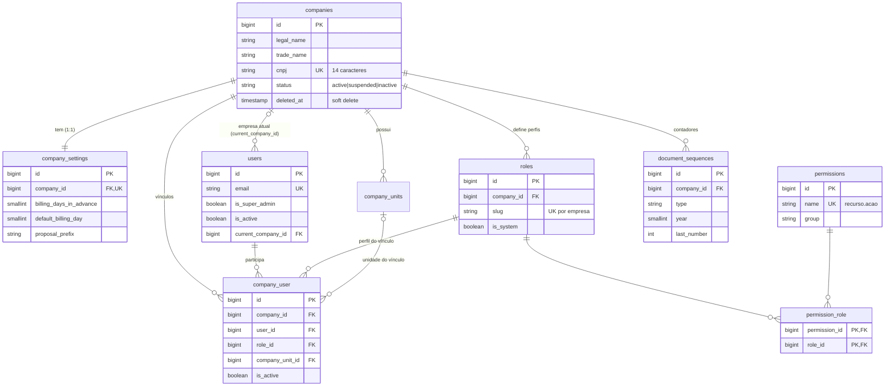
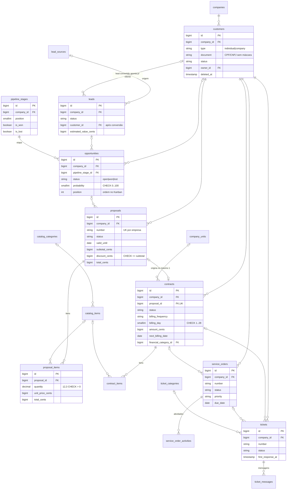
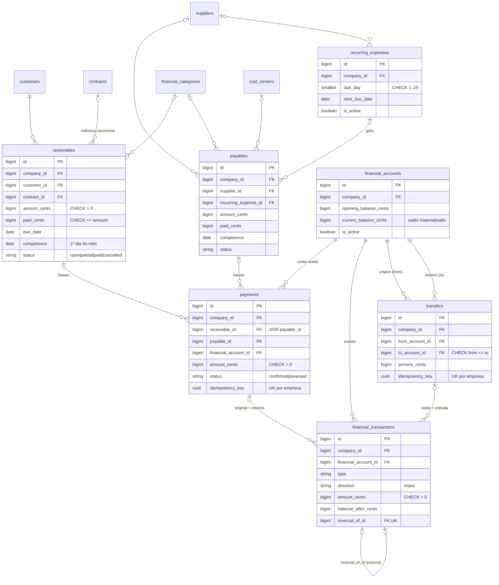

# 03 — Banco de dados

> Modelo de dados do Nexus ERP (PostgreSQL 17): diagramas ER, dicionário das principais tabelas e o **porquê** das decisões de modelagem.
> Fonte da verdade: as migrations em [`database/migrations`](../database/migrations). Tudo aqui foi conferido contra elas.

## Sumário

1. [Visão geral e convenções](#1-visão-geral-e-convenções)
2. [Diagramas ER](#2-diagramas-er)
   - [2.1 Empresas, usuários e acesso](#21-empresas-usuários-e-acesso)
   - [2.2 Comercial, CRM e operações](#22-comercial-crm-e-operações)
   - [2.3 Financeiro](#23-financeiro)
   - [2.4 Tabelas polimórficas e de apoio](#24-tabelas-polimórficas-e-de-apoio)
3. [Dicionário de dados](#3-dicionário-de-dados)
4. [Decisões de modelagem](#4-decisões-de-modelagem)
5. [Ordem das migrations](#5-ordem-das-migrations)

---

## 1. Visão geral e convenções

- **Banco:** PostgreSQL 17 (Docker, porta 5433 no `.env.example`). Os testes usam um banco separado, `nexus_erp_testing` ([`phpunit.xml`](../phpunit.xml)).
- **Chaves primárias:** `id` *bigint* auto-incremento (`$table->id()`), exceto `notifications` (UUID) e as tabelas do framework.
- **Chaves estrangeiras:** `xxx_id` com `foreignId()->constrained()`; a ação ao excluir o pai é escolhida caso a caso (seção 4.9).
- **Nomes:** tabelas e colunas em inglês, no plural e *snake_case* (convenção do Eloquent); textos para o usuário em português ficam nos Enums e nas views.
- **Status e tipos:** colunas `string` curtas (`status varchar(20)`) com os valores dos Enums PHP (`'draft'`, `'active'`...). Não usamos o tipo `ENUM` do banco porque adicionar um valor exigiria alterar a tabela; validamos na aplicação (`Rule::enum(...)`).
- **Dinheiro:** sempre `*_cents` inteiro (seção 4.1).
- **Timestamps:** `created_at`/`updated_at` em quase todas as tabelas; tabelas "só inserção" (`audit_logs`, `status_changes`) têm apenas `created_at`.

## 2. Diagramas ER

O modelo completo tem cerca de 50 tabelas (incluindo as do framework). Para ficar legível, ele foi dividido em quatro diagramas. Lembre-se de que quase todas as tabelas de negócio têm `company_id` apontando para `companies` (a raiz do isolamento multiempresa); para não poluir os desenhos, essa ligação aparece só nos dois primeiros.

Legenda de cardinalidade do Mermaid: `||--o{` = "um para zero-ou-muitos"; `|o--o{` = "zero-ou-um para muitos" (FK opcional); `||--o|` = "um para zero-ou-um".

### 2.1 Empresas, usuários e acesso



### 2.2 Comercial, CRM e operações



### 2.3 Financeiro



### 2.4 Tabelas polimórficas e de apoio

Tabelas **polimórficas** pertencem a "qualquer" registro, identificado pelo par (`xxx_type`, `xxx_id`). Não dá para desenhar uma FK real para elas (a FK apontaria para tabelas diferentes conforme o tipo), por isso aparecem à parte:

| Tabela | Colunas polimórficas | Quem usa (trait / Model) | Valores possíveis de `*_type` |
|---|---|---|---|
| `addresses` | `addressable_type`, `addressable_id` | `HasContactDetails` | `customer`, `supplier` |
| `contact_people` | `contactable_type`, `contactable_id` | `HasContactDetails` | `customer`, `supplier` |
| `attachments` | `attachable_type`, `attachable_id` | `HasAttachments` | clientes, fornecedores, propostas, contratos, OS, chamados, títulos |
| `status_changes` | `statusable_type`, `statusable_id` | `HasStatusHistory` | `proposal`, `contract`, `service_order`, `ticket`, `opportunity` |
| `interactions` | `interactable_type`, `interactable_id` | `HasRelationshipHistory` | `customer`, `lead`, `opportunity` |
| `tasks` | `taskable_type`, `taskable_id` (opcional) | `HasRelationshipHistory` | `customer`, `lead`, `opportunity` (ou nenhum) |
| `audit_logs` | `auditable_type`, `auditable_id` (opcional) | `Auditable` / `AuditLogger` | qualquer apelido do morph map |
| `notifications` | `notifiable_type`, `notifiable_id` | Laravel Notifications | `user` |
| `personal_access_tokens` | `tokenable_type`, `tokenable_id` | Laravel Sanctum | `user` |

Os valores de `*_type` são **apelidos curtos** do *morph map* (seção 4.6), não nomes de classe.

## 3. Dicionário de dados

Tipos: `bigint` (inteiro 64 bits), `varchar(n)`, `text`, `date`, `timestamp`, `boolean`, `decimal(p,s)`, `jsonb`, `uuid`. Em todas as tabelas de negócio, `company_id bigint FK → companies (cascade)` está presente e não é repetido abaixo, a menos que tenha algo especial.

### 3.1 Estrutura e acesso

#### `companies` — empresas (tenants)
Migration: [`2026_10_14_100000_create_companies_tables.php`](../database/migrations/2026_10_14_100000_create_companies_tables.php)

| Coluna | Tipo | Significado |
|---|---|---|
| `legal_name` / `trade_name` | varchar | Razão social / nome fantasia (`display_name` usa o fantasia, se houver) |
| `cnpj` | varchar(14) **UNIQUE** | CNPJ sem máscara |
| `zip_code`, `street`, ..., `state` | varchar / char(2) | Endereço da empresa |
| `status` | varchar(20), índice | `CompanyStatus`: active, suspended, inactive. Só empresas `active` são processadas pelas rotinas e acessíveis aos membros (o superadministrador também acessa as suspensas) |
| `logo_path` | varchar | Caminho do logotipo em disco **privado** (servido por rota autenticada) |
| `deleted_at` | timestamp | Soft delete |

#### `company_settings` — configurações da empresa (1:1)

| Coluna | Tipo | Padrão | Significado |
|---|---|---|---|
| `company_id` | bigint FK **UNIQUE** | — | Garante a relação 1:1 |
| `items_per_page` | smallint | 15 | Paginação das listagens |
| `proposal_prefix`, `contract_prefix`, `service_order_prefix`, `ticket_prefix` | varchar(10) | PROP, CTR, OS, CHM | Prefixos da numeração |
| `proposal_validity_days` | smallint | 15 | Validade padrão das propostas |
| `default_payment_terms` | text | — | Condições de pagamento padrão |
| `default_billing_day` | smallint | 10 | Dia de cobrança padrão dos contratos |
| `billing_days_in_advance` | smallint | 10 | **Janela de antecedência** das cobranças e despesas recorrentes |
| `notify_*` | boolean | true | Liga/desliga cada notificação por e-mail |
| `primary_color`, `default_theme` | varchar | `#4f46e5`, `system` | Aparência |

Por que colunas explícitas e não um JSON de configurações? O comentário de [`CompanySetting`](../app/Models/CompanySetting.php) explica: *"para ter tipos, valores padrão e validação garantidos pelo banco de dados"*.

#### `users` — usuários (colunas adicionadas ao padrão do Laravel)
Migrations: [`0001_01_01_000000_create_users_table.php`](../database/migrations/0001_01_01_000000_create_users_table.php) e [`2026_10_14_100100_create_access_control_tables.php`](../database/migrations/2026_10_14_100100_create_access_control_tables.php)

| Coluna | Tipo | Significado |
|---|---|---|
| `email` | varchar **UNIQUE** | Login |
| `is_super_admin` | boolean | Superadministrador da plataforma (acesso total) |
| `is_active` | boolean | Conta ativa (desativada = não loga e é desconectada) |
| `current_company_id` | bigint FK → companies (*null on delete*) | Empresa selecionada no seletor |
| `theme` | varchar(10) | Preferência de tema (claro/escuro/sistema) |
| `last_login_at`, `last_login_ip` | timestamp, varchar(45) | Gravados pelo listener `RecordSuccessfulLogin` |
| `deactivated_at` | timestamp | Quando foi desativado |

#### `company_user` — vínculo usuário ↔ empresa (pivô com Model próprio)

| Coluna | Tipo | Significado |
|---|---|---|
| `id` | bigint PK | O pivô tem id próprio (Model `CompanyMembership`, auditável) |
| `company_id`, `user_id` | FK (cascade) | **UNIQUE (company_id, user_id)**: um vínculo por par |
| `role_id` | FK → roles (**restrict**) | Perfil do usuário *nesta* empresa; impede apagar um perfil em uso |
| `company_unit_id` | FK (null on delete) | Unidade (filial) do usuário |
| `is_active` | boolean | Vínculo ativo; desativado = perde acesso só a esta empresa |

#### `roles`, `permissions`, `permission_role`

| Tabela | Colunas importantes | Restrições |
|---|---|---|
| `roles` | `company_id`, `name`, `slug`, `is_system` | UNIQUE (company_id, slug) — cada empresa tem seus perfis |
| `permissions` | `name` (`customers.view`), `group`, `label` | UNIQUE (name); sincronizada com [`config/permissions.php`](../config/permissions.php) pelo `PermissionSeeder` |
| `permission_role` | `permission_id`, `role_id` | PK composta; cascade dos dois lados |

#### `document_sequences` — contadores de numeração

| Coluna | Tipo | Significado |
|---|---|---|
| `type` | varchar(30) | `proposal`, `contract`, `service_order`, `ticket` |
| `year` | smallint | Ano (a numeração reinicia a cada ano) |
| `last_number` | int | Último número emitido |
| — | — | **UNIQUE (company_id, type, year)** — uma linha por contador; travada com `SELECT ... FOR UPDATE` |

### 3.2 Clientes, fornecedores e CRM

#### `customers` e `suppliers` — "partes" de negócio
Migration: [`2026_10_14_100300_create_customers_and_suppliers_tables.php`](../database/migrations/2026_10_14_100300_create_customers_and_suppliers_tables.php) (as duas tabelas são criadas pelo mesmo laço, com as mesmas colunas)

| Coluna | Tipo | Significado |
|---|---|---|
| `type` | varchar(20) | `PersonType`: `individual` (PF) ou `company` (PJ) |
| `name` / `trade_name` | varchar | Nome ou razão social / nome fantasia |
| `document` | varchar(14) | CPF (11) ou CNPJ (14) **sem máscara**, maiúsculo (CNPJ alfanumérico) |
| `state_registration` | varchar(30) | Inscrição estadual |
| `email`, `phone`, `mobile`, `website` | varchar | Contato |
| `status` | varchar(20) | `CustomerStatus` (clientes) / `RecordStatus` (fornecedores) |
| `owner_id` | FK → users | **Só em customers**: responsável comercial |
| `deleted_at` | timestamp | Soft delete |

Índices: `(company_id, status)`, `(company_id, name)` e o **UNIQUE parcial** `(company_id, document) WHERE deleted_at IS NULL`.

#### `leads`

| Coluna | Tipo | Significado |
|---|---|---|
| `name`, `company_name`, `email`, `phone`, `document` | varchar | Dados do contato (documento opcional) |
| `lead_source_id` | FK → lead_sources | Origem (Site, Indicação...) |
| `status` | varchar(20) | `LeadStatus`: new, contacted, qualified, disqualified, converted |
| `estimated_value_cents` | bigint | Valor potencial |
| `customer_id` | FK → customers (null on delete) | Cliente gerado pela conversão |
| `converted_at` | timestamp | Data da conversão |
| `next_contact_at` | date | Próximo contato agendado |

#### `pipeline_stages` — etapas do funil

| Coluna | Tipo | Significado |
|---|---|---|
| `name` | varchar(100) | UNIQUE (company_id, name) |
| `position` | smallint | Ordem das colunas |
| `probability` | smallint | Probabilidade padrão (**CHECK 0..100**) |
| `color` | varchar(7) | Cor hexadecimal |
| `is_won` / `is_lost` | boolean | Etapa de ganho / perda (encerra a oportunidade) |

#### `opportunities`

| Coluna | Tipo | Significado |
|---|---|---|
| `customer_id` / `lead_id` | FK (opcionais) | Com quem se negocia |
| `pipeline_stage_id` | FK (**restrict**) | Etapa atual; não se apaga etapa com oportunidades |
| `estimated_value_cents` | bigint | Valor estimado |
| `probability` | smallint | **CHECK 0..100** |
| `status` | varchar(20) | `open`, `won`, `lost` (derivado da etapa pelo `MoveOpportunity`) |
| `position` | int | Posição dentro da coluna do Kanban (persistida) |
| `lost_reason`, `closed_at` | varchar, timestamp | Motivo da perda e data de encerramento |

Índices: `(company_id, status)`, `(company_id, pipeline_stage_id, position)` — exatamente a ordem usada para montar o Kanban.

### 3.3 Catálogo, propostas e contratos

#### `catalog_items`

| Coluna | Tipo | Significado |
|---|---|---|
| `type` | varchar(20) | `CatalogItemType` (serviço/produto) |
| `code` | varchar(30) | Código do item — **UNIQUE parcial** (company_id, code) WHERE deleted_at IS NULL |
| `unit` | varchar(10) | Unidade (UN, H, MÊS...) |
| `price_cents` | bigint | Preço sugerido |
| `is_active` | boolean | Disponível para novas propostas |

#### `proposals`
Migration: [`2026_10_14_100600_create_proposals_and_contracts_tables.php`](../database/migrations/2026_10_14_100600_create_proposals_and_contracts_tables.php)

| Coluna | Tipo | Significado |
|---|---|---|
| `number` | varchar(30) | `PROP-2026-00001` — **UNIQUE (company_id, number)** |
| `customer_id` | FK (**restrict**) | Cliente |
| `opportunity_id` | FK (null on delete) | Oportunidade de origem (aprovar → oportunidade ganha) |
| `owner_id` | FK → users | Responsável |
| `status` | varchar(20) | `ProposalStatus` |
| `issue_date`, `valid_until` | date | Emissão e validade |
| `subtotal_cents`, `discount_cents`, `total_cents` | bigint | Totais **calculados no servidor**; **CHECK discount_cents <= subtotal_cents** |
| `sent_at`, `approved_at`, `approved_by`, `rejected_at`, `rejection_reason`, `cancelled_at` | — | Marcos do ciclo de vida |

Índices: `(company_id, status)`, `(company_id, valid_until)` (usado pela rotina de expiração).

#### `proposal_items` e `contract_items`

| Coluna | Tipo | Significado |
|---|---|---|
| `proposal_id` / `contract_id` | FK (cascade) | Pai — **sem company_id próprio** |
| `catalog_item_id` | FK (null on delete) | Item do catálogo (opcional; descrição livre também é aceita) |
| `description` | varchar | Descrição copiada no momento da venda |
| `quantity` | **decimal(12,3)** | Quantidade exata (ex.: 1,5 hora) — **CHECK > 0** |
| `unit` | varchar(10) | Unidade |
| `unit_price_cents`, `discount_cents`, `total_cents` | bigint | Preço, desconto do item e total do item |
| `position` | smallint | Ordem de exibição |

#### `contracts`

| Coluna | Tipo | Significado |
|---|---|---|
| `number` | varchar(30) | `CTR-2026-00001` — UNIQUE (company_id, number) |
| `proposal_id` | FK **UNIQUE** (null on delete) | Proposta de origem — uma proposta gera no máximo um contrato |
| `company_unit_id` | FK | Unidade responsável |
| `status` | varchar(20) | `ContractStatus` |
| `start_date`, `end_date` | date | Vigência (`end_date` nulo = prazo indeterminado); **CHECK end_date IS NULL OR end_date >= start_date** |
| `billing_frequency` | varchar(20) | monthly, quarterly, semiannual, annual |
| `billing_day` | smallint | Dia do vencimento — **CHECK 1..28** |
| `amount_cents` | bigint | Valor de **cada** cobrança |
| `financial_category_id` | FK | Categoria copiada para cada cobrança (adicionada por migration de evolução) |
| `next_billing_date` | date | Vencimento da próxima cobrança a gerar (nulo = não gera) |
| `auto_renew`, `renewal_months` | boolean, smallint (12) | Renovação automática e prazo de renovação |
| `signed_at`, `activated_at`, `suspended_at`, `cancelled_at`, `cancellation_reason`, `finished_at`, `renewed_at` | — | Marcos do ciclo de vida |

Índices: `(company_id, status)` e `(status, next_billing_date)` — este último serve à consulta da rotina de cobrança (`status = 'active' AND next_billing_date <= horizonte`).

### 3.4 Operações

#### `service_orders`

| Coluna | Tipo | Significado |
|---|---|---|
| `number` | varchar(30) | `OS-2026-00001` — UNIQUE (company_id, number) |
| `customer_id` | FK (restrict) | Cliente |
| `contract_id` | FK (null on delete) | Contrato relacionado (validado: do mesmo cliente) |
| `catalog_item_id` | FK | Serviço do catálogo |
| `priority` | varchar(10) | `Priority` (low/medium/high/urgent) |
| `status` | varchar(20) | `ServiceOrderStatus` |
| `assigned_to`, `created_by` | FK → users | Responsável e autor |
| `due_date`, `started_at`, `completed_at` | date/timestamp | Prazo e marcos |
| `resolution` | text | Solução aplicada (obrigatória para concluir) |

`service_order_activities`: `service_order_id` (cascade), `user_id`, `description`, `minutes_spent` (tempo registrado).

#### `tickets`

| Coluna | Tipo | Significado |
|---|---|---|
| `number` | varchar(30) | `CHM-2026-00001` — UNIQUE (company_id, number) |
| `customer_id`, `contract_id`, `service_order_id`, `ticket_category_id` | FK | Vínculos (contrato/OS validados como do mesmo cliente) |
| `subject`, `description` | varchar, text | Assunto e descrição |
| `priority`, `status`, `channel` | varchar | `Priority`, `TicketStatus`, `TicketChannel` |
| `first_response_at` | timestamp | Primeira resposta **pública** (indicador de atendimento) |
| `resolved_at`, `closed_at` | timestamp | Resolução e encerramento |

`ticket_messages`: `ticket_id` (cascade), `user_id`, `body`, `is_internal` (comentário interno não é visto pelo cliente e não conta como resposta).

### 3.5 Financeiro
Migration: [`2026_10_14_100800_create_finance_tables.php`](../database/migrations/2026_10_14_100800_create_finance_tables.php)

#### `receivables` (contas a receber) e `payables` (contas a pagar)

As duas tabelas têm as mesmas colunas financeiras (por isso compartilham o trait `IsBill`):

| Coluna | Tipo | Significado |
|---|---|---|
| `customer_id` (receivables) | FK (**restrict**) | Cliente devedor |
| `contract_id` (receivables) | FK (**restrict**) | Contrato que gerou a cobrança (opcional) |
| `supplier_id` (payables) | FK (restrict), opcional | Fornecedor |
| `recurring_expense_id` (payables) | FK (restrict) | Despesa recorrente que gerou o título |
| `financial_category_id`, `cost_center_id` | FK (null on delete) | Classificação gerencial |
| `description`, `document_number` | varchar | Descrição e nº do documento (NF, boleto...) |
| `amount_cents` | bigint | Valor do título |
| `paid_cents` | bigint (padrão 0) | Quanto já foi pago (soma dos pagamentos confirmados) |
| `issue_date`, `due_date` | date | Emissão e vencimento |
| `competence` | date | Mês de referência (sempre dia 1) |
| `status` | varchar(20) | `BillStatus`: open, partial, paid, cancelled |
| `paid_at` | date | Data da quitação total |
| `cancelled_at`, `cancelled_by`, `cancellation_reason` | — | Dados do cancelamento |
| `created_by` | FK → users | Quem lançou |

Restrições: **CHECK (amount_cents > 0 AND paid_cents <= amount_cents)**; UNIQUE parcial `receivables (contract_id, competence) WHERE contract_id IS NOT NULL` e `payables (recurring_expense_id, competence) WHERE recurring_expense_id IS NOT NULL`.
Índices: `(company_id, status, due_date)` (listagens e "vencidos"), `(company_id, customer_id|supplier_id)`, `(company_id, competence)`.
**Sem soft delete**: títulos são cancelados, nunca excluídos.

#### `recurring_expenses`

| Coluna | Tipo | Significado |
|---|---|---|
| `supplier_id`, `financial_category_id`, `cost_center_id` | FK | Copiados para cada conta a pagar gerada |
| `description`, `amount_cents` | varchar, bigint | Descrição e valor |
| `frequency` | varchar(20) | `BillingFrequency` |
| `due_day` | smallint | Dia do vencimento — **CHECK 1..28** |
| `start_date`, `end_date` | date | Vigência |
| `next_due_date` | date | Próximo vencimento a gerar |
| `is_active` | boolean | Ativa (desativada automaticamente ao passar do `end_date`) |

#### `financial_accounts` — contas bancárias/caixa

| Coluna | Tipo | Significado |
|---|---|---|
| `name` | varchar(100) | UNIQUE (company_id, name) |
| `type` | varchar(20) | `FinancialAccountType`: checking (corrente), savings (poupança), cash (caixa), investment (investimento), digital_wallet (carteira digital) |
| `bank_name`, `bank_code`, `agency`, `account_number` | varchar | Dados bancários (informativos) |
| `opening_balance_cents` | **bigint com sinal** | Saldo inicial (não editável depois) |
| `current_balance_cents` | **bigint com sinal** | **Saldo materializado**, alterado só pelo `LedgerService` |
| `opening_date` | date | Data do saldo inicial |
| `is_active` | boolean | Conta inativa não aceita novos lançamentos |

#### `payments` — baixas

| Coluna | Tipo | Significado |
|---|---|---|
| `receivable_id` / `payable_id` | FK (restrict) | Título pago — **CHECK ((receivable_id IS NULL) <> (payable_id IS NULL))**: exatamente um dos dois |
| `financial_account_id` | FK (restrict) | Conta de destino/origem do dinheiro |
| `amount_cents` | bigint | **CHECK > 0** |
| `paid_on` | date | Data do pagamento (não pode ser futura — validação) |
| `method` | varchar(20) | `PaymentMethod`: pix, bank_slip, bank_transfer, cash, credit_card, debit_card, other |
| `status` | varchar(20) | `EntryStatus`: confirmed / reversed |
| `idempotency_key` | uuid | **UNIQUE (company_id, idempotency_key)** |
| `reversed_at`, `reversed_by`, `reversal_reason` | — | Dados do estorno |

#### `financial_transactions` — livro-razão (extrato)

| Coluna | Tipo | Significado |
|---|---|---|
| `financial_account_id` | FK (restrict) | Conta |
| `type` | varchar(20) | `TransactionType`: receipt, payment, transfer_in, transfer_out, manual, reversal |
| `direction` | varchar(3) | `in` ou `out` — **CHECK direction IN ('in','out')** |
| `amount_cents` | bigint | Sempre positivo — **CHECK > 0** (o sinal vem de `direction`) |
| `balance_after_cents` | bigint com sinal | Saldo da conta **logo após** este lançamento |
| `occurred_on` | date | Data do movimento |
| `financial_category_id` | FK | Categoria (herdada do título) |
| `payment_id` / `transfer_id` | FK (restrict) | Origem do lançamento |
| `reversal_of_id` | FK → financial_transactions, **UNIQUE** | Se for estorno, aponta para o original (cada lançamento só pode ser estornado uma vez) |

Índices: `(company_id, occurred_on)` (fluxo de caixa), `(financial_account_id, occurred_on)` (extrato).

#### `transfers`

| Coluna | Tipo | Significado |
|---|---|---|
| `from_account_id`, `to_account_id` | FK (restrict) | **CHECK from_account_id <> to_account_id** |
| `amount_cents` | bigint | **CHECK > 0** |
| `transferred_on` | date | Data |
| `status`, `idempotency_key`, `reversed_*` | — | Mesmo esquema de `payments` (UNIQUE (company_id, idempotency_key)) |

#### `financial_categories` e `cost_centers`

| Tabela | Colunas | Restrição |
|---|---|---|
| `financial_categories` | `name`, `type` (income/expense), `is_active` | UNIQUE (company_id, type, name) |
| `cost_centers` | `code`, `name`, `is_active` | UNIQUE (company_id, code) |

### 3.6 Apoio

#### `audit_logs` — trilha de auditoria

| Coluna | Tipo | Significado |
|---|---|---|
| `company_id` | FK **opcional** (null on delete) | Alguns eventos são da plataforma |
| `user_id` | FK opcional | Quem fez |
| `event` | varchar(60) | `created`, `updated`, `deleted`, `restored` ou eventos de negócio (`payment.recorded`, `contract.cancelled`...) |
| `auditable_type`, `auditable_id` | polimórfico opcional | Registro afetado |
| `description` | varchar | Texto livre |
| `old_values`, `new_values` | **jsonb** | Fotografia dos valores (campos sensíveis viram `[protegido]`) |
| `ip_address`, `user_agent` | varchar | Origem da requisição |
| `created_at` | timestamp | Só inserção (sem `updated_at`) |

Índices: `(company_id, created_at)` e `(company_id, event)` — os filtros da tela de auditoria.

#### `status_changes` — histórico de status
`statusable_type/id`, `from_status`, `to_status`, `user_id`, `reason`, `created_at`. Gravado por `HasStatusHistory::recordStatusChange()` em toda mudança de status de propostas, contratos, OS, chamados e oportunidades (renovações de contrato também geram uma linha com `from_status = to_status` e o motivo).

#### `tasks`
`taskable_type/id` (opcional — tarefa pode ser solta), `title`, `priority`, `due_at`, `assigned_to`, `created_by`, `completed_at`, `completed_by`. Índice `(company_id, assigned_to, completed_at)` para "minhas tarefas pendentes" do dashboard.

#### Tabelas do framework
`sessions` (sessões em banco — permite listar e encerrar sessões no perfil), `password_reset_tokens`, `cache`, `jobs`/`failed_jobs`/`job_batches`, `notifications` (dados em `text` com JSON, padrão do Laravel) e `personal_access_tokens` (Sanctum).

## 4. Decisões de modelagem

### 4.1 Dinheiro em centavos (bigint), nunca float

Todo valor monetário é um **inteiro em centavos**: R$ 1.234,56 é gravado como `123456` em colunas `*_cents`.

**Por quê?** Números de ponto flutuante não representam frações decimais com exatidão (`0.1 + 0.2 = 0.30000000000000004`). Em um sistema financeiro, somas de milhares de parcelas acumulariam erros de centavos. Inteiros são exatos.

E as quantidades fracionárias (1,5 hora)? Ficam em `decimal(12,3)` (exato no banco) e o PHP as trata como **string** com a extensão `bcmath`:

```php
// app/Support/Money.php
public static function multiply(int $unitCents, string $quantity): int
{
    $quantity = self::normalizeDecimal($quantity);

    // Calcula com 4 casas de precisão e arredonda manualmente para inteiro.
    $product = bcmul((string) $unitCents, $quantity, 4);

    return self::roundHalfUp($product);
}
```

No Model, o cast `'quantity' => 'decimal:3'` mantém a quantidade como string (`"1.500"`), nunca float ([`ProposalItem`](../app/Models/ProposalItem.php)).

> Detalhe do PostgreSQL: ele **não tem inteiros sem sinal**. `unsignedBigInteger()` nas migrations vira um `bigint` comum — por isso as regras "valor maior que zero" são garantidas por **CHECK constraints** (seção 4.3) e pela validação, e não pelo tipo da coluna. Saldos (`opening_balance_cents`, `current_balance_cents`, `balance_after_cents`) usam `bigInteger()` deliberadamente com sinal.

### 4.2 Índices UNIQUE parciais

Um índice **parcial** só vale para as linhas que atendem a um `WHERE`. O Laravel não tem um método de Blueprint para isso, então as migrations usam SQL direto:

```php
// database/migrations/2026_10_14_100300_create_customers_and_suppliers_tables.php
DB::statement(
    "CREATE UNIQUE INDEX {$tableName}_company_document_unique
     ON {$tableName} (company_id, document) WHERE deleted_at IS NULL"
);
```

| Índice | Regra de negócio |
|---|---|
| `customers`/`suppliers` `(company_id, document) WHERE deleted_at IS NULL` | O mesmo CPF/CNPJ não pode ser cadastrado duas vezes **na mesma empresa** — mas um cadastro excluído (soft delete) não bloqueia um novo, e **outra empresa** pode ter o mesmo cliente. |
| `catalog_items`/`company_units` `(company_id, code) WHERE deleted_at IS NULL` | Código único entre itens/unidades não excluídos (permite reaproveitar o código de um item removido). |
| `receivables (contract_id, competence) WHERE contract_id IS NOT NULL` | Um contrato **não pode ser cobrado duas vezes na mesma competência**. Títulos avulsos (sem contrato) não entram na regra. |
| `payables (recurring_expense_id, competence) WHERE recurring_expense_id IS NOT NULL` | Uma despesa recorrente não gera duas contas a pagar no mesmo mês. |

**Por que no banco, se a aplicação já valida?** Porque a validação da aplicação ("já existe?") e a gravação são dois passos separados: duas requisições simultâneas podem passar pela validação ao mesmo tempo. O índice é atômico — o banco aceita só uma. A aplicação replica a regra para mostrar uma mensagem amigável (`Rule::unique(...)->whereNull('deleted_at')` em [`BusinessPartyRequest`](../app/Http/Requests/Customers/BusinessPartyRequest.php)) e captura `UniqueConstraintViolationException` nas rotinas de cobrança.

### 4.3 CHECK constraints: a última barreira

Também via `DB::statement`, as migrations declaram regras que o próprio PostgreSQL garante, **mesmo se a aplicação tiver um bug** ou alguém alterar dados direto no banco:

| Tabela | Constraint | Garante que... |
|---|---|---|
| `receivables`, `payables` | `amount_cents > 0 AND paid_cents <= amount_cents` | nunca se paga mais do que o valor do título |
| `payments` | `amount_cents > 0` | não existe pagamento zerado/negativo |
| `payments` | `(receivable_id IS NULL) <> (payable_id IS NULL)` | todo pagamento pertence a **exatamente um** título |
| `transfers` | `amount_cents > 0`, `from_account_id <> to_account_id` | transferência válida entre contas diferentes |
| `financial_transactions` | `amount_cents > 0`, `direction IN ('in','out')` | lançamentos sempre positivos com sentido válido |
| `proposals` | `discount_cents <= subtotal_cents` | total nunca negativo |
| `proposal_items`, `contract_items` | `quantity > 0` | quantidade positiva |
| `contracts` | `billing_day BETWEEN 1 AND 28` | o dia existe em todos os meses (inclusive fevereiro) |
| `contracts` | `end_date IS NULL OR end_date >= start_date` | vigência coerente |
| `recurring_expenses` | `due_day BETWEEN 1 AND 28` | idem |
| `opportunities`, `pipeline_stages` | `probability BETWEEN 0 AND 100` | percentual válido |

### 4.4 Soft delete: onde e por quê

**Usam soft delete** (`deleted_at`): `companies`, `company_units`, `customers`, `suppliers`, `leads`, `opportunities`, `catalog_items`, `proposals`, `contracts`, `service_orders`, `tickets`, `attachments`, `financial_accounts`, `recurring_expenses`.

Motivo: são cadastros referenciados por histórico. Um cliente "excluído" ainda aparece nas cobranças antigas — por isso relacionamentos como `Receivable::customer()` usam `->withTrashed()`.

Mesmo com soft delete, a exclusão é **restrita por regras de negócio**:

- Cliente com contrato ativo/suspenso ou título em aberto **não pode** ser excluído — a orientação é inativar ([`DeleteBusinessParty`](../app/Actions/Parties/DeleteBusinessParty.php)).
- Só propostas em rascunho podem ser excluídas; contratos e contas financeiras **nunca** (as Policies retornam `false`).
- OS e chamados: só abertos/cancelados (e chamados sem resposta ao cliente).

**Não usam soft delete — e nunca são apagados:** `receivables`, `payables` (são **cancelados**), `payments`, `transfers` (são **estornados**) e `financial_transactions` (imutáveis; o Model lança exceção em `updating`/`deleting`). A migration financeira registra a decisão: *"Nenhuma tabela financeira usa soft delete para pagamentos/lançamentos: eles NUNCA são apagados; erros são corrigidos por ESTORNO."* Isso preserva a rastreabilidade contábil: o extrato sempre explica 100% do saldo.

### 4.5 Tabelas polimórficas

Endereços, contatos, anexos, histórico de status, interações, tarefas e auditoria servem a vários tipos de registro. Em vez de criar `customer_addresses`, `supplier_addresses`..., uma única tabela guarda o par (`tipo`, `id`) do dono (`$table->morphs('addressable')` cria `addressable_type`, `addressable_id` e um índice composto).

Vantagem: um único Model, um único trait e um único componente de tela para cada recurso. Custo: não há FK real para o dono. Duas compensações no projeto:

- cada tabela polimórfica tem **`company_id` próprio** (e `BelongsToCompany`), então continua isolada por empresa;
- o dono é resolvido com [`MorphTarget::resolve()`](../app/Support/MorphTarget.php), que só aceita tipos de uma lista permitida e busca o registro pelo Model (respeitando o `CompanyScope`).

### 4.6 Morph map: apelidos em vez de nomes de classe

Por padrão, o Eloquent gravaria `App\Models\Customer` em `addressable_type`. O projeto registra um **morph map obrigatório**:

```php
// app/Providers/AppServiceProvider.php
Relation::enforceMorphMap([
    'company' => Company::class,
    'customer' => Customer::class,
    'proposal' => Proposal::class,
    'receivable' => Receivable::class,
    // ... 23 apelidos no total
]);
```

Assim o banco guarda `customer`. **Por quê?** (1) Se uma classe for renomeada ou movida de namespace, os dados continuam válidos; (2) o banco não expõe detalhes internos do código; (3) com `enforce`, usar um Model fora do mapa numa relação polimórfica gera erro imediato, em vez de gravar um nome de classe por engano.

### 4.7 JSON só na auditoria

O único JSON do modelo de negócio está em `audit_logs.old_values`/`new_values` (`jsonb`). O comentário da migration justifica: *"JSON é adequado aqui: é uma 'fotografia' dos valores alterados, não um relacionamento que precise de integridade referencial."*

Em todo o resto, dados que poderiam ir para um JSON (configurações da empresa, itens da proposta, endereços) viraram **colunas e tabelas de verdade**: com tipos, padrões, FKs, CHECKs e índices — e consultáveis por SQL comum nos relatórios. (A coluna `notifications.data` também guarda JSON, mas é a tabela padrão do Laravel Notifications.)

### 4.8 `company_id` em todas as tabelas de negócio

Toda tabela que representa dado de uma empresa tem `company_id` com FK para `companies` e `cascadeOnDelete()`. Isso permite:

- o filtro automático do `CompanyScope` em qualquer consulta;
- índices compostos começando por `company_id` (`(company_id, status)`, `(company_id, status, due_date)`...) — o PostgreSQL usa o prefixo para filtrar a empresa primeiro;
- restrições UNIQUE **por empresa** (`(company_id, number)`, `(company_id, idempotency_key)`), em vez de globais.

Exceções conscientes: as tabelas de itens filhos (`proposal_items`, `contract_items`, `service_order_activities`, `ticket_messages`) não têm `company_id` — herdam o isolamento do pai, sempre acessadas através dele (comentário em [`ProposalItem`](../app/Models/ProposalItem.php)).

### 4.9 Ações de FK ao excluir (cascade, restrict, null)

| Ação | Quando é usada | Exemplo |
|---|---|---|
| `cascadeOnDelete` | O filho não faz sentido sem o pai | `company_id` em tudo; itens de proposta; mensagens de chamado |
| `restrictOnDelete` | Apagar o pai destruiria histórico importante | `proposals.customer_id`, `receivables.customer_id`, `payments.financial_account_id`, `company_user.role_id`, `opportunities.pipeline_stage_id` |
| `nullOnDelete` | Vínculo opcional e informativo | `owner_id`, `assigned_to`, `financial_category_id`, `contracts.proposal_id` |

Como os cadastros usam soft delete, exclusões físicas são raras; `restrict` é uma rede de segurança para quando alguém tentar apagar fisicamente.

### 4.10 Livro-razão com saldo materializado e conferência

O saldo de uma conta poderia ser sempre calculado somando o extrato. O projeto faz **as duas coisas**:

1. **Extrato imutável** (`financial_transactions`): cada movimento é uma linha com `amount_cents` positivo, `direction` e `balance_after_cents` (o saldo logo após o lançamento — útil para exibir o extrato sem recalcular).
2. **Saldo materializado** (`financial_accounts.current_balance_cents`): atualizado **na mesma transação** de cada lançamento, com incremento atômico relativo (`saldo = saldo + x`), nunca "saldo = valor lido".

```php
// app/Services/Finance/LedgerService.php
// Atualização atômica e relativa ("saldo = saldo + x"), nunca "saldo = valor lido".
$lockedAccount->newQuery()->whereKey($lockedAccount->id)
    ->increment('current_balance_cents', $direction->sign() * $amountCents);
```

**Por que materializar?** Mostrar o saldo de várias contas e somá-lo no dashboard vira uma leitura simples, em vez de agregar todo o histórico a cada tela.

**E se os dois divergirem?** O comando `php artisan finance:verify-balances` (agendado às 05:30) recalcula cada conta pelo extrato (`FinancialAccount::ledgerBalanceCents()` = saldo inicial + entradas − saídas) e compara com o saldo gravado. Uma divergência indica alteração indevida no banco ou bug: é registrada no log `finance` como `critical` e o comando termina com código de erro.

Estornos são **novos lançamentos** de sentido oposto apontando para o original via `reversal_of_id` (**UNIQUE**: um lançamento só pode ser estornado uma vez — garantido pelo banco).

### 4.11 Numeração por empresa com contador travado

Por que não usar o `id` como número da proposta? O `id` é **global** (compartilhado entre empresas) e tem "buracos" (rollbacks, exclusões). Clientes esperam `PROP-2026-00001, 00002, 00003...` por empresa. A tabela `document_sequences` guarda um contador por (empresa, tipo, ano), criado com `insertOrIgnore` (`INSERT ... ON CONFLICT DO NOTHING`) e incrementado com a linha travada por `lockForUpdate()` ([`DocumentNumberGenerator`](../app/Services/DocumentNumberGenerator.php)).

### 4.12 Datas de competência como `date` (dia 1)

A competência poderia ser um texto `"2026-10"`. Foi modelada como `date` com dia 1 (`2026-10-01`) para permitir ordenação, comparação, índices e funções de data (`to_char(competence, 'MM/YYYY')`). O [`BillRequest`](../app/Http/Requests/Finance/BillRequest.php) converte o mês do formulário (`2026-10`) em `2026-10-01`, e o [`BillingSchedule::competenceFor()`](../app/Support/Billing/BillingSchedule.php) faz o mesmo para cobranças automáticas.

## 5. Ordem das migrations

| Arquivo | Conteúdo |
|---|---|
| `0001_01_01_000000_create_users_table` | `users`, `password_reset_tokens`, `sessions` (padrão Laravel) |
| `0001_01_01_000001_create_cache_table` | `cache`, `cache_locks` |
| `0001_01_01_000002_create_jobs_table` | `jobs`, `job_batches`, `failed_jobs` |
| `2026_10_14_100000_create_companies_tables` | `companies`, `company_settings`, `company_units` |
| `2026_10_14_100100_create_access_control_tables` | colunas extras em `users`, `permissions`, `roles`, `permission_role`, `company_user` |
| `2026_10_14_100200_create_system_support_tables` | `document_sequences`, `audit_logs`, `addresses`, `contact_people`, `attachments`, `status_changes`, `interactions`, `tasks` |
| `2026_10_14_100300_create_customers_and_suppliers_tables` | `customers`, `suppliers` (+ UNIQUE parcial do documento) |
| `2026_10_14_100400_create_crm_tables` | `lead_sources`, `pipeline_stages`, `leads`, `opportunities` (+ CHECKs de probabilidade) |
| `2026_10_14_100500_create_catalog_tables` | `catalog_categories`, `catalog_items` |
| `2026_10_14_100600_create_proposals_and_contracts_tables` | `proposals`, `proposal_items`, `contracts`, `contract_items` (+ CHECKs) |
| `2026_10_14_100700_create_service_orders_and_tickets_tables` | `service_orders`, `service_order_activities`, `ticket_categories`, `tickets`, `ticket_messages` |
| `2026_10_14_100800_create_finance_tables` | todas as tabelas financeiras (+ CHECKs e UNIQUE parciais de competência) |
| `2026_10_14_100900_add_financial_category_id_to_contracts_table` | **evolução**: adiciona `contracts.financial_category_id` |
| `2026_10_14_171125_create_notifications_table` | `notifications` |
| `2026_10_14_181801_create_personal_access_tokens_table` | `personal_access_tokens` (Sanctum) |
| `2026_10_15_090000_use_partial_unique_codes_for_catalog_and_units` | **evolução**: troca UNIQUE comum por UNIQUE parcial em `catalog_items.code` e `company_units.code` |

As duas migrations de **evolução** são exemplos de como alterar um esquema já aplicado: em vez de editar a migration original (que pode já ter rodado em outros ambientes), cria-se uma nova. Veja [05 — Eloquent ORM](05-eloquent-orm.md#12-migrations-criar-e-evoluir-o-esquema).
