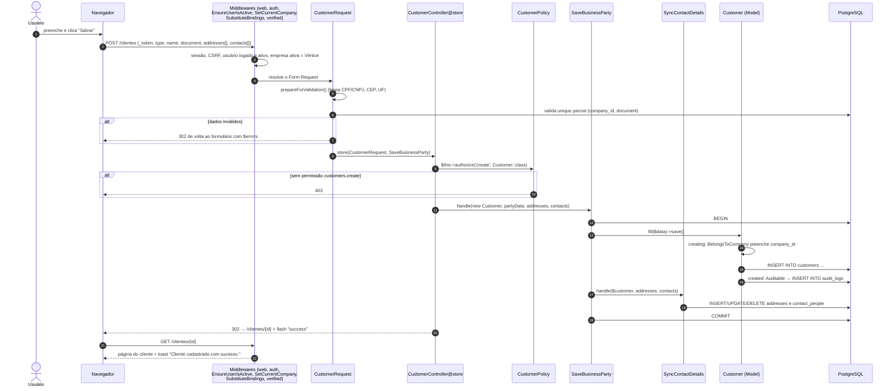
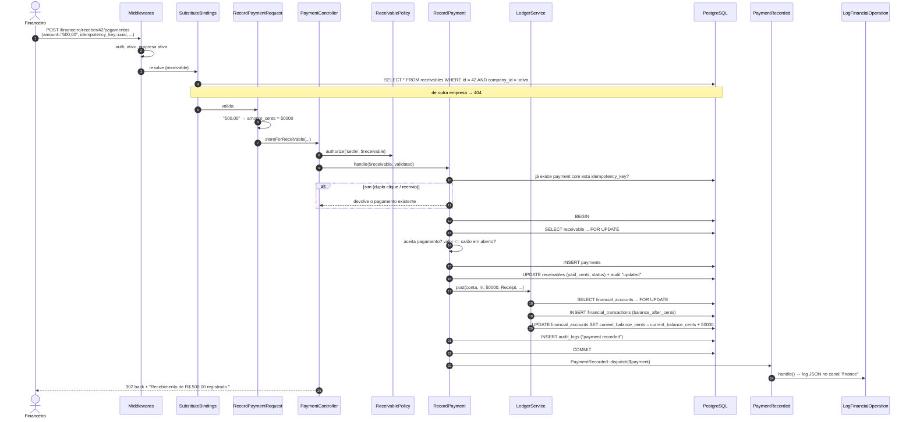

# 04 — Fluxo de uma requisição

> O caminho **real** que uma requisição percorre no Nexus ERP, do clique no navegador até o banco de dados e de volta — com os trechos de código de cada etapa.
> Ler este arquivo com o código aberto ao lado é a forma mais rápida de entender como as camadas descritas em [02 — Arquitetura](02-arquitetura.md) conversam.

## Sumário

1. [Salvar um cliente pelo formulário (`POST /clientes`)](#1-salvar-um-cliente-pelo-formulário-post-clientes)
2. [Registrar um pagamento (`POST /financeiro/receber/{id}/pagamentos`)](#2-registrar-um-pagamento-post-financeiroreceberidpagamentos)
3. [Uma listagem Livewire (`CustomerIndex`)](#3-uma-listagem-livewire-customerindex)
4. [Uma chamada de API (`POST /api/v1/receivables/{id}/payments`)](#4-uma-chamada-de-api-post-apiv1receivablesidpayments)
5. [Resumo: o que muda entre os quatro caminhos](#5-resumo-o-que-muda-entre-os-quatro-caminhos)

---

## 1. Salvar um cliente pelo formulário (`POST /clientes`)

Cenário: um usuário da empresa "Vértice TI" preenche o formulário **Novo cliente** e clica em **Salvar**.

### 1.1 Diagrama de sequência



### 1.2 Passo 1 — O formulário envia os dados

O formulário é compartilhado entre clientes e fornecedores ([`resources/views/parties/form.blade.php`](../resources/views/parties/form.blade.php)):

```blade
<form method="POST" action="{{ $action }}" class="space-y-6" x-data="{ submitting: false, type: ... }" x-on:submit="submitting = true">
    @csrf
    @if ($method !== 'POST') @method($method) @endif
```

- `@csrf` gera o campo oculto `_token`, que prova que o formulário veio do próprio sistema (proteção contra CSRF).
- `x-on:submit="submitting = true"` (Alpine) desabilita o botão após o primeiro clique, evitando envio duplo.
- Endereços e contatos são listas: `addresses[0][street]`, `addresses[0][city]`, `contacts[0][name]`...

### 1.3 Passo 2 — A rota

```php
// routes/web.php
Route::middleware(['auth', 'verified'])->group(function () {
    // ...
    Route::resource('clientes', CustomerController::class)->except('index')
        ->parameters(['clientes' => 'customer'])->names('customers');
});
```

`Route::resource` cria, entre outras, a rota `POST /clientes` → `CustomerController@store` com o nome `customers.store`. Você pode conferir com `php artisan route:list --path=clientes -v`.

### 1.4 Passo 3 — Os middlewares, na ordem real

A ordem efetiva (já ordenada pela lista de prioridades configurada em [`bootstrap/app.php`](../bootstrap/app.php)) é:

| # | Middleware | O que faz nesta requisição |
|---|---|---|
| 0 | **Globais**: `TrustProxies`, `HandleCors`, `ValidatePostSize`, `TrimStrings`, `ConvertEmptyStringsToNull`, [`SecurityHeaders`](../app/Http/Middleware/SecurityHeaders.php)... | Rodam em toda requisição: aparam espaços, transformam campos vazios em `null` e, na volta, acrescentam os cabeçalhos de segurança (`X-Frame-Options`, `nosniff`, `Referrer-Policy`, `Permissions-Policy`; HSTS em produção) |
| 1 | `EncryptCookies`, `AddQueuedCookiesToResponse` | Descriptografa os cookies |
| 2 | `StartSession` | Carrega a sessão (do banco: `SESSION_DRIVER=database`) |
| 3 | `ShareErrorsFromSession` | Disponibiliza `$errors` para as views |
| 4 | `PreventRequestForgery` | Valida o `_token` (CSRF). Token inválido → 419 |
| 5 | `Authenticate` (`auth`) | Sem usuário logado → redirect para `/login` |
| 6 | [`EnsureUserIsActive`](../app/Http/Middleware/EnsureUserIsActive.php) | Usuário desativado → logout e volta ao login |
| 7 | [`SetCurrentCompany`](../app/Http/Middleware/SetCurrentCompany.php) | Define a empresa ativa em `CurrentCompany` |
| 8 | `SubstituteBindings` | Route Model Binding (aqui não há `{customer}` na URL, então nada a resolver) |
| 9 | `EnsureEmailIsVerified` (`verified`) | E-mail não verificado → tela de verificação |

(Em desenvolvimento aparece também `InjectBoost`, do pacote Laravel Boost, que não afeta a lógica.)

O trecho essencial do `SetCurrentCompany`:

```php
// app/Http/Middleware/SetCurrentCompany.php
$company = $companies->firstWhere('id', $user->current_company_id) ?? $companies->first();
// ...
$this->currentCompany->set($company);

return $next($request);
```

A partir daqui, **toda** consulta de Model multiempresa será filtrada pela Vértice TI.

### 1.5 Passo 4 — O Form Request valida (antes do corpo do Controller)

A assinatura do método pede um `CustomerRequest`:

```php
// app/Http/Controllers/Customers/CustomerController.php
public function store(CustomerRequest $request, SaveBusinessParty $saveParty): RedirectResponse
```

Ao montar os parâmetros do método, o Laravel cria o `CustomerRequest` e **valida automaticamente**. Isso acontece **antes** da primeira linha do método rodar. Se a validação falhar, o Laravel redireciona de volta ao formulário com os erros e o *input* antigo (`old()`), e o Controller nem é executado.

> **Ordem real:** como a validação ocorre na resolução dos parâmetros e o `authorize()` do Form Request retorna `true`, a **validação acontece antes** do `$this->authorize()` do Controller. Na prática, um usuário sem permissão que envie dados inválidos verá erros de validação em vez de 403; com dados válidos, receberá 403 no passo seguinte, antes de qualquer gravação.

**4a. Normalização** — `prepareForValidation()` em [`BusinessPartyRequest`](../app/Http/Requests/Customers/BusinessPartyRequest.php):

```php
protected function prepareForValidation(): void
{
    $this->merge(['document' => BrazilianDocument::clean($this->input('document'))]);

    // Listas só são normalizadas quando enviadas: na API, omitir "addresses"
    // significa "não alterar os endereços" (e não "apagar todos").
    if (is_array($this->input('addresses'))) {
        $this->merge(['addresses' => collect($this->input('addresses'))->map(fn ($address) => [
            ...(array) $address,
            'zip_code' => isset($address['zip_code']) ? preg_replace('/\D/', '', (string) $address['zip_code']) : null,
            'state' => isset($address['state']) ? strtoupper((string) $address['state']) : null,
        ])->values()->all()]);
    }
    // ...
}
```

O usuário digitou `12.345.678/0001-95`; a validação já recebe `12345678000195`.

**4b. Regras** — `rules()`:

```php
'type' => ['required', Rule::enum(PersonType::class)],
'name' => ['required', 'string', 'max:255'],
'document' => [
    'required',
    new CpfCnpj($type?->documentRule()),                 // PF exige CPF; PJ exige CNPJ
    Rule::unique($this->table(), 'document')
        ->where('company_id', app(CurrentCompany::class)->id())
        ->whereNull('deleted_at')
        ->ignore($this->currentId()),
],
// ...
'addresses.*.street' => ['required', 'string', 'max:255'],
'addresses.*.state' => ['required', Rule::in(self::STATES)],
```

- [`CpfCnpj`](../app/Rules/CpfCnpj.php) é uma regra customizada (`ValidationRule`) que confere os dígitos verificadores via [`BrazilianDocument`](../app/Support/BrazilianDocument.php) (inclusive o CNPJ alfanumérico).
- O `Rule::unique(...)` replica exatamente o **índice UNIQUE parcial** do banco (`(company_id, document) WHERE deleted_at IS NULL`) para mostrar a mensagem amigável *"Já existe um cadastro com este CPF/CNPJ nesta empresa."*. Repare no `->where('company_id', ...)`: a regra `unique` consulta a tabela diretamente, **sem** o Global Scope — por isso o filtro de empresa precisa ser explícito.

As regras específicas de cliente ficam em [`CustomerRequest::extraRules()`](../app/Http/Requests/Customers/CustomerRequest.php): `status` (enum `CustomerStatus`) e `owner_id` (precisa ser membro da empresa ativa).

### 1.6 Passo 5 — O Controller autoriza e delega

```php
// app/Http/Controllers/Customers/CustomerController.php
public function store(CustomerRequest $request, SaveBusinessParty $saveParty): RedirectResponse
{
    $this->authorize('create', Customer::class);

    $customer = $saveParty->handle(new Customer, $request->partyData(), $request->validated('addresses', []), $request->validated('contacts', []));

    return redirect()->route('customers.show', $customer)->with('success', 'Cliente cadastrado com sucesso.');
}
```

**Autorização.** `$this->authorize('create', Customer::class)` passa por:

1. `Gate::before` ([`AppServiceProvider`](../app/Providers/AppServiceProvider.php)): superadministrador → libera.
2. [`CustomerPolicy`](../app/Policies/CustomerPolicy.php) → herda `create()` de [`TenantResourcePolicy`](../app/Policies/TenantResourcePolicy.php):

```php
public function create(User $user): bool
{
    return $user->hasPermission("{$this->permission}.create");   // "customers.create"
}
```

3. `User::hasPermission()` busca as permissões do perfil do usuário **na empresa ativa** (uma consulta com JOINs, em cache durante a requisição). Falhou → `AuthorizationException` → **403**.

**Delegação.** O Controller passa só **dados validados**: `partyData()` devolve `$this->safe()->except(['addresses', 'contacts'])`. Campos que não estão nas regras nunca chegam à Action.

### 1.7 Passo 6 — A Action grava tudo em uma transação

```php
// app/Actions/Parties/SaveBusinessParty.php
public function handle(Customer|Supplier $party, array $data, array $addresses, array $contacts): Customer|Supplier
{
    return DB::transaction(function () use ($party, $data, $addresses, $contacts) {
        $party->fill($data)->save();
        $this->syncContactDetails->handle($party, $addresses, $contacts);

        return $party;
    });
}
```

`DB::transaction()` garante "tudo ou nada": se a gravação de um endereço falhar, o cliente também não é gravado.

[`SyncContactDetails`](../app/Actions/Parties/SyncContactDetails.php) usa a estratégia "substituir a coleção": linhas com `id` são atualizadas, sem `id` são criadas, e as que sumiram do formulário são removidas. Antes, `ensureSinglePrimary()` garante **no máximo um** endereço/contato principal.

```php
$keptIds[] = $relation->create($attributes)->id;   // $party->addresses()->create([...])
// ...
(clone $relation)->whereNotIn('id', $keptIds)->delete();
```

### 1.8 Passo 7 — O Model reage: `company_id` e auditoria

Ao chamar `$party->save()` em um `Customer` novo, os **eventos do Eloquent** disparam os traits do Model ([`Customer`](../app/Models/Customer.php) usa `Auditable, BelongsToCompany, ..., IsBusinessParty, SoftDeletes`):

1. **Mutator de documento** (`IsBusinessParty::document()`): garante que o documento seja gravado sem máscara, mesmo se alguém esquecer de limpar.

   ```php
   protected function document(): Attribute
   {
       return Attribute::set(fn (?string $value): string => BrazilianDocument::clean($value));
   }
   ```

2. **Evento `creating`** (`BelongsToCompany`): preenche `company_id` com a empresa ativa — por isso nem o formulário nem a Action enviam `company_id`.

   ```php
   static::creating(function (Model $model): void {
       if (empty($model->company_id)) {
           $model->company_id = app(CurrentCompany::class)->id()
               ?? throw new RuntimeException('Não é possível criar '.class_basename($model).' sem uma empresa ativa.');
       }
   });
   ```

3. **INSERT** no banco (aproximadamente):

   ```sql
   insert into "customers" ("type", "name", "document", "status", ..., "company_id", "updated_at", "created_at")
   values ('company', 'Acme Ltda', '12345678000195', 'active', ..., 1, now(), now()) returning "id"
   ```

4. **Evento `created`** (`Auditable`): grava a auditoria com os atributos do novo registro (sem `created_at`, `updated_at`, `password`...):

   ```php
   static::created(function (Model $model): void {
       app(AuditLogger::class)->log('created', $model, null, $model->auditableAttributes($model->getAttributes()));
   });
   ```

   O [`AuditLogger`](../app/Services/AuditLogger.php) grava em `audit_logs` o `company_id`, o usuário, `auditable_type = 'customer'` (apelido do morph map), os valores (com campos sensíveis trocados por `[protegido]`), IP e *user agent*. Como roda **dentro** da transação, se o resto falhar a auditoria também é desfeita.

5. Os endereços criados por `$customer->addresses()->create([...])` recebem automaticamente `addressable_type = 'customer'`, `addressable_id = <id do cliente>` (relação `morphMany`) e `company_id` (o `Address` também usa `BelongsToCompany`).

### 1.9 Passo 8 — Redirect, flash e toast

```php
return redirect()->route('customers.show', $customer)->with('success', 'Cliente cadastrado com sucesso.');
```

- O navegador recebe **302** e faz um `GET /clientes/{id}` (padrão *Post/Redirect/Get*: recarregar a página não reenvia o formulário).
- `->with('success', ...)` grava uma mensagem **flash** na sessão (dura só a próxima requisição).
- No `GET`, o *partial* [`toasts.blade.php`](../resources/views/layouts/partials/toasts.blade.php) lê a sessão e entrega as mensagens ao componente Alpine `toasts`:

```blade
@php
    $initial = collect(['success', 'error', 'warning', 'status'])
        ->filter(fn ($type) => session()->has($type))
        ->map(fn ($type) => ['type' => $type === 'status' ? 'success' : $type, 'message' => session($type)])
        ->values();
@endphp

<div x-data="toasts(@js($initial))" x-on:notify.window="add($event.detail)" ...>
```

O mesmo componente escuta o evento de navegador `notify`, usado pelos componentes Livewire (`$this->dispatch('notify', ...)`).

**E se uma regra de negócio falhar?** Uma Action lança `BusinessRuleException`; o método `render()` da exceção faz `back()->withInput()->with('error', $mensagem)`, e o mesmo partial exibe um toast vermelho.

---

## 2. Registrar um pagamento (`POST /financeiro/receber/{id}/pagamentos`)

Cenário: na tela de uma conta a receber, o financeiro abre o modal **Registrar recebimento**, informa R$ 500,00 na conta "Banco Inter" e confirma.

### 2.1 Diagrama de sequência



### 2.2 Passo 1 — O formulário com chave de idempotência

O Controller que exibe o título gera um UUID novo a cada carregamento da tela:

```php
// app/Http/Controllers/Finance/ReceivableController.php (método show)
'idempotencyKey' => (string) Str::uuid(),
```

E o modal envia esse UUID num campo oculto:

```blade
{{-- resources/views/finance/bills/show.blade.php --}}
<form method="POST" action="{{ route($routePrefix.'.payments.store', $bill) }}" ...>
    @csrf
    {{-- Chave de idempotência: um duplo clique ou reenvio não duplica o pagamento. --}}
    <input type="hidden" name="idempotency_key" value="{{ old('idempotency_key', $idempotencyKey) }}">
    <x-form.select name="financial_account_id" ... />
    <x-form.money name="amount" label="Valor" :value="$bill->outstandingCents()" required help="Pode ser parcial." />
```

Se o usuário clicar duas vezes (ou o navegador reenviar), as duas requisições chegam com **a mesma chave** — e o sistema processa só uma (passo 5).

### 2.3 Passo 2 — Rota, middlewares e Route Model Binding

```php
// routes/web.php
Route::post('/financeiro/receber/{receivable}/pagamentos', [PaymentController::class, 'storeForReceivable'])->name('receivables.payments.store');
```

Os middlewares são os mesmos do exemplo 1. A diferença é que agora há `{receivable}` na URL: o `SubstituteBindings` executa `Receivable::where('id', 42)->firstOrFail()`. Como `SetCurrentCompany` já rodou, o `CompanyScope` acrescenta `AND receivables.company_id = <empresa ativa>`. Um título de outra empresa simplesmente "não existe" → **404** (teste *"não permite registrar pagamento em título de outra empresa"* em [`CompanyIsolationTest`](../tests/Feature/Tenancy/CompanyIsolationTest.php)).

### 2.4 Passo 3 — `RecordPaymentRequest`: centavos e regras

```php
// app/Http/Requests/Finance/RecordPaymentRequest.php
class RecordPaymentRequest extends FormRequest
{
    use NormalizesMoney;

    protected function moneyFields(): array
    {
        return ['amount' => 'amount_cents'];
    }

    public function rules(): array
    {
        return [
            'financial_account_id' => ['required', 'integer', Rule::exists('financial_accounts', 'id')
                ->where('company_id', app(CurrentCompany::class)->id())->where('is_active', true)->whereNull('deleted_at')],
            'amount_cents' => ['required', 'integer', 'min:1'],
            'paid_on' => ['required', 'date', 'before_or_equal:today'],
            'method' => ['required', Rule::enum(PaymentMethod::class)],
            'notes' => ['nullable', 'string', 'max:255'],
            'idempotency_key' => ['required', 'uuid'],
        ];
    }
}
```

O trait [`NormalizesMoney`](../app/Http/Requests/Concerns/NormalizesMoney.php) converte `"500,00"` em `50000` com [`Money::tryParse()`](../app/Support/Money.php) **sem usar float**. Um texto inválido vira a string `'invalid'`, reprovada pela regra `integer`. Pela API, o cliente pode mandar `amount_cents` direto — o mesmo Form Request atende os dois canais.

### 2.5 Passo 4 — Controller e Policy

```php
// app/Http/Controllers/Finance/PaymentController.php
public function storeForReceivable(RecordPaymentRequest $request, Receivable $receivable, RecordPayment $recordPayment): RedirectResponse
{
    $this->authorize('settle', $receivable);

    $payment = $recordPayment->handle($receivable, $request->validated());

    return back()->with('success', 'Recebimento de '.money($payment->amount_cents).' registrado.');
}
```

```php
// app/Policies/ReceivablePolicy.php
public function settle(User $user, Receivable $receivable): bool
{
    return $this->allows($user, $receivable, 'receivables.settle');   // empresa ativa + permissão
}
```

### 2.6 Passo 5 — `RecordPayment`: idempotência, trava e validações

```php
// app/Actions/Finance/RecordPayment.php
public function handle(Receivable|Payable $bill, array $data): Payment
{
    if ($existing = $this->findByIdempotencyKey($data['idempotency_key'])) {
        return $this->guardSameTarget($existing, $bill);
    }

    try {
        $payment = DB::transaction(fn (): Payment => $this->process($bill, $data));
    } catch (UniqueConstraintViolationException) {
        // Corrida entre duas requisições com a mesma chave: a outra venceu.
        return $this->guardSameTarget($this->findByIdempotencyKey($data['idempotency_key']), $bill);
    }

    PaymentRecorded::dispatch($payment);

    return $payment;
}
```

As **quatro proteções** contra pagamento duplicado ou acima do saldo (descritas no próprio docblock da classe):

1. **Idempotência na aplicação**: se a chave já foi usada, devolve o pagamento existente (e confere que é do mesmo título com `guardSameTarget()`).
2. **Índice UNIQUE `(company_id, idempotency_key)`**: se duas requisições idênticas passarem pela verificação 1 ao mesmo tempo, o banco aceita só uma; a outra recebe `UniqueConstraintViolationException`, capturada acima.
3. **Lock pessimista no título**: dentro da transação, o título é relido com `SELECT ... FOR UPDATE`. Uma segunda baixa simultânea no mesmo título **espera** a primeira terminar e então enxerga o saldo já atualizado.
4. **CHECK `paid_cents <= amount_cents`** no banco, como última barreira.

O método `process()`:

```php
$lockedBill = $bill->newQuery()->whereKey($bill->getKey())->lockForUpdate()->firstOrFail();
$amount = (int) $data['amount_cents'];

if (! $lockedBill->status->acceptsPayment()) {
    throw new BusinessRuleException("Este título está \"{$lockedBill->status->label()}\" e não aceita pagamentos.");
}

if ($amount > $lockedBill->outstandingCents()) {
    throw new BusinessRuleException('O valor informado ('.money($amount).') é maior que o saldo em aberto ('.money($lockedBill->outstandingCents()).').');
}

$account = FinancialAccount::query()->findOrFail($data['financial_account_id']);

$payment = Payment::create([
    'receivable_id' => $isReceivable ? $lockedBill->id : null,
    'payable_id' => $isReceivable ? null : $lockedBill->id,
    'financial_account_id' => $account->id,
    'amount_cents' => $amount,
    // ...
    'status' => EntryStatus::Confirmed,
    'idempotency_key' => $data['idempotency_key'],
    'user_id' => Auth::id(),
]);

$lockedBill->applyPayment($amount, $paidOn);
```

### 2.7 Passo 6 — O título se atualiza (`IsBill::applyPayment`)

```php
// app/Models/Concerns/IsBill.php
public function applyPayment(int $amountCents, Carbon $paidOn): void
{
    if ($amountCents <= 0 || $amountCents > $this->outstandingCents()) {
        throw new LogicException('Valor de pagamento inválido para o saldo do título.');
    }

    $this->paid_cents += $amountCents;
    $this->status = $this->paid_cents === $this->amount_cents ? BillStatus::Paid : BillStatus::Partial;
    $this->paid_at = $this->status === BillStatus::Paid ? $paidOn : null;
    $this->save();
}
```

Como `Receivable` usa `Auditable`, este `save()` gera automaticamente uma auditoria `updated` com os valores antigos e novos de `paid_cents`, `status` e `paid_at`.

### 2.8 Passo 7 — O livro-razão movimenta o saldo (`LedgerService::post`)

```php
// app/Actions/Finance/RecordPayment.php
$this->ledger->post(
    account: $account,
    direction: $isReceivable ? TransactionDirection::In : TransactionDirection::Out,
    amountCents: $amount,
    type: $isReceivable ? TransactionType::Receipt : TransactionType::Payment,
    description: ($isReceivable ? 'Recebimento: ' : 'Pagamento: ').$lockedBill->description,
    occurredOn: $paidOn,
    links: ['payment_id' => $payment->id, 'financial_category_id' => $lockedBill->financial_category_id],
);
```

Dentro do [`LedgerService`](../app/Services/Finance/LedgerService.php):

```php
$this->ensureInsideTransaction();      // lança LogicException se não houver DB::transaction aberta

$lockedAccount = FinancialAccount::query()->whereKey($account->getKey())->lockForUpdate()->firstOrFail();

$newBalance = $lockedAccount->current_balance_cents + ($direction->sign() * $amountCents);

if ($newBalance < 0 && $direction === TransactionDirection::Out && ! $allowNegativeBalance) {
    throw new BusinessRuleException(sprintf('Saldo insuficiente na conta "%s". Saldo disponível: %s.', ...));
}

$transaction = FinancialTransaction::create([
    'financial_account_id' => $lockedAccount->id,
    'type' => $type,
    'direction' => $direction,
    'amount_cents' => $amountCents,
    'balance_after_cents' => $newBalance,
    // ...
]);

// Atualização atômica e relativa ("saldo = saldo + x"), nunca "saldo = valor lido".
$lockedAccount->newQuery()->whereKey($lockedAccount->id)
    ->increment('current_balance_cents', $direction->sign() * $amountCents);
```

Por último, a Action grava a auditoria **de intenção** (`payment.recorded`, com descrição *"Pagamento de R$ 500,00 registrado."*) e sincroniza o objeto `$bill` recebido com os valores travados (`setRawAttributes(..., sync: true)`), para que o chamador veja o título atualizado. Então a transação faz **COMMIT**.

### 2.9 Passo 8 — Evento e Listener

```php
PaymentRecorded::dispatch($payment);
```

[`PaymentRecorded`](../app/Events/PaymentRecorded.php) implementa `ShouldDispatchAfterCommit`: se houver uma transação aberta em volta (por exemplo, quando outra Action chama `RecordPayment`), o evento só é entregue depois do commit — nunca se anuncia um pagamento que foi desfeito.

O Listener [`LogFinancialOperation`](../app/Listeners/LogFinancialOperation.php) (registrado por descoberta automática, pelo tipo do parâmetro de `handle()`) escreve uma linha JSON em `storage/logs/finance-AAAA-MM-DD.log`:

```php
Log::channel('finance')->info($event instanceof PaymentRecorded ? 'payment.recorded' : 'payment.reversed', [
    'company_id' => $payment->company_id,
    'payment_id' => $payment->id,
    'receivable_id' => $payment->receivable_id,
    // ... só identificadores e valores, nenhum dado pessoal
]);
```

### 2.10 Passo 9 — Resposta

`back()->with('success', 'Recebimento de R$ 500,00 registrado.')` volta para a tela do título, agora mostrando "Pago parcialmente" (ou "Quitado"), o pagamento no histórico e a auditoria. O extrato da conta mostra a entrada com o saldo resultante.

---

## 3. Uma listagem Livewire (`CustomerIndex`)

### 3.1 Primeira carga: `GET /clientes`

```php
// routes/web.php
Route::livewire('/clientes', Livewire\Customers\CustomerIndex::class)->name('customers.index');
```

A rota aponta para o `LivewirePageController`, que:

1. instancia [`CustomerIndex`](../app/Livewire/Customers/CustomerIndex.php);
2. preenche as propriedades marcadas com `#[Url]` a partir da *query string* (`?busca=acme&status=active`);
3. chama `mount()` — que **autoriza** (`$this->authorize('viewAny', Customer::class)`);
4. chama `render()` e envolve o HTML no layout `layouts::app`, com o título do atributo `#[Title('Clientes')]`.

```php
public function render(): View
{
    $query = Customer::query()
        ->with('owner:id,name')                                    // eager loading do responsável
        ->withCount(['contracts as active_contracts_count' => fn ($query) => $query->where('status', 'active')])
        ->search($this->search)                                    // scope local de IsBusinessParty
        ->when($this->status !== '', fn ($query) => $query->where('status', $this->status))
        ->when($this->type !== '', fn ($query) => $query->where('type', $this->type));

    return view('livewire.customers.customer-index', [
        'customers' => $this->applySorting($query, 'name')->paginate($this->perPageForCompany()),
        'statusOptions' => CustomerStatus::options(),
        'typeOptions' => PersonType::options(),
    ]);
}
```

O HTML enviado contém, junto com a tabela, um **snapshot** (estado serializado e assinado) do componente.

### 3.2 O usuário digita na busca

O campo de busca é o componente [`<x-table.search>`](../resources/views/components/table/search.blade.php):

```blade
<input type="search" wire:model.live.debounce.400ms="search" placeholder="{{ $placeholder }}" ... class="form-control pl-9">
```

- `wire:model.live` liga o campo à propriedade `$search` (definida no trait [`WithDataTable`](../app/Livewire/Concerns/WithDataTable.php) com `#[Url(as: 'busca', except: '')]`).
- `.debounce.400ms` espera o usuário parar de digitar por 400 ms antes de enviar — evita uma requisição por tecla.

### 3.3 A requisição AJAX

O JavaScript do Livewire envia um `POST /livewire-<hash>/update` (rota `default-livewire.update`) com o snapshot e a alteração (`search = "acme"`). No servidor:

1. A rota de update roda o grupo `web` — **inclusive `EnsureUserIsActive` e `SetCurrentCompany`** (por isso o comentário em `bootstrap/app.php`: *"Executados em todas as rotas web (incluindo as requisições do Livewire)"*). O Livewire também reaplica os middlewares "persistentes" da rota original da página, como `Authenticate`.
2. O Livewire confere a assinatura do snapshot (o navegador não pode adulterar o estado), reidrata o componente e aplica `search = "acme"`.
3. Dispara o *hook* `updated()` do trait, que volta para a página 1:

   ```php
   public function updated(string $property): void
   {
       if (! in_array($property, ['paginators', 'page'], true)) {
           $this->resetPage();
       }
   }
   ```

4. Chama `render()` de novo. A consulta gerada fica parecida com:

   ```sql
   select "customers".*, (select count(*) from "contracts"
          where "customers"."id" = "contracts"."customer_id" and "status" = 'active'
          and "contracts"."company_id" = 1 and "contracts"."deleted_at" is null) as "active_contracts_count"
   from "customers"
   where ("name" ilike '%acme%' or "trade_name" ilike '%acme%' or "email" ilike '%acme%')
     and "customers"."company_id" = 1          -- CompanyScope
     and "customers"."deleted_at" is null       -- SoftDeletes
   order by "customers"."name" asc, "customers"."id" desc
   limit 15 offset 0
   ```

   Os valores digitados vão como *bindings* (parâmetros), nunca concatenados no SQL — proteção contra SQL Injection. O responsável (`owner`) vem numa segunda consulta (`with('owner:id,name')`), evitando N+1.

5. O Livewire devolve o novo HTML e o novo snapshot; o navegador troca só o que mudou (*DOM diffing*) e atualiza a URL para `/clientes?busca=acme` graças ao `#[Url]` — o usuário pode recarregar ou compartilhar o link com o mesmo filtro.

### 3.4 Ações na listagem (excluir)

```blade
<button type="button" wire:click="delete({{ $customer->id }})" wire:confirm="Excluir o cliente {{ $customer->display_name }}?" ...>
```

```php
public function delete(int $customerId, DeleteBusinessParty $deleteParty): void
{
    $customer = Customer::query()->findOrFail($customerId);   // CompanyScope: id de outra empresa → 404
    $this->authorize('delete', $customer);

    try {
        $deleteParty->handle($customer);
        $this->dispatch('notify', type: 'success', message: 'Cliente excluído.');
    } catch (BusinessRuleException $exception) {
        $this->dispatch('notify', type: 'error', message: $exception->getMessage());
    }
}
```

Atenção ao detalhe de segurança: o `id` vem do navegador e **pode ser adulterado**. Por isso o método busca o registro pelo Model (com `CompanyScope`) e **autoriza de novo** — nunca confie que, só porque o botão não apareceu na tela, a ação não será chamada. `$this->dispatch('notify', ...)` vira um evento de navegador capturado pelo componente de toasts.

### 3.5 Ordenação segura

```php
// app/Livewire/Concerns/WithDataTable.php
public function sortBy(string $field): void
{
    if (! in_array($field, $this->sortableColumns(), true)) {
        return;
    }
    // ...
}
```

Cada listagem declara `$sortable` (em `CustomerIndex`: `['name', 'document', 'created_at', 'status']`). Um valor arbitrário vindo da URL (`?ordem=senha`) é ignorado — evita `ORDER BY` em colunas não previstas.

---

## 4. Uma chamada de API (`POST /api/v1/receivables/{id}/payments`)

### 4.1 Obter um token

```http
POST /api/v1/auth/token
Content-Type: application/json
Accept: application/json

{"email": "financeiro@verticeti.local", "password": "<senha>", "device_name": "integracao-erp"}
```

[`AuthTokenController::store()`](../app/Http/Controllers/Api/V1/AuthTokenController.php) confere a senha, se a conta está ativa e se o usuário tem alguma empresa, e cria um token Sanctum válido por 30 dias. A rota é limitada a 5 tentativas por minuto por e-mail + IP (`throttle:api-token`).

### 4.2 Registrar o pagamento

```http
POST /api/v1/receivables/42/payments
Authorization: Bearer 3|xYz...
X-Company-Id: 1
Accept: application/json
Content-Type: application/json

{
  "financial_account_id": 3,
  "amount_cents": 50000,
  "paid_on": "2026-10-14",
  "method": "pix",
  "idempotency_key": "7b0c6f7e-3c1a-4c55-9d7e-2f1f3c9a1b20"
}
```

Caminho no servidor:

| Etapa | Web (exemplo 2) | API |
|---|---|---|
| Rota | `routes/web.php` | [`routes/api.php`](../routes/api.php): `Route::post('receivables/{receivable}/payments', [V1\ReceivableController::class, 'pay'])` |
| Autenticação | sessão (`auth`) | token (`auth:sanctum`) + `throttle:api` (60/min) |
| Empresa ativa | `users.current_company_id` | cabeçalho `X-Company-Id` (sem acesso → **403**); sem cabeçalho, a empresa atual do usuário |
| Middlewares (ordem real) | ver seção 1.4 | `Authenticate:sanctum` → `ThrottleRequests:api` → `EnsureUserIsActive` → `SetCurrentCompany` → `SubstituteBindings` |
| Validação | `RecordPaymentRequest` (envia `amount`) | **o mesmo** `RecordPaymentRequest` (envia `amount_cents` direto) |
| Autorização | `authorize('settle', $receivable)` | **a mesma** |
| Regra de negócio | `RecordPayment` | **a mesma** |
| Resposta | redirect + toast | JSON via [`PaymentResource`](../app/Http/Resources/V1/PaymentResource.php) |

```php
// app/Http/Controllers/Api/V1/ReceivableController.php
public function pay(RecordPaymentRequest $request, Receivable $receivable, RecordPayment $recordPayment): JsonResponse
{
    $this->authorize('settle', $receivable);

    $payment = $recordPayment->handle($receivable, $request->validated());

    return (new PaymentResource($payment))->response()->setStatusCode($payment->wasRecentlyCreated ? 201 : 200);
}
```

Repare no status: **201** quando o pagamento foi criado agora; **200** quando a mesma `idempotency_key` foi reenviada (por exemplo, um *retry* após *timeout*) e a Action devolveu o pagamento existente. Resposta:

```json
{
  "data": {
    "id": 118,
    "receivable_id": 42,
    "payable_id": null,
    "financial_account_id": 3,
    "amount": { "cents": 50000, "formatted": "R$ 500,00" },
    "paid_on": "2026-10-14",
    "method": { "value": "pix", "label": "PIX" },
    "status": { "value": "confirmed", "label": "Confirmado" },
    "notes": null,
    "idempotency_key": "7b0c6f7e-3c1a-4c55-9d7e-2f1f3c9a1b20",
    "reversed_at": null,
    "reversal_reason": null
  }
}
```

(O rótulo de `method` vem do `label()` do Enum `PaymentMethod`.)

### 4.3 Erros na API

Configurados em [`bootstrap/app.php`](../bootstrap/app.php) (`shouldRenderJsonWhen` para `api/*`) e em [`BusinessRuleException::render()`](../app/Exceptions/BusinessRuleException.php):

| Situação | Status | Corpo |
|---|---|---|
| Sem token / token inválido | 401 | `{"message": "Não autenticado. Envie um token válido..."}` |
| `X-Company-Id` sem acesso | 403 | `{"message": "Você não tem acesso à empresa informada."}` |
| Sem permissão (Policy) | 403 | `{"message": "Você não tem permissão para executar esta ação."}` |
| Título de outra empresa / inexistente | 404 | `{"message": "Registro não encontrado."}` |
| Validação (ex.: `amount_cents` ausente) | 422 | `{"message": "...", "errors": {"amount_cents": ["..."]}}` |
| Regra de negócio (ex.: valor maior que o saldo) | 422 | `{"message": "...", "errors": {"business_rule": ["..."]}}` |
| Excesso de requisições | 429 | `{"message": "Muitas requisições. Aguarde alguns instantes e tente novamente."}` |

---

## 5. Resumo: o que muda entre os quatro caminhos

| | Formulário (cliente) | Formulário (pagamento) | Livewire | API |
|---|---|---|---|---|
| Entrada | POST + redirect | POST + redirect | AJAX `/livewire-<hash>/update` | JSON + Bearer token |
| Empresa ativa | sessão | sessão | sessão | `X-Company-Id` ou padrão do usuário |
| Validação | Form Request | Form Request | regras no componente / filtros seguros | **mesmos** Form Requests |
| Autorização | `$this->authorize()` → Policy | idem | `$this->authorize()` no `mount()` e em cada ação | idem |
| Regra de negócio | Action | Action | Action (`DeleteBusinessParty`) | **mesmas** Actions |
| Transação/travas | `DB::transaction` | `DB::transaction` + `lockForUpdate` + UNIQUE | (na Action) | (na Action) |
| Resposta | redirect + flash → toast | redirect + flash → toast | HTML parcial + evento `notify` → toast | JSON (API Resource) |

O ponto central: **as regras moram nas Actions e nas Policies**. Controllers, componentes Livewire e controllers de API são apenas "portas de entrada" diferentes para o mesmo núcleo — por isso as regras de negócio são idênticas em todos os canais.
