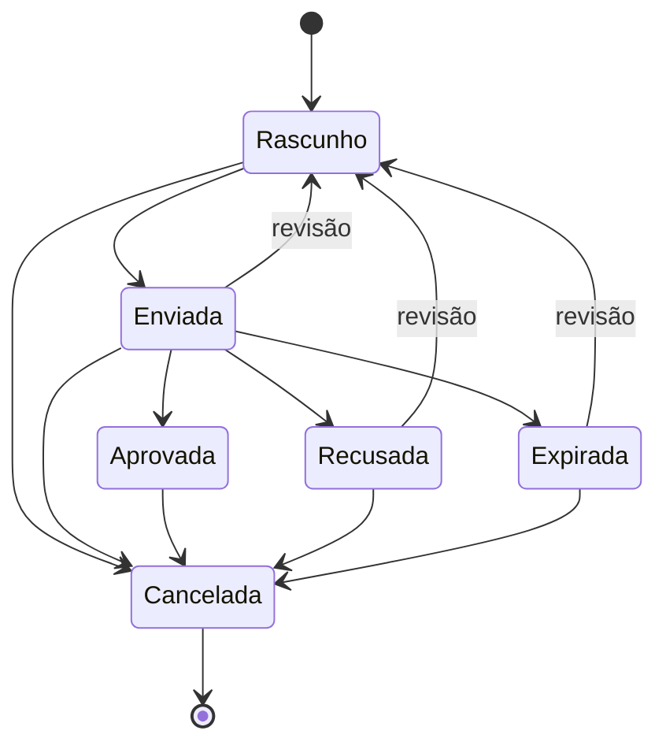
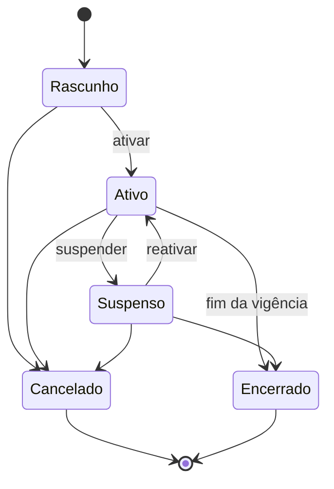

# 06 — Regras de negócio

> Todas as regras comerciais e financeiras implementadas no Nexus ERP, com o arquivo onde cada uma está e o **porquê** dela.
> As fórmulas dos indicadores do dashboard e dos relatórios estão nas seções 12 e 13.
> Convenção: "Action" = classe em `app/Actions`; "Policy" = classe em `app/Policies`. Toda violação de regra lança `BusinessRuleException` (mensagem amigável ao usuário; 422 na API).

## Sumário

1. [Máquinas de estado (status)](#1-máquinas-de-estado-status)
2. [Itens, descontos e totais](#2-itens-descontos-e-totais)
3. [Numeração de documentos](#3-numeração-de-documentos)
4. [Propostas](#4-propostas)
5. [Contratos e cobrança recorrente](#5-contratos-e-cobrança-recorrente)
6. [Despesas recorrentes](#6-despesas-recorrentes)
7. [Títulos financeiros: baixas, estornos e cancelamentos](#7-títulos-financeiros-baixas-estornos-e-cancelamentos)
8. [Contas financeiras: livro-razão, transferências e lançamentos avulsos](#8-contas-financeiras-livro-razão-transferências-e-lançamentos-avulsos)
9. [CRM](#9-crm)
10. [Clientes e fornecedores: duplicidade, exclusão e inativação](#10-clientes-e-fornecedores-duplicidade-exclusão-e-inativação)
11. [Operações: ordens de serviço e chamados](#11-operações-ordens-de-serviço-e-chamados)
12. [Fórmulas do dashboard](#12-fórmulas-do-dashboard)
13. [Fórmulas dos relatórios](#13-fórmulas-dos-relatórios)
14. [Pontos de atenção conhecidos](#14-pontos-de-atenção-conhecidos)

---

## 1. Máquinas de estado (status)

Os status de propostas, contratos, OS e chamados são Enums com um método `transitions()` que lista **para onde cada status pode ir**. O trait [`HasStateMachine`](../app/Enums/Concerns/HasStateMachine.php) oferece `canTransitionTo()` e `isFinal()` (status sem saídas). As Actions de mudança de status sempre:

1. travam o registro (`lockForUpdate`);
2. conferem `canTransitionTo()` — transição inválida → erro;
3. aplicam as regras específicas e os efeitos colaterais;
4. gravam o histórico (`status_changes`) e a auditoria.

**Por que centralizar no Enum?** A regra "um contrato cancelado não pode ser reativado" fica em **um só lugar**, válido para tela, API e rotinas automáticas.

### 1.1 Proposta — [`ProposalStatus`](../app/Enums/ProposalStatus.php)

| De \ Para | Rascunho | Enviada | Aprovada | Recusada | Expirada | Cancelada |
|---|:-:|:-:|:-:|:-:|:-:|:-:|
| **Rascunho** (`draft`) | | ✓ | | | | ✓ |
| **Enviada** (`sent`) | ✓ | | ✓ | ✓ | ✓ | ✓ |
| **Aprovada** (`approved`) | | | | | | ✓ |
| **Recusada** (`rejected`) | ✓ | | | | | ✓ |
| **Expirada** (`expired`) | ✓ | | | | | ✓ |
| **Cancelada** (`cancelled`) | — final — | | | | | |



Regras adicionais em [`ChangeProposalStatus`](../app/Actions/Proposals/ChangeProposalStatus.php) — detalhadas na seção 4.

### 1.2 Contrato — [`ContractStatus`](../app/Enums/ContractStatus.php)

| De \ Para | Rascunho | Ativo | Suspenso | Cancelado | Encerrado |
|---|:-:|:-:|:-:|:-:|:-:|
| **Rascunho** (`draft`) | | ✓ | | ✓ | |
| **Ativo** (`active`) | | | ✓ | ✓ | ✓ |
| **Suspenso** (`suspended`) | | ✓ | | ✓ | ✓ |
| **Cancelado** (`cancelled`) | — final — | | | | |
| **Encerrado** (`finished`) | — final — | | | | |



- Só contratos **Ativos** geram cobranças (`ContractStatus::generatesCharges()`).
- Contratos em status final não podem ser editados (`isEditable()` = `! isFinal()`, usado em `ContractPolicy::update()` e `SaveContract::update()`).
- Contratos **nunca são excluídos** (`ContractPolicy::delete()` retorna `false`; a rota `destroy` nem existe): cancela-se ou encerra-se.

### 1.3 Ordem de serviço — [`ServiceOrderStatus`](../app/Enums/ServiceOrderStatus.php)

| De \ Para | Aberta | Em execução | Aguardando | Concluída | Cancelada |
|---|:-:|:-:|:-:|:-:|:-:|
| **Aberta** (`open`) | | ✓ | ✓ | | ✓ |
| **Em execução** (`in_progress`) | | | ✓ | ✓ | ✓ |
| **Aguardando** (`on_hold`) | | ✓ | | | ✓ |
| **Concluída** (`completed`) | | ✓ (reabrir) | | | |
| **Cancelada** (`cancelled`) | — final — | | | | |

"Pendentes" (dashboard e relatórios) = Aberta, Em execução e Aguardando (`ServiceOrderStatus::pending()`).

### 1.4 Chamado — [`TicketStatus`](../app/Enums/TicketStatus.php)

| De \ Para | Aberto | Em atendimento | Aguardando cliente | Resolvido | Encerrado | Cancelado |
|---|:-:|:-:|:-:|:-:|:-:|:-:|
| **Aberto** (`open`) | | ✓ | ✓ | ✓ | | ✓ |
| **Em atendimento** (`in_progress`) | | | ✓ | ✓ | | ✓ |
| **Aguardando cliente** (`waiting_customer`) | | ✓ | | ✓ | | ✓ |
| **Resolvido** (`resolved`) | | ✓ (reabrir) | | | ✓ | |
| **Encerrado** (`closed`) | — final — | | | | | |
| **Cancelado** (`cancelled`) | — final — | | | | | |

"Em aberto" (indicadores) = Aberto, Em atendimento e Aguardando cliente (`TicketStatus::open()`).

### 1.5 Status sem máquina de estados

| Enum | Valores | Como muda |
|---|---|---|
| [`BillStatus`](../app/Enums/BillStatus.php) (títulos) | open, partial, paid, cancelled | Calculado por `IsBill::applyPayment()`/`revertPayment()` e por `CancelBill` (seção 7). **"Vencido" não é status.** |
| [`EntryStatus`](../app/Enums/EntryStatus.php) (pagamentos, transferências) | confirmed, reversed | Só vai de confirmado para estornado. |
| [`OpportunityStatus`](../app/Enums/OpportunityStatus.php) | open, won, lost | Derivado da etapa do funil (seção 9). |
| [`LeadStatus`](../app/Enums/LeadStatus.php) | new, contacted, qualified, disqualified, converted | Livre entre os quatro primeiros; `converted` só pela conversão (seção 9). |

## 2. Itens, descontos e totais

Arquivo: [`app/Services/LineItemCalculator.php`](../app/Services/LineItemCalculator.php) (usado por `SaveProposal` e `SaveContract`).

```text
bruto do item   = preço unitário (centavos) × quantidade     ← bcmath, arredondamento "meio para cima"
total do item   = bruto do item − desconto do item
subtotal        = Σ total dos itens
total geral     = subtotal − desconto geral
```

| Regra | Onde |
|---|---|
| Pelo menos 1 item (máx. 100) | `LineItemCalculator` e `NormalizesLineItems::lineItemRules()` |
| Quantidade > 0 (até 3 casas decimais; ex.: 1,5 hora) | `LineItemCalculator`, validação `gt:0`, CHECK `quantity > 0` |
| Desconto do item entre 0 e o bruto do item | `LineItemCalculator` |
| Desconto geral entre 0 e o subtotal | `LineItemCalculator` e CHECK `discount_cents <= subtotal_cents` |
| Preço e desconto digitados ("1.234,56") viram centavos antes da validação | [`NormalizesLineItems`](../app/Http/Requests/Concerns/NormalizesLineItems.php) |
| Unidade padrão `UN` | `LineItemCalculator` |
| `position` = ordem dos itens no formulário | `LineItemCalculator` |

**Os totais nunca vêm do navegador.** O formulário envia só quantidade, preço e desconto; o servidor calcula o resto (comentário em [`SaveProposal`](../app/Actions/Proposals/SaveProposal.php)). Assim ninguém consegue "forjar" um total editando o HTML. O editor de itens no navegador (Alpine `lineItemsEditor`) calcula os totais só para exibição.

**Multiplicação exata** ([`Money::multiply()`](../app/Support/Money.php)): `bcmul(preço, quantidade, 4)` e depois arredondamento meio-para-cima para centavos inteiros. Ex.: R$ 33,33 × 1,5 = 4999,5 centavos → **5000** (R$ 50,00).

**Edição substitui os itens:** ao atualizar uma proposta/contrato, todos os itens são apagados e recriados a partir do formulário — *"mais simples e seguro do que comparar linha a linha"*.

## 3. Numeração de documentos

Arquivo: [`app/Services/DocumentNumberGenerator.php`](../app/Services/DocumentNumberGenerator.php).

- Formato: `{PREFIXO}-{ANO}-{SEQUÊNCIA com 5 dígitos}` → `PROP-2026-00001`.
- Prefixos configuráveis por empresa em `company_settings` (padrões: `PROP`, `CTR`, `OS`, `CHM`); validados como letras maiúsculas, números e hífen, até 10 caracteres ([`CompanySettingsRequest`](../app/Http/Requests/Settings/CompanySettingsRequest.php)).
- Sequência **por empresa, por tipo e por ano** (reinicia em 1º de janeiro). O ano é o da **data de criação** do documento (`now()`).
- Concorrência: a linha do contador em `document_sequences` é criada com `insertOrIgnore` e travada com `lockForUpdate()` antes do incremento. Dois usuários criando propostas no mesmo instante recebem números diferentes.
- Números são únicos por empresa no banco (`UNIQUE (company_id, number)` em propostas, contratos, OS e chamados).

**Por que não usar o `id`?** Ele é global (compartilhado entre empresas) e tem lacunas; clientes esperam numeração contínua por empresa.

## 4. Propostas

Arquivos: [`SaveProposal`](../app/Actions/Proposals/SaveProposal.php), [`ChangeProposalStatus`](../app/Actions/Proposals/ChangeProposalStatus.php), [`ExpireProposals`](../app/Actions/Proposals/ExpireProposals.php), [`ConvertProposalToContract`](../app/Actions/Proposals/ConvertProposalToContract.php), [`ProposalPolicy`](../app/Policies/ProposalPolicy.php).

### 4.1 Criação e edição

| Regra | Detalhe |
|---|---|
| Status inicial | Sempre **Rascunho**; histórico "Proposta criada." |
| Responsável padrão | `owner_id` informado ou o usuário logado |
| Data de emissão padrão | hoje |
| Validade padrão | hoje + `proposal_validity_days` da empresa (padrão 15). Se informada, deve ser ≥ emissão |
| Condições de pagamento padrão | `default_payment_terms` da empresa |
| Cliente, oportunidade, responsável | Precisam pertencer à empresa ativa (validação `exists` com `company_id`) |
| Editar / excluir | **Somente em Rascunho** (`ProposalStatus::isEditable()`, `ProposalPolicy::update()/delete()`). Para alterar uma proposta enviada, volte-a para Rascunho |

### 4.2 Mudanças de status (`ChangeProposalStatus`)

| Transição | Regra extra | Efeito |
|---|---|---|
| → Enviada | Precisa ter pelo menos 1 item | `sent_at = agora` |
| → Aprovada | A validade não pode ter passado (`valid_until` até o fim do dia) | `approved_at`, `approved_by` |
| → Recusada | **Motivo obrigatório** | `rejected_at`, `rejection_reason` |
| → Cancelada | Proibido se a proposta já originou um contrato ("Cancele o contrato em vez da proposta") | `cancelled_at` |
| → Rascunho (revisão) | — | Limpa `approved_at/by`, `rejected_at` e `rejection_reason` |
| → Expirada | — | (sem campo extra) |

Permissão: `proposals.approve` (enviar, aprovar, recusar, cancelar, reabrir).

Depois do commit, o evento `ProposalStatusChanged` aciona:

- [`MarkOpportunityAsWon`](../app/Listeners/MarkOpportunityAsWon.php): proposta **aprovada** vinculada a uma oportunidade **em aberto** → a oportunidade é movida para a primeira etapa de "ganho" do funil (pelo `MoveOpportunity`, então status vira "Ganha", probabilidade da etapa, data de fechamento).
- [`SendProposalStatusNotification`](../app/Listeners/SendProposalStatusNotification.php): proposta **aprovada ou recusada** por **outra pessoa** → notifica o responsável (se `notify_proposal_status` estiver ligado na empresa).

### 4.3 Expiração automática (`ExpireProposals`)

Rodada diariamente (Job `ProcessDailyCommercialRoutinesJob`): toda proposta **Enviada** com `valid_until < hoje` passa para **Expirada**, com o motivo "Validade expirada (rotina automática)." Usa `eachById` porque cada proposta processada sai do filtro.

### 4.4 Conversão em contrato (`ConvertProposalToContract`)

| Regra | Detalhe |
|---|---|
| Só propostas **Aprovadas** | Senão: "Somente propostas aprovadas podem ser convertidas em contrato." |
| No máximo **um** contrato por proposta | Checado na Action e garantido pelo banco (`contracts.proposal_id` UNIQUE). Conversões simultâneas: a segunda recebe "Esta proposta já foi convertida em contrato." |
| Dados copiados da proposta | cliente, responsável (ou usuário atual), título, `notes` → descrição, `payment_terms` → observações, **itens** (com seus totais) |
| Valor do contrato | `amount_cents = total_cents` da proposta (**já com o desconto geral**) |
| Dados informados pelo usuário | início (padrão hoje), término (opcional, após o início), periodicidade (padrão mensal), dia de cobrança 1..28 (padrão da empresa), renovação automática, categoria financeira |
| Status inicial | **Rascunho**, com histórico "Gerado a partir da proposta PROP-...". Se marcada a opção **ativar**, o contrato é ativado em seguida (`ChangeContractStatus`) |
| Permissão | `contracts.create` (`ProposalPolicy::convert()`) |

## 5. Contratos e cobrança recorrente

Arquivos: [`SaveContract`](../app/Actions/Contracts/SaveContract.php), [`ChangeContractStatus`](../app/Actions/Contracts/ChangeContractStatus.php), [`GenerateContractCharges`](../app/Actions/Contracts/GenerateContractCharges.php), [`RenewContract`](../app/Actions/Contracts/RenewContract.php), [`ProcessContractLifecycle`](../app/Actions/Contracts/ProcessContractLifecycle.php), [`BillingSchedule`](../app/Support/Billing/BillingSchedule.php), [`Contract`](../app/Models/Contract.php).

### 5.1 Cadastro manual

- Valor periódico (`amount_cents`) = **soma dos totais dos itens** (`LineItemCalculator`, sem desconto geral).
- Status inicial Rascunho; histórico "Contrato cadastrado."
- Validações ([`ContractRequest`](../app/Http/Requests/Commercial/ContractRequest.php)): término **depois** do início; dia de cobrança **1..28**; renovação 1..120 meses; categoria precisa ser de **receita** (`income`) da empresa.
- Editar contrato ativo é permitido (fica na auditoria); "As próximas cobranças usarão o novo valor." Cobranças já geradas não mudam.

**Por que o dia de cobrança vai só até 28?** Para existir em todos os meses (inclusive fevereiro), evitando ambiguidades como "31 de fevereiro". Garantido na validação e por CHECK no banco.

### 5.2 Datas de cobrança (`BillingSchedule` e `Contract`)

```text
primeiro vencimento = dia "billing_day" do mês da data de início;
                      se cair antes do início, o mesmo dia do mês seguinte        (Contract::firstBillingDate)

próximo vencimento  = 1º dia do mês do vencimento atual
                      + N meses (1, 3, 6 ou 12, conforme a periodicidade)
                      no dia "billing_day"                                          (BillingSchedule::advance)

competência         = 1º dia do mês do vencimento                                   (BillingSchedule::competenceFor)
```

Exemplo: início em 15/10/2026, dia de cobrança 10, mensal → primeiro vencimento 10/11/2026 (10/10 é antes do início), depois 10/12/2026, 10/01/2027... Competências: 11/2026, 12/2026, 01/2027.

### 5.3 Efeitos de cada mudança de status (`ChangeContractStatus`)

| Transição | Regras | Efeitos |
|---|---|---|
| **Ativar** (Rascunho → Ativo) | Valor > 0 | `next_billing_date` = o já definido ou `firstBillingDate()`; `activated_at`; `signed_at` = hoje se vazio |
| **Suspender** (Ativo → Suspenso) | — | `suspended_at`. Para de gerar cobranças; **as existentes permanecem** |
| **Reativar** (Suspenso → Ativo) | Valor > 0 | Avança `next_billing_date` até o **primeiro vencimento a partir de hoje**: o período suspenso **não é cobrado retroativamente**. Limpa `suspended_at` |
| **Cancelar** (Ativo/Suspenso/Rascunho → Cancelado) | **Motivo obrigatório** | `cancelled_at`, `cancellation_reason`, `next_billing_date = null`. Cancela as cobranças **futuras** (vencimento ≥ hoje) **em aberto e sem nenhum pagamento**, com o motivo "Cancelamento do contrato CTR-...: ...". Cobranças vencidas, parciais ou pagas são preservadas (a dívida passada continua existindo) |
| **Encerrar** (Ativo/Suspenso → Encerrado) | — | `finished_at`, `next_billing_date = null` |

Permissão: `contracts.manage` (ativar, suspender, cancelar, encerrar, renovar e gerar cobranças).

### 5.4 Geração de cobranças (`GenerateContractCharges`)

Executada diariamente para cada empresa (Job `GenerateContractChargesJob`) ou sob demanda pelo botão **Gerar cobranças** do contrato.

```text
horizonte = hoje + billing_days_in_advance (configuração da empresa, padrão 10, permitido 0..60)

para cada contrato ATIVO com next_billing_date <= horizonte:      (eachById)
    trava o contrato (lockForUpdate)
    vencimento = next_billing_date
    enquanto vencimento <= horizonte:
        se o contrato não estiver vigente no vencimento (vencimento > end_date):
            next_billing_date = null; para
        se ainda não existe cobrança deste contrato nesta competência:
            cria a conta a receber
        vencimento = próximo vencimento (BillingSchedule::advance)
        next_billing_date = vencimento
    salva o contrato (saveQuietly)
```

Cada cobrança criada:

| Campo | Valor |
|---|---|
| `customer_id`, `contract_id` | do contrato |
| `financial_category_id` | categoria do contrato |
| `description` | `"CTR-2026-00001 — Suporte mensal (competência 11/2026)"` |
| `amount_cents` | valor periódico do contrato |
| `issue_date` | hoje |
| `due_date` | o vencimento calculado |
| `competence` | 1º dia do mês do vencimento |
| `status` / `paid_cents` | open / 0 |

**Idempotência — rodar duas vezes no mesmo dia não duplica nada.** Três proteções:

1. o contrato fica **travado** durante a geração (duas execuções simultâneas se enfileiram);
2. antes de criar, verifica se já existe cobrança para a competência;
3. o índice **UNIQUE parcial `(contract_id, competence)`** no banco; se ele barrar, a inserção é desfeita em um *savepoint* e o laço continua.

Além disso, os Jobs implementam `ShouldBeUnique` por empresa e o Scheduler usa `withoutOverlapping()`.

**Vigência:** nenhuma cobrança é gerada com vencimento após `end_date` (`Contract::isInForceOn()`).

**Repare:** o laço gera **todos** os vencimentos até o horizonte, inclusive os que estão no passado. Ao ativar um rascunho cuja data de início ficou para trás, as competências desde o início são geradas de uma vez (e já nascem vencidas). Na **reativação** isso não acontece, porque o `activate()` pula os vencimentos passados.

### 5.5 Renovação e vigência

**Renovar** (`RenewContract`): só contratos Ativos ou Suspensos **com** data de término (prazo indeterminado não precisa). Estende `end_date` em N meses (padrão `renewal_months` do contrato; permitido 1..120), usando `addMonthsNoOverflow` (31/01 + 1 mês = 28/02, não 03/03). Grava `renewed_at`, uma linha no histórico de status ("Renovado por 12 meses: término de ... para ...") e auditoria com o término anterior.

**Rotina diária** (`ProcessContractLifecycle`), para contratos Ativos/Suspensos com `end_date < hoje`:

- com `auto_renew`: renova **quantas vezes forem necessárias** até cobrir a data atual;
- sem `auto_renew`: muda para **Encerrado** ("Encerrado automaticamente ao fim da vigência.").

### 5.6 Exibição no dashboard

Contratos ativos com término nos próximos **60 dias** aparecem no quadro "contratos a vencer" do dashboard ([`App\Livewire\Dashboard`](../app/Livewire/Dashboard.php)).

## 6. Despesas recorrentes

Arquivos: [`GenerateRecurringExpenses`](../app/Actions/Finance/GenerateRecurringExpenses.php), [`RecurringExpenseController`](../app/Http/Controllers/Finance/RecurringExpenseController.php).

- Cadastro: descrição, valor, fornecedor/categoria/centro de custo opcionais, periodicidade, dia de vencimento **1..28** (CHECK no banco), início e término opcional.
- **Primeiro vencimento** = dia `due_day` do mês de início; se cair antes do início, no mês seguinte (`firstDueDate()`, mesma lógica dos contratos).
- Geração diária, com a **mesma janela** `billing_days_in_advance` das cobranças: para cada despesa **ativa** com `next_due_date <= horizonte`, cria as contas a pagar até o horizonte, avançando `next_due_date` com `BillingSchedule::advance`.
- Ao passar do término (`vencimento > end_date`), a despesa é **desativada** (`is_active = false`).
- Cada conta a pagar: descrição `"Aluguel (competência 11/2026)"`, valor, fornecedor, categoria, centro de custo, competência = mês do vencimento, `created_by` = quem cadastrou a despesa.
- **Idempotente**: trava a despesa, verifica a competência e conta com o UNIQUE parcial `(recurring_expense_id, competence)`.
- Editar a despesa vale **para os próximos períodos**; contas já geradas não mudam.

## 7. Títulos financeiros: baixas, estornos e cancelamentos

Arquivos: [`IsBill`](../app/Models/Concerns/IsBill.php), [`RecordPayment`](../app/Actions/Finance/RecordPayment.php), [`ReversePayment`](../app/Actions/Finance/ReversePayment.php), [`CancelBill`](../app/Actions/Finance/CancelBill.php), [`ReceivablePolicy`](../app/Policies/ReceivablePolicy.php), [`PayablePolicy`](../app/Policies/PayablePolicy.php), [`BillRequest`](../app/Http/Requests/Finance/BillRequest.php).

### 7.1 Status de um título

```text
saldo em aberto = valor − valor pago                (0 se cancelado)   IsBill::outstandingCents()

Em aberto (open)         → paid_cents = 0
Pago parcialmente        → 0 < paid_cents < amount_cents
Quitado (paid)           → paid_cents = amount_cents   (paid_at = data do pagamento que quitou)
Cancelado (cancelled)    → título invalidado (sem pagamentos)

Vencido (DERIVADO)       → status open ou partial  E  due_date < hoje   IsBill::isOverdue(), scopeOverdue()
```

**Por que "vencido" não é um status gravado?** Porque mudaria sozinho com a passagem do tempo: um campo gravado ficaria desatualizado esperando uma rotina noturna. Calculado na hora, nunca está errado. As telas mostram "Vencido" (vermelho) via `statusLabel()`/`statusColor()`.

### 7.2 Lançamento e edição

- Competência: o formulário envia o mês (`2026-10`) e ela é gravada como `2026-10-01`; se não informada, usa o mês do vencimento ([`BillRequest`](../app/Http/Requests/Finance/BillRequest.php)).
- Valor de 1 centavo até R$ 999.999.999,99; categoria precisa ser do tipo certo (receita para contas a receber, despesa para contas a pagar).
- Conta a receber vinculada a contrato: o contrato precisa ser **do mesmo cliente** ([`ReceivableRequest`](../app/Http/Requests/Finance/ReceivableRequest.php)).
- **Editar** só é permitido se o título aceita pagamento **e não tem nenhum pagamento** (`paid_cents === 0`) — Policies `update()`.
- **Excluir: nunca.** `delete()` das Policies retorna `false`; títulos são **cancelados**.

### 7.3 Baixa (pagamento/recebimento) — `RecordPayment`

| Regra | Detalhe |
|---|---|
| Título precisa aceitar pagamento | status Em aberto ou Pago parcialmente |
| Valor > 0 e ≤ saldo em aberto | Baixa **parcial** é permitida; acima do saldo → "O valor informado (...) é maior que o saldo em aberto (...)" |
| Data não pode ser futura | `before_or_equal:today` |
| Conta financeira | ativa, não excluída, da empresa ativa |
| Forma de pagamento | Enum `PaymentMethod` (pix, boleto, transferência, dinheiro, cartões, outro) |
| Idempotência | `idempotency_key` (UUID) obrigatória: repetir a chave devolve o pagamento já registrado (na API: 200 em vez de 201). Se a chave já foi usada **para outro título** → erro |
| Concorrência | título travado com `lockForUpdate`; CHECK `paid_cents <= amount_cents` no banco |
| Efeitos | cria `Payment` (confirmado); atualiza `paid_cents`/status/`paid_at` do título; lança **entrada** (receber) ou **saída** (pagar) no extrato da conta; auditoria `payment.recorded`; evento `PaymentRecorded` (log JSON no canal `finance`) |
| Saldo da conta (contas a pagar) | a saída **não pode deixar a conta negativa** ("Saldo insuficiente na conta ...") |
| Permissão | `receivables.settle` / `payables.settle` |

### 7.4 Estorno de pagamento — `ReversePayment`

**Nada é apagado.** O estorno:

1. trava o pagamento; se já estornado → erro;
2. trava o título e **devolve o valor ao saldo em aberto** (`revertPayment`: `paid_cents −= valor`; status volta a Pago parcialmente, ou Em aberto se zerar; `paid_at = null`);
3. cria no extrato um lançamento **de sentido oposto** apontando para o original (`reversal_of_id`), datado de hoje;
4. marca o pagamento como **Estornado** com data, usuário e **motivo** (obrigatório);
5. grava auditoria `payment.reversed` e dispara `PaymentReversed`.

Detalhes do lançamento de estorno ([`LedgerService::reverse()`](../app/Services/Finance/LedgerService.php)):

- um estorno **não pode ser estornado**; um lançamento só pode ser estornado **uma vez** (verificação + UNIQUE em `reversal_of_id`);
- o estorno **pode deixar a conta negativa** e é aceito mesmo em conta inativa (`allowNegativeBalance: true`) — desfazer um registro errado não pode ser bloqueado por um saldo que já foi gasto.

Permissão: `payments.reverse` (`PaymentPolicy::reverse()` também recusa pagamentos já estornados).

### 7.5 Cancelamento de título — `CancelBill`

- Título já cancelado → erro.
- Título **com qualquer valor pago** não pode ser cancelado: *"Estorne os pagamentos antes de cancelá-lo."* Isso evita "dinheiro órfão" no extrato sem título correspondente.
- Grava `cancelled_at`, `cancelled_by`, `cancellation_reason` (motivo obrigatório) e auditoria (`receivable.cancelled` / `payable.cancelled`).
- Permissão: `receivables.cancel` / `payables.cancel`.
- Um título cancelado tem saldo em aberto **zero** e continua bloqueando a competência (o índice de competência não olha o status): uma cobrança de contrato cancelada **não é regerada** automaticamente.

## 8. Contas financeiras: livro-razão, transferências e lançamentos avulsos

Arquivos: [`LedgerService`](../app/Services/Finance/LedgerService.php), [`CreateFinancialAccount`](../app/Actions/Finance/CreateFinancialAccount.php), [`CreateTransfer`](../app/Actions/Finance/CreateTransfer.php), [`ReverseTransfer`](../app/Actions/Finance/ReverseTransfer.php), [`RecordManualTransaction`](../app/Actions/Finance/RecordManualTransaction.php), [`VerifyAccountBalances`](../app/Console/Commands/VerifyAccountBalances.php).

### 8.1 Regras do livro-razão (`LedgerService::post`)

O `LedgerService` é o **único** ponto que altera saldo:

1. exige estar **dentro de uma transação** de banco (senão lança `LogicException`);
2. valor > 0;
3. trava a conta (`lockForUpdate`);
4. conta **inativa** não aceita lançamentos (exceto estornos);
5. **saída não pode deixar o saldo negativo** (exceto estornos);
6. grava o lançamento com `balance_after_cents` = saldo resultante;
7. atualiza o saldo com incremento atômico relativo.

Lançamentos são **imutáveis**: o Model [`FinancialTransaction`](../app/Models/FinancialTransaction.php) lança exceção ao tentar alterá-los ou excluí-los.

### 8.2 Saldo e conferência

```text
saldo da conta (materializado) = financial_accounts.current_balance_cents
saldo pelo extrato             = opening_balance_cents + Σ entradas − Σ saídas     FinancialAccount::ledgerBalanceCents()

conferência diária (05:30): os dois devem ser iguais; divergência → log "critical" no canal finance e código de erro
```

- Ao criar a conta, saldo atual = saldo inicial.
- **Saldo inicial e data de abertura não podem ser alterados depois** (`prohibited` na edição, [`FinancialAccountRequest`](../app/Http/Requests/Finance/FinancialAccountRequest.php)): correções são feitas com lançamento avulso, para que o extrato continue explicando 100% do saldo.
- Contas não são excluídas (`FinancialAccountPolicy::delete()` = `false`); podem ser inativadas.

### 8.3 Transferências (`CreateTransfer`)

| Regra | Detalhe |
|---|---|
| Contas diferentes | validação `different`, Action e CHECK `from_account_id <> to_account_id` |
| Contas ativas da empresa | validação `exists` com `is_active` |
| Valor > 0, data não futura | validação e CHECK |
| Idempotência | `idempotency_key` UNIQUE por empresa; repetir a chave devolve a transferência existente |
| **Ordem de lock** | as duas contas são travadas **sempre em ordem crescente de id**. Se A→B e B→A acontecerem juntas, ambas tentam travar primeiro a de menor id; uma espera a outra, em vez de *deadlock* |
| Efeitos | `Transfer` confirmada + lançamento de **saída** (`transfer_out`) na origem — que valida saldo, sem negativo — e de **entrada** (`transfer_in`) no destino; auditoria `transfer.created` |
| Permissão | `transfers.create` |

**Estorno de transferência** (`ReverseTransfer`): trava a transferência (já estornada → erro), trava as duas contas na mesma ordem por id, estorna os dois lançamentos originais (podendo negativar) e marca a transferência como estornada com motivo. Permissão `payments.reverse`.

### 8.4 Lançamentos avulsos (`RecordManualTransaction`)

Entradas ou saídas sem título (tarifa bancária, rendimento, aporte, correção de saldo):

- direção, valor > 0, data não futura, descrição obrigatória, categoria opcional;
- saída respeita a regra de saldo não negativo;
- auditoria `transaction.manual`;
- **estorno** por esta mesma Action só para lançamentos do tipo `manual` ("Pagamentos e transferências possuem estorno próprio");
- permissão: `accounts.manage`.

## 9. CRM

Arquivos: [`MoveOpportunity`](../app/Actions/Crm/MoveOpportunity.php), [`SaveOpportunity`](../app/Actions/Crm/SaveOpportunity.php), [`ConvertLeadToCustomer`](../app/Actions/Crm/ConvertLeadToCustomer.php), [`CrmSettings`](../app/Livewire/Crm/CrmSettings.php), [`ProvisionCompanyDefaults`](../app/Actions/Companies/ProvisionCompanyDefaults.php).

### 9.1 Funil e etapas

Etapas padrão de cada nova empresa:

| Posição | Etapa | Probabilidade | Tipo |
|---|---|---|---|
| 0 | Prospecção | 10% | comum |
| 1 | Qualificação | 25% | comum |
| 2 | Proposta enviada | 50% | comum |
| 3 | Negociação | 75% | comum |
| 4 | Ganha | 100% | **ganho** (`is_won`) |
| 5 | Perdida | 0% | **perda** (`is_lost`) |

Configuração (`crm.configure`): nome único por empresa, probabilidade 0..100, cor hexadecimal; novas etapas entram **antes** das etapas de encerramento; uma etapa não pode ser ganho e perda ao mesmo tempo; **não se exclui etapa com oportunidades** (inclusive excluídas) e o funil precisa ter **pelo menos duas etapas**.

### 9.2 Mover oportunidade (`MoveOpportunity`)

Usado pelo arrastar-e-soltar do Kanban, pela edição e pelo listener de proposta aprovada:

```text
novo status = Ganha   se a etapa é de ganho
              Perdida se a etapa é de perda
              Em aberto caso contrário (voltar para etapa comum REABRE a oportunidade)

probabilidade = probabilidade padrão da nova etapa (só quando a etapa muda)
closed_at     = mantido/agora ao encerrar; null ao reabrir
lost_reason   = só mantido quando Perdida
position      = posição de destino; a coluna é reordenada (0, 1, 2...) numa única passada
histórico     = status_changes gravado quando o status muda
```

Criar oportunidade: status Em aberto, probabilidade informada ou a da etapa, posição = final da coluna; se a etapa inicial já for de ganho/perda, aplica as regras acima.

**Valor ponderado** (`Opportunity::weightedValueCents()`) = `valor estimado × probabilidade ÷ 100` (divisão inteira).

### 9.3 Leads e conversão (`ConvertLeadToCustomer`)

- O status `converted` **não pode ser escolhido manualmente** ([`LeadRequest`](../app/Http/Requests/Crm/LeadRequest.php) exclui esse valor).
- Converter exige `leads.convert` e lead **ainda não convertido** ([`LeadPolicy::convert()`](../app/Policies/LeadPolicy.php)).
- Os dados do novo cliente passam pelas **mesmas regras** de documento e duplicidade do cadastro de clientes ([`ConvertLeadRequest`](../app/Http/Requests/Crm/ConvertLeadRequest.php)); CPF/CNPJ já cadastrado → *"Já existe um cliente com este CPF/CNPJ. Vincule o lead ao cliente existente."*
- O cliente nasce **Ativo**, com o responsável informado (ou o do lead) e a observação "Origem: lead #ID".
- O lead **não é apagado**: fica `converted`, com `customer_id` e `converted_at` (preserva a origem comercial).
- As oportunidades do lead **sem cliente** passam a apontar para o novo cliente.
- Tudo em uma transação, com o lead travado (conversão dupla simultânea → "Este lead já foi convertido em cliente.").

## 10. Clientes e fornecedores: duplicidade, exclusão e inativação

Arquivos: [`BusinessPartyRequest`](../app/Http/Requests/Customers/BusinessPartyRequest.php), [`BrazilianDocument`](../app/Support/BrazilianDocument.php), [`DeleteBusinessParty`](../app/Actions/Parties/DeleteBusinessParty.php), [`SyncContactDetails`](../app/Actions/Parties/SyncContactDetails.php).

### 10.1 Documento e duplicidade

- PF exige **CPF** válido; PJ exige **CNPJ** válido (dígitos verificadores; CPFs com todos os dígitos iguais são rejeitados). O CNPJ aceita o **novo formato alfanumérico** (IN RFB 2.229/2024).
- O documento é gravado **sem máscara** e em maiúsculas (Form Request e mutator do Model).
- **Mesmo CPF/CNPJ não pode existir duas vezes na mesma empresa** entre registros não excluídos: regra `unique` no formulário (mensagem amigável) + índice UNIQUE parcial `(company_id, document) WHERE deleted_at IS NULL` no banco (garantia contra corrida).
- Empresas diferentes **podem** ter o mesmo cliente; um cadastro excluído **não** bloqueia um novo.

### 10.2 Endereços e contatos

- Até 10 endereços e 20 contatos; UF precisa ser uma das 27 válidas; CEP com 8 dígitos.
- **No máximo um** endereço e um contato **principal**: o primeiro marcado, ou o primeiro da lista se nenhum for marcado (`ensureSinglePrimary()`).
- Na **API**, omitir `addresses`/`contacts` na edição significa "não alterar" (e não "apagar todos").

### 10.3 Exclusão vs. inativação

A exclusão é **lógica** (soft delete) e só é permitida quando não quebra o histórico. Quando não pode excluir, o sistema orienta **inativar**.

| Registro | Pode excluir quando... | Caso contrário | Arquivo |
|---|---|---|---|
| Cliente | não tem contrato **ativo ou suspenso** nem conta a receber **em aberto/parcial** | inativar | `DeleteBusinessParty` |
| Fornecedor | não tem conta a pagar em aberto/parcial | inativar | `DeleteBusinessParty` |
| Proposta | está em **Rascunho** | cancelar | `ProposalPolicy` |
| Contrato | **nunca** | cancelar/encerrar | `ContractPolicy` |
| Conta a receber/pagar | **nunca** | cancelar | `ReceivablePolicy`, `PayablePolicy` |
| Pagamento, transferência, lançamento | **nunca** | estornar | `ReversePayment`, `ReverseTransfer`, `FinancialTransaction` |
| Conta financeira | **nunca** | inativar | `FinancialAccountPolicy` |
| Ordem de serviço | status **Aberta** ou **Cancelada** | cancelar | [`DeleteServiceOrder`](../app/Actions/ServiceOrders/DeleteServiceOrder.php) |
| Chamado | **Aberto** ou **Cancelado** **e** sem nenhuma mensagem pública (comentários internos não contam) | cancelar/encerrar | [`DeleteTicket`](../app/Actions/Tickets/DeleteTicket.php) |
| Perfil de acesso | não é perfil do sistema **e** não está atribuído a ninguém | trocar o perfil dos usuários | [`DeleteRole`](../app/Actions/Roles/DeleteRole.php) |
| Unidade | sem usuários lotados e sem contratos | inativar | [`DeleteCompanyUnit`](../app/Actions/Companies/DeleteCompanyUnit.php) |
| Etapa do funil | sem oportunidades e restando ≥ 2 etapas | mover as oportunidades | `CrmSettings` |
| Usuário | (não há exclusão) | desativar o vínculo com a empresa ou, pelo superadmin, a conta inteira; sessões e tokens são revogados na hora | [`ToggleUserAccess`](../app/Actions/Users/ToggleUserAccess.php) |

**Por que tanto cuidado?** Um ERP é um registro histórico: o relatório de inadimplência de 2026 precisa continuar mostrando o cliente mesmo que ele tenha sido "excluído" em 2027. Por isso os relacionamentos de títulos e contratos com clientes usam `withTrashed()`.

## 11. Operações: ordens de serviço e chamados

Arquivos: [`SaveServiceOrder`](../app/Actions/ServiceOrders/SaveServiceOrder.php), [`ChangeServiceOrderStatus`](../app/Actions/ServiceOrders/ChangeServiceOrderStatus.php), [`SaveTicket`](../app/Actions/Tickets/SaveTicket.php), [`ChangeTicketStatus`](../app/Actions/Tickets/ChangeTicketStatus.php), [`AddTicketMessage`](../app/Actions/Tickets/AddTicketMessage.php).

### 11.1 Ordens de serviço

- Nasce **Aberta**, com número `OS-...`, `created_by` e histórico "Ordem de serviço aberta."
- Contrato vinculado precisa ser **do mesmo cliente** ([`ServiceOrderRequest`](../app/Http/Requests/Operations/ServiceOrderRequest.php)).
- **Concluir exige a solução aplicada** (gravada em `resolution`, `completed_at = agora`); **cancelar exige motivo**.
- Ir para Em execução define `started_at` (só na primeira vez) e limpa `completed_at` (reabertura).
- Atividades registram descrição e minutos gastos (somados em `totalMinutesSpent()` e no relatório).
- **Atrasada** (derivado) = pendente com prazo (`due_date`) já passado (`ServiceOrder::isOverdue()`).
- Mudou o responsável → evento `WorkItemAssigned` → notificação ao novo responsável (exceto se ele atribuiu a si mesmo; e-mail conforme `notify_service_order_assignment`).

### 11.2 Chamados

- Nasce **Aberto**, com número `CHM-...`; contrato e OS vinculados precisam ser **do mesmo cliente** ([`TicketRequest`](../app/Http/Requests/Operations/TicketRequest.php)).
- **Mensagens** (`AddTicketMessage`):
  - não é possível responder chamado Encerrado ou Cancelado;
  - a **primeira resposta pública** grava `first_response_at` (indicador de tempo de primeira resposta);
  - responder publicamente um chamado **Aberto** o move automaticamente para **Em atendimento**;
  - comentários **internos** não contam como resposta e não mudam o status.
- Datas por status (`ChangeTicketStatus`): Resolvido → `resolved_at = agora`; Encerrado → `closed_at = agora` (e `resolved_at` = agora se vazio); Cancelado → `closed_at = agora`; reabrir (Em atendimento) limpa `resolved_at` e `closed_at`.
- Atribuição também notifica o responsável (`notify_ticket_assignment`).
- Categorias de chamados são configuráveis por empresa em `/chamados/categorias` ([`TicketCategoryManager`](../app/Livewire/Operations/TicketCategoryManager.php)).

## 12. Fórmulas do dashboard

Arquivo: [`app/Services/Dashboard/DashboardMetrics.php`](../app/Services/Dashboard/DashboardMetrics.php); componente [`app/Livewire/Dashboard.php`](../app/Livewire/Dashboard.php).

### 12.1 Período e empresas

- **Período padrão**: do 1º dia de 5 meses atrás até o fim do mês atual (6 meses). Atalhos: mês, trimestre (3 meses), ano. Datas invertidas são trocadas; períodos acima de **24 meses** são limitados aos 24 últimos.
- **Empresas**: a empresa ativa, uma empresa específica ou "todas as minhas empresas" (consolidado) — **sempre** limitadas às empresas acessíveis em que o usuário tem `dashboard.view`. As consultas usam `forCompanies($ids)`.
- Indicadores marcados como **fotografia** ignoram o período (mostram a situação de agora).

### 12.2 KPIs (`kpis()`)

| Chave | Indicador | Fórmula | Usa o período? |
|---|---|---|---|
| `active_customers` | Clientes ativos | `COUNT(customers) WHERE status = 'active'` | não (fotografia) |
| `new_customers` | Novos clientes | `COUNT(customers) WHERE created_at` no período | sim |
| `active_contracts` | Contratos ativos | `COUNT(contracts) WHERE status = 'active'` | não |
| `monthly_recurring_cents` | **MRR** | `Σ (amount_cents ÷ meses da periodicidade)` dos contratos ativos; divisor: trimestral 3, semestral 6, anual 12, mensal 1. Divisão **inteira** em centavos, por contrato | não |
| `open_proposals` | Propostas em aberto | `COUNT(proposals) WHERE status IN ('draft','sent')` | não |
| `open_proposals_cents` | Valor em aberto | `Σ total_cents` das mesmas propostas | não |
| `conversion_rate` | Taxa de conversão (%) | `aprovadas ÷ (aprovadas + recusadas + expiradas) × 100`, arredondada a 1 casa, considerando propostas nesses três status cuja **data da decisão** (`approved_at` ou `rejected_at`; para expiradas, `updated_at`) está no período; `null` (exibe "—") se nenhuma | sim |
| `revenue_received_cents` | Receita recebida | `Σ payments.amount_cents WHERE status = 'confirmed' AND receivable_id IS NOT NULL AND paid_on` no período | sim |
| `expenses_paid_cents` | Despesas pagas | idem com `payable_id IS NOT NULL` | sim |
| `balance_cents` | Saldo consolidado | `Σ current_balance_cents` das contas financeiras **ativas** | não |
| `overdue_receivables_cents` / `_count` | A receber vencido | `Σ (amount_cents − paid_cents)` / `COUNT` dos títulos `open`/`partial` com `due_date < hoje` | não |
| `upcoming_receivables_cents` | A receber nos próximos 30 dias | `Σ (amount_cents − paid_cents)` dos títulos `open`/`partial` com vencimento entre hoje e hoje + 30 dias | não |
| `overdue_payables_cents` | A pagar vencido | mesma fórmula em `payables` | não |
| `upcoming_payables_cents` | A pagar em 30 dias | mesma fórmula em `payables` | não |
| `open_tickets` | Chamados em aberto | `COUNT(tickets) WHERE status IN ('open','in_progress','waiting_customer')` | não |
| `pending_service_orders` | OS pendentes | `COUNT(service_orders) WHERE status IN ('open','in_progress','on_hold')` | não |
| `overdue_service_orders` | OS atrasadas | pendentes com `due_date < hoje` | não |
| `open_pipeline_cents` | Funil em aberto | `Σ estimated_value_cents` das oportunidades `open` (valor **cheio**, não ponderado) | não |

Observações importantes sobre as fórmulas:

- **Receita recebida** é regime de **caixa** (data do pagamento), não de competência. Um pagamento estornado deixa de contar (status `reversed`) — inclusive no mês em que foi originalmente recebido.
- **MRR** usa divisão inteira por contrato no SQL: um contrato trimestral de R$ 100,00 (10000 centavos) contribui com 3333 centavos/mês. A mesma fórmula é usada no relatório de contratos.
- **Taxa de conversão do dashboard** usa a **data da decisão** (`approved_at`/`rejected_at`); o relatório comercial usa a **data de emissão** (seção 13.2). Os dois números podem diferir para o mesmo período.

### 12.3 Gráficos

| Método | Gráfico | Fórmula |
|---|---|---|
| `monthlyRevenueVsExpenses()` | Receitas × despesas por mês | Pagamentos **confirmados** agrupados por `to_char(paid_on, 'YYYY-MM')`: receitas = com `receivable_id`; despesas = com `payable_id`. Meses sem movimento = 0 |
| `cashFlow()` | Fluxo de caixa realizado | Lançamentos do extrato **sem** `transfer_id` (transferências internas e seus estornos não alteram o total). Saldo de abertura = `Σ opening_balance_cents` das contas + movimentos líquidos anteriores ao período. Por mês: entradas, saídas e **saldo acumulado** = abertura + Σ (entradas − saídas) até o mês |
| `proposalsByStatus()` | Propostas por status | `COUNT` por status das propostas com **`issue_date`** no período, em todos os 6 status |
| `opportunitiesByStage()` | Oportunidades por etapa | Etapas que não são de ganho/perda: `withCount` e `withSum(estimated_value_cents)` das oportunidades `open`. No consolidado, etapas de mesmo **nome** de empresas diferentes são somadas |
| `customersByMonth()` | Novos clientes por mês | `COUNT` por `to_char(created_at, 'YYYY-MM')` no período |

Quadros extras (só quando uma única empresa está selecionada): **minhas tarefas** pendentes (até 6, por prazo), **OS urgentes** pendentes (até 6, ordenadas por prioridade urgente → alta → média → baixa e depois prazo) e **contratos a vencer** (ativos com término em até 60 dias, até 5).

## 13. Fórmulas dos relatórios

Arquivos: [`app/Reports`](../app/Reports). Todos os valores são calculados no banco (agregações com `FILTER`, subconsultas), respeitam a empresa ativa (`CompanyScope`) e exportam para CSV/PDF. Permissões: `reports.commercial`, `reports.financial` ou `reports.operational`.

### 13.1 Clientes (`clientes`) — [`CustomersReport`](../app/Reports/CustomersReport.php)

Filtros: status, tipo (PF/PJ), período de **cadastro** (sem padrão: carteira inteira). Por cliente:

- **Contratos ativos** = `COUNT(contracts) WHERE status = 'active'`
- **Total recebido** = `Σ receivables.paid_cents` (todos os títulos do cliente)
- **Em aberto** = `Σ (amount_cents − paid_cents)` dos títulos `open`/`partial`

### 13.2 Desempenho comercial (`comercial`) — [`CommercialReport`](../app/Reports/CommercialReport.php)

Propostas com **data de emissão** no período (padrão: mês atual), agrupadas por responsável:

- emitidas, aprovadas, recusadas, expiradas, em aberto (rascunho + enviada);
- **valor aprovado** = `Σ total_cents` das aprovadas;
- **conversão** = `aprovadas ÷ (aprovadas + recusadas + expiradas) × 100` (1 casa); canceladas e em aberto não entram (ainda não tiveram decisão do cliente).

Cartão **Funil em aberto** = `Σ estimated_value_cents` e quantidade das oportunidades abertas **hoje** (fotografia, independe do período).

### 13.3 Contratos (`contratos`) — [`ContractsReport`](../app/Reports/ContractsReport.php)

Filtros: status e periodicidade. Por contrato: valor periódico e **MRR = `intdiv(amount_cents, meses da periodicidade)`**. Totais: **MRR dos ativos** = `Σ MRR` dos contratos ativos filtrados; **receita anualizada** = MRR × 12.

### 13.4 Contas a receber e a pagar (`contas-a-receber`, `contas-a-pagar`) — [`ReceivablesReport`](../app/Reports/ReceivablesReport.php), [`PayablesReport`](../app/Reports/PayablesReport.php), [`SummarizesBills`](../app/Reports/Concerns/SummarizesBills.php)

Títulos por **vencimento** no período (padrão: mês atual). Filtro **Situação**:

| Opção | Condição |
|---|---|
| Todas (padrão) | `status <> 'cancelled'` |
| Em aberto | `status IN ('open','partial')` |
| Somente vencidos | em aberto **e** `due_date < hoje` |
| Quitados | `status = 'paid'` |
| Cancelados | `status = 'cancelled'` |

Totais: valor dos títulos `Σ amount_cents`; pago `Σ paid_cents`; **em aberto** `Σ (amount − paid)` dos `open`/`partial`; **vencido** = em aberto com `due_date < hoje`. A coluna Situação mostra "Vencido" pela mesma regra derivada (`statusLabel()`).

### 13.5 Fluxo de caixa (`fluxo-de-caixa`) — [`CashFlowReport`](../app/Reports/CashFlowReport.php)

Padrão: últimos 6 meses. Períodos de até **31 dias** são exibidos **dia a dia**; acima disso, **por mês**.

- **Realizado** (extrato): entradas = `Σ amount_cents WHERE direction = 'in'`; saídas = idem `'out'`; inclui recebimentos, pagamentos, avulsos e estornos.
- **Transferências**: excluídas, junto com seus estornos, na visão consolidada (todas as contas); **incluídas** quando uma conta específica é filtrada (alteram o saldo daquela conta).
- **Saldo inicial** = `Σ opening_balance_cents` das contas (incluindo contas excluídas, cujo extrato continua no histórico) + movimentos líquidos anteriores à data inicial.
- **Saldo acumulado** = saldo inicial + Σ (entradas − saídas) até o intervalo.
- **Previsto**: `Σ (amount_cents − paid_cents)` dos títulos `open`/`partial` com vencimento no intervalo (a receber e a pagar); **resultado previsto** = a receber − a pagar.

### 13.6 Inadimplência (`inadimplencia`) — [`DelinquencyReport`](../app/Reports/DelinquencyReport.php)

Fotografia de hoje (sem período). Considera contas a receber `open`/`partial` com `due_date < hoje`:

```text
dias de atraso = hoje − vencimento        (no PostgreSQL, date − date = número de dias)
saldo          = amount_cents − paid_cents
faixas         = 1–30 · 31–60 · 61–90 · mais de 90 dias (soma do saldo em cada faixa)
```

Por cliente: total vencido, quantidade de títulos, vencimento mais antigo e maior atraso. Cartão **Vencido ÷ carteira** = total vencido ÷ `Σ (amount − paid)` de todos os títulos em aberto (vencidos ou não) × 100.

### 13.7 Ordens de serviço (`ordens-de-servico`) — [`ServiceOrdersReport`](../app/Reports/ServiceOrdersReport.php)

OS **abertas** (`created_at`) no período (padrão: mês atual), por responsável, com filtro de prioridade:

- total, abertas, **em andamento** (em execução + aguardando), concluídas, canceladas;
- **atrasadas** = pendentes com `due_date < hoje`;
- **tempo médio de conclusão (h)** = média de `(completed_at − created_at)` das concluídas, em horas (`EXTRACT(EPOCH FROM ...) / 3600`);
- **minutos registrados** = `Σ minutes_spent` das atividades dessas OS (atribuídos ao responsável pela OS, não a quem lançou).

### 13.8 Produtividade do atendimento (`produtividade-atendimento`) — [`SupportProductivityReport`](../app/Reports/SupportProductivityReport.php)

Chamados **recebidos** (`created_at`) no período (padrão: mês atual), por atendente, com filtro de categoria:

- recebidos; **resolvidos** = status Resolvido ou Encerrado; **em aberto** = Aberto, Em atendimento ou Aguardando cliente;
- **primeira resposta (h)** = média de `(first_response_at − created_at)` dos que tiveram resposta;
- **resolução (h)** = média de `(COALESCE(resolved_at, closed_at) − created_at)` dos resolvidos/encerrados.

## 14. Pontos de atenção conhecidos

Comportamentos que vale conhecer. Os itens marcados como **corrigido** foram encontrados na revisão do código e já têm teste automatizado cobrindo a correção.

1. **Renovação + cobrança recorrente (corrigido).** Quando o próximo vencimento cai depois do `end_date`, a geração de cobranças define `next_billing_date = null`. Ao renovar um contrato **ativo**, o [`RenewContract`](../app/Actions/Contracts/RenewContract.php) agora retoma a cobrança a partir do vencimento seguinte à última cobrança gerada (sem duplicar nem pular competências).
2. **Desconto geral da proposta (corrigido).** Na conversão em contrato, o desconto geral é **rateado entre os itens** (aritmética inteira, sobra no último item). Assim a soma dos itens é igual ao valor do contrato, e editar o contrato depois não perde o desconto.
3. **Ativar um contrato com início no passado** gera de uma vez as cobranças de todas as competências desde o início (já vencidas), pois só a reativação após suspensão pula vencimentos passados. É intencional (nada deixa de ser cobrado), mas confira a data de início antes de ativar.
4. **Cobrança manual na mesma competência (corrigido).** O `ReceivableRequest` valida o UNIQUE `(contract_id, competence)` antes de gravar e mostra "Este contrato já possui uma cobrança nesta competência.".
5. **Taxa de conversão.** O dashboard considera a **data da decisão** (`approved_at`/`rejected_at`, ou a última atualização para expiradas); o relatório comercial agrupa pela **data de emissão** (`issue_date`). São perguntas diferentes ("quanto decidimos neste período?" x "das propostas emitidas neste período, quantas fecharam?").
6. **Fluxo de caixa consolidado (corrigido).** Transferências **e seus estornos** são excluídos pelo `transfer_id` (o estorno herda o vínculo com a transferência), então os totais de entradas e saídas não ficam inflados.
7. **Atividades de OS (corrigido).** OS concluída ou cancelada não aceita novas atividades; é preciso reabrir a OS antes.
8. **Desativar o vínculo com uma empresa (corrigido).** Só revoga sessões e tokens se a pessoa não tiver outra empresa ativa. O acesso à empresa bloqueada é negado a cada requisição, porque o middleware `SetCurrentCompany` só aceita vínculos ativos.
9. **Auditoria dentro de transações (corrigido).** O `AuditLogger` grava dentro de uma transação aninhada (SAVEPOINT): se o INSERT da auditoria falhar, o PostgreSQL desfaz apenas esse trecho, sem abortar a operação principal.
