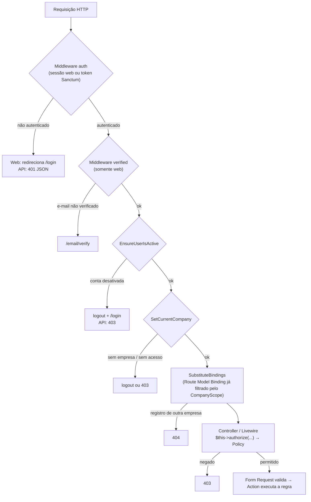
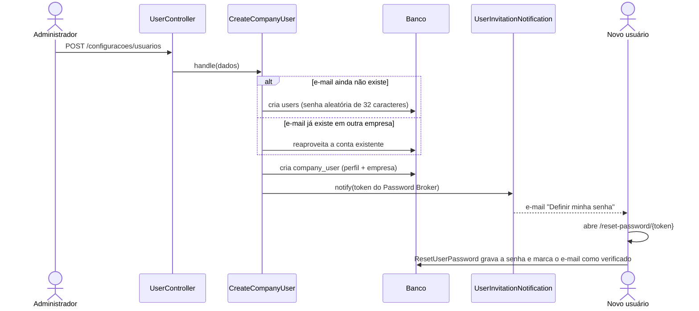
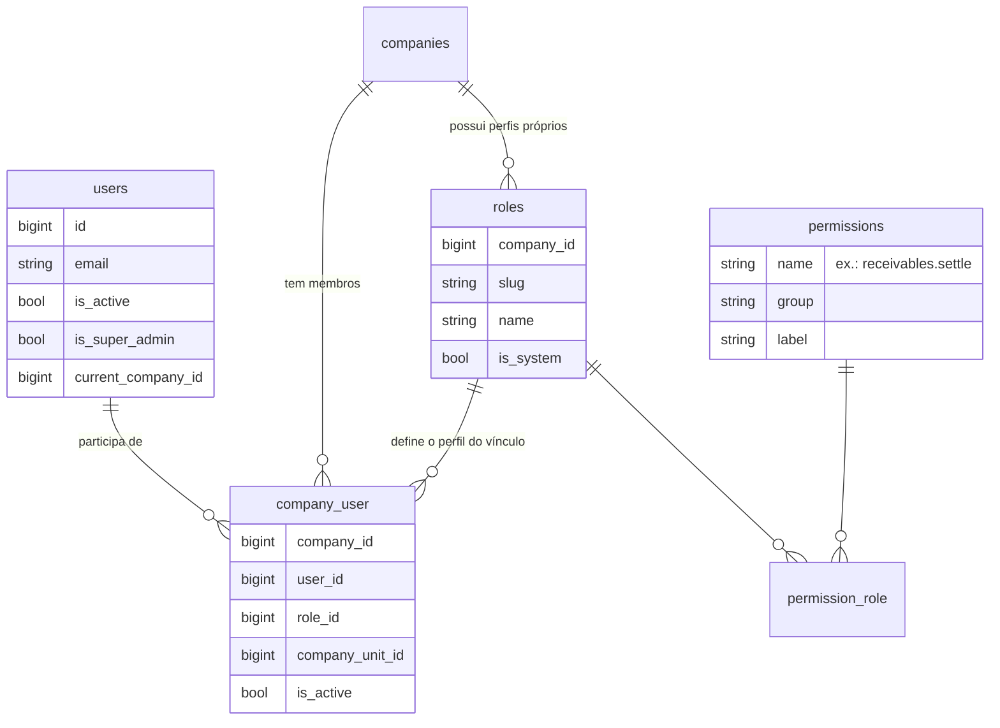

# 07 — Autenticação e permissões

Este documento explica **quem pode entrar** no Nexus ERP (autenticação) e **o que cada pessoa pode fazer** depois de entrar (autorização). São dois assuntos diferentes, e o Laravel tem ferramentas diferentes para cada um:

| Pergunta | Nome no Laravel | Onde fica no projeto |
|---|---|---|
| "Quem é você?" | **Authentication** (Fortify, Sanctum, Session) | `app/Providers/FortifyServiceProvider.php`, `config/fortify.php`, `app/Http/Controllers/Api/V1/AuthTokenController.php` |
| "Você pode fazer isso?" | **Authorization** (Gate, Policy) | `config/permissions.php`, `app/Models/User.php`, `app/Policies/*`, `app/Providers/AppServiceProvider.php` |
| "Isso pertence à sua empresa?" | **Global Scope** + Policy | `app/Models/Scopes/CompanyScope.php`, `app/Policies/TenantResourcePolicy.php` |

## Sumário

1. [Visão geral do fluxo de uma requisição](#1-visão-geral-do-fluxo-de-uma-requisição)
2. [Laravel Fortify: o backend de autenticação](#2-laravel-fortify-o-backend-de-autenticação)
3. [Login com bloqueio de contas inativas](#3-login-com-bloqueio-de-contas-inativas)
4. [Proteção contra força bruta (rate limit)](#4-proteção-contra-força-bruta-rate-limit)
5. [Verificação de e-mail](#5-verificação-de-e-mail)
6. [Recuperação de senha e convite de usuário](#6-recuperação-de-senha-e-convite-de-usuário)
7. [Sessões no banco e "encerrar outras sessões"](#7-sessões-no-banco-e-encerrar-outras-sessões)
8. [Middleware EnsureUserIsActive](#8-middleware-ensureuserisactive)
9. [Tokens de API com Laravel Sanctum](#9-tokens-de-api-com-laravel-sanctum)
10. [Modelo de permissões (perfis por empresa)](#10-modelo-de-permissões-perfis-por-empresa)
11. [Perfis padrão e matriz de permissões](#11-perfis-padrão-e-matriz-de-permissões)
12. [Superadministrador e Gate::before](#12-superadministrador-e-gatebefore)
13. [Policies](#13-policies)
14. [Como verificar permissões no código](#14-como-verificar-permissões-no-código)
15. [Isolamento por empresa e por que validar no backend](#15-isolamento-por-empresa-e-por-que-validar-no-backend)
16. [Checklist para quem for mexer nesta área](#16-checklist-para-quem-for-mexer-nesta-área)

---

## 1. Visão geral do fluxo de uma requisição

Toda requisição autenticada passa por várias camadas antes de chegar ao Controller ou ao componente Livewire. Entender essa ordem ajuda a saber **onde** colocar cada verificação.



A ordem dos middlewares é configurada em [`bootstrap/app.php`](../bootstrap/app.php):

```php
// bootstrap/app.php
$middleware->web(append: [
    EnsureUserIsActive::class,
    SetCurrentCompany::class,
]);

// A empresa ativa precisa ser definida ANTES do Route Model Binding,
// para que o CompanyScope filtre os models resolvidos pela URL.
$middleware->prependToPriorityList(before: SubstituteBindings::class, prepend: SetCurrentCompany::class);
$middleware->prependToPriorityList(before: SetCurrentCompany::class, prepend: EnsureUserIsActive::class);
```

Além desses, o middleware global [`SecurityHeaders`](../app/Http/Middleware/SecurityHeaders.php) (registrado com `$middleware->append(...)`) adiciona cabeçalhos de segurança a todas as respostas (`X-Frame-Options`, `X-Content-Type-Options`, `Referrer-Policy`, `Permissions-Policy` e, em produção com HTTPS, `Strict-Transport-Security`). O caminho completo de uma requisição é detalhado em [04 — Fluxo de uma requisição](04-fluxo-de-uma-requisicao.md).

> **Por que a prioridade importa?** O `SubstituteBindings` é o middleware que transforma `/clientes/15` em um objeto `Customer`. Se ele rodasse antes do `SetCurrentCompany`, o `CompanyScope` ainda não saberia qual é a empresa ativa e o cliente 15 de **outra** empresa seria carregado.

---

## 2. Laravel Fortify: o backend de autenticação

O [Laravel Fortify](https://laravel.com/docs/13.x/fortify) fornece as **rotas e controllers** de login, logout, recuperação de senha, verificação de e-mail, confirmação de senha e atualização de perfil/senha. Ele **não** fornece telas: o projeto usa telas Blade próprias em [`resources/views/auth`](../resources/views/auth).

### Features ativas

Em [`config/fortify.php`](../config/fortify.php):

```php
'features' => [
    Features::resetPasswords(),
    Features::emailVerification(),
    Features::updateProfileInformation(),
    Features::updatePasswords(),
],
```

| Feature | Ativa? | Observação |
|---|---|---|
| `registration()` (cadastro público) | **Não** | Usuários são criados por administradores, que enviam um convite. |
| `resetPasswords()` | Sim | `/forgot-password` e `/reset-password/{token}`. Também usada pelo convite. |
| `emailVerification()` | Sim | `/email/verify`. Rotas autenticadas exigem o middleware `verified`. |
| `updateProfileInformation()` | Sim | `PUT /user/profile-information` → `UpdateUserProfileInformation`. |
| `updatePasswords()` | Sim | `PUT /user/password` → `UpdateUserPassword`. |
| `twoFactorAuthentication()` / passkeys | Não | O Fortify suporta; veja o [roadmap](12-roadmap.md). |

Outras opções importantes do mesmo arquivo:

- `'username' => 'email'` e `'lowercase_usernames' => true`: o e-mail é o login e é normalizado para minúsculas.
- `'home' => '/dashboard'`: para onde o usuário vai depois do login.
- `'views' => true`: o Fortify registra as rotas `GET` das telas (que apontam para as views definidas no provider).

### Telas próprias

O [`FortifyServiceProvider`](../app/Providers/FortifyServiceProvider.php) diz ao Fortify qual view Blade usar em cada tela e quais classes executam cada ação:

```php
// app/Providers/FortifyServiceProvider.php
Fortify::updateUserProfileInformationUsing(UpdateUserProfileInformation::class);
Fortify::updateUserPasswordsUsing(UpdateUserPassword::class);
Fortify::resetUserPasswordsUsing(ResetUserPassword::class);

Fortify::loginView(fn () => view('auth.login'));
Fortify::requestPasswordResetLinkView(fn () => view('auth.forgot-password'));
Fortify::resetPasswordView(fn (Request $request) => view('auth.reset-password', ['request' => $request]));
Fortify::verifyEmailView(fn () => view('auth.verify-email'));
Fortify::confirmPasswordView(fn () => view('auth.confirm-password'));
```

As classes em [`app/Actions/Fortify`](../app/Actions/Fortify) são as "Actions" do Fortify (o nome é coincidência com as Actions de domínio do projeto, mas a ideia é a mesma: uma classe, uma operação).

> **Por que Fortify e não Breeze/Jetstream?** Os *starter kits* geram telas e componentes que passam a ser código do projeto. O Fortify entrega apenas o backend testado e mantido pelo Laravel, deixando as telas 100% sob controle do projeto (layout próprio, português, Tailwind). Veja a decisão completa em [11 — Decisões de arquitetura](11-decisoes-de-arquitetura.md).

---

## 3. Login com bloqueio de contas inativas

Por padrão, o Fortify autentica qualquer usuário cuja senha confira. O projeto **substitui** essa lógica com `Fortify::authenticateUsing()` para também exigir que a conta esteja ativa:

```php
// app/Providers/FortifyServiceProvider.php
Fortify::authenticateUsing(function (Request $request): ?User {
    $user = User::query()->where('email', mb_strtolower((string) $request->input('email')))->first();

    if ($user === null || ! Hash::check((string) $request->input('password'), $user->password)) {
        return null;
    }

    if (! $user->is_active) {
        throw ValidationException::withMessages([
            Fortify::username() => 'Sua conta está desativada. Procure o administrador do sistema.',
        ]);
    }

    return $user;
});
```

Pontos didáticos:

- Retornar `null` faz o Fortify responder com a mensagem genérica de "credenciais inválidas" (não revelamos se o e-mail existe).
- A conta desativada só recebe a mensagem específica **depois** de a senha conferir — assim um atacante não descobre quais contas existem.
- Depois do login, o Listener [`RecordSuccessfulLogin`](../app/Listeners/RecordSuccessfulLogin.php) ouve o Event nativo `Illuminate\Auth\Events\Login` e grava `last_login_at` e `last_login_ip` (usados na gestão de usuários).

Há **dois níveis** de desativação, implementados em [`ToggleUserAccess`](../app/Actions/Users/ToggleUserAccess.php):

| Nível | Coluna | Quem pode | Efeito |
|---|---|---|---|
| Vínculo com uma empresa | `company_user.is_active` | Quem tem `users.deactivate` na empresa | O usuário perde o acesso **àquela** empresa. |
| Conta inteira | `users.is_active` | Somente superadministrador (`scope=global`) | O login é bloqueado em todas as empresas. |

Ao desativar a **conta**, `revokeAccess()` apaga as sessões do usuário na tabela `sessions` e todos os seus tokens Sanctum, para que o bloqueio tenha efeito imediato. Ao desativar só o **vínculo**, a revogação acontece apenas se a pessoa não tiver outra empresa ativa: o acesso à empresa bloqueada já é negado na requisição seguinte (o middleware `SetCurrentCompany` só aceita vínculos ativos), sem derrubar o trabalho dela nas demais empresas.

---

## 4. Proteção contra força bruta (rate limit)

O Fortify usa um *rate limiter* chamado `login` (configurado em `config/fortify.php` → `'limiters' => ['login' => 'login']`). O projeto define esse limitador no provider:

```php
// app/Providers/FortifyServiceProvider.php
RateLimiter::for('login', function (Request $request) {
    $throttleKey = Str::transliterate(Str::lower($request->input(Fortify::username())).'|'.$request->ip());

    return Limit::perMinute(5)->by($throttleKey);
});
```

- **5 tentativas por minuto** por combinação **e-mail + IP**. A sexta tentativa recebe HTTP 429.
- A chave combina os dois para não bloquear um escritório inteiro (mesmo IP) por causa de um único usuário, e para não permitir que um atacante teste milhares de senhas de um único e-mail.
- A emissão de tokens da API tem um limitador equivalente (`api-token`, também 5/min) — veja a [seção 9](#9-tokens-de-api-com-laravel-sanctum).

O teste `limita tentativas excessivas de login` em [`tests/Feature/Auth/AuthenticationTest.php`](../tests/Feature/Auth/AuthenticationTest.php) prova esse comportamento.

---

## 5. Verificação de e-mail

1. O Model [`User`](../app/Models/User.php) implementa o contrato `MustVerifyEmail`.
2. A feature `Features::emailVerification()` registra as rotas `/email/verify`, `/email/verify/{id}/{hash}` e `POST /email/verification-notification`.
3. Todas as rotas da aplicação estão no grupo `Route::middleware(['auth', 'verified'])` em [`routes/web.php`](../routes/web.php). O middleware `verified` redireciona quem não verificou para `/email/verify`.

Quando o próprio usuário altera o e-mail no perfil, [`UpdateUserProfileInformation`](../app/Actions/Fortify/UpdateUserProfileInformation.php) zera `email_verified_at` e envia um novo link:

```php
$user->forceFill([
    // ...
    'email_verified_at' => $emailChanged ? null : $user->email_verified_at,
])->save();

if ($emailChanged && $user instanceof MustVerifyEmail) {
    $user->sendEmailVerificationNotification();
}
```

> **Por quê?** Sem isso, alguém poderia trocar o e-mail da conta para um endereço que não controla (ou que pertence a outra pessoa) e continuar usando o sistema.

---

## 6. Recuperação de senha e convite de usuário

### Recuperação de senha ("Esqueci minha senha")

Fluxo padrão do Fortify: `GET /forgot-password` → `POST /forgot-password` (envia o link) → `GET /reset-password/{token}` → `POST /reset-password`. O link expira em 60 minutos (`config/auth.php` → `passwords.users.expire`), e o comando `auth:clear-resets` agendado em [`routes/console.php`](../routes/console.php) limpa tokens vencidos diariamente.

### Convite de novo usuário

O cadastro público está desativado. Quem cria usuários é um administrador da empresa, pela tela **Configurações → Usuários**, que chama a Action [`CreateCompanyUser`](../app/Actions/Users/CreateCompanyUser.php):



Trechos importantes:

```php
// app/Actions/Users/CreateCompanyUser.php
$user = User::create([
    // ...
    'password' => Str::password(32),
    'current_company_id' => $company->id,
]);
// ...
if ($isNewUser && ($data['send_invitation'] ?? true)) {
    $user->notify(new UserInvitationNotification($company, Password::broker()->createToken($user)));
}
```

```php
// app/Notifications/UserInvitationNotification.php
$url = route('password.reset', ['token' => $this->token, 'email' => $notifiable->getEmailForPasswordReset()]);
```

O convite **reaproveita o mecanismo de redefinição de senha**: o token é criado pelo mesmo `Password::broker()` e a tela é a mesma `auth.reset-password`. E a Action [`ResetUserPassword`](../app/Actions/Fortify/ResetUserPassword.php) marca o e-mail como verificado:

```php
// app/Actions/Fortify/ResetUserPassword.php
$user->forceFill([
    'password' => Hash::make($input['password']),
    'email_verified_at' => $user->email_verified_at ?? now(),
])->save();
```

> **Por quê?** O link só chega a quem tem acesso à caixa de e-mail; concluir o fluxo já prova que o e-mail é dessa pessoa. Assim o usuário convidado não precisa verificar o e-mail duas vezes, e **nenhum administrador conhece ou envia a senha de outra pessoa**.

A notificação implementa `ShouldQueue`: o envio do e-mail roda na fila (Redis em desenvolvimento), não atrasando a resposta da tela. Se o administrador desmarcar "enviar convite", o usuário pode usar "Esqueci minha senha" depois — o efeito é o mesmo.

---

## 7. Sessões no banco e "encerrar outras sessões"

O `.env.example` define `SESSION_DRIVER=database` (e `SESSION_ENCRYPT=true`). Com isso, cada sessão fica na tabela `sessions` com `user_id`, `ip_address`, `user_agent` e `last_activity`. Isso permite duas funcionalidades no perfil ([`ProfileController`](../app/Http/Controllers/ProfileController.php)):

1. **Listar as sessões ativas** do usuário (navegador, sistema, IP, última atividade e qual é a sessão atual).
2. **Encerrar as sessões em outros dispositivos**, exigindo a senha atual:

```php
// app/Http/Controllers/ProfileController.php
public function destroyOtherSessions(Request $request): RedirectResponse
{
    $request->validate(['password' => ['required', 'current_password']]);

    Auth::logoutOtherDevices($request->input('password'));

    DB::table('sessions')
        ->where('user_id', $request->user()->id)
        ->where('id', '!=', $request->session()->getId())
        ->delete();

    return back()->with('success', 'Sessões em outros dispositivos foram encerradas.');
}
```

`Auth::logoutOtherDevices()` invalida o hash de senha das outras sessões; apagar as linhas da tabela garante que elas somem da lista na hora. A exigência de senha impede que alguém que encontrou o computador desbloqueado derrube a sessão do dono legítimo.

> Com sessões em arquivo ou cookie, não haveria como listar nem apagar sessões de outros dispositivos. Veja o ADR "Sessões no banco" em [11 — Decisões de arquitetura](11-decisoes-de-arquitetura.md).

---

## 8. Middleware EnsureUserIsActive

O login já bloqueia contas inativas, mas e se a conta for desativada **enquanto** o usuário navega? O middleware [`EnsureUserIsActive`](../app/Http/Middleware/EnsureUserIsActive.php) roda em toda requisição web e API:

```php
// app/Http/Middleware/EnsureUserIsActive.php
if ($user === null || $user->is_active) {
    return $next($request);
}

if ($request->expectsJson()) {
    $user->currentAccessToken()?->delete();

    return response()->json(['message' => 'Sua conta está desativada.'], Response::HTTP_FORBIDDEN);
}

Auth::guard('web')->logout();
$request->session()->invalidate();
$request->session()->regenerateToken();

return redirect()->route('login')->withErrors(['email' => 'Sua conta está desativada. Procure o administrador.']);
```

Logo depois roda o [`SetCurrentCompany`](../app/Http/Middleware/SetCurrentCompany.php), que faz algo parecido para o **vínculo com a empresa**: se o usuário não tiver mais nenhuma empresa ativa acessível, ele é desconectado (web) ou recebe 403 (API).

---

## 9. Tokens de API com Laravel Sanctum

A API REST (`/api/v1`) usa **tokens pessoais** do [Laravel Sanctum](https://laravel.com/docs/13.x/sanctum). O Model `User` usa o trait `HasApiTokens`, e os tokens ficam na tabela `personal_access_tokens` (somente o **hash** do token é gravado).

Há duas formas de obter um token:

### a) Pela interface (perfil do usuário)

Em **Meu perfil → Tokens de acesso à API**, o usuário informa um nome e a validade (30, 90 ou 365 dias, ou sem expiração):

```php
// app/Http/Controllers/ProfileController.php
$expiresAt = isset($validated['expires_in_days']) ? now()->addDays((int) $validated['expires_in_days']) : null;
$token = $request->user()->createToken($validated['token_name'], ['*'], $expiresAt);

return back()->with('plain_token', $token->plainTextToken)->with('success', 'Token criado. Copie-o agora: ele não será exibido novamente.');
```

O valor completo aparece **uma única vez** (flash na sessão). Depois, só é possível revogar.

### b) Pelo endpoint da API

`POST /api/v1/auth/token` com `email`, `password` e `device_name` ([`AuthTokenController`](../app/Http/Controllers/Api/V1/AuthTokenController.php)):

```php
// app/Http/Controllers/Api/V1/AuthTokenController.php
if (! $user->is_active) {
    throw ValidationException::withMessages(['email' => 'Sua conta está desativada.']);
}

if ($user->accessibleCompanies()->isEmpty()) {
    throw ValidationException::withMessages(['email' => 'Seu usuário não está vinculado a nenhuma empresa ativa.']);
}

$token = $user->createToken($credentials['device_name'], ['*'], now()->addDays(30));
```

- Tokens emitidos por esse endpoint expiram em **30 dias**.
- O endpoint tem rate limit próprio: **5 por minuto** por e-mail + IP (limitador `api-token` no `AppServiceProvider`).
- `DELETE /api/v1/auth/token` revoga o token usado na requisição; `GET /api/v1/me` devolve o usuário, as empresas acessíveis e as permissões na empresa ativa.
- O comando `sanctum:prune-expired --hours=48`, agendado diariamente, remove tokens expirados.

Os tokens são criados com a habilidade `['*']`: o Sanctum não restringe nada por si só — **as permissões efetivas são as do perfil do usuário na empresa**, verificadas pelas mesmas Policies da web. Detalhes completos em [13 — API](13-api.md).

---

## 10. Modelo de permissões (perfis por empresa)

O projeto **não usa** pacotes como `spatie/laravel-permission`. O modelo é próprio porque o perfil de uma pessoa **depende da empresa**: a mesma Maria pode ser "Financeiro" na empresa A e "Gerente" na empresa B (veja o ADR correspondente em [11 — Decisões de arquitetura](11-decisoes-de-arquitetura.md)).



| Tabela / Model | Papel |
|---|---|
| `permissions` / [`Permission`](../app/Models/Permission.php) | Catálogo **global** de permissões no formato `recurso.ação`. |
| `roles` / [`Role`](../app/Models/Role.php) | Perfis **de cada empresa** (usa `BelongsToCompany`). Cada empresa pode customizar os seus. |
| `permission_role` | Quais permissões cada perfil tem. |
| `company_user` / [`CompanyMembership`](../app/Models/CompanyMembership.php) | Vínculo usuário ↔ empresa, com **um** perfil, a unidade e se o vínculo está ativo. É um *Pivot model* customizado. |

### A fonte da verdade: `config/permissions.php`

[`config/permissions.php`](../config/permissions.php) tem duas chaves:

- `groups`: todas as permissões, agrupadas por módulo (o agrupamento aparece na tela de perfis);
- `roles`: os perfis padrão criados para cada nova empresa; `['*']` significa "todas".

```php
// config/permissions.php (trecho)
'Financeiro' => [
    'receivables.view' => 'Visualizar contas a receber',
    'receivables.create' => 'Lançar contas a receber',
    // ...
    'receivables.settle' => 'Registrar recebimentos',
    'payments.reverse' => 'Estornar pagamentos e transferências',
],
```

### Sincronizando com o banco: `PermissionSeeder`

O [`PermissionSeeder`](../database/seeders/PermissionSeeder.php) é **idempotente** (pode rodar quantas vezes quiser): cria/atualiza cada permissão com `updateOrCreate` e **apaga** as que saíram do arquivo.

```bash
php artisan db:seed --class=PermissionSeeder
```

### Criando os perfis de uma empresa: `ProvisionCompanyDefaults`

Quando uma empresa é criada ([`CreateCompany`](../app/Actions/Companies/CreateCompany.php)), a Action [`ProvisionCompanyDefaults`](../app/Actions/Companies/ProvisionCompanyDefaults.php) cria os perfis padrão:

```php
// app/Actions/Companies/ProvisionCompanyDefaults.php
// Na primeira criação aplica o padrão; perfis já existentes mantêm
// as customizações da empresa (exceto o administrador, sempre completo).
if ($role->wasRecentlyCreated || $role->slug === Role::COMPANY_ADMIN) {
    $role->permissions()->sync($permissionIds);
}
```

> **Ao adicionar uma permissão nova:** o `PermissionSeeder` cria a permissão e a adiciona ao perfil "Administrador da empresa" de todas as empresas existentes. Os demais perfis (que podem ter sido personalizados) não são alterados: atribua pela tela de perfis. O tutorial [09 — Como adicionar uma funcionalidade](09-como-adicionar-uma-funcionalidade.md) mostra como.

### Como a permissão é verificada: `User::permissionsFor()` e `hasPermission()`

```php
// app/Models/User.php
public function permissionsFor(int $companyId): array
{
    return $this->permissionCache[$companyId] ??= DB::table('company_user')
        ->join('permission_role', 'permission_role.role_id', '=', 'company_user.role_id')
        ->join('permissions', 'permissions.id', '=', 'permission_role.permission_id')
        ->where('company_user.user_id', $this->id)
        ->where('company_user.company_id', $companyId)
        ->where('company_user.is_active', true)
        ->pluck('permissions.name')
        ->all();
}

public function hasPermission(string $permission, ?int $companyId = null): bool
{
    if ($this->isSuperAdmin()) {
        return true;
    }

    $companyId ??= app(CurrentCompany::class)->id();

    return $companyId !== null && in_array($permission, $this->permissionsFor($companyId), true);
}
```

- **Uma única consulta** com JOINs traz todas as permissões do usuário na empresa.
- O resultado fica em cache **na memória do objeto** (`$permissionCache`), durante a requisição. Não há cache em Redis: alterar um perfil vale a partir da próxima requisição. Se for preciso, dentro da mesma requisição, use `flushPermissionCache()` (o teste `alterar as permissões do perfil muda o acesso imediatamente` faz isso).
- Vínculo desativado (`company_user.is_active = false`) = nenhuma permissão.

---

## 11. Perfis padrão e matriz de permissões

| Slug | Nome | Descrição (do config) | Qtd. de permissões |
|---|---|---|---|
| `company-admin` | Administrador da empresa | Acesso total aos módulos e à administração da empresa. | todas (71) |
| `manager` | Gerente | Gestão operacional, comercial e financeira, sem administrar usuários e perfis. | 60 |
| `sales` | Comercial | Clientes, CRM, propostas e criação de contratos. | 26 |
| `finance` | Financeiro | Contas a receber e a pagar, contas financeiras e fluxo de caixa. | 24 |
| `support` | Atendimento | Chamados, ordens de serviço e consulta de clientes e contratos. | 12 |
| `collaborator` | Colaborador | Execução de ordens de serviço e atendimento básico. | 8 |

Os usuários de demonstração (somente em desenvolvimento, senha `Nexus@2026`) cobrem cada perfil: `admin@verticeti.local`, `gerente@verticeti.local`, `comercial@verticeti.local`, `financeiro@verticeti.local`, `atendimento@verticeti.local`, `colaborador@verticeti.local` e o superadministrador `admin@nexuserp.local`.

### Matriz completa (gerada a partir de `config/permissions.php`)

| Permissão | Descrição | `company-admin` | `manager` | `sales` | `finance` | `support` | `collaborator` |
|---|---|---|---|---|---|---|---|
| **Geral** | | | | | | | |
| `dashboard.view` | Visualizar dashboard | ✅ | ✅ | ✅ | ✅ | ✅ | ✅ |
| `reports.commercial` | Relatórios comerciais | ✅ | ✅ | ✅ | — | — | — |
| `reports.financial` | Relatórios financeiros | ✅ | ✅ | — | ✅ | — | — |
| `reports.operational` | Relatórios operacionais | ✅ | ✅ | — | — | ✅ | — |
| **Administração** | | | | | | | |
| `settings.manage` | Gerenciar configurações da empresa | ✅ | — | — | — | — | — |
| `units.view` | Visualizar unidades | ✅ | ✅ | — | — | — | — |
| `units.manage` | Gerenciar unidades | ✅ | — | — | — | — | — |
| `users.view` | Visualizar usuários | ✅ | ✅ | — | — | — | — |
| `users.create` | Cadastrar usuários | ✅ | — | — | — | — | — |
| `users.update` | Editar usuários | ✅ | — | — | — | — | — |
| `users.deactivate` | Ativar/desativar usuários | ✅ | — | — | — | — | — |
| `roles.view` | Visualizar perfis de acesso | ✅ | ✅ | — | — | — | — |
| `roles.manage` | Gerenciar perfis e permissões | ✅ | — | — | — | — | — |
| `audit.view` | Consultar auditoria | ✅ | ✅ | — | — | — | — |
| **Clientes e fornecedores** | | | | | | | |
| `customers.view` | Visualizar clientes | ✅ | ✅ | ✅ | ✅ | ✅ | ✅ |
| `customers.create` | Cadastrar clientes | ✅ | ✅ | ✅ | — | — | — |
| `customers.update` | Editar clientes | ✅ | ✅ | ✅ | — | ✅ | — |
| `customers.delete` | Excluir clientes | ✅ | ✅ | — | — | — | — |
| `customers.export` | Exportar clientes | ✅ | ✅ | ✅ | — | — | — |
| `suppliers.view` | Visualizar fornecedores | ✅ | ✅ | — | ✅ | — | — |
| `suppliers.create` | Cadastrar fornecedores | ✅ | ✅ | — | ✅ | — | — |
| `suppliers.update` | Editar fornecedores | ✅ | ✅ | — | ✅ | — | — |
| `suppliers.delete` | Excluir fornecedores | ✅ | — | — | — | — | — |
| `suppliers.export` | Exportar fornecedores | ✅ | ✅ | — | ✅ | — | — |
| **CRM** | | | | | | | |
| `leads.view` | Visualizar leads | ✅ | ✅ | ✅ | — | — | — |
| `leads.create` | Cadastrar leads | ✅ | ✅ | ✅ | — | — | — |
| `leads.update` | Editar leads | ✅ | ✅ | ✅ | — | — | — |
| `leads.delete` | Excluir leads | ✅ | ✅ | ✅ | — | — | — |
| `leads.convert` | Converter leads em clientes | ✅ | ✅ | ✅ | — | — | — |
| `opportunities.view` | Visualizar oportunidades | ✅ | ✅ | ✅ | — | — | — |
| `opportunities.create` | Cadastrar oportunidades | ✅ | ✅ | ✅ | — | — | — |
| `opportunities.update` | Editar e mover oportunidades | ✅ | ✅ | ✅ | — | — | — |
| `opportunities.delete` | Excluir oportunidades | ✅ | ✅ | ✅ | — | — | — |
| `crm.configure` | Configurar funil e origens | ✅ | ✅ | — | — | — | — |
| **Catálogo** | | | | | | | |
| `catalog.view` | Visualizar catálogo | ✅ | ✅ | ✅ | — | ✅ | ✅ |
| `catalog.create` | Cadastrar itens | ✅ | ✅ | — | — | — | — |
| `catalog.update` | Editar itens | ✅ | ✅ | — | — | — | — |
| `catalog.delete` | Excluir itens | ✅ | — | — | — | — | — |
| **Propostas e contratos** | | | | | | | |
| `proposals.view` | Visualizar propostas | ✅ | ✅ | ✅ | — | — | — |
| `proposals.create` | Criar propostas | ✅ | ✅ | ✅ | — | — | — |
| `proposals.update` | Editar propostas | ✅ | ✅ | ✅ | — | — | — |
| `proposals.delete` | Excluir propostas | ✅ | ✅ | ✅ | — | — | — |
| `proposals.approve` | Enviar, aprovar e recusar propostas | ✅ | ✅ | ✅ | — | — | — |
| `contracts.view` | Visualizar contratos | ✅ | ✅ | ✅ | ✅ | ✅ | — |
| `contracts.create` | Criar contratos | ✅ | ✅ | ✅ | — | — | — |
| `contracts.update` | Editar contratos | ✅ | ✅ | — | — | — | — |
| `contracts.manage` | Ativar, suspender, renovar e cancelar contratos | ✅ | ✅ | — | — | — | — |
| **Operações** | | | | | | | |
| `service_orders.view` | Visualizar ordens de serviço | ✅ | ✅ | ✅ | — | ✅ | ✅ |
| `service_orders.create` | Abrir ordens de serviço | ✅ | ✅ | — | — | ✅ | — |
| `service_orders.update` | Atualizar ordens de serviço | ✅ | ✅ | — | — | ✅ | ✅ |
| `service_orders.delete` | Excluir ordens de serviço | ✅ | ✅ | — | — | — | — |
| `tickets.view` | Visualizar chamados | ✅ | ✅ | ✅ | — | ✅ | ✅ |
| `tickets.create` | Abrir chamados | ✅ | ✅ | ✅ | — | ✅ | ✅ |
| `tickets.update` | Atender e atualizar chamados | ✅ | ✅ | — | — | ✅ | ✅ |
| `tickets.delete` | Excluir chamados | ✅ | ✅ | — | — | — | — |
| **Financeiro** | | | | | | | |
| `receivables.view` | Visualizar contas a receber | ✅ | ✅ | — | ✅ | — | — |
| `receivables.create` | Lançar contas a receber | ✅ | ✅ | — | ✅ | — | — |
| `receivables.update` | Editar contas a receber | ✅ | ✅ | — | ✅ | — | — |
| `receivables.cancel` | Cancelar contas a receber | ✅ | ✅ | — | ✅ | — | — |
| `receivables.settle` | Registrar recebimentos | ✅ | ✅ | — | ✅ | — | — |
| `payables.view` | Visualizar contas a pagar | ✅ | ✅ | — | ✅ | — | — |
| `payables.create` | Lançar contas a pagar | ✅ | ✅ | — | ✅ | — | — |
| `payables.update` | Editar contas a pagar | ✅ | ✅ | — | ✅ | — | — |
| `payables.cancel` | Cancelar contas a pagar | ✅ | ✅ | — | ✅ | — | — |
| `payables.settle` | Registrar pagamentos | ✅ | ✅ | — | ✅ | — | — |
| `payments.reverse` | Estornar pagamentos e transferências | ✅ | — | — | ✅ | — | — |
| `accounts.view` | Visualizar contas financeiras e extratos | ✅ | ✅ | — | ✅ | — | — |
| `accounts.manage` | Gerenciar contas financeiras e lançamentos avulsos | ✅ | — | — | ✅ | — | — |
| `transfers.create` | Transferir entre contas | ✅ | ✅ | — | ✅ | — | — |
| `cash_flow.view` | Visualizar fluxo de caixa | ✅ | ✅ | — | ✅ | — | — |
| `finance.configure` | Configurar categorias, centros de custo e recorrências | ✅ | — | — | ✅ | — | — |

Repare em algumas escolhas de negócio que a matriz revela:

- O **Gerente** não estorna pagamentos (`payments.reverse`) nem gerencia contas financeiras: operações que alteram o caixa ficam com o Financeiro e o Administrador (segregação de funções).
- O **Comercial** cria contratos (`contracts.create`, necessário para converter proposta), mas não os ativa/cancela (`contracts.manage`).
- O **Colaborador** atualiza OS e chamados, mas não abre OS nem vê propostas ou o financeiro.

O perfil "Administrador da empresa" não pode ser editado pela tela (a [`RolePolicy`](../app/Policies/RolePolicy.php) bloqueia), para que a empresa nunca perca o acesso administrativo. Perfis do sistema (`is_system = true`) não podem ser excluídos. Perfis personalizados (ex.: "Estagiário") podem ser criados em **Configurações → Perfis de acesso**.

---

## 12. Superadministrador e Gate::before

O superadministrador **não é um perfil**: é a flag `users.is_super_admin`. Ele administra a plataforma (cadastro de empresas em `/admin/empresas`) e enxerga todas as empresas não inativas.

A regra está em `configureAuthorization()` no [`AppServiceProvider`](../app/Providers/AppServiceProvider.php):

```php
// app/Providers/AppServiceProvider.php
Gate::before(function (User $user, string $ability, array $arguments): ?bool {
    if ($user->isSuperAdmin()) {
        return true;
    }

    // Habilidades no formato "recurso.acao" sem model associado
    // (ex.: @can('reports.financial')) são verificadas direto na
    // lista de permissões do perfil do usuário na empresa ativa.
    if ($arguments === [] && str_contains($ability, '.')) {
        return $user->hasPermission($ability);
    }

    return null;
});
```

O `Gate::before` roda **antes** de qualquer Policy. Ele tem três respostas possíveis:

| Retorno | Significado |
|---|---|
| `true` | Permite, sem consultar a Policy (superadministrador). |
| `true`/`false` de `hasPermission()` | Para habilidades com ponto e sem argumentos, como `'reports.financial'`, `'transfers.create'`, `'catalog.update'`. |
| `null` | "Não decidi" — o Laravel segue para a Policy do Model (ex.: `CustomerPolicy::update`). |

Esse segundo caso é um atalho muito usado no projeto: não é preciso registrar um `Gate::define()` para cada permissão. Exemplos reais:

```php
// app/Http/Controllers/Finance/TransferController.php
$this->authorize('transfers.create');

// app/Livewire/Finance/CashFlow.php
$this->authorize('cash_flow.view');

// app/Http/Controllers/Api/V1/DashboardController.php
$this->authorize('dashboard.view');
```

```blade
{{-- resources/views/livewire/catalog/catalog-index.blade.php --}}
@can('catalog.update')
    <x-ui.button variant="secondary" icon="squares" :href="route('catalog.categories')">Categorias</x-ui.button>
@endcan
```

E a gestão de empresas da plataforma? A [`CompanyPolicy`](../app/Policies/CompanyPolicy.php) **nega** `viewAny`, `create` e `delete` para todo mundo. Como o `Gate::before` devolve `true` para o superadministrador antes da Policy ser consultada, só ele passa. É uma forma elegante de dizer "somente o superadministrador" sem espalhar `if ($user->isSuperAdmin())` pelo código.

---

## 13. Policies

Uma [Policy](https://laravel.com/docs/13.x/authorization#creating-policies) agrupa as regras de autorização de **um Model**. O Laravel descobre a Policy automaticamente pelo nome (`App\Models\Customer` → `App\Policies\CustomerPolicy`); por isso o projeto não registra Policies manualmente.

### A base: `TenantResourcePolicy`

Quase todas as Policies estendem [`TenantResourcePolicy`](../app/Policies/TenantResourcePolicy.php), que implementa o CRUD padrão a partir de um **prefixo de permissão**:

```php
// app/Policies/TenantResourcePolicy.php
abstract class TenantResourcePolicy
{
    protected string $permission;

    public function viewAny(User $user): bool
    {
        return $user->hasPermission("{$this->permission}.view");
    }

    public function view(User $user, Model $model): bool
    {
        return $this->belongsToActiveCompany($model) && $user->hasPermission("{$this->permission}.view");
    }

    public function update(User $user, Model $model): bool
    {
        return $this->belongsToActiveCompany($model) && $user->hasPermission("{$this->permission}.update");
    }

    // create(), delete() e attach() seguem o mesmo padrão...

    protected function belongsToActiveCompany(Model $model): bool
    {
        $companyId = app(CurrentCompany::class)->id();

        return $companyId !== null && (int) $model->getAttribute('company_id') === $companyId;
    }
}
```

Uma Policy simples fica com **três linhas**:

```php
// app/Policies/CatalogItemPolicy.php
class CatalogItemPolicy extends TenantResourcePolicy
{
    protected string $permission = 'catalog';
}
```

> **Por que verificar `company_id` na Policy se o `CompanyScope` já filtra as consultas?** Defesa em profundidade. O Global Scope protege as consultas, mas um registro pode chegar por outro caminho (um relacionamento carregado sem escopo, um `withoutGlobalScopes()` esquecido, um job). A Policy é a segunda barreira, barata e explícita.

### Policies com regras extras

As Policies específicas sobrescrevem métodos ou adicionam **habilidades** (abilities) próprias:

| Policy | Prefixo | Particularidades |
|---|---|---|
| [`CustomerPolicy`](../app/Policies/CustomerPolicy.php) / [`SupplierPolicy`](../app/Policies/SupplierPolicy.php) | `customers` / `suppliers` | `export()` (exportação CSV). |
| [`LeadPolicy`](../app/Policies/LeadPolicy.php) | `leads` | `convert()`: exige `leads.convert` **e** que o lead ainda não tenha sido convertido. |
| [`ProposalPolicy`](../app/Policies/ProposalPolicy.php) | `proposals` | `update`/`delete` só em rascunho; `changeStatus()` exige `proposals.approve`; `convert()` exige `contracts.create`. |
| [`ContractPolicy`](../app/Policies/ContractPolicy.php) | `contracts` | `update` só se o status permitir edição; `delete` sempre `false` (contratos são cancelados/encerrados); `manage()` exige `contracts.manage`. |
| [`ReceivablePolicy`](../app/Policies/ReceivablePolicy.php) / [`PayablePolicy`](../app/Policies/PayablePolicy.php) | `receivables` / `payables` | `update` só sem pagamentos; `delete` sempre `false` (títulos são cancelados); `cancel()` e `settle()`. |
| [`PaymentPolicy`](../app/Policies/PaymentPolicy.php) / [`TransferPolicy`](../app/Policies/TransferPolicy.php) | `payments` / `transfers` | `reverse()`: exige `payments.reverse` e que ainda não tenha sido estornado. |
| [`FinancialAccountPolicy`](../app/Policies/FinancialAccountPolicy.php) | `accounts` | `create`/`update` exigem `accounts.manage`; `delete` sempre `false` (contas são inativadas). |
| [`RecurringExpensePolicy`](../app/Policies/RecurringExpensePolicy.php) | `payables` | `create`/`update`/`delete` exigem `finance.configure`. |
| [`CompanyUnitPolicy`](../app/Policies/CompanyUnitPolicy.php) | `units` | Escrita exige `units.manage`. |
| [`RolePolicy`](../app/Policies/RolePolicy.php) | `roles` | Não edita o perfil administrador; não exclui perfis do sistema. |
| [`UserPolicy`](../app/Policies/UserPolicy.php) | (própria) | Verifica se o usuário-alvo é membro da empresa ativa; não edita superadministrador; `toggleStatus()` impede desativar a si mesmo. |
| [`CompanyPolicy`](../app/Policies/CompanyPolicy.php) | (própria) | Nega tudo (só o superadministrador passa via `Gate::before`); `update` exige `settings.manage` na empresa ativa. |
| [`AttachmentPolicy`](../app/Policies/AttachmentPolicy.php) | (própria) | Delega para a Policy do registro "dono" do anexo (`view` e `attach`). |
| `ServiceOrderPolicy`, `TicketPolicy`, `OpportunityPolicy`, `CatalogItemPolicy` | vários | Apenas o padrão da base. |

A habilidade **`attach`** da base merece destaque: enviar anexos, registrar interações e tarefas exige a permissão de **edição** do recurso, mesmo quando o registro já não pode ser editado (ex.: anexar um comprovante a uma proposta aprovada).

Note também como regras de estado aparecem na Policy **e** na Action. Por exemplo, `ProposalPolicy::update()` exige rascunho (para esconder o botão "Editar") e [`SaveProposal`](../app/Actions/Proposals/SaveProposal.php) também lança `BusinessRuleException` se a proposta não for rascunho (para garantir a regra mesmo se a Action for chamada por outro caminho, como a API ou um teste).

---

## 14. Como verificar permissões no código

### Em Controllers: `$this->authorize()`

```php
// app/Http/Controllers/Catalog/CatalogItemController.php
public function update(CatalogItemRequest $request, CatalogItem $catalogItem): RedirectResponse
{
    $this->authorize('update', $catalogItem);   // → CatalogItemPolicy::update()

    $catalogItem->update($request->validated());
    // ...
}

public function create(): View
{
    $this->authorize('create', CatalogItem::class);   // sem instância: passa a classe
    // ...
}
```

Se a Policy negar, o Laravel lança `AuthorizationException`, que vira **403** (na API, com a mensagem "Você não tem permissão para executar esta ação.").

### Em componentes Livewire

O mesmo `authorize()` está disponível. Verifique no `mount()` (acesso à tela) **e em cada ação** (cada clique é uma nova requisição):

```php
// app/Livewire/Catalog/CatalogIndex.php
public function mount(): void
{
    $this->authorize('viewAny', CatalogItem::class);
}

public function delete(int $catalogItemId): void
{
    $catalogItem = CatalogItem::query()->findOrFail($catalogItemId);
    $this->authorize('delete', $catalogItem);
    // ...
}
```

### Nas views Blade: `@can` / `@cannot`

```blade
@can('create', \App\Models\CatalogItem::class)
    <x-ui.button icon="plus" :href="route('catalog.create')">Novo item</x-ui.button>
@endcan

@can('update', $item)
    <a href="{{ route('catalog.edit', $item) }}">Editar</a>
@endcan

@can('catalog.update')   {{-- habilidade "recurso.acao", resolvida pelo Gate::before --}}
    ...
@endcan
```

O menu lateral ([`layouts/partials/navigation.blade.php`](../resources/views/layouts/partials/navigation.blade.php)) usa `auth()->user()->can($permissao)` para mostrar somente os itens permitidos.

### Em código PHP qualquer

```php
$request->user()->can('settle', $receivable);       // via Policy
$user->hasPermission('receivables.view');            // direto na lista de permissões
$user->hasAnyPermission('reports.commercial', 'reports.financial');
Gate::forUser($user)->allows('view', $attachment->attachable);  // usado na AttachmentPolicy
```

### E o middleware `can:` nas rotas?

O Laravel permite `Route::get(...)->can('viewAny', Customer::class)`. **O projeto não usa essa forma** — a convenção (descrita no topo de [`routes/web.php`](../routes/web.php)) é autorizar dentro do Controller/Livewire, perto do código que usa o registro, porque várias regras dependem do estado do Model já carregado (status da proposta, título com pagamento etc.). Para manter a consistência, siga a convenção.

---

## 15. Isolamento por empresa e por que validar no backend

O Nexus ERP é **multiempresa**: várias empresas compartilham o mesmo banco. O isolamento acontece em camadas, e cada camada cobre uma brecha diferente:

| Camada | Arquivo | Protege contra |
|---|---|---|
| `SetCurrentCompany` | [`app/Http/Middleware/SetCurrentCompany.php`](../app/Http/Middleware/SetCurrentCompany.php) | Ativar uma empresa sem vínculo (inclusive via cabeçalho `X-Company-Id` na API → 403). |
| `CompanyScope` (Global Scope) | [`app/Models/Scopes/CompanyScope.php`](../app/Models/Scopes/CompanyScope.php) | Listar ou abrir registros de outra empresa (URL manipulada → **404**). |
| `BelongsToCompany` | [`app/Models/Concerns/BelongsToCompany.php`](../app/Models/Concerns/BelongsToCompany.php) | Criar registro sem empresa; mover registro para outra empresa. |
| Policies | `app/Policies/*` | Operar em registro de outra empresa que chegou por outro caminho. |
| Form Requests com `exists` restrito | ex.: [`ReceivableRequest`](../app/Http/Requests/Finance/ReceivableRequest.php) | Relacionar um ID de outra empresa em um formulário (ex.: `customer_id` de outra empresa). |

Exemplo da última camada — repare no `->where('company_id', $companyId)`:

```php
// app/Http/Requests/Finance/ReceivableRequest.php
'customer_id' => ['required', 'integer', Rule::exists('customers', 'id')->where('company_id', $companyId)->whereNull('deleted_at')],
// Se vinculado a um contrato, ele precisa ser do MESMO cliente.
'contract_id' => ['nullable', 'integer', Rule::exists('contracts', 'id')->where('company_id', $companyId)->where('customer_id', (int) $this->input('customer_id'))],
```

> A regra `exists` faz uma consulta SQL direta (sem passar pelo Eloquent), então o `CompanyScope` **não** se aplica a ela. Por isso o filtro por `company_id` precisa ser escrito explicitamente em toda regra `exists`/`unique`.

### Por que esconder o botão não basta

O comentário no topo do menu lateral resume a regra de ouro do projeto:

```blade
{{--
    Menu lateral. Cada item só aparece se o usuário tiver a permissão
    correspondente (@can) — mas a proteção REAL está nas rotas e Policies:
    esconder um link não impede o acesso direto pela URL.
--}}
```

Qualquer pessoa pode digitar uma URL, reenviar um formulário com o DevTools, chamar um método Livewire pelo console do navegador ou usar `curl` na API. **Toda verificação de interface é só conveniência; a segurança está no backend.** Os testes em [`tests/Feature/Authorization/RolePermissionTest.php`](../tests/Feature/Authorization/RolePermissionTest.php) e [`tests/Feature/Tenancy/CompanyIsolationTest.php`](../tests/Feature/Tenancy/CompanyIsolationTest.php) fazem exatamente isso: chamam as rotas diretamente com perfis sem permissão e com IDs de outra empresa, e esperam 403/404.

```php
// tests/Feature/Authorization/RolePermissionTest.php
it('perfil colaborador não cria clientes', function () {
    actingAsRole('collaborator', $this->company);

    $this->get('/clientes/create')->assertForbidden();
    $this->post('/clientes', ['name' => 'X', 'type' => 'company', 'document' => '11222333000181', 'status' => 'active'])->assertForbidden();
    expect(Customer::count())->toBe(0);
});
```

Por que **404** (e não 403) para registro de outra empresa? Porque o `CompanyScope` faz a consulta não encontrar o registro — e isso é desejável: responder 403 confirmaria que o ID existe em alguma empresa, vazando informação.

---

## 16. Checklist para quem for mexer nesta área

- [ ] Nova permissão? Adicione em `config/permissions.php` (grupo + perfis padrão) e rode `php artisan db:seed --class=PermissionSeeder`. O administrador das empresas existentes recebe a permissão automaticamente; os demais perfis, não.
- [ ] Novo Model multiempresa? Crie uma Policy estendendo `TenantResourcePolicy` com o prefixo da permissão.
- [ ] Toda action de Controller e de componente Livewire chama `$this->authorize(...)`.
- [ ] Toda regra `exists`/`unique` filtra por `company_id`.
- [ ] Botões e links da view usam `@can` com a **mesma** habilidade verificada no backend.
- [ ] Escreva um teste que tente a operação com um perfil sem permissão (espera 403) e com um registro de outra empresa (espera 404).

Leituras recomendadas na documentação oficial:

- [Authentication](https://laravel.com/docs/13.x/authentication) · [Fortify](https://laravel.com/docs/13.x/fortify) · [Email Verification](https://laravel.com/docs/13.x/verification) · [Resetting Passwords](https://laravel.com/docs/13.x/passwords)
- [Authorization (Gates e Policies)](https://laravel.com/docs/13.x/authorization) · [Sanctum](https://laravel.com/docs/13.x/sanctum) · [Rate Limiting](https://laravel.com/docs/13.x/rate-limiting) · [Session](https://laravel.com/docs/13.x/session)
