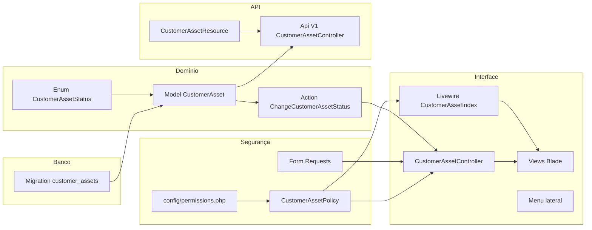

# 09 — Como adicionar uma funcionalidade (tutorial completo)

> **Importante:** este documento é um **tutorial**. O módulo "Ativos do cliente" descrito aqui **não existe no projeto** — ele serve de exemplo para você praticar. Todo o código abaixo segue exatamente os padrões do Nexus ERP e cita os arquivos reais que serviram de modelo, para você comparar.

Vamos construir, do banco de dados até a API, um cadastro de **Ativos do cliente**: equipamentos instalados nos clientes (servidores, notebooks, impressoras...), com nome, número de série, cliente, data de compra, garantia e status.

## Sumário

0. [Visão geral: o que vamos criar](#0-visão-geral-o-que-vamos-criar)
1. [Migration](#1-migration)
2. [Enum de status com máquina de estados](#2-enum-de-status-com-máquina-de-estados)
3. [Model](#3-model)
4. [Morph map (obrigatório) e rótulo da auditoria](#4-morph-map-obrigatório-e-rótulo-da-auditoria)
5. [Permissões e perfis](#5-permissões-e-perfis)
6. [Policy](#6-policy)
7. [Form Requests](#7-form-requests)
8. [Action (regra de negócio)](#8-action-regra-de-negócio)
9. [Controller](#9-controller)
10. [Componente Livewire de listagem](#10-componente-livewire-de-listagem)
11. [Views Blade](#11-views-blade)
12. [Rotas](#12-rotas)
13. [Item no menu](#13-item-no-menu)
14. [Factory](#14-factory)
15. [Testes Pest](#15-testes-pest)
16. [Endpoint de API (opcional)](#16-endpoint-de-api-opcional)
17. [Checklist final](#17-checklist-final)

---

## 0. Visão geral: o que vamos criar



| Arquivo novo | Baseado em (arquivo real) |
|---|---|
| `database/migrations/xxxx_create_customer_assets_table.php` | [`create_catalog_tables`](../database/migrations/2026_10_14_100500_create_catalog_tables.php), [`use_partial_unique_codes...`](../database/migrations/2026_10_15_090000_use_partial_unique_codes_for_catalog_and_units.php) |
| `app/Enums/CustomerAssetStatus.php` | [`ServiceOrderStatus`](../app/Enums/ServiceOrderStatus.php) |
| `app/Models/CustomerAsset.php` | [`CatalogItem`](../app/Models/CatalogItem.php), [`ServiceOrder`](../app/Models/ServiceOrder.php) |
| `app/Policies/CustomerAssetPolicy.php` | [`ContractPolicy`](../app/Policies/ContractPolicy.php) |
| `app/Http/Requests/Customers/CustomerAssetRequest.php` | [`CatalogItemRequest`](../app/Http/Requests/Catalog/CatalogItemRequest.php) |
| `app/Http/Requests/Customers/ChangeCustomerAssetStatusRequest.php` | [`ChangeServiceOrderStatusRequest`](../app/Http/Requests/Operations/ChangeServiceOrderStatusRequest.php) |
| `app/Actions/CustomerAssets/ChangeCustomerAssetStatus.php` | [`ChangeServiceOrderStatus`](../app/Actions/ServiceOrders/ChangeServiceOrderStatus.php) |
| `app/Http/Controllers/Customers/CustomerAssetController.php` | [`CatalogItemController`](../app/Http/Controllers/Catalog/CatalogItemController.php) |
| `app/Livewire/Customers/CustomerAssetIndex.php` | [`CatalogIndex`](../app/Livewire/Catalog/CatalogIndex.php) |
| `resources/views/customer-assets/*.blade.php` e `resources/views/livewire/customers/customer-asset-index.blade.php` | [`resources/views/catalog`](../resources/views/catalog), [`catalog-index.blade.php`](../resources/views/livewire/catalog/catalog-index.blade.php) |
| `database/factories/CustomerAssetFactory.php` | [`CatalogItemFactory`](../database/factories/CatalogItemFactory.php), [`ReceivableFactory`](../database/factories/ReceivableFactory.php) |
| `tests/Feature/Customers/CustomerAssetTest.php` | [`CustomerCrudTest`](../tests/Feature/Customers/CustomerCrudTest.php), [`CompanyIsolationTest`](../tests/Feature/Tenancy/CompanyIsolationTest.php) |
| `app/Http/Resources/V1/CustomerAssetResource.php` + `app/Http/Controllers/Api/V1/CustomerAssetController.php` | [`CatalogItemResource`](../app/Http/Resources/V1/CatalogItemResource.php), [`Api\V1\CatalogItemController`](../app/Http/Controllers/Api/V1/CatalogItemController.php) |

Arquivos existentes que vamos **editar**: `app/Providers/AppServiceProvider.php`, `config/morph-labels.php`, `config/permissions.php`, `app/Models/Customer.php`, `routes/web.php`, `routes/api.php` e `resources/views/layouts/partials/navigation.blade.php`.

> **Sempre que possível, gere os arquivos com o Artisan** (`php artisan make:...`) e depois substitua o conteúdo. Isso garante namespace e local corretos. Passe `--no-interaction` para não haver perguntas.

---

## 1. Migration

```bash
php artisan make:migration create_customer_assets_table --no-interaction
```

```php
<?php

use Illuminate\Database\Migrations\Migration;
use Illuminate\Database\Schema\Blueprint;
use Illuminate\Support\Facades\DB;
use Illuminate\Support\Facades\Schema;

/**
 * Ativos (equipamentos) instalados nos clientes.
 *
 * - company_id em toda tabela multiempresa (filtrada pelo CompanyScope).
 * - Número de série único por empresa apenas entre registros NÃO excluídos:
 *   índice UNIQUE PARCIAL do PostgreSQL (mesma regra do CPF/CNPJ de clientes).
 * - CHECK garante no banco que a garantia não termina antes da compra.
 */
return new class extends Migration
{
    public function up(): void
    {
        Schema::create('customer_assets', function (Blueprint $table) {
            $table->id();
            $table->foreignId('company_id')->constrained()->cascadeOnDelete();
            $table->foreignId('customer_id')->constrained()->restrictOnDelete();
            $table->string('name');
            $table->string('serial_number', 100);
            $table->string('manufacturer', 100)->nullable();
            $table->date('purchased_on')->nullable();
            $table->date('warranty_expires_on')->nullable();
            $table->string('status', 20)->default('active');
            $table->text('notes')->nullable();
            $table->timestamps();
            $table->softDeletes();

            $table->index(['company_id', 'status']);
            $table->index(['company_id', 'customer_id']);
            $table->index(['company_id', 'warranty_expires_on']);
        });

        DB::statement('CREATE UNIQUE INDEX customer_assets_company_serial_unique ON customer_assets (company_id, serial_number) WHERE deleted_at IS NULL');
        DB::statement('ALTER TABLE customer_assets ADD CONSTRAINT customer_assets_warranty_check CHECK (warranty_expires_on IS NULL OR purchased_on IS NULL OR warranty_expires_on >= purchased_on)');
    }

    public function down(): void
    {
        Schema::dropIfExists('customer_assets');
    }
};
```

Por que cada decisão:

| Decisão | Motivo |
|---|---|
| `company_id` + `cascadeOnDelete()` | Toda tabela de negócio é multiempresa. Se uma empresa for removida, seus dados vão junto. |
| `customer_id` + `restrictOnDelete()` | Impede apagar fisicamente um cliente que tem ativos (o cliente usa soft delete, então isso só protege contra exclusões manuais no banco). |
| Índices começando por `company_id` | Toda consulta passa pelo `CompanyScope` (`WHERE company_id = ?`); índices compostos com `company_id` na frente atendem às listagens filtradas por status, cliente e garantia. |
| `status` como `string(20)` | O valor vem de um Enum PHP (seção 2). String é legível no banco e fácil de evoluir (adicionar um status não exige alterar tipo de coluna). |
| UNIQUE **parcial** via `DB::statement` | O Schema Builder não cria índices parciais; o PostgreSQL permite `WHERE deleted_at IS NULL`, então um ativo excluído libera o número de série. |
| CHECK constraint | Última barreira: mesmo que alguém grave direto no banco, a regra "garantia ≥ compra" é garantida. A validação do Form Request dá a mensagem amigável; o CHECK garante a integridade. |
| `softDeletes()` | Registros excluídos somem das telas, mas o histórico (auditoria) continua apontando para eles. |

Rode a migration no banco de desenvolvimento: `php artisan migrate`.

---

## 2. Enum de status com máquina de estados

```bash
php artisan make:enum Enums/CustomerAssetStatus --no-interaction
```

```php
<?php

namespace App\Enums;

use App\Enums\Concerns\EnumHelpers;
use App\Enums\Concerns\HasStateMachine;

/**
 * Situação de um ativo instalado no cliente.
 *
 * transitions() define a máquina de estados: quais mudanças são permitidas
 * a partir de cada status. "Desativado" é final (sem transições).
 */
enum CustomerAssetStatus: string
{
    use EnumHelpers;
    use HasStateMachine;

    case Active = 'active';
    case InMaintenance = 'in_maintenance';
    case Retired = 'retired';

    public function label(): string
    {
        return match ($this) {
            self::Active => 'Em operação',
            self::InMaintenance => 'Em manutenção',
            self::Retired => 'Desativado',
        };
    }

    public function color(): string
    {
        return match ($this) {
            self::Active => 'green',
            self::InMaintenance => 'yellow',
            self::Retired => 'gray',
        };
    }

    public function transitions(): array
    {
        return match ($this) {
            self::Active => [self::InMaintenance, self::Retired],
            self::InMaintenance => [self::Active, self::Retired],
            self::Retired => [],
        };
    }
}
```

Os traits já existentes dão de graça:

- [`EnumHelpers`](../app/Enums/Concerns/EnumHelpers.php): `options()` (array `valor => rótulo` para `<select>`), `values()` e `color()`.
- [`HasStateMachine`](../app/Enums/Concerns/HasStateMachine.php): `canTransitionTo()` e `isFinal()`.

> Por que um Enum e não uma tabela de status? Os status mudam junto com o **código** (regras dependem deles), não com dados do usuário. O Enum dá autocompletar, impede valores inválidos (o cast do Eloquent lança erro) e concentra rótulo, cor e transições num só lugar.

---

## 3. Model

```bash
php artisan make:model CustomerAsset --no-interaction
```

```php
<?php

namespace App\Models;

use App\Enums\CustomerAssetStatus;
use App\Models\Concerns\Auditable;
use App\Models\Concerns\BelongsToCompany;
use App\Models\Concerns\HasStatusHistory;
use Database\Factories\CustomerAssetFactory;
use Illuminate\Database\Eloquent\Attributes\Fillable;
use Illuminate\Database\Eloquent\Builder;
use Illuminate\Database\Eloquent\Factories\HasFactory;
use Illuminate\Database\Eloquent\Model;
use Illuminate\Database\Eloquent\Relations\BelongsTo;
use Illuminate\Database\Eloquent\SoftDeletes;

/**
 * Equipamento instalado em um cliente (servidor, notebook, impressora...).
 *
 * Multiempresa (BelongsToCompany), auditado automaticamente (Auditable) e com
 * histórico de mudanças de status (HasStatusHistory).
 */
#[Fillable(['customer_id', 'name', 'serial_number', 'manufacturer', 'purchased_on', 'warranty_expires_on', 'status', 'notes'])]
class CustomerAsset extends Model
{
    /** @use HasFactory<CustomerAssetFactory> */
    use Auditable, BelongsToCompany, HasFactory, HasStatusHistory, SoftDeletes;

    protected function casts(): array
    {
        return [
            'status' => CustomerAssetStatus::class,
            'purchased_on' => 'date',
            'warranty_expires_on' => 'date',
        ];
    }

    /**
     * withTrashed(): o ativo continua mostrando o cliente mesmo que ele tenha sido excluído.
     *
     * @return BelongsTo<Customer, $this>
     */
    public function customer(): BelongsTo
    {
        return $this->belongsTo(Customer::class)->withTrashed();
    }

    public function isUnderWarranty(): bool
    {
        return $this->warranty_expires_on !== null && $this->warranty_expires_on->greaterThanOrEqualTo(today());
    }

    /**
     * @param  Builder<CustomerAsset>  $query
     */
    public function scopeSearch(Builder $query, ?string $term): void
    {
        $term = trim((string) $term);

        if ($term !== '') {
            $query->whereAny(['name', 'serial_number', 'manufacturer'], 'ilike', "%{$term}%");
        }
    }

    /**
     * @param  Builder<CustomerAsset>  $query
     */
    public function scopeUnderWarranty(Builder $query): void
    {
        $query->whereDate('warranty_expires_on', '>=', today());
    }

    /**
     * @param  Builder<CustomerAsset>  $query
     */
    public function scopeWarrantyExpired(Builder $query): void
    {
        $query->whereDate('warranty_expires_on', '<', today());
    }
}
```

O que cada peça faz:

| Peça | Efeito |
|---|---|
| `#[Fillable([...])]` | Atributo PHP 8 do Laravel 13 que substitui a propriedade `$fillable`: lista os campos aceitos em `create()`/`update()` em massa. **`company_id` fica de fora de propósito** — quem preenche é o trait `BelongsToCompany`. |
| `BelongsToCompany` | Aplica o `CompanyScope` (toda consulta filtra pela empresa ativa), preenche `company_id` ao criar e impede mover o registro de empresa. Veja [`BelongsToCompany`](../app/Models/Concerns/BelongsToCompany.php). |
| `Auditable` | Grava em `audit_logs` cada criação, alteração e exclusão, com valores antigos e novos. |
| `HasStatusHistory` | Relacionamento `statusChanges()` e método `recordStatusChange()`. |
| `casts()` | `status` vira `CustomerAssetStatus`; datas viram objetos Carbon. |
| `ilike` | Busca sem diferenciar maiúsculas/minúsculas (recurso do PostgreSQL). |

Acrescente também o relacionamento inverso em [`app/Models/Customer.php`](../app/Models/Customer.php) (o `HasMany` já está importado lá):

```php
/**
 * @return HasMany<CustomerAsset, $this>
 */
public function assets(): HasMany
{
    return $this->hasMany(CustomerAsset::class);
}
```

---

## 4. Morph map (obrigatório) e rótulo da auditoria

O `AppServiceProvider` usa `Relation::enforceMorphMap([...])`. Isso significa que **todo Model gravado numa relação polimórfica precisa ter um apelido registrado** — senão o Laravel lança `ClassMorphViolationException`. Como o `Auditable` grava `auditable_type` e o `HasStatusHistory` grava `statusable_type`, o registro é **obrigatório** para o nosso Model:

```php
// app/Providers/AppServiceProvider.php — dentro de configureModels()
Relation::enforceMorphMap([
    // ... apelidos existentes ...
    'attachment' => Attachment::class,
    'customer_asset' => CustomerAsset::class,   // novo
]);
```

(Lembre-se do `use App\Models\CustomerAsset;` no topo do arquivo.)

E o rótulo amigável usado na tela de auditoria e nos históricos, em [`config/morph-labels.php`](../config/morph-labels.php):

```php
'customer_asset' => 'Ativo do cliente',
```

> **Por que morph map?** Sem ele, o banco guardaria `App\Models\CustomerAsset` na coluna `auditable_type`. Se um dia a classe for renomeada ou mudar de namespace, os registros antigos ficariam órfãos. Com o apelido, o banco guarda `customer_asset` e o código pode mudar livremente.

---

## 5. Permissões e perfis

Adicione um grupo em [`config/permissions.php`](../config/permissions.php), na chave `groups`:

```php
'Ativos de clientes' => [
    'customer_assets.view' => 'Visualizar ativos de clientes',
    'customer_assets.create' => 'Cadastrar ativos de clientes',
    'customer_assets.update' => 'Editar ativos e alterar status',
    'customer_assets.delete' => 'Excluir ativos de clientes',
],
```

E distribua aos perfis padrão (chave `roles`). O `company-admin` usa `['*']` e recebe tudo automaticamente:

```php
'manager' => [ /* ... */ 'customer_assets.view', 'customer_assets.create', 'customer_assets.update', 'customer_assets.delete' ],
'sales' => [ /* ... */ 'customer_assets.view' ],
'support' => [ /* ... */ 'customer_assets.view', 'customer_assets.create', 'customer_assets.update' ],
'collaborator' => [ /* ... */ 'customer_assets.view' ],
```

Sincronize o banco:

```bash
php artisan db:seed --class=PermissionSeeder
```

O seeder também ressincroniza o perfil **"Administrador da empresa"** (`company-admin`) de **todas as empresas já existentes**, que passa a ter a permissão nova. Os perfis padrão restantes só são preenchidos na criação da empresa (veja [07 — Autenticação e permissões](07-autenticacao-e-permissoes.md#10-modelo-de-permissões-perfis-por-empresa)).

Os demais perfis das empresas existentes (que podem ter sido customizados) devem ser ajustados pela tela **Configurações → Perfis de acesso**. Em um banco de desenvolvimento, `php artisan migrate:fresh --seed` recria tudo do zero com o novo padrão.

---

## 6. Policy

```bash
php artisan make:policy CustomerAssetPolicy --model=CustomerAsset --no-interaction
```

Substitua o conteúdo gerado por uma Policy que estende a base do projeto:

```php
<?php

namespace App\Policies;

use App\Models\CustomerAsset;
use App\Models\User;
use Illuminate\Database\Eloquent\Model;

class CustomerAssetPolicy extends TenantResourcePolicy
{
    protected string $permission = 'customer_assets';

    /**
     * Ativos desativados fazem parte do histórico: não são mais editados.
     *
     * @param  CustomerAsset  $model
     */
    public function update(User $user, Model $model): bool
    {
        return ! $model->status->isFinal() && parent::update($user, $model);
    }

    /**
     * Colocar em manutenção, reativar ou desativar.
     */
    public function changeStatus(User $user, CustomerAsset $customerAsset): bool
    {
        return ! $customerAsset->status->isFinal() && $this->allows($user, $customerAsset, 'customer_assets.update');
    }
}
```

Com `$permission = 'customer_assets'`, a [`TenantResourcePolicy`](../app/Policies/TenantResourcePolicy.php) já resolve `viewAny`, `view`, `create`, `update`, `delete` e `attach`, **sempre** conferindo que o registro pertence à empresa ativa. O Laravel encontra a Policy sozinho pela convenção de nomes (`CustomerAsset` → `CustomerAssetPolicy`).

---

## 7. Form Requests

### 7.1 Cadastro e edição

```bash
php artisan make:request Customers/CustomerAssetRequest --no-interaction
```

```php
<?php

namespace App\Http\Requests\Customers;

use App\Models\CustomerAsset;
use App\Support\Tenancy\CurrentCompany;
use Illuminate\Foundation\Http\FormRequest;
use Illuminate\Validation\Rule;

/**
 * Validação do cadastro de ativos (tela web e API).
 * A autorização (Policy) é feita no Controller.
 *
 * - O cliente precisa ser da EMPRESA ATIVA (o "exists" não passa pelo CompanyScope).
 * - O número de série é gravado em maiúsculas e é único por empresa
 *   (espelha o índice UNIQUE parcial do banco).
 */
class CustomerAssetRequest extends FormRequest
{
    public function authorize(): bool
    {
        return true;
    }

    protected function prepareForValidation(): void
    {
        if ($this->filled('serial_number')) {
            $this->merge(['serial_number' => mb_strtoupper(trim((string) $this->input('serial_number')))]);
        }
    }

    /**
     * @return array<string, mixed>
     */
    public function rules(): array
    {
        $companyId = app(CurrentCompany::class)->id();

        return [
            'customer_id' => ['required', 'integer', Rule::exists('customers', 'id')
                ->where('company_id', $companyId)
                ->whereNull('deleted_at')],
            'name' => ['required', 'string', 'max:255'],
            'serial_number' => [
                'required', 'string', 'max:100',
                Rule::unique('customer_assets', 'serial_number')
                    ->where('company_id', $companyId)
                    ->whereNull('deleted_at')
                    ->ignore($this->currentId()),
            ],
            'manufacturer' => ['nullable', 'string', 'max:100'],
            'purchased_on' => ['nullable', 'date', 'before_or_equal:today'],
            'warranty_expires_on' => ['nullable', 'date', 'after_or_equal:purchased_on'],
            'notes' => ['nullable', 'string', 'max:5000'],
        ];
    }

    /**
     * @return array<string, string>
     */
    public function messages(): array
    {
        return [
            'customer_id.exists' => 'Selecione um cliente válido desta empresa.',
            'serial_number.unique' => 'Já existe um ativo com este número de série nesta empresa.',
        ];
    }

    /**
     * @return array<string, string>
     */
    public function attributes(): array
    {
        return [
            'serial_number' => 'número de série',
            'manufacturer' => 'fabricante',
            'purchased_on' => 'data de compra',
            'warranty_expires_on' => 'fim da garantia',
        ];
    }

    /**
     * Id do ativo em edição (para ignorar na regra de número de série único).
     */
    private function currentId(): ?int
    {
        $customerAsset = $this->route('customerAsset');

        return $customerAsset instanceof CustomerAsset ? $customerAsset->id : null;
    }
}
```

Pontos de atenção:

- `authorize()` retorna `true` porque, por convenção do projeto, **a autorização fica no Controller** (`$this->authorize()`), perto do Model já carregado.
- **Todo `exists` e `unique` filtra por `company_id`.** Essas regras consultam o banco diretamente, sem o `CompanyScope`. Esquecer o filtro permitiria vincular um cliente de outra empresa (o teste da seção 15 prova que isso não acontece).
- `prepareForValidation()` normaliza o dado **antes** de validar — assim "sn-001" e "SN-001" são tratados como iguais pela regra `unique`.

### 7.2 Mudança de status

```bash
php artisan make:request Customers/ChangeCustomerAssetStatusRequest --no-interaction
```

```php
<?php

namespace App\Http\Requests\Customers;

use App\Enums\CustomerAssetStatus;
use Illuminate\Foundation\Http\FormRequest;
use Illuminate\Validation\Rule;

class ChangeCustomerAssetStatusRequest extends FormRequest
{
    public function authorize(): bool
    {
        return true;
    }

    /**
     * @return array<string, mixed>
     */
    public function rules(): array
    {
        return [
            'status' => ['required', Rule::enum(CustomerAssetStatus::class)],
            'reason' => ['nullable', 'string', 'max:2000'],
        ];
    }

    public function targetStatus(): CustomerAssetStatus
    {
        return CustomerAssetStatus::from((string) $this->validated('status'));
    }
}
```

Repare que o Form Request valida apenas o **formato** (o status existe no Enum). Se a **transição** é permitida, e se o motivo é obrigatório, é regra de negócio — fica na Action.

---

## 8. Action (regra de negócio)

O cadastro simples (criar/editar/excluir) não tem regra além da validação, então o Controller grava direto no Model — exatamente como o [`CatalogItemController`](../app/Http/Controllers/Catalog/CatalogItemController.php) faz. Já a **mudança de status** tem regras (máquina de estados, motivo obrigatório, histórico, concorrência), então ganha uma Action:

```bash
php artisan make:class Actions/CustomerAssets/ChangeCustomerAssetStatus --no-interaction
```

```php
<?php

namespace App\Actions\CustomerAssets;

use App\Enums\CustomerAssetStatus;
use App\Exceptions\BusinessRuleException;
use App\Models\CustomerAsset;
use App\Services\AuditLogger;
use Illuminate\Support\Facades\DB;

/**
 * Altera o status de um ativo respeitando a máquina de estados do
 * Enum CustomerAssetStatus. Desativar exige um motivo.
 */
class ChangeCustomerAssetStatus
{
    public function __construct(private AuditLogger $audit) {}

    public function handle(CustomerAsset $asset, CustomerAssetStatus $target, ?string $reason = null): CustomerAsset
    {
        return DB::transaction(function () use ($asset, $target, $reason): CustomerAsset {
            /** @var CustomerAsset $locked */
            $locked = CustomerAsset::query()->whereKey($asset->id)->lockForUpdate()->firstOrFail();
            $from = $locked->status;

            if (! $from->canTransitionTo($target)) {
                throw new BusinessRuleException(sprintf('Não é possível mudar o ativo de "%s" para "%s".', $from->label(), $target->label()));
            }

            if ($target === CustomerAssetStatus::Retired && blank($reason)) {
                throw new BusinessRuleException('Informe o motivo da desativação do ativo.');
            }

            $locked->status = $target;
            $locked->save();

            $locked->recordStatusChange($from, $target, $reason);
            $this->audit->log("customer_asset.{$target->value}", $locked, ['status' => $from->value], ['status' => $target->value]);

            $asset->setRawAttributes($locked->getAttributes(), sync: true);

            return $locked;
        });
    }
}
```

O porquê de cada linha (o mesmo raciocínio da [`ChangeServiceOrderStatus`](../app/Actions/ServiceOrders/ChangeServiceOrderStatus.php)):

| Trecho | Motivo |
|---|---|
| `DB::transaction(...)` | Status, histórico e auditoria são gravados juntos ou nada é gravado. |
| `lockForUpdate()` | Se dois usuários clicarem ao mesmo tempo ("Desativar" e "Manutenção"), o segundo espera o primeiro e então lê o status **atualizado** — a transição dele é validada contra o estado real. |
| `BusinessRuleException` | Erro de regra esperado. O próprio exception sabe se renderizar: na web volta com a mensagem; na API responde 422 com `errors.business_rule`. Não polui o log de erros. |
| `setRawAttributes(..., sync: true)` | Atualiza o objeto que o chamador passou, para que ele não continue com o status antigo em memória. |

> **Por que Action e não colocar no Controller?** A mesma regra será usada pela tela web, pela API e pelos testes. Em uma Action, ela existe em um único lugar e pode ser testada sem HTTP. Veja o ADR "Actions em vez de Repositories" em [11 — Decisões de arquitetura](11-decisoes-de-arquitetura.md).

---

## 9. Controller

```bash
php artisan make:controller Customers/CustomerAssetController --no-interaction
```

```php
<?php

namespace App\Http\Controllers\Customers;

use App\Actions\CustomerAssets\ChangeCustomerAssetStatus;
use App\Enums\CustomerAssetStatus;
use App\Http\Controllers\Controller;
use App\Http\Controllers\Operations\Concerns\ProvidesOperationFormOptions;
use App\Http\Requests\Customers\ChangeCustomerAssetStatusRequest;
use App\Http\Requests\Customers\CustomerAssetRequest;
use App\Models\CustomerAsset;
use Illuminate\Http\RedirectResponse;
use Illuminate\Http\Request;
use Illuminate\View\View;

/**
 * Cadastro de ativos dos clientes (a listagem fica no Livewire CustomerAssetIndex).
 *
 * Sem regra de negócio além da validação, o cadastro grava direto no Model;
 * a mudança de status, que tem regras, usa a Action ChangeCustomerAssetStatus.
 */
class CustomerAssetController extends Controller
{
    use ProvidesOperationFormOptions;

    public function create(Request $request): View
    {
        $this->authorize('create', CustomerAsset::class);

        return view('customer-assets.create', [
            // Permite abrir o formulário já com o cliente escolhido: /ativos/create?customer_id=10
            'asset' => new CustomerAsset(['customer_id' => $request->integer('customer_id') ?: null]),
            'customers' => $this->customerOptions(),
        ]);
    }

    public function store(CustomerAssetRequest $request): RedirectResponse
    {
        $this->authorize('create', CustomerAsset::class);

        // company_id é preenchido pelo trait BelongsToCompany.
        $asset = CustomerAsset::create([...$request->validated(), 'status' => CustomerAssetStatus::Active]);

        return redirect()->route('customer-assets.show', $asset)->with('success', 'Ativo cadastrado.');
    }

    public function show(CustomerAsset $customerAsset): View
    {
        $this->authorize('view', $customerAsset);

        // Eager loading de tudo que a tela exibe (preventLazyLoading está ativo).
        $customerAsset->load(['customer', 'statusChanges.user']);

        return view('customer-assets.show', [
            'asset' => $customerAsset,
            'auditLogs' => $customerAsset->auditLogs()->with('user')->limit(30)->get(),
        ]);
    }

    public function edit(CustomerAsset $customerAsset): View
    {
        $this->authorize('update', $customerAsset);

        return view('customer-assets.edit', [
            'asset' => $customerAsset,
            'customers' => $this->customerOptions($customerAsset->customer_id),
        ]);
    }

    public function update(CustomerAssetRequest $request, CustomerAsset $customerAsset): RedirectResponse
    {
        $this->authorize('update', $customerAsset);

        $customerAsset->update($request->validated());

        return redirect()->route('customer-assets.show', $customerAsset)->with('success', 'Ativo atualizado.');
    }

    public function destroy(CustomerAsset $customerAsset): RedirectResponse
    {
        $this->authorize('delete', $customerAsset);

        $customerAsset->delete();

        return redirect()->route('customer-assets.index')->with('success', 'Ativo excluído.');
    }

    public function changeStatus(ChangeCustomerAssetStatusRequest $request, CustomerAsset $customerAsset, ChangeCustomerAssetStatus $changeStatus): RedirectResponse
    {
        $this->authorize('changeStatus', $customerAsset);

        $target = $request->targetStatus();
        $changeStatus->handle($customerAsset, $target, $request->validated('reason'));

        return redirect()->route('customer-assets.show', $customerAsset)->with('success', "Status alterado para \"{$target->label()}\".");
    }
}
```

Observações:

- **Toda action chama `$this->authorize()`.** Sem exceção.
- `CustomerAsset $customerAsset` é **Route Model Binding**: o Laravel busca o registro pelo ID da URL. Como o `SetCurrentCompany` roda antes, a consulta já tem o filtro do `CompanyScope` — um ID de outra empresa resulta em 404 automaticamente.
- A Action é injetada como parâmetro do método (o Service Container resolve as dependências dela).
- O trait [`ProvidesOperationFormOptions`](../app/Http/Controllers/Operations/Concerns/ProvidesOperationFormOptions.php) já existe e fornece `customerOptions()` (clientes ativos + o cliente atual na edição). **Reaproveite antes de escrever de novo.**

---

## 10. Componente Livewire de listagem

A convenção do projeto (descrita no topo de [`routes/web.php`](../routes/web.php)) é: **listagens com busca/filtros/ordenação em tempo real são componentes Livewire de página inteira; formulários e detalhes são Controllers.** O projeto usa componentes Livewire *class-based* (`config/livewire.php` → `'type' => 'class'`).

```bash
php artisan make:livewire Customers/CustomerAssetIndex --no-interaction
```

```php
<?php

namespace App\Livewire\Customers;

use App\Enums\CustomerAssetStatus;
use App\Livewire\Concerns\WithDataTable;
use App\Models\CustomerAsset;
use Illuminate\Contracts\View\View;
use Livewire\Attributes\Title;
use Livewire\Attributes\Url;
use Livewire\Component;

/**
 * Listagem de ativos dos clientes, com busca, filtros e ordenação na URL.
 */
#[Title('Ativos de clientes')]
class CustomerAssetIndex extends Component
{
    use WithDataTable;

    #[Url(except: '')]
    public string $status = '';

    /**
     * Situação da garantia: "vigente", "vencida" ou vazio (todas).
     */
    #[Url(as: 'garantia', except: '')]
    public string $warranty = '';

    /**
     * Colunas permitidas no ORDER BY (proteção contra valores arbitrários da URL).
     *
     * @var list<string>
     */
    protected array $sortable = ['name', 'serial_number', 'warranty_expires_on', 'created_at'];

    public function mount(): void
    {
        $this->authorize('viewAny', CustomerAsset::class);
    }

    public function delete(int $assetId): void
    {
        $asset = CustomerAsset::query()->findOrFail($assetId);
        $this->authorize('delete', $asset);

        $asset->delete();

        $this->dispatch('notify', type: 'success', message: 'Ativo excluído.');
    }

    public function render(): View
    {
        $query = CustomerAsset::query()
            ->with('customer:id,name,trade_name')
            ->search($this->search)
            ->when(CustomerAssetStatus::tryFrom($this->status), fn ($query, CustomerAssetStatus $status) => $query->where('status', $status))
            ->when($this->warranty === 'vigente', fn ($query) => $query->underWarranty())
            ->when($this->warranty === 'vencida', fn ($query) => $query->warrantyExpired());

        return view('livewire.customers.customer-asset-index', [
            'assets' => $this->applySorting($query, 'name')->paginate($this->perPageForCompany()),
            'statusOptions' => CustomerAssetStatus::options(),
        ]);
    }
}
```

O trait [`WithDataTable`](../app/Livewire/Concerns/WithDataTable.php) fornece `$search` (na URL como `?busca=`), `sortBy()`, `applySorting()`, `clearFilters()`, paginação e `perPageForCompany()` (itens por página configurados pela empresa). Pontos importantes:

- `authorize()` no `mount()` protege a abertura da tela, **e** de novo dentro de `delete()`: cada `wire:click` é uma nova requisição HTTP que pode ser forjada pelo console do navegador.
- `CustomerAssetStatus::tryFrom()` ignora valores inválidos vindos da URL em vez de quebrar.
- `with('customer:id,name,trade_name')` evita N+1 (lembre-se: `preventLazyLoading` transforma N+1 em erro em desenvolvimento).

---

## 11. Views Blade

Use os componentes que já existem em [`resources/views/components`](../resources/views/components): `x-ui.page-header`, `x-ui.card`, `x-ui.button`, `x-ui.badge`, `x-ui.empty-state`, `x-ui.confirm-action`, `x-form.input`, `x-form.select`, `x-form.textarea`, `x-table.search`, `x-table.sort-header`, `x-table.loading`, `x-status-history`, `x-audit-history` e `x-icon`.

### 11.1 Listagem — `resources/views/livewire/customers/customer-asset-index.blade.php`

```blade
<div>
    <x-ui.page-header title="Ativos de clientes" subtitle="Equipamentos instalados nos clientes, com garantia e situação.">
        @can('create', \App\Models\CustomerAsset::class)
            <x-ui.button icon="plus" :href="route('customer-assets.create')">Novo ativo</x-ui.button>
        @endcan
    </x-ui.page-header>

    <div class="card relative">
        <x-table.loading />

        <div class="flex flex-wrap items-center gap-3 border-b border-slate-200 p-4 dark:border-slate-800">
            <x-table.search placeholder="Buscar por nome, número de série ou fabricante..." />
            <select wire:model.live="status" class="form-control w-auto" aria-label="Filtrar por status">
                <option value="">Todos os status</option>
                @foreach ($statusOptions as $value => $label)
                    <option value="{{ $value }}">{{ $label }}</option>
                @endforeach
            </select>
            <select wire:model.live="warranty" class="form-control w-auto" aria-label="Filtrar por garantia">
                <option value="">Qualquer garantia</option>
                <option value="vigente">Garantia vigente</option>
                <option value="vencida">Garantia vencida</option>
            </select>
            @if ($search || $status || $warranty)
                <button type="button" wire:click="clearFilters" class="text-sm link">Limpar filtros</button>
            @endif
        </div>

        @if ($assets->isEmpty())
            <x-ui.empty-state icon="printer" title="Nenhum ativo encontrado" description="Ajuste os filtros ou cadastre um novo ativo." />
        @else
            <div class="table-wrapper">
                <table class="table">
                    <thead>
                        <tr>
                            <x-table.sort-header field="name" :$sortField :$sortDirection>Ativo</x-table.sort-header>
                            <x-table.sort-header field="serial_number" :$sortField :$sortDirection>Número de série</x-table.sort-header>
                            <th>Cliente</th>
                            <x-table.sort-header field="warranty_expires_on" :$sortField :$sortDirection>Garantia</x-table.sort-header>
                            <th>Status</th>
                            <th><span class="sr-only">Ações</span></th>
                        </tr>
                    </thead>
                    <tbody class="divide-y divide-slate-100 dark:divide-slate-800">
                        @foreach ($assets as $asset)
                            <tr wire:key="customer-asset-{{ $asset->id }}">
                                <td>
                                    <a href="{{ route('customer-assets.show', $asset) }}" class="link">{{ $asset->name }}</a>
                                    <p class="text-xs text-slate-500">{{ $asset->manufacturer ?? '—' }}</p>
                                </td>
                                <td class="font-mono text-xs">{{ $asset->serial_number }}</td>
                                <td>{{ $asset->customer->display_name }}</td>
                                <td>
                                    {{ br_date($asset->warranty_expires_on) }}
                                    @if ($asset->warranty_expires_on && ! $asset->isUnderWarranty())
                                        <x-ui.badge color="red">Vencida</x-ui.badge>
                                    @endif
                                </td>
                                <td><x-ui.badge :color="$asset->status->color()">{{ $asset->status->label() }}</x-ui.badge></td>
                                <td class="text-right">
                                    <div class="flex justify-end gap-1">
                                        @can('update', $asset)
                                            <a href="{{ route('customer-assets.edit', $asset) }}" class="rounded p-1.5 text-slate-400 hover:bg-slate-100 hover:text-slate-700 dark:hover:bg-slate-800" title="Editar"><x-icon name="pencil" class="size-4" /></a>
                                        @endcan
                                        @can('delete', $asset)
                                            <button type="button" wire:click="delete({{ $asset->id }})" wire:confirm="Excluir o ativo {{ $asset->serial_number }}?" class="rounded p-1.5 text-slate-400 hover:bg-red-50 hover:text-red-600 dark:hover:bg-red-500/10" title="Excluir"><x-icon name="trash" class="size-4" /></button>
                                        @endcan
                                    </div>
                                </td>
                            </tr>
                        @endforeach
                    </tbody>
                </table>
            </div>
            <div class="border-t border-slate-200 px-4 py-3 dark:border-slate-800">{{ $assets->links() }}</div>
        @endif
    </div>
</div>
```

> Componentes Livewire precisam de **um único elemento raiz** (o `<div>` externo). O `wire:key` em cada linha ajuda o Livewire a atualizar a tabela corretamente quando os filtros mudam.

### 11.2 Formulário compartilhado — `resources/views/customer-assets/form.blade.php`

```blade
{{--
    Formulário compartilhado de criação/edição de ativos.
    Variáveis: $asset, $customers, $action (URL), $method, $cancelUrl
--}}
<form method="POST" action="{{ $action }}" class="space-y-6" x-data="{ submitting: false }" x-on:submit="submitting = true">
    @csrf
    @if ($method !== 'POST') @method($method) @endif

    <x-ui.card title="Dados do ativo">
        <div class="grid gap-4 md:grid-cols-6">
            <x-form.select name="customer_id" label="Cliente" class="md:col-span-3" :options="$customers" :value="$asset->customer_id"
                placeholder="Selecione o cliente" required />
            <x-form.input name="name" label="Nome do ativo" class="md:col-span-3" :value="$asset->name" required maxlength="255"
                help="Ex.: Servidor de arquivos, Notebook do financeiro." />

            <x-form.input name="serial_number" label="Número de série" class="md:col-span-2" :value="$asset->serial_number" required maxlength="100"
                style="text-transform: uppercase" help="Gravado em maiúsculas. Único na empresa." />
            <x-form.input name="manufacturer" label="Fabricante" class="md:col-span-2" :value="$asset->manufacturer" maxlength="100" />
            <div class="md:col-span-2"></div>

            <x-form.input name="purchased_on" type="date" label="Data de compra" class="md:col-span-2" :value="$asset->purchased_on?->toDateString()" />
            <x-form.input name="warranty_expires_on" type="date" label="Fim da garantia" class="md:col-span-2" :value="$asset->warranty_expires_on?->toDateString()" />

            <x-form.textarea name="notes" label="Observações" class="md:col-span-6" :value="$asset->notes" rows="4" maxlength="5000" />
        </div>
    </x-ui.card>

    <div class="flex justify-end gap-2">
        <x-ui.button variant="secondary" :href="$cancelUrl">Cancelar</x-ui.button>
        <x-ui.button icon="check" x-bind:disabled="submitting">Salvar</x-ui.button>
    </div>
</form>
```

O `x-data="{ submitting: false }"` desabilita o botão após o primeiro clique (evita envio duplo). Os componentes `x-form.*` já exibem o rótulo, o asterisco de obrigatório, o valor antigo (`old()`) e a mensagem de erro de validação.

### 11.3 Criar e editar — `resources/views/customer-assets/create.blade.php` e `edit.blade.php`

```blade
{{-- create.blade.php --}}
<x-layouts::app title="Novo ativo">
    <x-ui.page-header title="Novo ativo" :back="route('customer-assets.index')" />

    @include('customer-assets.form', [
        'action' => route('customer-assets.store'),
        'method' => 'POST',
        'cancelUrl' => route('customer-assets.index'),
    ])
</x-layouts::app>
```

```blade
{{-- edit.blade.php --}}
<x-layouts::app :title="'Editar '.$asset->name">
    <x-ui.page-header title="Editar ativo" :subtitle="$asset->serial_number.' — '.$asset->name" :back="route('customer-assets.show', $asset)" />

    @include('customer-assets.form', [
        'action' => route('customer-assets.update', $asset),
        'method' => 'PUT',
        'cancelUrl' => route('customer-assets.show', $asset),
    ])
</x-layouts::app>
```

(O `@include` herda as variáveis da view — `$asset` e `$customers` — e acrescenta as do array.)

### 11.4 Detalhe — `resources/views/customer-assets/show.blade.php`

```blade
<x-layouts::app :title="$asset->name">
    <x-ui.page-header :title="$asset->name" :back="route('customer-assets.index')">
        <x-slot:meta>
            <div class="mt-2 flex flex-wrap items-center gap-2 text-sm text-slate-500">
                <x-ui.badge :color="$asset->status->color()">{{ $asset->status->label() }}</x-ui.badge>
                <span class="font-mono">{{ $asset->serial_number }}</span>
            </div>
        </x-slot:meta>

        @can('changeStatus', $asset)
            @foreach ($asset->status->transitions() as $target)
                @php($isRetire = $target === \App\Enums\CustomerAssetStatus::Retired)
                <x-ui.confirm-action :action="route('customer-assets.status', $asset)" method="PATCH"
                    :title="'Mudar para '.$target->label()" message="A mudança fica registrada no histórico do ativo."
                    :confirm="$target->label()" :variant="$isRetire ? 'danger' : 'primary'" size="sm" :reason="$isRetire">
                    <x-slot:fields><input type="hidden" name="status" value="{{ $target->value }}"></x-slot:fields>
                    {{ $target->label() }}
                </x-ui.confirm-action>
            @endforeach
        @endcan
        @can('update', $asset)
            <x-ui.button icon="pencil" :href="route('customer-assets.edit', $asset)">Editar</x-ui.button>
        @endcan
    </x-ui.page-header>

    <div class="grid gap-6 lg:grid-cols-3">
        <div class="space-y-6 lg:col-span-2">
            <x-ui.card title="Dados do ativo">
                <dl class="grid gap-4 sm:grid-cols-2">
                    <div class="dl-item"><dt>Cliente</dt><dd><a href="{{ route('customers.show', $asset->customer) }}" class="link">{{ $asset->customer->display_name }}</a></dd></div>
                    <div class="dl-item"><dt>Fabricante</dt><dd>{{ $asset->manufacturer ?? '—' }}</dd></div>
                    <div class="dl-item"><dt>Data de compra</dt><dd>{{ br_date($asset->purchased_on) }}</dd></div>
                    <div class="dl-item"><dt>Fim da garantia</dt><dd>{{ br_date($asset->warranty_expires_on) }} {{ $asset->isUnderWarranty() ? '(vigente)' : '' }}</dd></div>
                    @if ($asset->notes)
                        <div class="dl-item sm:col-span-2"><dt>Observações</dt><dd class="whitespace-pre-line">{{ $asset->notes }}</dd></div>
                    @endif
                </dl>
            </x-ui.card>

            <section>
                <h2 class="mb-2 text-sm font-semibold text-slate-700 dark:text-slate-300">Histórico de alterações</h2>
                <x-audit-history :logs="$auditLogs" :labels="['serial_number' => 'número de série', 'warranty_expires_on' => 'fim da garantia']" />
            </section>
        </div>

        <div class="space-y-6">
            <x-status-history :changes="$asset->statusChanges" :enum="\App\Enums\CustomerAssetStatus::class" />

            @can('delete', $asset)
                <div class="flex justify-end">
                    <x-ui.confirm-action :action="route('customer-assets.destroy', $asset)" method="DELETE" title="Excluir ativo"
                        message="O ativo deixará de aparecer nas listagens." confirm="Excluir ativo" icon="trash" size="sm">Excluir ativo</x-ui.confirm-action>
                </div>
            @endcan
        </div>
    </div>
</x-layouts::app>
```

Os botões de status são gerados a partir de `transitions()` do Enum: a interface mostra exatamente as mudanças que a Action vai aceitar. Mas lembre-se — **a Action valida de novo**; a interface é só conveniência.

---

## 12. Rotas

Em [`routes/web.php`](../routes/web.php), dentro do grupo `Route::middleware(['auth', 'verified'])`, na seção de clientes (adicione `use App\Http\Controllers\Customers\CustomerAssetController;` no topo):

```php
Route::livewire('/ativos', Livewire\Customers\CustomerAssetIndex::class)->name('customer-assets.index');
Route::patch('/ativos/{customerAsset}/status', [CustomerAssetController::class, 'changeStatus'])->name('customer-assets.status');
Route::resource('ativos', CustomerAssetController::class)->except('index')
    ->parameters(['ativos' => 'customerAsset'])->names('customer-assets');
```

O padrão é idêntico ao dos outros módulos:

- **URLs em português** (`/ativos`), **nomes de rota em inglês** (`customer-assets.*`) — o código sempre usa `route('customer-assets.show', $asset)`, nunca a URL escrita à mão.
- A listagem (`index`) é o componente Livewire; o `Route::resource(...)->except('index')` cria `create`, `store`, `show`, `edit`, `update` e `destroy`.
- `->parameters(['ativos' => 'customerAsset'])` faz o parâmetro da URL se chamar `{customerAsset}`, combinando com o nome da variável no Controller (necessário para o Route Model Binding).
- Rotas específicas (`/ativos/{customerAsset}/status`) vêm **antes** do `resource`, como no restante do arquivo.

Confira:

```bash
php artisan route:list --name=customer-assets
```

---

## 13. Item no menu

Em [`resources/views/layouts/partials/navigation.blade.php`](../resources/views/layouts/partials/navigation.blade.php), cada item é `[rótulo, rota, ícone, permissão, padrão de rota ativa]`. Adicione na seção "Operações":

```php
'Operações' => [
    ['Ordens de serviço', 'service-orders.index', 'wrench', 'service_orders.view', 'service-orders.*'],
    ['Chamados', 'tickets.index', 'lifebuoy', 'tickets.view', 'tickets.*'],
    ['Ativos de clientes', 'customer-assets.index', 'printer', 'customer_assets.view', 'customer-assets.*'],
],
```

O ícone precisa existir em [`components/icon.blade.php`](../resources/views/components/icon.blade.php) (`printer` existe). O item só aparece para quem tem `customer_assets.view` — mas, como sempre, quem protege de verdade é o `authorize()` do `mount()`.

---

## 14. Factory

```bash
php artisan make:factory CustomerAssetFactory --model=CustomerAsset --no-interaction
```

```php
<?php

namespace Database\Factories;

use App\Enums\CustomerAssetStatus;
use App\Models\Customer;
use App\Models\CustomerAsset;
use Carbon\CarbonImmutable;
use Database\Factories\Concerns\ResolvesCompany;
use Illuminate\Database\Eloquent\Factories\Factory;

/**
 * @extends Factory<CustomerAsset>
 */
class CustomerAssetFactory extends Factory
{
    use ResolvesCompany;

    /**
     * @return array<string, mixed>
     */
    public function definition(): array
    {
        $purchasedOn = CarbonImmutable::instance(fake()->dateTimeBetween('-2 years', '-1 month'));

        return [
            'company_id' => $this->companyId(),
            // O cliente é criado na MESMA empresa do ativo.
            'customer_id' => fn (array $attributes) => Customer::factory()->create(['company_id' => $attributes['company_id']])->id,
            'name' => fake()->randomElement(['Servidor', 'Notebook', 'Impressora', 'Roteador', 'Nobreak']).' '.fake()->word(),
            'serial_number' => strtoupper(fake()->unique()->bothify('SN-########')),
            'manufacturer' => fake()->randomElement(['Dell', 'HP', 'Lenovo', 'Cisco', 'APC']),
            'purchased_on' => $purchasedOn->toDateString(),
            'warranty_expires_on' => $purchasedOn->addYears(3)->toDateString(),
            'status' => CustomerAssetStatus::Active,
        ];
    }

    public function retired(): static
    {
        return $this->state(fn () => ['status' => CustomerAssetStatus::Retired]);
    }

    public function warrantyExpired(): static
    {
        return $this->state(fn () => [
            'purchased_on' => today()->subYears(4)->toDateString(),
            'warranty_expires_on' => today()->subYear()->toDateString(),
        ]);
    }
}
```

- [`ResolvesCompany`](../database/factories/Concerns/ResolvesCompany.php) usa a empresa ativa (ou cria uma).
- O `customer_id` como *closure* recebe os atributos já resolvidos e cria o cliente na **mesma** empresa — padrão copiado de [`ReceivableFactory`](../database/factories/ReceivableFactory.php). Sem isso, o teste poderia criar um ativo de uma empresa apontando para cliente de outra.
- Estados (`retired()`, `warrantyExpired()`) deixam os testes legíveis.

Opcional: acrescente alguns ativos no [`DemoDataSeeder`](../database/seeders/DemoDataSeeder.php) para que a tela tenha dados em desenvolvimento.

---

## 15. Testes Pest

```bash
php artisan make:test --pest CustomerAssetTest --no-interaction
```

Mova o arquivo para `tests/Feature/Customers/CustomerAssetTest.php` e escreva:

```php
<?php

use App\Actions\CustomerAssets\ChangeCustomerAssetStatus;
use App\Enums\CustomerAssetStatus;
use App\Exceptions\BusinessRuleException;
use App\Livewire\Customers\CustomerAssetIndex;
use App\Models\Customer;
use App\Models\CustomerAsset;
use App\Support\Tenancy\CurrentCompany;
use Livewire\Livewire;

beforeEach(function () {
    $this->user = actingAsRole('support');
    $this->customer = Customer::factory()->create();
});

function assetPayload(Customer $customer, array $overrides = []): array
{
    return [
        'customer_id' => $customer->id,
        'name' => 'Servidor de arquivos',
        'serial_number' => ' sn-0001 ',
        'manufacturer' => 'Dell',
        'purchased_on' => today()->subMonths(2)->toDateString(),
        'warranty_expires_on' => today()->addYears(2)->toDateString(),
        ...$overrides,
    ];
}

it('cadastra ativo na empresa ativa com número de série normalizado', function () {
    $this->post('/ativos', assetPayload($this->customer))->assertRedirect();

    $asset = CustomerAsset::query()->sole();

    expect($asset->serial_number)->toBe('SN-0001')
        ->and($asset->status)->toBe(CustomerAssetStatus::Active)
        ->and($asset->company_id)->toBe(currentCompany()->id);
});

it('valida garantia anterior à compra e número de série duplicado', function () {
    $this->post('/ativos', assetPayload($this->customer, [
        'purchased_on' => today()->subMonth()->toDateString(),
        'warranty_expires_on' => today()->subYear()->toDateString(),
    ]))->assertSessionHasErrors('warranty_expires_on');

    CustomerAsset::factory()->create(['serial_number' => 'SN-0001']);

    $this->post('/ativos', assetPayload($this->customer))
        ->assertSessionHasErrors(['serial_number' => 'Já existe um ativo com este número de série nesta empresa.']);
});

it('não aceita cliente de outra empresa', function () {
    $otherCustomer = app(CurrentCompany::class)->run(createCompany(), fn () => Customer::factory()->create());

    $this->post('/ativos', assetPayload($otherCustomer))->assertSessionHasErrors('customer_id');

    expect(CustomerAsset::count())->toBe(0);
});

it('perfil colaborador visualiza, mas não cadastra ativos', function () {
    actingAsRole('collaborator', currentCompany());

    $this->get('/ativos')->assertOk();
    $this->get('/ativos/create')->assertForbidden();
    $this->post('/ativos', assetPayload($this->customer))->assertForbidden();

    expect(CustomerAsset::count())->toBe(0);
});

it('responde 404 ao acessar ativo de outra empresa', function () {
    $foreignAsset = app(CurrentCompany::class)->run(createCompany(), fn () => CustomerAsset::factory()->create());

    $this->get("/ativos/{$foreignAsset->id}")->assertNotFound();
    $this->delete("/ativos/{$foreignAsset->id}")->assertNotFound();

    expect($foreignAsset->fresh()->trashed())->toBeFalse();
});

it('desativa ativo exigindo motivo e bloqueia novas transições', function () {
    $asset = CustomerAsset::factory()->create(['customer_id' => $this->customer->id]);
    $action = app(ChangeCustomerAssetStatus::class);

    expect(fn () => $action->handle($asset, CustomerAssetStatus::Retired))
        ->toThrow(BusinessRuleException::class, 'motivo');

    $action->handle($asset, CustomerAssetStatus::Retired, 'Equipamento substituído.');

    expect($asset->fresh()->status)->toBe(CustomerAssetStatus::Retired)
        ->and($asset->statusChanges()->count())->toBe(1);

    expect(fn () => $action->handle($asset->fresh(), CustomerAssetStatus::Active))
        ->toThrow(BusinessRuleException::class, 'Não é possível mudar');
});

it('filtra ativos com garantia vencida na listagem', function () {
    CustomerAsset::factory()->warrantyExpired()->create(['name' => 'Roteador antigo']);
    CustomerAsset::factory()->create(['name' => 'Notebook novo']);

    Livewire::test(CustomerAssetIndex::class)
        ->set('warranty', 'vencida')
        ->assertSee('Roteador antigo')
        ->assertDontSee('Notebook novo');
});
```

O que esse arquivo cobre (o mínimo esperado para qualquer módulo novo):

| Teste | Garante |
|---|---|
| cadastra ativo... | Caminho feliz via HTTP, normalização do dado, `company_id` automático. |
| valida garantia... e duplicado | Validação do Form Request (inclusive o `unique` por empresa). |
| não aceita cliente de outra empresa | O `exists` está restrito à empresa. |
| perfil colaborador... | Permissão verificada **no backend** (403) e nada gravado. |
| responde 404... | Isolamento multiempresa pelo `CompanyScope` + Route Model Binding. |
| desativa ativo... | Regra de negócio na Action: motivo obrigatório, histórico, estado final. |
| filtra ativos... | Componente Livewire. |

Rode só esse arquivo:

```bash
php artisan test --compact tests/Feature/Customers/CustomerAssetTest.php
```

Veja [08 — Testes](08-testes.md) para entender os helpers (`actingAsRole`, `createCompany`, `currentCompany`) e como interpretar falhas.

---

## 16. Endpoint de API (opcional)

A API reaproveita **os mesmos** Form Requests, Policies e Actions da web. Só precisamos de um Resource (formato do JSON) e de um Controller.

### 16.1 Resource

```bash
php artisan make:resource V1/CustomerAssetResource --no-interaction
```

```php
<?php

namespace App\Http\Resources\V1;

use App\Http\Resources\V1\Concerns\FormatsValues;
use Illuminate\Http\Request;
use Illuminate\Http\Resources\Json\JsonResource;

class CustomerAssetResource extends JsonResource
{
    use FormatsValues;

    /**
     * @return array<string, mixed>
     */
    public function toArray(Request $request): array
    {
        return [
            'id' => $this->id,
            'name' => $this->name,
            'serial_number' => $this->serial_number,
            'manufacturer' => $this->manufacturer,
            'status' => $this->enum($this->status),
            'customer' => $this->whenLoaded('customer', fn () => ['id' => $this->customer->id, 'name' => $this->customer->display_name]),
            'purchased_on' => $this->date($this->purchased_on),
            'warranty_expires_on' => $this->date($this->warranty_expires_on),
            'is_under_warranty' => $this->isUnderWarranty(),
            'notes' => $this->notes,
            'created_at' => $this->dateTime($this->created_at),
        ];
    }
}
```

O trait [`FormatsValues`](../app/Http/Resources/V1/Concerns/FormatsValues.php) padroniza enums (`{"value": "active", "label": "Em operação"}`), datas (`AAAA-MM-DD`) e data/hora (ISO 8601), igual aos demais endpoints.

### 16.2 Controller da API

```bash
php artisan make:controller Api/V1/CustomerAssetController --no-interaction
```

```php
<?php

namespace App\Http\Controllers\Api\V1;

use App\Enums\CustomerAssetStatus;
use App\Http\Requests\Customers\CustomerAssetRequest;
use App\Http\Resources\V1\CustomerAssetResource;
use App\Models\CustomerAsset;
use Illuminate\Http\JsonResponse;
use Illuminate\Http\Request;
use Illuminate\Http\Resources\Json\AnonymousResourceCollection;

/**
 * Ativos de clientes via API. Filtros: ?search= ?status= ?customer_id=
 */
class CustomerAssetController extends ApiController
{
    public function index(Request $request): AnonymousResourceCollection
    {
        $this->authorize('viewAny', CustomerAsset::class);

        $query = CustomerAsset::query()
            ->with('customer:id,name,trade_name')
            ->search($request->query('search'))
            ->when($request->query('status'), fn ($query, $status) => $query->where('status', $status))
            ->when($request->query('customer_id'), fn ($query, $customerId) => $query->where('customer_id', $customerId));

        return CustomerAssetResource::collection($this->sort($query, $request, ['name', 'serial_number', 'warranty_expires_on'], 'name')->paginate($this->perPage($request)));
    }

    public function store(CustomerAssetRequest $request): JsonResponse
    {
        $this->authorize('create', CustomerAsset::class);

        $asset = CustomerAsset::create([...$request->validated(), 'status' => CustomerAssetStatus::Active]);

        return (new CustomerAssetResource($asset->load('customer')))->response()->setStatusCode(201);
    }

    public function show(CustomerAsset $customerAsset): CustomerAssetResource
    {
        $this->authorize('view', $customerAsset);

        return new CustomerAssetResource($customerAsset->load('customer'));
    }
}
```

O [`ApiController`](../app/Http/Controllers/Api/V1/ApiController.php) fornece `perPage()` (1 a 100, padrão 15) e `sort()` (somente colunas permitidas).

### 16.3 Rota da API

Em [`routes/api.php`](../routes/api.php), dentro do grupo `auth:sanctum`:

```php
Route::apiResource('customer-assets', V1\CustomerAssetController::class)->only(['index', 'show', 'store'])
    ->parameters(['customer-assets' => 'customerAsset']);
```

Teste rápido de API para acrescentar ao arquivo de testes:

```php
it('lista ativos pela API com o formato padrão', function () {
    CustomerAsset::factory()->create(['customer_id' => $this->customer->id, 'name' => 'Nobreak da recepção']);
    $token = $this->user->createToken('testes')->plainTextToken;

    $this->withToken($token)->getJson('/api/v1/customer-assets')
        ->assertOk()
        ->assertJsonPath('data.0.name', 'Nobreak da recepção')
        ->assertJsonPath('data.0.status.value', 'active')
        ->assertJsonStructure(['data', 'links', 'meta']);
});
```

Por fim, documente o endpoint em [13 — API](13-api.md).

---

## 17. Checklist final

- [ ] Migration criada e aplicada (`php artisan migrate`), com `company_id`, índices compostos e UNIQUE parcial quando houver soft delete.
- [ ] Enum com `label()`, `color()` e `transitions()`.
- [ ] Model com `#[Fillable]` (sem `company_id`), `BelongsToCompany`, `Auditable`, casts e relacionamentos.
- [ ] Apelido no **morph map** (`AppServiceProvider`) e rótulo em `config/morph-labels.php`.
- [ ] Permissões em `config/permissions.php` + `php artisan db:seed --class=PermissionSeeder` + perfis (exceto o administrador) das empresas existentes ajustados.
- [ ] Policy estendendo `TenantResourcePolicy`.
- [ ] Form Request com `exists`/`unique` filtrando `company_id`.
- [ ] Action para regras de negócio (transação, `lockForUpdate`, `BusinessRuleException`, histórico/auditoria).
- [ ] Controller e componente Livewire chamando `authorize()` em **toda** ação.
- [ ] Views usando os componentes Blade existentes; `@can` nos botões.
- [ ] Rotas com URL em português e nome em inglês; item no menu com a permissão `.view`.
- [ ] Factory com `ResolvesCompany` e relacionamentos na mesma empresa.
- [ ] Testes: caminho feliz, validação, permissão (403), isolamento (404), regra de negócio, Livewire (e API, se houver).
- [ ] Formatação: `vendor/bin/pint --dirty --format agent`.
- [ ] Testes do módulo: `php artisan test --compact tests/Feature/Customers/CustomerAssetTest.php`; depois a suíte completa: `php artisan test --compact`.
- [ ] Análise estática com Larastan (configurado em `phpstan.neon`): `composer analyse`. Ou tudo de uma vez (Pint + Larastan + testes): `composer check`.
- [ ] Assets do front-end: `npm run build` (ou `npm run dev` em desenvolvimento) — o Tailwind 4 gera o CSS a partir das classes encontradas nas views, então views novas podem precisar de um novo build.
- [ ] Abrir a tela no navegador com perfis diferentes (ex.: `atendimento@verticeti.local` e `colaborador@verticeti.local`) e conferir o comportamento.

Leituras recomendadas: [Migrations](https://laravel.com/docs/13.x/migrations) · [Eloquent](https://laravel.com/docs/13.x/eloquent) · [Validation](https://laravel.com/docs/13.x/validation) · [Authorization](https://laravel.com/docs/13.x/authorization) · [Eloquent API Resources](https://laravel.com/docs/13.x/eloquent-resources) · [Livewire Components](https://livewire.laravel.com/docs/components) · [Pest](https://pestphp.com/docs/writing-tests).
