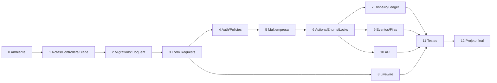

# 10 — Guia de estudos

Este guia é um **roteiro progressivo** para aprender Laravel usando o próprio código do Nexus ERP. Cada etapa diz **o que estudar**, **quais arquivos ler**, **o que observar** e **um exercício prático**, com links para a documentação oficial.

A sugestão é de uma etapa por semana (cerca de 5 a 8 horas cada), mas vá no seu ritmo. Não pule etapas: cada uma usa conceitos da anterior.

## Sumário

- [Como usar este guia](#como-usar-este-guia)
- [Etapa 0 — Preparação do ambiente](#etapa-0--preparação-do-ambiente)
- [Etapa 1 — Rotas, Controllers e Blade](#etapa-1--rotas-controllers-e-blade)
- [Etapa 2 — Banco de dados: Migrations, Eloquent e relacionamentos](#etapa-2--banco-de-dados-migrations-eloquent-e-relacionamentos)
- [Etapa 3 — Formulários: Form Requests, validação e componentes Blade](#etapa-3--formulários-form-requests-validação-e-componentes-blade)
- [Etapa 4 — Autenticação e autorização](#etapa-4--autenticação-e-autorização)
- [Etapa 5 — Multiempresa: Middleware, Service Container e Global Scope](#etapa-5--multiempresa-middleware-service-container-e-global-scope)
- [Etapa 6 — Regras de negócio: Actions, Enums, transações e locks](#etapa-6--regras-de-negócio-actions-enums-transações-e-locks)
- [Etapa 7 — Dinheiro, idempotência e livro-razão](#etapa-7--dinheiro-idempotência-e-livro-razão)
- [Etapa 8 — Livewire e Alpine.js](#etapa-8--livewire-e-alpinejs)
- [Etapa 9 — Events, Listeners, Notifications, Jobs e Scheduler](#etapa-9--events-listeners-notifications-jobs-e-scheduler)
- [Etapa 10 — API REST com Sanctum e Resources](#etapa-10--api-rest-com-sanctum-e-resources)
- [Etapa 11 — Testes com Pest](#etapa-11--testes-com-pest)
- [Etapa 12 — Projeto final](#etapa-12--projeto-final)
- [Mapa rápido: conceito → arquivo](#mapa-rápido-conceito--arquivo)

---

## Como usar este guia

1. **Leia o arquivo com a documentação oficial aberta ao lado.** Os comentários do código explicam o "porquê"; a documentação explica o "como" do framework.
2. **Rode o sistema enquanto lê.** Abra a tela correspondente ao código no navegador (login demo: `admin@verticeti.local`, senha `Nexus@2026`, somente em desenvolvimento).
3. **Use o `php artisan tinker`** para experimentar consultas Eloquent no banco de desenvolvimento (somente leitura enquanto estiver aprendendo).
4. **Faça os exercícios em uma branch separada** (`git checkout -b estudo/etapa-3`), para poder descartar tudo depois.
5. **Rode os testes relacionados** depois de cada exercício (`php artisan test --compact --filter=...`) — veja [08 — Testes](08-testes.md).

---

## Etapa 0 — Preparação do ambiente

**Objetivo:** ter o sistema rodando e entender a estrutura de pastas.

**O que fazer:**

- Suba a infraestrutura (`docker compose up -d`) e rode a aplicação seguindo o README/guia de instalação do projeto.
- Rode `php artisan route:list --except-vendor` e `php artisan list` para ter uma visão do que existe.
- Navegue pelas pastas: `app/`, `config/`, `database/`, `resources/`, `routes/`, `tests/`.

**Arquivos para ler:**

| Arquivo | Por quê |
|---|---|
| [`docker-compose.yml`](../docker-compose.yml) | Entender o modo híbrido (só infraestrutura no Docker) e o perfil `app`. |
| [`.env.example`](../.env.example) | Variáveis de ambiente: banco na porta 5433, Redis, sessão em banco. |
| [`composer.json`](../composer.json) | Dependências e scripts (`setup`, `dev`, `test`, `lint`, `analyse`, `check`). |
| [`bootstrap/app.php`](../bootstrap/app.php) | Ponto de configuração do Laravel 13: rotas, middlewares, exceções. |

**Documentação:** [Installation](https://laravel.com/docs/13.x/installation) · [Configuration](https://laravel.com/docs/13.x/configuration) · [Directory Structure](https://laravel.com/docs/13.x/structure) · [Request Lifecycle](https://laravel.com/docs/13.x/lifecycle)

**Exercício:** faça login com cada usuário demo (`gerente@`, `comercial@`, `financeiro@`, `atendimento@`, `colaborador@verticeti.local`) e anote quais itens do menu cada um vê. Guarde a lista: você vai explicá-la na etapa 4.

---

## Etapa 1 — Rotas, Controllers e Blade

**Objetivo:** entender como uma URL chega a um Controller e vira HTML.

**Arquivos para ler (nesta ordem):**

| Arquivo | O que observar |
|---|---|
| [`routes/web.php`](../routes/web.php) | O comentário de convenções no topo; `Route::middleware([...])->group()`; `Route::resource(...)->parameters()->names()`; URLs em português e nomes de rota em inglês. |
| [`app/Http/Controllers/Catalog/CatalogItemController.php`](../app/Http/Controllers/Catalog/CatalogItemController.php) | Um CRUD simples: `create`, `store`, `show`, `edit`, `update`, `destroy`; `redirect()->route(...)->with('success', ...)`. |
| [`resources/views/layouts/app.blade.php`](../resources/views/layouts/app.blade.php) | O layout principal; como as páginas são "encaixadas". |
| [`resources/views/catalog/show.blade.php`](../resources/views/catalog/show.blade.php) e [`form.blade.php`](../resources/views/catalog/form.blade.php) | `<x-layouts::app>`, `@include`, `@csrf`, `@method`, `{{ }}` (escapado), componentes `<x-ui.*>`. |
| [`app/Support/helpers.php`](../app/Support/helpers.php) | Helpers globais usados nas views: `money()`, `br_date()`, `document_format()`. |

**Documentação:** [Routing](https://laravel.com/docs/13.x/routing) · [Controllers (Resource Controllers)](https://laravel.com/docs/13.x/controllers#resource-controllers) · [Blade Templates](https://laravel.com/docs/13.x/blade) · [Blade Components](https://laravel.com/docs/13.x/blade#components) · [URL Generation](https://laravel.com/docs/13.x/urls) · [Responses (redirects)](https://laravel.com/docs/13.x/responses#redirects)

**Exercícios:**

1. Rode `php artisan route:list --name=catalog` e relacione cada linha com um método do `CatalogItemController`.
2. Descubra por que `/clientes/exportar` é declarada **antes** do `Route::resource('clientes', ...)` (dica: o que aconteceria com `/clientes/{customer}`?).
3. Encontre no projeto um lugar onde `{!! !!}` seria perigoso e explique por que o projeto usa `{{ }}`. O teste de XSS em `tests/Feature/Security/SecurityTest.php` ajuda.

---

## Etapa 2 — Banco de dados: Migrations, Eloquent e relacionamentos

**Objetivo:** entender como as tabelas são criadas e como o Eloquent as representa.

**Arquivos para ler:**

| Arquivo | O que observar |
|---|---|
| [`database/migrations/2026_10_14_100500_create_catalog_tables.php`](../database/migrations/2026_10_14_100500_create_catalog_tables.php) | `foreignId()->constrained()`, `softDeletes()`, índices compostos começando por `company_id`. |
| [`database/migrations/2026_10_14_100300_create_customers_and_suppliers_tables.php`](../database/migrations/2026_10_14_100300_create_customers_and_suppliers_tables.php) | Índice UNIQUE **parcial** com `DB::statement` (`WHERE deleted_at IS NULL`). |
| [`database/migrations/2026_10_15_090000_use_partial_unique_codes_for_catalog_and_units.php`](../database/migrations/2026_10_15_090000_use_partial_unique_codes_for_catalog_and_units.php) | Uma migration de **evolução** de esquema (não se edita migration antiga já aplicada). |
| [`app/Models/CatalogItem.php`](../app/Models/CatalogItem.php) | `#[Fillable]`, `casts()`, `belongsTo`/`hasMany`, Local Scopes (`scopeActive`, `scopeSearch`). |
| [`app/Models/Customer.php`](../app/Models/Customer.php) | Muitos relacionamentos e traits reutilizáveis (`HasContactDetails`, `HasAttachments`...). |
| [`app/Models/User.php`](../app/Models/User.php) | `belongsToMany` com Pivot model customizado (`CompanyMembership`), `withPivot`. |
| [`database/factories/CustomerFactory.php`](../database/factories/CustomerFactory.php) e [`database/seeders/DemoDataSeeder.php`](../database/seeders/DemoDataSeeder.php) | Factories com estados; seeders de dados demonstrativos. |

**Conceitos-chave:** migrations versionam o esquema; o Model **não** define colunas (elas vêm do banco); `casts()` converte tipos (Enum, data, booleano); relacionamentos são métodos; **eager loading** (`with()`) evita N+1.

**Documentação:** [Migrations](https://laravel.com/docs/13.x/migrations) · [Eloquent: Getting Started](https://laravel.com/docs/13.x/eloquent) · [Relationships](https://laravel.com/docs/13.x/eloquent-relationships) · [Eager Loading](https://laravel.com/docs/13.x/eloquent-relationships#eager-loading) · [Mutators & Casting](https://laravel.com/docs/13.x/eloquent-mutators) · [Local Scopes](https://laravel.com/docs/13.x/eloquent#local-scopes) · [Soft Deleting](https://laravel.com/docs/13.x/eloquent#soft-deleting) · [Factories](https://laravel.com/docs/13.x/eloquent-factories) · [Seeding](https://laravel.com/docs/13.x/seeding) · [Query Builder](https://laravel.com/docs/13.x/queries)

**Exercícios:**

1. No `tinker`, rode `App\Models\Customer::query()->toRawSql()` com e sem empresa ativa e compare (isso antecipa a etapa 5).
2. Ache o `Model::preventLazyLoading()` no [`AppServiceProvider`](../app/Providers/AppServiceProvider.php). Em uma branch, remova um item do `->load([...])` do `ServiceOrderController::show()` e abra a tela: leia o erro e explique o que é N+1.
3. Desenhe (no papel ou em Mermaid) o diagrama de relacionamentos entre `customers`, `proposals`, `proposal_items`, `contracts`, `contract_items` e `receivables`.

---

## Etapa 3 — Formulários: Form Requests, validação e componentes Blade

**Objetivo:** entender o caminho de um formulário até o banco, com validação e normalização de dados.

**Arquivos para ler:**

| Arquivo | O que observar |
|---|---|
| [`app/Http/Requests/Catalog/CatalogItemRequest.php`](../app/Http/Requests/Catalog/CatalogItemRequest.php) | `prepareForValidation()` (normalizar antes de validar), `Rule::unique()->where('company_id', ...)->ignore()`, `messages()`, `attributes()`. |
| [`app/Http/Requests/Concerns/NormalizesMoney.php`](../app/Http/Requests/Concerns/NormalizesMoney.php) | Converter "1.234,56" em centavos **antes** da validação. |
| [`app/Http/Requests/Customers/BusinessPartyRequest.php`](../app/Http/Requests/Customers/BusinessPartyRequest.php) | Classe abstrata compartilhada por clientes e fornecedores; validação de arrays (`addresses.*.street`). |
| [`app/Rules/CpfCnpj.php`](../app/Rules/CpfCnpj.php) e [`app/Support/BrazilianDocument.php`](../app/Support/BrazilianDocument.php) | Uma regra de validação customizada (inclui CNPJ alfanumérico). |
| [`resources/views/components/form/input.blade.php`](../resources/views/components/form/input.blade.php) e [`money.blade.php`](../resources/views/components/form/money.blade.php) | Componentes anônimos com `@props`, `old()`, exibição de erros. |

**Documentação:** [Validation](https://laravel.com/docs/13.x/validation) · [Form Request Validation](https://laravel.com/docs/13.x/validation#form-request-validation) · [Preparing Input for Validation](https://laravel.com/docs/13.x/validation#preparing-input-for-validation) · [Custom Validation Rules](https://laravel.com/docs/13.x/validation#custom-validation-rules) · [Validating Arrays](https://laravel.com/docs/13.x/validation#validating-arrays) · [CSRF Protection](https://laravel.com/docs/13.x/csrf)

**Exercícios:**

1. Explique por que todo `Rule::exists(...)` do projeto tem `->where('company_id', $companyId)` (dica: o `exists` usa o Query Builder, não o Eloquent).
2. Adicione (em uma branch) a validação de que o campo `website` de um cliente comece com `https://`, com mensagem em português. Escreva um teste em `CustomerCrudTest` que prove a regra.
3. Envie o formulário de cliente com um CNPJ inválido e siga o caminho: Form Request → redirect → `$errors` → componente `x-form.input`.

---

## Etapa 4 — Autenticação e autorização

**Objetivo:** entender login (Fortify), permissões por perfil, Gates e Policies.

**Leitura principal:** [07 — Autenticação e permissões](07-autenticacao-e-permissoes.md).

**Arquivos para ler:**

| Arquivo | O que observar |
|---|---|
| [`app/Providers/FortifyServiceProvider.php`](../app/Providers/FortifyServiceProvider.php) e [`config/fortify.php`](../config/fortify.php) | Features ativas, telas próprias, `authenticateUsing`, rate limit de login. |
| [`config/permissions.php`](../config/permissions.php) e [`database/seeders/PermissionSeeder.php`](../database/seeders/PermissionSeeder.php) | Catálogo de permissões e perfis padrão. |
| [`app/Models/User.php`](../app/Models/User.php) | `permissionsFor()`, `hasPermission()`, cache em memória. |
| [`app/Providers/AppServiceProvider.php`](../app/Providers/AppServiceProvider.php) | `Gate::before` (superadministrador e habilidades "recurso.acao"). |
| [`app/Policies/TenantResourcePolicy.php`](../app/Policies/TenantResourcePolicy.php), [`ProposalPolicy.php`](../app/Policies/ProposalPolicy.php), [`ReceivablePolicy.php`](../app/Policies/ReceivablePolicy.php) | Policy base e habilidades extras (`changeStatus`, `convert`, `settle`, `cancel`). |
| [`resources/views/layouts/partials/navigation.blade.php`](../resources/views/layouts/partials/navigation.blade.php) | Menu filtrado por permissão (e o comentário sobre segurança real). |

**Documentação:** [Authentication](https://laravel.com/docs/13.x/authentication) · [Fortify](https://laravel.com/docs/13.x/fortify) · [Authorization](https://laravel.com/docs/13.x/authorization) · [Gates](https://laravel.com/docs/13.x/authorization#gates) · [Policies](https://laravel.com/docs/13.x/authorization#creating-policies) · [Intercepting Gate Checks (before)](https://laravel.com/docs/13.x/authorization#intercepting-gate-checks) · [Email Verification](https://laravel.com/docs/13.x/verification) · [Password Reset](https://laravel.com/docs/13.x/passwords)

**Exercícios:**

1. Volte à lista da etapa 0 e explique, usando `config/permissions.php`, por que cada perfil vê os itens que vê.
2. Logado como `comercial@verticeti.local`, tente abrir `/financeiro/receber` pela URL. Encontre a linha de código que devolve o 403.
3. Crie (em uma branch) a permissão `customers.import` no config, rode o `PermissionSeeder` e use `@can('customers.import')` em um botão fictício. Explique por que funcionou sem `Gate::define` (resposta: `Gate::before`).

---

## Etapa 5 — Multiempresa: Middleware, Service Container e Global Scope

**Objetivo:** entender o coração da arquitetura — como várias empresas compartilham o mesmo banco sem ver os dados umas das outras.

**Arquivos para ler (nesta ordem):**

| Arquivo | O que observar |
|---|---|
| [`app/Support/Tenancy/CurrentCompany.php`](../app/Support/Tenancy/CurrentCompany.php) | Guarda a empresa ativa; `run()` executa código "dentro" de uma empresa. |
| [`app/Providers/AppServiceProvider.php`](../app/Providers/AppServiceProvider.php) | `$this->app->scoped(CurrentCompany::class)`: uma instância por requisição/job. |
| [`app/Http/Middleware/SetCurrentCompany.php`](../app/Http/Middleware/SetCurrentCompany.php) | Define a empresa (sessão web ou cabeçalho `X-Company-Id`). |
| [`bootstrap/app.php`](../bootstrap/app.php) | `prependToPriorityList`: por que o middleware precisa rodar antes do `SubstituteBindings`. |
| [`app/Models/Scopes/CompanyScope.php`](../app/Models/Scopes/CompanyScope.php) | O Global Scope que adiciona `WHERE company_id = ?`. |
| [`app/Models/Concerns/BelongsToCompany.php`](../app/Models/Concerns/BelongsToCompany.php) | Trait que aplica o scope, preenche `company_id` e impede mover registros. |
| [`app/Services/Dashboard/DashboardMetrics.php`](../app/Services/Dashboard/DashboardMetrics.php) | `forCompanies()`: consulta consolidada **intencional** de várias empresas. |
| [`tests/Feature/Tenancy/CompanyIsolationTest.php`](../tests/Feature/Tenancy/CompanyIsolationTest.php) | A prova automatizada do isolamento. |

**Documentação:** [Middleware](https://laravel.com/docs/13.x/middleware) · [Sorting Middleware (prioridade)](https://laravel.com/docs/13.x/middleware#sorting-middleware) · [Service Container](https://laravel.com/docs/13.x/container) · [Scoped Singletons](https://laravel.com/docs/13.x/container#binding-scoped) · [Global Scopes](https://laravel.com/docs/13.x/eloquent#global-scopes) · [Route Model Binding](https://laravel.com/docs/13.x/routing#route-model-binding) · [Service Providers](https://laravel.com/docs/13.x/providers)

**Exercícios:**

1. Explique, com suas palavras, por que acessar `/clientes/{id-de-outra-empresa}` dá 404 e não 403.
2. No `tinker`: `app(App\Support\Tenancy\CurrentCompany::class)->set(App\Models\Company::find(1)); App\Models\Customer::count();` — depois troque para a empresa 2 e compare.
3. Encontre todos os usos de `withoutGlobalScope` no projeto (`grep -rn withoutGlobalScope app`) e justifique cada um.
4. Por que o `CurrentCompany` é `scoped` e não `singleton`? (Pense em um worker de filas processando jobs de várias empresas seguidos.)

---

## Etapa 6 — Regras de negócio: Actions, Enums, transações e locks

**Objetivo:** entender onde ficam as regras do domínio e como elas se protegem contra concorrência.

**Arquivos para ler:**

| Arquivo | O que observar |
|---|---|
| [`app/Enums/ProposalStatus.php`](../app/Enums/ProposalStatus.php) e [`app/Enums/Concerns/HasStateMachine.php`](../app/Enums/Concerns/HasStateMachine.php) | Máquina de estados: `transitions()`, `canTransitionTo()`, `isFinal()`. |
| [`app/Actions/Proposals/SaveProposal.php`](../app/Actions/Proposals/SaveProposal.php) | Action de criação com cálculo de itens e numeração. |
| [`app/Services/LineItemCalculator.php`](../app/Services/LineItemCalculator.php) | Cálculo puro e testável (sem banco). |
| [`app/Actions/Proposals/ChangeProposalStatus.php`](../app/Actions/Proposals/ChangeProposalStatus.php) | `DB::transaction`, `lockForUpdate`, `BusinessRuleException`, histórico de status, auditoria, Event. |
| [`app/Actions/Proposals/ConvertProposalToContract.php`](../app/Actions/Proposals/ConvertProposalToContract.php) | Conversão "sem duplicar dados"; `UniqueConstraintViolationException` como proteção extra. |
| [`app/Services/DocumentNumberGenerator.php`](../app/Services/DocumentNumberGenerator.php) | Numeração sequencial por empresa/ano com `insertOrIgnore` + `lockForUpdate`. |
| [`app/Exceptions/BusinessRuleException.php`](../app/Exceptions/BusinessRuleException.php) | Exceção que sabe se renderizar (web: volta com erro; API: 422). |
| [`app/Services/AuditLogger.php`](../app/Services/AuditLogger.php) e [`app/Models/Concerns/Auditable.php`](../app/Models/Concerns/Auditable.php) | Auditoria automática via eventos do Eloquent e manual nas Actions. |

**Documentação:** [Database Transactions](https://laravel.com/docs/13.x/database#database-transactions) · [Pessimistic Locking](https://laravel.com/docs/13.x/queries#pessimistic-locking) · [Eloquent Events](https://laravel.com/docs/13.x/eloquent#events) · [Error Handling (renderable exceptions)](https://laravel.com/docs/13.x/errors#renderable-exceptions) · [PHP Enums](https://www.php.net/manual/pt_BR/language.enumerations.php) · [Validating Enums](https://laravel.com/docs/13.x/validation#rule-enum)

**Exercícios:**

1. Desenhe o diagrama de estados de `ContractStatus` a partir de `transitions()`.
2. Explique o que aconteceria **sem** o `lockForUpdate()` no `DocumentNumberGenerator` se dois usuários criassem propostas no mesmo milissegundo.
3. Adicione (em uma branch) a regra "não é possível enviar uma proposta com total zero" na Action certa, com `BusinessRuleException`, e um teste em `ProposalFlowTest`.
4. Leia [11 — Decisões de arquitetura](11-decisoes-de-arquitetura.md) (ADRs "Actions em vez de Repositories" e "Status como Enum") e escreva um parágrafo concordando ou discordando.

---

## Etapa 7 — Dinheiro, idempotência e livro-razão

**Objetivo:** entender as garantias financeiras — a parte mais crítica do sistema.

**Arquivos para ler:**

| Arquivo | O que observar |
|---|---|
| [`app/Support/Money.php`](../app/Support/Money.php) | Centavos inteiros, `parse()` sem float, `multiply()` com bcmath e arredondamento meio-para-cima. |
| [`tests/Unit/MoneyTest.php`](../tests/Unit/MoneyTest.php) | O clássico `0,10 + 0,20`. |
| [`app/Actions/Finance/RecordPayment.php`](../app/Actions/Finance/RecordPayment.php) | As **quatro** proteções contra processamento duplicado (leia o docblock). |
| [`app/Services/Finance/LedgerService.php`](../app/Services/Finance/LedgerService.php) | O único ponto que movimenta saldos; `balance_after_cents`; saldo materializado. |
| [`app/Models/FinancialTransaction.php`](../app/Models/FinancialTransaction.php) | Lançamento imutável (eventos `updating`/`deleting` lançam exceção). |
| [`app/Actions/Finance/ReversePayment.php`](../app/Actions/Finance/ReversePayment.php) e [`CancelBill.php`](../app/Actions/Finance/CancelBill.php) | Estorno (nunca apagar) e cancelamento. |
| [`app/Console/Commands/VerifyAccountBalances.php`](../app/Console/Commands/VerifyAccountBalances.php) | Conferência diária saldo × extrato. |
| [`database/migrations/2026_10_14_100800_create_finance_tables.php`](../database/migrations/2026_10_14_100800_create_finance_tables.php) | CHECK constraints e UNIQUE parciais como última barreira. |

**Documentação:** [Database: Getting Started](https://laravel.com/docs/13.x/database) · [Pessimistic Locking](https://laravel.com/docs/13.x/queries#pessimistic-locking) · [Artisan Console](https://laravel.com/docs/13.x/artisan) · [BCMath (PHP)](https://www.php.net/manual/pt_BR/book.bc.php) · [Constraints no PostgreSQL](https://www.postgresql.org/docs/17/ddl-constraints.html) · [Índices parciais](https://www.postgresql.org/docs/17/indexes-partial.html)

**Exercícios:**

1. Calcule à mão `Money::multiply(999, '0.333')` e confira com o teste.
2. Explique por que um **duplo clique** no botão "Registrar pagamento" não gera dois pagamentos. Siga a `idempotency_key` desde a view até o índice do banco.
3. Por que o sistema guarda o saldo na conta (`current_balance_cents`) **e** em cada lançamento (`balance_after_cents`)? Qual é o papel do `finance:verify-balances`?
4. Rode `php artisan finance:verify-balances` no banco de desenvolvimento e leia a saída.

---

## Etapa 8 — Livewire e Alpine.js

**Objetivo:** entender as telas reativas sem escrever um SPA.

**Arquivos para ler:**

| Arquivo | O que observar |
|---|---|
| [`app/Livewire/Concerns/WithDataTable.php`](../app/Livewire/Concerns/WithDataTable.php) | Busca, ordenação e paginação reutilizáveis; `#[Url]`; `$sortable` como lista branca. |
| [`app/Livewire/Catalog/CatalogIndex.php`](../app/Livewire/Catalog/CatalogIndex.php) + [`catalog-index.blade.php`](../resources/views/livewire/catalog/catalog-index.blade.php) | Componente de página inteira; `wire:model.live`, `wire:click`, `wire:confirm`, `wire:key`. |
| [`app/Livewire/Crm/Pipeline.php`](../app/Livewire/Crm/Pipeline.php) | Kanban: arrastar e soltar persistindo no banco via Action. |
| [`app/Livewire/Dashboard.php`](../app/Livewire/Dashboard.php) + [`components/chart.blade.php`](../resources/views/components/chart.blade.php) | Dashboard com Chart.js. |
| [`app/Livewire/Finance/FinanceSettings.php`](../app/Livewire/Finance/FinanceSettings.php) | Formulários dentro de um componente; `authorize()` em cada ação. |
| [`resources/js/app.js`](../resources/js/app.js) | Componentes Alpine reutilizáveis (máscara de dinheiro) e Chart.js. |
| [`config/livewire.php`](../config/livewire.php) | `component_layout`, `make_command.type = class`. |

**Documentação:** [Livewire Quickstart](https://livewire.laravel.com/docs/quickstart) · [Components](https://livewire.laravel.com/docs/components) · [Properties](https://livewire.laravel.com/docs/properties) · [Actions](https://livewire.laravel.com/docs/actions) · [URL Query Parameters](https://livewire.laravel.com/docs/url) · [Pagination](https://livewire.laravel.com/docs/pagination) · [Pages (full-page components)](https://livewire.laravel.com/docs/pages) · [Authorization](https://livewire.laravel.com/docs/authorization) · [Alpine](https://livewire.laravel.com/docs/alpine) · [Testing](https://livewire.laravel.com/docs/testing) · [Alpine.js](https://alpinejs.dev/start-here)

**Exercícios:**

1. Abra o DevTools (aba Network) e observe a requisição do Livewire ao digitar na busca de clientes. O que vai no corpo? Por que o `authorize()` dentro de `delete()` é indispensável?
2. Adicione (em uma branch) um filtro "Somente com contrato ativo" na listagem de clientes, com `#[Url]`, e um teste com `Livewire::test()`.
3. Explique por que `$sortable` existe no `WithDataTable` (o que aconteceria com `?ordem=password`?).

---

## Etapa 9 — Events, Listeners, Notifications, Jobs e Scheduler

**Objetivo:** entender o que acontece "por trás", fora do ciclo de uma requisição.

**Arquivos para ler:**

| Arquivo | O que observar |
|---|---|
| [`app/Events/ProposalStatusChanged.php`](../app/Events/ProposalStatusChanged.php) e [`app/Listeners/MarkOpportunityAsWon.php`](../app/Listeners/MarkOpportunityAsWon.php), [`SendProposalStatusNotification.php`](../app/Listeners/SendProposalStatusNotification.php) | Um Event com vários Listeners (descobertos automaticamente pelo tipo do parâmetro). |
| [`app/Listeners/LogFinancialOperation.php`](../app/Listeners/LogFinancialOperation.php) | Listener dos eventos financeiros. |
| [`app/Notifications/ProposalStatusChangedNotification.php`](../app/Notifications/ProposalStatusChangedNotification.php) e [`UserInvitationNotification.php`](../app/Notifications/UserInvitationNotification.php) | Notificações por e-mail/banco, `ShouldQueue`. |
| [`app/Livewire/Notifications/Bell.php`](../app/Livewire/Notifications/Bell.php) | O sino de notificações internas. |
| [`routes/console.php`](../routes/console.php) | O Scheduler: `dailyAt`, `withoutOverlapping`, `onOneServer`. |
| [`app/Console/Commands/RunDailyRoutines.php`](../app/Console/Commands/RunDailyRoutines.php) | Um comando que enfileira um job por empresa (`--sync`, `--company`). |
| [`app/Jobs/Concerns/RunsForCompany.php`](../app/Jobs/Concerns/RunsForCompany.php) e [`app/Jobs/GenerateContractChargesJob.php`](../app/Jobs/GenerateContractChargesJob.php) | Jobs por empresa, `ShouldBeUnique` + `uniqueId()`, `tries`/`backoff`. |
| [`app/Actions/Contracts/GenerateContractCharges.php`](../app/Actions/Contracts/GenerateContractCharges.php) e [`app/Support/Billing/BillingSchedule.php`](../app/Support/Billing/BillingSchedule.php) | Cobrança recorrente idempotente. |

**Documentação:** [Events](https://laravel.com/docs/13.x/events) · [Event Discovery](https://laravel.com/docs/13.x/events#event-discovery) · [Notifications](https://laravel.com/docs/13.x/notifications) · [Mail](https://laravel.com/docs/13.x/mail) · [Queues](https://laravel.com/docs/13.x/queues) · [Unique Jobs](https://laravel.com/docs/13.x/queues#unique-jobs) · [Task Scheduling](https://laravel.com/docs/13.x/scheduling) · [Redis](https://laravel.com/docs/13.x/redis)

**Exercícios:**

1. Rode `php artisan erp:daily-routines --sync --company=1` e depois veja as contas a receber geradas. Rode de novo: por que nada é duplicado?
2. Com `php artisan queue:work` em um terminal, aprove uma proposta na tela e observe os jobs/notificações sendo processados. Abra o Mailpit (`http://localhost:8025`).
3. Explique a diferença entre chamar uma Action diretamente e disparar um Event. Quando cada um faz sentido?
4. Por que os jobs recebem a `Company` no construtor e usam `withinCompany()`, em vez de depender do usuário logado?

---

## Etapa 10 — API REST com Sanctum e Resources

**Objetivo:** entender como o mesmo domínio é exposto para integrações.

**Leitura principal:** [13 — API](13-api.md).

**Arquivos para ler:**

| Arquivo | O que observar |
|---|---|
| [`routes/api.php`](../routes/api.php) | Versionamento `/v1`, `apiResource`, `throttle`. |
| [`app/Http/Controllers/Api/V1/ApiController.php`](../app/Http/Controllers/Api/V1/ApiController.php) | Paginação e ordenação padronizadas. |
| [`app/Http/Controllers/Api/V1/ReceivableController.php`](../app/Http/Controllers/Api/V1/ReceivableController.php) | Reaproveita Form Request, Policy e Action da web; 201 vs 200 na idempotência. |
| [`app/Http/Resources/V1/BillResource.php`](../app/Http/Resources/V1/BillResource.php) e [`Concerns/FormatsValues.php`](../app/Http/Resources/V1/Concerns/FormatsValues.php) | O contrato do JSON; `whenLoaded`. |
| [`app/Http/Controllers/Api/V1/AuthTokenController.php`](../app/Http/Controllers/Api/V1/AuthTokenController.php) | Emissão e revogação de tokens. |
| [`bootstrap/app.php`](../bootstrap/app.php) | `withExceptions()`: erros JSON em português. |

**Documentação:** [Sanctum](https://laravel.com/docs/13.x/sanctum) · [Eloquent API Resources](https://laravel.com/docs/13.x/eloquent-resources) · [Resource Collections & Pagination](https://laravel.com/docs/13.x/eloquent-resources#pagination) · [Rate Limiting](https://laravel.com/docs/13.x/routing#rate-limiting) · [Error Handling](https://laravel.com/docs/13.x/errors)

**Exercícios:**

1. Siga a seção 11 de [13 — API](13-api.md) com `curl` (ou Postman/Insomnia) e execute o fluxo proposta → contrato → pagamento → estorno.
2. Repita o mesmo pagamento com a mesma `idempotency_key` e compare os status HTTP.
3. Faça a mesma requisição com o token de `comercial@verticeti.local` em `/api/v1/receivables` e explique o 403.

---

## Etapa 11 — Testes com Pest

**Objetivo:** ler, rodar e escrever testes.

**Leitura principal:** [08 — Testes](08-testes.md).

**Arquivos para ler:**

| Arquivo | O que observar |
|---|---|
| [`tests/Pest.php`](../tests/Pest.php) e [`tests/TestCase.php`](../tests/TestCase.php) | `RefreshDatabase`, seed de permissões, helpers. |
| [`tests/Unit/MoneyTest.php`](../tests/Unit/MoneyTest.php) | `describe`, datasets, `throws`. |
| [`tests/Feature/Finance/PaymentTest.php`](../tests/Feature/Finance/PaymentTest.php) | Testar a Action diretamente. |
| [`tests/Feature/Commercial/RecurringBillingTest.php`](../tests/Feature/Commercial/RecurringBillingTest.php) | `travelTo()` para controlar o tempo. |
| [`tests/Feature/Tenancy/CompanyIsolationTest.php`](../tests/Feature/Tenancy/CompanyIsolationTest.php) | Testes de segurança multiempresa. |
| [`tests/Feature/Livewire/LivewireComponentsTest.php`](../tests/Feature/Livewire/LivewireComponentsTest.php) | `Livewire::test()`. |
| [`tests/Feature/SmokeTest.php`](../tests/Feature/SmokeTest.php) | Teste de fumaça com dados demonstrativos. |

**Documentação:** [Pest: Writing Tests](https://pestphp.com/docs/writing-tests) · [Expectations](https://pestphp.com/docs/expectations) · [Datasets](https://pestphp.com/docs/datasets) · [Hooks](https://pestphp.com/docs/hooks) · [Filtering Tests](https://pestphp.com/docs/filtering-tests) · [Arch Testing](https://pestphp.com/docs/arch-testing) · [Laravel: Testing](https://laravel.com/docs/13.x/testing) · [HTTP Tests](https://laravel.com/docs/13.x/http-tests) · [Database Testing](https://laravel.com/docs/13.x/database-testing) · [Mocking](https://laravel.com/docs/13.x/mocking) · [Livewire Testing](https://livewire.laravel.com/docs/testing)

**Exercícios:**

1. Rode a suíte completa e depois só os testes de `Finance`. Anote o tempo de cada um.
2. Quebre propositalmente uma regra (ex.: comente a verificação de saldo em `RecordPayment`) e veja qual teste falha. Desfaça.
3. Escreva um teste que prove que o perfil **Atendimento** não consegue estornar pagamentos (siga o passo a passo da seção 9 de [08 — Testes](08-testes.md)).
4. (Desafio) Escreva um *arch test* do Pest garantindo que nenhuma classe em `app/Http/Controllers` use `DB::` diretamente.

---

## Etapa 12 — Projeto final

**Objetivo:** juntar tudo construindo um módulo completo.

Siga o tutorial [09 — Como adicionar uma funcionalidade](09-como-adicionar-uma-funcionalidade.md) e implemente o módulo "Ativos do cliente" do zero, em uma branch. Depois, escolha **um** item do [12 — Roadmap](12-roadmap.md) de esforço baixo ou médio (por exemplo, juros/multa por atraso ou régua de cobrança) e escreva:

1. um mini-ADR (contexto, decisão, alternativas, consequências) no formato de [11 — Decisões de arquitetura](11-decisoes-de-arquitetura.md);
2. a implementação seguindo os padrões do projeto;
3. os testes (caminho feliz, validação, permissão, isolamento, regra de negócio);
4. a verificação final: `vendor/bin/pint --dirty`, `composer analyse`, `php artisan test --compact`.

Se conseguir fazer isso sozinho, você domina os fundamentos do Laravel e as técnicas avançadas que um ERP de verdade exige.

---

## Mapa rápido: conceito → arquivo

| Conceito Laravel | Exemplo no projeto |
|---|---|
| Route / Resource Route | [`routes/web.php`](../routes/web.php) |
| Controller | [`app/Http/Controllers/Catalog/CatalogItemController.php`](../app/Http/Controllers/Catalog/CatalogItemController.php) |
| Form Request | [`app/Http/Requests/Catalog/CatalogItemRequest.php`](../app/Http/Requests/Catalog/CatalogItemRequest.php) |
| Custom Validation Rule | [`app/Rules/CpfCnpj.php`](../app/Rules/CpfCnpj.php) |
| Middleware | [`app/Http/Middleware/SetCurrentCompany.php`](../app/Http/Middleware/SetCurrentCompany.php), [`SecurityHeaders.php`](../app/Http/Middleware/SecurityHeaders.php) |
| Service Provider | [`app/Providers/AppServiceProvider.php`](../app/Providers/AppServiceProvider.php) |
| Service Container (scoped) | `CurrentCompany` em `AppServiceProvider::register()` |
| Migration | [`database/migrations`](../database/migrations) |
| Eloquent Model / Cast / Relationship | [`app/Models/Contract.php`](../app/Models/Contract.php) |
| Global Scope | [`app/Models/Scopes/CompanyScope.php`](../app/Models/Scopes/CompanyScope.php) |
| Trait de Model (boot) | [`app/Models/Concerns/BelongsToCompany.php`](../app/Models/Concerns/BelongsToCompany.php), [`Auditable.php`](../app/Models/Concerns/Auditable.php) |
| Polymorphic Relation + Morph Map | [`HasAttachments`](../app/Models/Concerns/HasAttachments.php), `enforceMorphMap` no `AppServiceProvider` |
| Enum | [`app/Enums/ContractStatus.php`](../app/Enums/ContractStatus.php) |
| Gate / Policy | [`app/Policies/TenantResourcePolicy.php`](../app/Policies/TenantResourcePolicy.php) |
| Action (padrão do projeto) | [`app/Actions/Finance/RecordPayment.php`](../app/Actions/Finance/RecordPayment.php) |
| Service | [`app/Services/Finance/LedgerService.php`](../app/Services/Finance/LedgerService.php) |
| Transaction / Lock | `DB::transaction` + `lockForUpdate` em [`ChangeProposalStatus`](../app/Actions/Proposals/ChangeProposalStatus.php) |
| Event / Listener | [`app/Events`](../app/Events), [`app/Listeners`](../app/Listeners) |
| Notification | [`app/Notifications`](../app/Notifications) |
| Job / Queue | [`app/Jobs`](../app/Jobs) |
| Artisan Command | [`app/Console/Commands`](../app/Console/Commands) |
| Scheduler | [`routes/console.php`](../routes/console.php) |
| Livewire Component | [`app/Livewire`](../app/Livewire) |
| Blade Component | [`resources/views/components`](../resources/views/components) |
| API Resource | [`app/Http/Resources/V1`](../app/Http/Resources/V1) |
| Sanctum | [`app/Http/Controllers/Api/V1/AuthTokenController.php`](../app/Http/Controllers/Api/V1/AuthTokenController.php) |
| Factory / Seeder | [`database/factories`](../database/factories), [`database/seeders`](../database/seeders) |
| Pest Test | [`tests`](../tests) |
