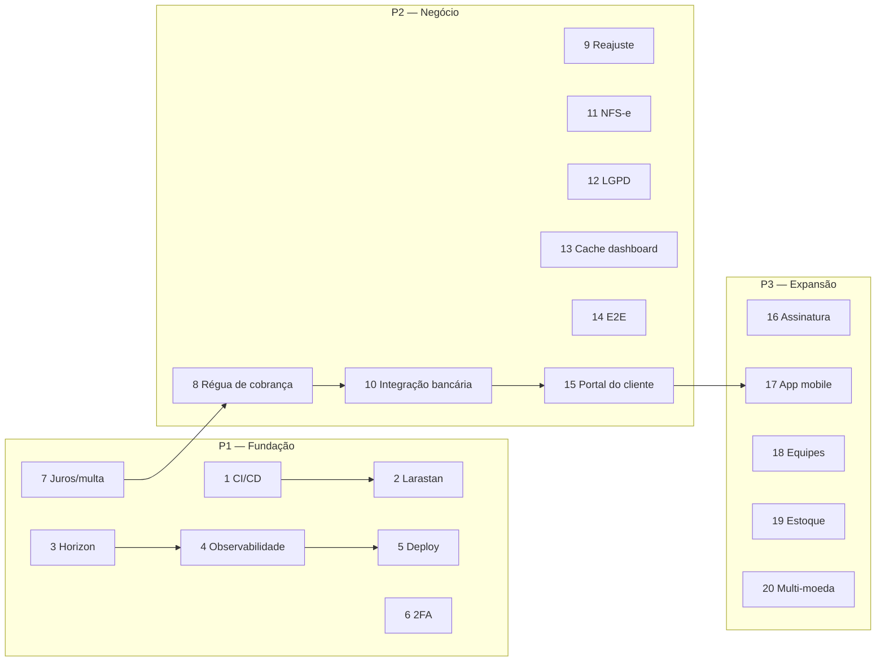

# 12 — Roadmap (melhorias futuras)

Este documento lista melhorias **realistas** para o Nexus ERP, priorizadas, com esforço estimado e o ponto de partida no código. Nada aqui está implementado — são propostas para orientar a evolução do projeto (e bons exercícios para quem está estudando, veja a etapa 12 do [guia de estudos](10-guia-de-estudos.md)).

## Como ler

**Prioridade**

| Sigla | Significado |
|---|---|
| **P1** | Alto valor e/ou reduz risco operacional. Fazer primeiro. |
| **P2** | Valor claro, depende de P1 ou de decisão de negócio. |
| **P3** | Desejável; fazer quando houver demanda. |

**Esforço** (para um desenvolvedor familiarizado com o projeto, incluindo testes)

| Sigla | Faixa |
|---|---|
| **P** (pequeno) | até 3 dias |
| **M** (médio) | 1 a 2 semanas |
| **G** (grande) | 3 a 6 semanas |
| **GG** (muito grande) | mais de 6 semanas / projeto próprio |

> Antes de começar qualquer item: escreva um mini-ADR (formato de [11 — Decisões de arquitetura](11-decisoes-de-arquitetura.md)), siga o passo a passo de [09 — Como adicionar uma funcionalidade](09-como-adicionar-uma-funcionalidade.md) e lembre que **mudanças de dependências exigem aprovação** do responsável pelo projeto.

## Visão geral

| # | Item | Área | Prioridade | Esforço |
|---|---|---|---|---|
| 1 | [CI/CD com GitHub Actions (Pint, Larastan, Pest)](#1-cicd-com-github-actions) | Qualidade | P1 | P |
| 2 | [Subir o nível do Larastan (hoje nível 1)](#2-subir-o-nível-do-larastan) | Qualidade | P1 | M (gradual) |
| 3 | [Filas com Laravel Horizon](#3-filas-com-laravel-horizon) | Operação | P1 | P |
| 4 | [Observabilidade (Pulse/Telescope, logs JSON, métricas)](#4-observabilidade) | Operação | P1 | M |
| 5 | [Deploy de produção](#5-deploy-de-produção) | Operação | P1 | M |
| 6 | [2FA e passkeys](#6-2fa-e-passkeys) | Segurança | P1 | P |
| 7 | [Juros e multa por atraso](#7-juros-e-multa-por-atraso) | Financeiro | P1 | M |
| 8 | [Régua de cobrança](#8-régua-de-cobrança) | Financeiro | P2 | M |
| 9 | [Reajuste automático de contratos por índice (IPCA/IGP-M)](#9-reajuste-automático-de-contratos-por-índice) | Comercial | P2 | M |
| 10 | [Integração bancária: boletos/PIX e conciliação OFX/CNAB](#10-integração-bancária) | Financeiro | P2 | G |
| 11 | [Emissão de NFS-e](#11-emissão-de-nfs-e) | Fiscal | P2 | G |
| 12 | [LGPD: exportação e anonimização de dados](#12-lgpd-exportação-e-anonimização) | Conformidade | P2 | M |
| 13 | [Cache do dashboard](#13-cache-do-dashboard) | Desempenho | P2 | P |
| 14 | [Testes E2E (Pest Browser / Dusk)](#14-testes-e2e) | Qualidade | P2 | M |
| 15 | [Portal do cliente](#15-portal-do-cliente) | Produto | P2 | G |
| 16 | [Assinatura eletrônica de contratos](#16-assinatura-eletrônica-de-contratos) | Comercial | P3 | M |
| 17 | [App mobile (a API já existe)](#17-app-mobile) | Produto | P3 | GG |
| 18 | [Equipes/departamentos](#18-equipesdepartamentos) | Administração | P3 | M |
| 19 | [Controle de estoque](#19-controle-de-estoque) | Operações | P3 | G |
| 20 | [Multi-moeda](#20-multi-moeda) | Financeiro | P3 | G |



---

## 1. CI/CD com GitHub Actions

**Prioridade P1 · Esforço P**

**Por quê.** Hoje a verificação depende de cada desenvolvedor rodar `composer check` (Pint + Larastan + testes) localmente. Um pipeline garante que nada quebrado chegue à branch principal.

**Proposta.**
- Workflow `.github/workflows/ci.yml` (o repositório ainda não tem a pasta `.github`) disparado em `push` e `pull_request`.
- Serviços do job: `postgres:17` e `redis:7` (mesmas versões do `docker-compose.yml`), criando o banco `nexus_erp_testing`.
- Passos: `composer install` → `cp .env.example .env` + `php artisan key:generate` → `vendor/bin/pint --test` → `composer analyse` → `php artisan test --compact` (opcionalmente `--parallel`) → `npm ci && npm run build`.
- Cache das pastas `vendor` e `node_modules`.

**Por onde começar.** Os scripts `lint`, `analyse`, `test` e `check` já existem no [`composer.json`](../composer.json); o [`phpunit.xml`](../phpunit.xml) já aponta para `nexus_erp_testing`. No CI, defina `DB_HOST`, `DB_PORT=5432`, `DB_USERNAME` e `DB_PASSWORD` como variáveis de ambiente do job.

---

## 2. Subir o nível do Larastan

**Prioridade P1 · Esforço M (gradual, um nível por vez)**

**Situação atual.** O [`phpstan.neon`](../phpstan.neon) roda o Larastan no **nível 1** (classes, métodos e variáveis inexistentes), via `composer analyse`. Os níveis vão de 0 a 10; cada nível acrescenta verificações (tipos de retorno, argumentos, `null`, tipos genéricos...). Níveis mais altos pegam bugs antes dos testes.

**Por que não subir direto?** Ao subir de nível, o PHPStan passa a exigir que o tipo de cada propriedade de Model seja conhecido. O Larastan infere boa parte das colunas lendo as migrations, mas não consegue deduzir tudo neste projeto:

- colunas e índices criados com `DB::statement` (SQL puro);
- **accessors** como `display_name` e `formatted_document` (em [`IsBusinessParty`](../app/Models/Concerns/IsBusinessParty.php));
- agregados de `withCount()`/`loadCount()` (ex.: `active_contracts_count`, `proposal_items_count`);
- o pivô `membership` do `User::companies()` (`->as('membership')`) e atributos de traits;
- propriedades dinâmicas usadas nos traits de Model (`company_id`, `status`), que o PHPStan vê como `mixed`.

**Proposta (passo a passo).**

1. **Anotar os Models com `@property`** no docblock da classe. Exemplo para [`CatalogItem`](../app/Models/CatalogItem.php):

   ```php
   /**
    * Produto ou serviço do catálogo.
    *
    * @property int $id
    * @property int $company_id
    * @property int|null $catalog_category_id
    * @property CatalogItemType $type
    * @property string $code
    * @property string $name
    * @property string|null $description
    * @property string $unit
    * @property int $price_cents
    * @property bool $is_active
    * @property \Illuminate\Support\Carbon|null $created_at
    * @property \Illuminate\Support\Carbon|null $updated_at
    * @property \Illuminate\Support\Carbon|null $deleted_at
    * @property-read CatalogCategory|null $category
    * @property-read int|null $proposal_items_count
    * @property-read int|null $contract_items_count
    */
   ```

   Use `@property-read` para relacionamentos, accessors e contagens (não são gravados). Comece pelos Models financeiros (`Receivable`, `Payable`, `Payment`, `FinancialAccount`, `FinancialTransaction`), que são os mais críticos.

   > Ferramentas como `barryvdh/laravel-ide-helper` geram essas anotações automaticamente, mas são uma **nova dependência** — exigem aprovação. Escrever à mão também é um ótimo exercício de leitura do esquema.

2. **Subir um nível por vez** (`level: 2`, depois 3...), rodando `composer analyse` e corrigindo os apontamentos. Os relacionamentos do projeto já declaram genéricos (`@return BelongsTo<Customer, $this>`), o que ajuda nos níveis mais altos.

3. **Usar baseline quando necessário:** `vendor/bin/phpstan analyse --generate-baseline` grava os erros atuais em `phpstan-baseline.neon` (incluído no `phpstan.neon`), permitindo subir o nível e impedir erros **novos**, enquanto os antigos são corrigidos aos poucos.

4. Meta sugerida: **nível 5** (o valor que o próprio `phpstan.neon` usava antes), depois avaliar 6+.

5. Integrar ao CI (item 1).

**Por onde começar.** [`phpstan.neon`](../phpstan.neon) (o comentário já aponta para este documento), Models em [`app/Models`](../app/Models) e traits em [`app/Models/Concerns`](../app/Models/Concerns).

---

## 3. Filas com Laravel Horizon

**Prioridade P1 · Esforço P**

**Por quê.** As rotinas diárias, notificações e convites rodam em filas Redis. Sem painel, falhas e atrasos passam despercebidos.

**Proposta.** Instalar o [Laravel Horizon](https://laravel.com/docs/13.x/horizon) (nova dependência), configurar filas nomeadas (ex.: `notifications`, `billing`, `default`) com prioridades, proteger o painel `/horizon` com o Gate `viewHorizon` liberado só ao superadministrador, e trocar `queue:work` por `horizon` no perfil `app` do Docker e na produção.

**Por onde começar.** [`app/Jobs`](../app/Jobs) (definir `$queue` por job), [`app/Notifications`](../app/Notifications) (`viaQueues()`), serviço `queue` do [`docker-compose.yml`](../docker-compose.yml), `Gate::before` no [`AppServiceProvider`](../app/Providers/AppServiceProvider.php).

---

## 4. Observabilidade

**Prioridade P1 · Esforço M**

**Por quê.** Em produção é preciso saber: o que está lento, o que está falhando, quanto cada empresa usa.

**Proposta.**
- **Laravel Pulse** (métricas de produção: requisições lentas, jobs, exceções, uso por usuário) e **Telescope** apenas em desenvolvimento/homologação. O `phpunit.xml` já desliga `PULSE_ENABLED` e `TELESCOPE_ENABLED`, então os testes não serão afetados.
- **Logs estruturados em JSON** (canal `daily`/`stderr` com `Monolog\Formatter\JsonFormatter` em `config/logging.php`) enviados a um agregador (Loki, ELK, CloudWatch...). Adicionar contexto padrão com `Log::withContext(['company_id' => ..., 'user_id' => ...])` em um middleware.
- **Métricas de negócio**: o projeto já registra eventos como `billing.contract_charges_generated` em [`GenerateContractChargesJob`](../app/Jobs/GenerateContractChargesJob.php) — padronizar esses eventos e criar alertas (ex.: `finance:verify-balances` encontrando divergência).
- Alerta quando o comando `finance:verify-balances` falhar (ele retorna código de falha — veja [`VerifyAccountBalances`](../app/Console/Commands/VerifyAccountBalances.php)).

**Por onde começar.** [`config/logging.php`](../config/logging.php), [`bootstrap/app.php`](../bootstrap/app.php) (middleware de contexto), [`routes/console.php`](../routes/console.php) (`->onFailure()` nas tarefas agendadas).

---

## 5. Deploy de produção

**Prioridade P1 · Esforço M**

**Proposta.**
- Escolher a plataforma (Laravel Cloud, Forge + VPS, Kubernetes, ou containers a partir do [`docker/php/Dockerfile`](../docker/php/Dockerfile) com uma imagem de produção multi-stage, PHP-FPM/FrankenPHP e assets compilados).
- Checklist de produção: `APP_ENV=production`, `APP_DEBUG=false`, HTTPS (o middleware [`SecurityHeaders`](../app/Http/Middleware/SecurityHeaders.php) envia HSTS automaticamente em produção com HTTPS), `SESSION_SECURE_COOKIE=true`, `php artisan optimize`, `php artisan migrate --force`, worker de filas supervisionado, **uma** entrada de cron para `schedule:run` (comentário em [`routes/console.php`](../routes/console.php)), backups do PostgreSQL com teste de restauração, disco de anexos persistente (ou S3).
- O `DatabaseSeeder` já se recusa a criar dados demo em produção; em produção, rode apenas `php artisan db:seed --class=PermissionSeeder`.
- Deploy contínuo a partir do CI (item 1) com *zero downtime*.

**Por onde começar.** [`.env.example`](../.env.example), [`database/seeders/DatabaseSeeder.php`](../database/seeders/DatabaseSeeder.php), [`config/filesystems.php`](../config/filesystems.php).

---

## 6. 2FA e passkeys

**Prioridade P1 · Esforço P**

**Por quê.** ERPs concentram dados financeiros; senha sozinha é pouco, principalmente para administradores e o perfil financeiro.

**Proposta.** O Fortify já suporta: ativar `Features::twoFactorAuthentication(['confirm' => true, 'confirmPassword' => true])` (e, se desejado, passkeys — o [`config/fortify.php`](../config/fortify.php) já tem a seção `passkeys` e o limitador `two-factor`) e criar as telas Blade: ativação com QR code, códigos de recuperação e desafio no login. O `AuditLogger` já trata `two_factor_secret` e `two_factor_recovery_codes` como sensíveis. Opcional: configuração da empresa "exigir 2FA para administradores".

**Por onde começar.** [`config/fortify.php`](../config/fortify.php), [`FortifyServiceProvider`](../app/Providers/FortifyServiceProvider.php) (`Fortify::twoFactorChallengeView`), [`resources/views/profile/show.blade.php`](../resources/views/profile/show.blade.php), Model `User` (adicionar o trait `Laravel\Fortify\TwoFactorAuthenticatable`) e uma migration com as colunas `two_factor_secret`, `two_factor_recovery_codes` e `two_factor_confirmed_at` (ainda não existem na tabela `users`).

---

## 7. Juros e multa por atraso

**Prioridade P1 · Esforço M**

**Por quê.** Hoje o valor do título não muda com o atraso. Cobrar multa e juros é requisito comum no Brasil (ex.: multa de 2% e juros de 1% ao mês, *pro rata die*).

**Proposta.**
- Configurações por empresa: percentual de multa e de juros mensais (em **pontos-base inteiros**, ex.: 200 = 2,00%, para continuar sem float).
- Cálculo **derivado** no momento do recebimento (como "vencido" já é derivado), em um Service novo usando `bcmath` (mesmo padrão de `Money::multiply`).
- No `RecordPayment`, permitir que o valor recebido inclua encargos: registrar `fine_cents`/`interest_cents` no pagamento (o principal continua abatendo `paid_cents`, preservando a CHECK `paid_cents <= amount_cents`), lançando os encargos no livro-razão com categoria própria.
- Exibir o "valor atualizado" na tela do título e na API (`BillResource`).

**Por onde começar.** [`app/Models/Concerns/IsBill.php`](../app/Models/Concerns/IsBill.php) (`isOverdue()`, `outstandingCents()`), [`app/Actions/Finance/RecordPayment.php`](../app/Actions/Finance/RecordPayment.php), [`app/Models/CompanySetting.php`](../app/Models/CompanySetting.php), [`app/Support/Money.php`](../app/Support/Money.php).

---

## 8. Régua de cobrança

**Prioridade P2 · Esforço M**

**Por quê.** Hoje existe um aviso diário **interno** de inadimplência ([`NotifyOverdueReceivablesJob`](../app/Jobs/NotifyOverdueReceivablesJob.php)). Falta comunicar o **cliente** em etapas: lembrete antes do vencimento, no dia, e após 3/7/15 dias.

**Proposta.** Tabela `collection_steps` por empresa (dias relativos ao vencimento, canal, modelo de mensagem) e `collection_attempts` (histórico e idempotência: um envio por título + etapa, garantido por índice UNIQUE). Um job por empresa, no padrão `RunsForCompany` + `ShouldBeUnique`, adicionado ao comando `erp:daily-routines`. Começar por e-mail (Notification para o contato principal do cliente); WhatsApp/SMS depois, via integração.

**Por onde começar.** [`app/Console/Commands/RunDailyRoutines.php`](../app/Console/Commands/RunDailyRoutines.php), [`app/Jobs/Concerns/RunsForCompany.php`](../app/Jobs/Concerns/RunsForCompany.php), escopos `overdue()`/`upcoming()` em [`IsBill`](../app/Models/Concerns/IsBill.php), [`app/Notifications`](../app/Notifications).

---

## 9. Reajuste automático de contratos por índice

**Prioridade P2 · Esforço M**

**Por quê.** Contratos recorrentes costumam ser reajustados anualmente por IPCA ou IGP-M.

**Proposta.**
- Campos no contrato: índice (Enum `AdjustmentIndex`: IPCA, IGP-M, fixo, nenhum), mês de aniversário e data do último reajuste.
- Tabela `index_rates` (índice, competência, variação em pontos-base) alimentada por um comando que consulta a API pública do Banco Central (SGS) — ou cadastro manual na primeira versão.
- Action `AdjustContract`: calcula o novo `amount_cents` com bcmath, registra histórico (auditoria + `recordStatusChange` ou tabela própria `contract_adjustments`) e afeta apenas cobranças **futuras** (as já geradas permanecem).
- Job diário por empresa no `erp:daily-routines`.

**Por onde começar.** [`app/Models/Contract.php`](../app/Models/Contract.php), [`app/Actions/Contracts/RenewContract.php`](../app/Actions/Contracts/RenewContract.php) e [`ProcessContractLifecycle.php`](../app/Actions/Contracts/ProcessContractLifecycle.php) (padrão de rotina sobre contratos), [`app/Support/Billing/BillingSchedule.php`](../app/Support/Billing/BillingSchedule.php).

---

## 10. Integração bancária

**Prioridade P2 · Esforço G**

**Por quê.** Emitir boletos/PIX e baixar pagamentos automaticamente elimina digitação e erros.

**Proposta em fases.**
1. **Conciliação por arquivo (OFX / CNAB 240 retorno):** upload do extrato, parser, sugestão de correspondência (valor + data + documento) entre lançamentos do banco e títulos em aberto, confirmação pelo usuário. Cada baixa usa o `RecordPayment` com `idempotency_key` derivada do identificador da transação bancária — reimportar o mesmo arquivo não duplica pagamentos.
2. **Emissão via API de banco/PSP:** boleto registrado e cobrança PIX (QR code dinâmico) a partir da conta a receber; armazenar `external_id`, linha digitável e copia-e-cola.
3. **Webhooks de liquidação:** rota pública assinada (verificação de assinatura do banco), processamento em fila, baixa idempotente.

**Por onde começar.** [`app/Actions/Finance/RecordPayment.php`](../app/Actions/Finance/RecordPayment.php) (idempotência pronta), [`app/Models/FinancialAccount.php`](../app/Models/FinancialAccount.php) (dados bancários já existem: banco, agência, conta), Enum [`PaymentMethod`](../app/Enums/PaymentMethod.php) (`pix`, `bank_slip`). Criar um contrato (interface) `BankGateway` em `app/Services/Banking` para trocar de banco sem mexer nas Actions.

---

## 11. Emissão de NFS-e

**Prioridade P2 · Esforço G**

**Por quê.** Empresas de serviços precisam emitir nota fiscal de serviço a cada cobrança/recebimento.

**Proposta.** Integrar com o padrão nacional da NFS-e (ou com um provedor/agregador que abstraia as prefeituras). Dados fiscais na empresa (inscrição municipal, regime tributário, código de serviço, alíquota de ISS) e nos itens do catálogo; Action `IssueServiceInvoice` disparada manualmente ou por Event ao registrar o pagamento/gerar a cobrança; tabela `service_invoices` com status (Enum com máquina de estados: pendente, emitida, cancelada, rejeitada), XML/PDF em disco privado (mesmo padrão dos anexos) e processamento em fila com retries.

**Por onde começar.** [`app/Models/Company.php`](../app/Models/Company.php) e [`CompanySetting`](../app/Models/CompanySetting.php), [`app/Models/CatalogItem.php`](../app/Models/CatalogItem.php), Events [`PaymentRecorded`](../app/Events/PaymentRecorded.php), [`StoreAttachment`](../app/Actions/Attachments/StoreAttachment.php).

---

## 12. LGPD: exportação e anonimização

**Prioridade P2 · Esforço M**

**Por quê.** Titulares (pessoas físicas) podem pedir acesso e eliminação dos seus dados; o sistema precisa atender sem apagar registros fiscais/financeiros que a lei exige manter.

**Proposta.**
- **Exportação:** Action que reúne os dados de um cliente pessoa física (cadastro, endereços, contatos, interações, chamados) em JSON/CSV, gerada em fila e entregue por download autenticado.
- **Anonimização:** substituir dados pessoais (nome, CPF, e-mail, telefones, endereços) por valores irreversíveis, mantendo títulos e contratos para fins contábeis; registrar na auditoria **sem** gravar os valores originais.
- Revisar a auditoria (`old_values`/`new_values` em JSON guardam dados pessoais) e definir política de retenção de `audit_logs`, `sessions` e logs.
- Permissão nova (ex.: `customers.privacy`).

**Por onde começar.** [`app/Models/Customer.php`](../app/Models/Customer.php), [`HasContactDetails`](../app/Models/Concerns/HasContactDetails.php), [`AuditLogger`](../app/Services/AuditLogger.php) (`SENSITIVE_KEYS`, `sanitize()`), [`CsvExporter`](../app/Support/CsvExporter.php).

---

## 13. Cache do dashboard

**Prioridade P2 · Esforço P**

**Por quê.** O [`DashboardMetrics`](../app/Services/Dashboard/DashboardMetrics.php) executa várias agregações a cada carregamento; com muitos dados (e na visão consolidada de várias empresas), isso fica pesado. Hoje o projeto não usa `Cache::` em nenhum lugar.

**Proposta.** `Cache::remember()` por empresa + período + escopo, com TTL curto (ex.: 5 minutos) e **cache tags** ou chaves versionadas invalidadas pelos Events já existentes (`PaymentRecorded`, `PaymentReversed`, `ContractStatusChanged`, `ProposalStatusChanged`). A chave **deve** conter o `company_id` (ou a lista de empresas) — um cache compartilhado entre empresas seria um vazamento de dados.

**Por onde começar.** [`app/Services/Dashboard/DashboardMetrics.php`](../app/Services/Dashboard/DashboardMetrics.php), [`app/Livewire/Dashboard.php`](../app/Livewire/Dashboard.php), [`app/Http/Controllers/Api/V1/DashboardController.php`](../app/Http/Controllers/Api/V1/DashboardController.php), Listeners em [`app/Listeners`](../app/Listeners).

---

## 14. Testes E2E

**Prioridade P2 · Esforço M**

**Por quê.** A suíte atual (169 testes) cobre backend, HTTP e componentes Livewire, mas não executa JavaScript: máscara de dinheiro (Alpine), arrastar e soltar do Kanban, gráficos e modais de confirmação ficam sem cobertura.

**Proposta.** Usar o **browser testing do Pest** (plugin `pestphp/pest-plugin-browser`, baseado em Playwright) ou **Laravel Dusk** (nova dependência, exige aprovação). Começar por poucos fluxos críticos: login, criar proposta com itens (máscara de valores), aprovar e converter, registrar pagamento (duplo clique não duplica), mover card no funil. Rodar no CI em um job separado.

**Por onde começar.** [`tests/Pest.php`](../tests/Pest.php) (helpers reaproveitáveis), [`resources/js/app.js`](../resources/js/app.js), [`resources/views/components/form/money.blade.php`](../resources/views/components/form/money.blade.php), [`app/Livewire/Crm/Pipeline.php`](../app/Livewire/Crm/Pipeline.php). Documentação: [Pest Browser Testing](https://pestphp.com/docs/browser-testing) · [Laravel Dusk](https://laravel.com/docs/13.x/dusk).

---

## 15. Portal do cliente

**Prioridade P2 · Esforço G**

**Por quê.** Clientes poderiam consultar contratos, baixar boletos/2ª via, abrir e acompanhar chamados e aprovar propostas sem depender de e-mail.

**Proposta.**
- Autenticação separada (guard `portal` com model `CustomerUser` vinculado a `customers`), sem misturar com os usuários internos e suas permissões.
- Rotas com prefixo `/portal`, escopo obrigatório pelo `customer_id` do usuário do portal (além do `company_id`) — com Policies próprias e testes de isolamento entre clientes.
- Reaproveitar Actions: `AddTicketMessage`, `ChangeProposalStatus` (aprovar/recusar pelo cliente), leitura de títulos.
- O Enum [`TicketChannel`](../app/Enums/TicketChannel.php) já tem o canal `portal`.

**Por onde começar.** [`config/auth.php`](../config/auth.php) (guards/providers), [`app/Actions/Tickets`](../app/Actions/Tickets), [`app/Actions/Proposals/ChangeProposalStatus.php`](../app/Actions/Proposals/ChangeProposalStatus.php), [`SetCurrentCompany`](../app/Http/Middleware/SetCurrentCompany.php) (a empresa viria do cliente logado).

---

## 16. Assinatura eletrônica de contratos

**Prioridade P3 · Esforço M**

**Proposta.** Gerar o PDF do contrato (o projeto já gera PDF de propostas com `barryvdh/laravel-dompdf`), enviar a um provedor de assinatura eletrônica via API, receber o webhook de conclusão, anexar o documento assinado (disco privado) e preencher `signed_at` do contrato — opcionalmente ativando o contrato via `ChangeContractStatus`.

**Por onde começar.** `ProposalController::pdf()` em [`app/Http/Controllers/Commercial/ProposalController.php`](../app/Http/Controllers/Commercial/ProposalController.php) (padrão de PDF), [`app/Models/Contract.php`](../app/Models/Contract.php) (`signed_at`), [`StoreAttachment`](../app/Actions/Attachments/StoreAttachment.php), [`ChangeContractStatus`](../app/Actions/Contracts/ChangeContractStatus.php).

---

## 17. App mobile

**Prioridade P3 · Esforço GG**

**Por quê.** Técnicos de campo (ordens de serviço) e gestores (dashboard, aprovações) se beneficiam de um app.

**Proposta.** A [API REST v1](13-api.md) já cobre autenticação por token, dashboard, clientes, propostas, OS e chamados. Faltaria: endpoints de mudança de status e atividades de OS (`ChangeServiceOrderStatus` e registro de atividades já existem como Actions na web), upload de fotos (anexos via API), notificações push (canal de Notification adicional) e, eventualmente, modo offline com sincronização (idempotência por UUID, no mesmo padrão dos pagamentos). Tecnologias possíveis: React Native/Expo, Flutter ou NativePHP.

**Por onde começar.** [`routes/api.php`](../routes/api.php), [`app/Http/Controllers/Api/V1/ServiceOrderController.php`](../app/Http/Controllers/Api/V1/ServiceOrderController.php), [`app/Actions/ServiceOrders`](../app/Actions/ServiceOrders), [`AttachmentController`](../app/Http/Controllers/AttachmentController.php).

---

## 18. Equipes/departamentos

**Prioridade P3 · Esforço M**

**Proposta.** Tabela `teams` por empresa e `team_user`; atribuição de OS, chamados e leads a uma equipe (fila de atendimento); filtros "minha equipe" nas listagens; relatórios de produtividade por equipe; opcionalmente restringir a visibilidade de registros por equipe (exigiria um escopo adicional — avaliar com cuidado para não complicar o modelo de permissões).

**Por onde começar.** [`app/Models/CompanyMembership.php`](../app/Models/CompanyMembership.php) (já tem `company_unit_id`, um conceito parecido), [`app/Models/CompanyUnit.php`](../app/Models/CompanyUnit.php), [`app/Reports/SupportProductivityReport.php`](../app/Reports/SupportProductivityReport.php), [`app/Livewire/Concerns/WithDataTable.php`](../app/Livewire/Concerns/WithDataTable.php).

---

## 19. Controle de estoque

**Prioridade P3 · Esforço G**

**Proposta.** Para itens do catálogo do tipo produto: locais de estoque, movimentações imutáveis (entrada, saída, ajuste, transferência) com **saldo materializado** — exatamente o padrão do livro-razão financeiro ([ADR-09](11-decisoes-de-arquitetura.md#adr-09--livro-razão-imutável-com-saldo-materializado)), com `lockForUpdate` e quantidades `decimal(12,3)` via bcmath. Baixa automática ao concluir OS que consome produtos; custo médio para relatórios.

**Por onde começar.** [`app/Models/CatalogItem.php`](../app/Models/CatalogItem.php) e o Enum [`CatalogItemType`](../app/Enums/CatalogItemType.php), [`app/Services/Finance/LedgerService.php`](../app/Services/Finance/LedgerService.php) (como modelo), [`app/Actions/ServiceOrders/ChangeServiceOrderStatus.php`](../app/Actions/ServiceOrders/ChangeServiceOrderStatus.php).

---

## 20. Multi-moeda

**Prioridade P3 · Esforço G**

**Proposta.** Coluna `currency` (ISO 4217) em contas financeiras, títulos, propostas e contratos; tabela de câmbio por data; conversão para a moeda da empresa nos relatórios e no dashboard; `Money::format()` passando a receber a moeda (e as casas decimais da moeda). Exige revisar todos os pontos que assumem "R$" e duas casas decimais, além do formato da API (`{"cents": ..., "currency": "BRL", "formatted": ...}`, o que seria uma mudança para a v2).

**Por onde começar.** [`app/Support/Money.php`](../app/Support/Money.php), [`app/Support/helpers.php`](../app/Support/helpers.php) (`money()`), [`FormatsValues`](../app/Http/Resources/V1/Concerns/FormatsValues.php), [ADR-06](11-decisoes-de-arquitetura.md#adr-06--dinheiro-em-centavos-inteiros--bcmath).

---

## Itens menores (dívida técnica identificada)

Pequenos ajustes encontrados durante a escrita da documentação, bons para um primeiro *pull request*:

| Item | Esforço | Onde |
|---|---|---|
| `PaymentPolicy` e `TransferPolicy` herdam `viewAny`/`view`/`create` com os prefixos `payments`/`transfers`, mas não existem as permissões `payments.view`, `transfers.view` etc. (hoje esses métodos não são usados). Documentar ou sobrescrever para evitar surpresas. | P | [`app/Policies`](../app/Policies) |
| Política de retenção para `audit_logs`, `sessions`, `notifications` e logs. | M | comando agendado em [`routes/console.php`](../routes/console.php) |
