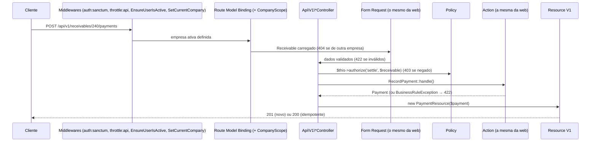

# 13 — API REST v1

O Nexus ERP expõe uma API REST em `/api/v1` para integrações (BI, aplicativos móveis, automações, outros sistemas). Este documento descreve autenticação, convenções, todos os endpoints e traz exemplos completos com `curl`.

> **Princípio de projeto:** a API usa **os mesmos** Form Requests, Policies e Actions da interface web (veja o comentário no topo de [`routes/api.php`](../routes/api.php)). Uma regra de negócio vale igualmente nos dois canais — não existe "atalho" pela API.

## Sumário

1. [Visão geral](#1-visão-geral)
2. [Autenticação](#2-autenticação)
3. [Empresa ativa: cabeçalho `X-Company-Id`](#3-empresa-ativa-cabeçalho-x-company-id)
4. [Rate limit](#4-rate-limit)
5. [Formatos de dados](#5-formatos-de-dados)
6. [Paginação, ordenação e busca](#6-paginação-ordenação-e-busca)
7. [Formato de erros](#7-formato-de-erros)
8. [Idempotência nos pagamentos](#8-idempotência-nos-pagamentos)
9. [Tabela de endpoints e permissões](#9-tabela-de-endpoints-e-permissões)
10. [Filtros e campos de cada recurso](#10-filtros-e-campos-de-cada-recurso)
11. [Exemplos completos com curl](#11-exemplos-completos-com-curl)
12. [Como a API é implementada (para quem vai mantê-la)](#12-como-a-api-é-implementada-para-quem-vai-mantê-la)

---

## 1. Visão geral

| Item | Valor |
|---|---|
| URL base (desenvolvimento) | `http://localhost:8000/api/v1` |
| Formato | JSON (`Content-Type: application/json`, `Accept: application/json`) |
| Autenticação | Token pessoal do Laravel Sanctum: `Authorization: Bearer <token>` |
| Empresa | Cabeçalho opcional `X-Company-Id` (padrão: empresa atual do usuário) |
| Idioma das mensagens | Português do Brasil |
| Valores monetários | Centavos inteiros (`cents`) + texto formatado |
| Rotas | `php artisan route:list --path=api` lista os 47 endpoints |

Sempre envie `Accept: application/json`. Sem ele, alguns erros podem ser tratados como requisição de navegador.

---

## 2. Autenticação

A API usa [tokens pessoais do Sanctum](https://laravel.com/docs/13.x/sanctum#api-token-authentication). O token é enviado em todas as requisições no cabeçalho `Authorization: Bearer <token>`.

### 2.1 Obter um token — `POST /api/v1/auth/token`

Corpo:

| Campo | Tipo | Obrigatório | Descrição |
|---|---|---|---|
| `email` | string | sim | E-mail do usuário. |
| `password` | string | sim | Senha. |
| `device_name` | string (até 100) | sim | Nome do dispositivo/integração (aparece no perfil do usuário). |

Regras (em [`AuthTokenController`](../app/Http/Controllers/Api/V1/AuthTokenController.php)):

- credenciais inválidas → 422 com `errors.email` ("E-mail ou senha inválidos.");
- conta desativada → 422 ("Sua conta está desativada.");
- usuário sem nenhuma empresa ativa → 422;
- o token emitido **expira em 30 dias**;
- limite de **5 tentativas por minuto** por e-mail + IP.

Resposta `201 Created`:

```json
{
    "token": "1|Jk8x0lW3vYq4nR2sT7uZ9aBcDeFgHiJkLmNoPqRs",
    "token_type": "Bearer",
    "expires_at": "2026-11-13T10:30:00-03:00",
    "user": {
        "id": 3,
        "name": "Fernanda Lima",
        "email": "financeiro@verticeti.local",
        "job_title": "Analista financeira",
        "is_super_admin": false,
        "current_company_id": 1,
        "companies": [
            { "id": 1, "name": "Vértice TI" }
        ],
        "permissions": ["dashboard.view", "reports.financial", "customers.view", "receivables.view", "..."]
    }
}
```

> Guarde o `token` com segurança: ele só é mostrado nesta resposta. No banco fica apenas o hash.

Tokens também podem ser criados pela interface, em **Meu perfil → Tokens de acesso à API**, com validade de 30, 90 ou 365 dias, ou sem expiração. Detalhes em [07 — Autenticação e permissões](07-autenticacao-e-permissoes.md#9-tokens-de-api-com-laravel-sanctum).

### 2.2 Usuário autenticado — `GET /api/v1/me`

Retorna o mesmo objeto `user` acima, dentro de `data`. Útil para descobrir as empresas acessíveis e as permissões na empresa ativa (o superadministrador recebe `"permissions": ["*"]`).

### 2.3 Revogar o token atual — `DELETE /api/v1/auth/token`

Apaga o token usado na requisição. Resposta `200`:

```json
{ "message": "Token revogado." }
```

### 2.4 Validade e revogação automática

- Tokens expirados deixam de funcionar (401) e são removidos diariamente pelo Scheduler (`sanctum:prune-expired --hours=48`).
- Se a conta do usuário for desativada, o middleware `EnsureUserIsActive` apaga o token e responde 403; desativar o vínculo com a empresa também revoga os tokens do usuário (`ToggleUserAccess`).
- Os tokens são criados com a habilidade `['*']`: **o que o token pode fazer é exatamente o que o perfil do usuário pode fazer na empresa ativa.**

---

## 3. Empresa ativa: cabeçalho `X-Company-Id`

Um usuário pode pertencer a várias empresas, com um perfil diferente em cada uma. O middleware [`SetCurrentCompany`](../app/Http/Middleware/SetCurrentCompany.php) define a empresa da requisição:

- **Com** `X-Company-Id: 2` → usa a empresa 2, **se** o usuário tiver vínculo ativo com ela; caso contrário, **403** ("Você não tem acesso à empresa informada.").
- **Sem** o cabeçalho → usa a empresa atual do usuário (`users.current_company_id`, a última escolhida na interface).

Todos os dados retornados e todas as permissões verificadas são da empresa ativa. Registros de outras empresas simplesmente "não existem" (404).

```bash
curl -H "Authorization: Bearer $TOKEN" -H "Accept: application/json" \
     -H "X-Company-Id: 2" http://localhost:8000/api/v1/customers
```

---

## 4. Rate limit

Definidos em `configureRateLimiting()` no [`AppServiceProvider`](../app/Providers/AppServiceProvider.php):

| Limitador | Onde | Limite | Chave |
|---|---|---|---|
| `api-token` | `POST /auth/token` | 5 por minuto | e-mail + IP |
| `api` | todos os demais endpoints | 60 por minuto | ID do usuário (ou IP) |

Ao exceder, a resposta é **429**. Para o limitador `api`:

```json
{ "message": "Muitas requisições. Aguarde alguns instantes e tente novamente." }
```

Para o limitador `api-token` (emissão de tokens):

```json
{ "message": "Muitas tentativas de login. Aguarde um minuto e tente novamente." }
```

As respostas incluem os cabeçalhos `X-RateLimit-Limit` e `X-RateLimit-Remaining`; a resposta 429 inclui `Retry-After` (segundos). Clientes devem respeitar `Retry-After` antes de tentar de novo.

---

## 5. Formatos de dados

Os Resources usam o trait [`FormatsValues`](../app/Http/Resources/V1/Concerns/FormatsValues.php), garantindo o mesmo formato em todos os endpoints.

### Dinheiro

Sempre um objeto com centavos inteiros e o texto formatado:

```json
"amount": { "cents": 150000, "formatted": "R$ 1.500,00" }
```

> Use **sempre** `cents` para cálculos. Nunca converta para `float` (0,1 + 0,2 ≠ 0,3 em ponto flutuante). O campo `formatted` serve apenas para exibição.

**Na entrada**, os campos monetários aceitam duas formas:

| Forma | Exemplo | Observação |
|---|---|---|
| Campo `_cents` (inteiro) | `"amount_cents": 150000` | Recomendado para integrações. |
| Campo sem sufixo (texto) | `"amount": "1.500,00"` ou `"amount": "1500.00"` | Convertido pelo servidor com `Money::parse()` ([`NormalizesMoney`](../app/Http/Requests/Concerns/NormalizesMoney.php)). |

> Cuidado: um **número inteiro** no campo sem sufixo é interpretado como reais — `"amount": 150` vira R$ 150,00 (15000 centavos). Para evitar ambiguidade, prefira os campos `_cents`.

Nos itens de propostas, o mesmo vale para `unit_price_cents`/`unit_price` e `discount_cents`/`discount`. A quantidade é uma string decimal (`"2.5"` ou `"2,5"`) e os totais são **sempre calculados no servidor**.

### Enums (status, tipos, prioridades)

```json
"status": { "value": "partial", "label": "Pago parcialmente" }
```

Envie sempre o `value` nas requisições. O `label` é o texto em português para exibição.

| Enum | Valores |
|---|---|
| `PersonType` (clientes/fornecedores) | `individual`, `company` |
| `CustomerStatus` | `active`, `inactive`, `blocked` |
| `RecordStatus` (fornecedores) | `active`, `inactive` |
| `CatalogItemType` | `product`, `service` |
| `ProposalStatus` | `draft`, `sent`, `approved`, `rejected`, `expired`, `cancelled` |
| `ContractStatus` | `draft`, `active`, `suspended`, `cancelled`, `finished` |
| `BillingFrequency` | `monthly`, `quarterly`, `semiannual`, `annual` |
| `BillStatus` (títulos) | `open`, `partial`, `paid`, `cancelled` |
| `PaymentMethod` | `pix`, `bank_slip`, `bank_transfer`, `cash`, `credit_card`, `debit_card`, `other` |
| `EntryStatus` (pagamentos) | `confirmed`, `reversed` |
| `Priority` | `low`, `medium`, `high`, `urgent` |
| `ServiceOrderStatus` | `open`, `in_progress`, `on_hold`, `completed`, `cancelled` |
| `TicketStatus` | `open`, `in_progress`, `waiting_customer`, `resolved`, `closed`, `cancelled` |
| `TicketChannel` | `phone`, `email`, `whatsapp`, `in_person`, `portal` |

### Datas

| Tipo | Formato | Exemplo |
|---|---|---|
| Data | `AAAA-MM-DD` | `"due_date": "2026-11-10"` |
| Data e hora | ISO 8601 com fuso (`DATE_ATOM`) | `"created_at": "2026-10-14T10:30:00-03:00"` |
| Competência | `AAAA-MM` | `"competence": "2026-11"` |

O fuso da aplicação é `America/Sao_Paulo`. Na entrada, envie datas como `AAAA-MM-DD`.

### Documentos (CPF/CNPJ)

Pode enviar com ou sem máscara (`"11.222.333/0001-81"` ou `"11222333000181"`). O servidor grava só os caracteres válidos e devolve os dois formatos: `document` (limpo) e `document_formatted` (com máscara). CNPJ alfanumérico é aceito.

---

## 6. Paginação, ordenação e busca

Todas as listagens são paginadas e aceitam os parâmetros padronizados pelo [`ApiController`](../app/Http/Controllers/Api/V1/ApiController.php):

| Parâmetro | Padrão | Descrição |
|---|---|---|
| `page` | 1 | Página. |
| `per_page` | 15 | Itens por página, de 1 a **100** (valores fora do intervalo são ajustados). |
| `sort` | depende do recurso | Campo de ordenação — **somente** os campos permitidos de cada recurso (seção 10); outros valores são ignorados. |
| `direction` | `asc` | `asc` ou `desc` (só tem efeito quando `sort` é informado; sem `sort`, vale a direção padrão do recurso). |
| `search` | — | Busca textual (os campos pesquisados variam por recurso). |

Formato da resposta (padrão dos API Resources do Laravel):

```json
{
    "data": [ { "id": 12, "...": "..." } ],
    "links": {
        "first": "http://localhost:8000/api/v1/customers?page=1",
        "last": "http://localhost:8000/api/v1/customers?page=4",
        "prev": null,
        "next": "http://localhost:8000/api/v1/customers?page=2"
    },
    "meta": {
        "current_page": 1,
        "from": 1,
        "last_page": 4,
        "links": [ { "url": null, "label": "&laquo; Anterior", "active": false } ],
        "path": "http://localhost:8000/api/v1/customers",
        "per_page": 15,
        "to": 15,
        "total": 52
    }
}
```

Para percorrer tudo, siga `links.next` até ser `null`. A ordenação sempre usa o `id` como critério de desempate, garantindo uma paginação estável.

---

## 7. Formato de erros

Todos os erros têm a chave `message` em português ([tratamento em `bootstrap/app.php`](../bootstrap/app.php)). Erros 422 trazem também `errors`.

| Status | Quando | Corpo |
|---|---|---|
| **401** | Sem token, token inválido ou expirado. | `{"message": "Não autenticado. Envie um token válido no cabeçalho Authorization: Bearer <token>."}` |
| **403** | Perfil sem permissão (Policy). | `{"message": "Você não tem permissão para executar esta ação."}` |
| **403** | `X-Company-Id` sem acesso. | `{"message": "Você não tem acesso à empresa informada."}` |
| **403** | Conta desativada / sem empresa ativa. | `{"message": "Sua conta está desativada."}` |
| **404** | Registro inexistente **ou de outra empresa**. | `{"message": "Registro não encontrado."}` |
| **404** | URL inexistente. | `{"message": "Recurso não encontrado."}` |
| **405** | Método HTTP errado para a URL. | `{"message": "Método HTTP não permitido para este endpoint."}` |
| **422** | Erro de **validação** (Form Request). | `message` + `errors` por campo |
| **422** | Violação de **regra de negócio** (`BusinessRuleException`). | `message` + `errors.business_rule` |
| **429** | Rate limit excedido. | Veja a [seção 4](#4-rate-limit). |
| **500** | Erro inesperado no servidor. | `{"message": "Server Error"}` (detalhes só no log) |

### 422 — validação

```json
{
    "message": "O campo CPF/CNPJ não contém um CNPJ válido.",
    "errors": {
        "document": ["O campo CPF/CNPJ não contém um CNPJ válido."]
    }
}
```

A `message` repete o primeiro erro (com mais de um erro, o Laravel acrescenta um sufixo do tipo "(and 1 more error)"). Os textos vêm das regras do projeto (ex.: [`CpfCnpj`](../app/Rules/CpfCnpj.php)) e de `lang/pt_BR/validation.php`; para integrações, o que importa é a estrutura `errors.<campo>`.

### 422 — regra de negócio

Quando a requisição é válida no formato, mas viola uma regra (ex.: aprovar uma proposta que ainda está em rascunho), as Actions lançam [`BusinessRuleException`](../app/Exceptions/BusinessRuleException.php), que se renderiza assim:

```json
{
    "message": "Não é possível alterar a proposta de \"Rascunho\" para \"Aprovada\".",
    "errors": {
        "business_rule": ["Não é possível alterar a proposta de \"Rascunho\" para \"Aprovada\"."]
    }
}
```

O mesmo formato dos erros de validação facilita o tratamento no cliente: basta procurar a chave `business_rule` em `errors`.

> Por que 404 (e não 403) para registro de outra empresa? Porque o `CompanyScope` faz a consulta não encontrar o registro — responder 403 confirmaria que o ID existe em alguma empresa.

---

## 8. Idempotência nos pagamentos

Registrar um pagamento movimenta dinheiro. Se a rede cair depois de o servidor processar o pagamento, mas antes de a resposta chegar, o cliente não sabe se deu certo — e tentar de novo **não pode** gerar um segundo pagamento.

Por isso, `POST /receivables/{id}/payments` e `POST /payables/{id}/payments` exigem o campo **`idempotency_key`** (um UUID gerado pelo cliente):

| Situação | Resposta |
|---|---|
| Primeira requisição com a chave | **201 Created** + o pagamento criado |
| Mesma chave, mesmo título (retry) | **200 OK** + **o mesmo** pagamento (nada é gravado de novo) |
| Mesma chave usada em **outro** título | **422** `business_rule`: "Esta operação já foi processada para outro título..." |

Como o servidor garante (detalhes em [`RecordPayment`](../app/Actions/Finance/RecordPayment.php)):

1. procura um pagamento com a chave antes de processar;
2. índice UNIQUE `(company_id, idempotency_key)` no banco — se duas requisições idênticas chegarem ao mesmo tempo, só uma é gravada, e a outra recebe o pagamento vencedor;
3. `lockForUpdate` no título impede que dois pagamentos simultâneos ultrapassem o saldo;
4. CHECK `paid_cents <= amount_cents` no banco como última barreira.

**Regras para o cliente:** gere **uma** chave por intenção de pagamento e reutilize-a em todas as tentativas daquela operação. Uma chave nova = um pagamento novo.

---

## 9. Tabela de endpoints e permissões

Todas as rotas exigem token, exceto `POST /auth/token`. A coluna "Permissão" indica a permissão do perfil (veja a matriz em [07 — Autenticação e permissões](07-autenticacao-e-permissoes.md#11-perfis-padrão-e-matriz-de-permissões)); o superadministrador passa em todas.

| Método | Endpoint | Ação | Permissão / condição |
|---|---|---|---|
| POST | `/auth/token` | Emite token | pública (5/min) |
| DELETE | `/auth/token` | Revoga o token atual | autenticado |
| GET | `/me` | Usuário, empresas e permissões | autenticado |
| GET | `/dashboard` | Indicadores da empresa | `dashboard.view` |
| GET | `/customers` | Lista clientes | `customers.view` |
| POST | `/customers` | Cria cliente | `customers.create` |
| GET | `/customers/{id}` | Detalhe (com endereços e contatos) | `customers.view` |
| PUT/PATCH | `/customers/{id}` | Atualiza cliente | `customers.update` |
| DELETE | `/customers/{id}` | Exclui (soft delete) | `customers.delete`; sem contratos ativos nem títulos em aberto |
| GET | `/suppliers` | Lista fornecedores | `suppliers.view` |
| POST | `/suppliers` | Cria fornecedor | `suppliers.create` |
| GET | `/suppliers/{id}` | Detalhe | `suppliers.view` |
| PUT/PATCH | `/suppliers/{id}` | Atualiza | `suppliers.update` |
| DELETE | `/suppliers/{id}` | Exclui (soft delete) | `suppliers.delete`; sem contas a pagar em aberto |
| GET | `/catalog-items` | Lista itens do catálogo | `catalog.view` |
| GET | `/catalog-items/{id}` | Detalhe | `catalog.view` |
| GET | `/proposals` | Lista propostas | `proposals.view` |
| POST | `/proposals` | Cria proposta (rascunho) | `proposals.create` |
| GET | `/proposals/{id}` | Detalhe com itens | `proposals.view` |
| PUT/PATCH | `/proposals/{id}` | Atualiza | `proposals.update`; somente rascunho |
| POST | `/proposals/{id}/status` | Envia, aprova, recusa, cancela, reabre | `proposals.approve` |
| POST | `/proposals/{id}/convert` | Converte em contrato | `contracts.create`; somente aprovada, uma única vez |
| GET | `/contracts` | Lista contratos | `contracts.view` |
| GET | `/contracts/{id}` | Detalhe com itens | `contracts.view` |
| POST | `/contracts/{id}/status` | Ativa, suspende, cancela, encerra | `contracts.manage` |
| GET | `/receivables` | Lista contas a receber | `receivables.view` |
| POST | `/receivables` | Lança conta a receber | `receivables.create` |
| GET | `/receivables/{id}` | Detalhe com pagamentos | `receivables.view` |
| POST | `/receivables/{id}/payments` | Registra recebimento (idempotente) | `receivables.settle` |
| POST | `/receivables/{id}/cancel` | Cancela | `receivables.cancel`; sem pagamentos confirmados |
| GET | `/payables` | Lista contas a pagar | `payables.view` |
| POST | `/payables` | Lança conta a pagar | `payables.create` |
| GET | `/payables/{id}` | Detalhe com pagamentos | `payables.view` |
| POST | `/payables/{id}/payments` | Registra pagamento (idempotente) | `payables.settle` |
| POST | `/payables/{id}/cancel` | Cancela | `payables.cancel`; sem pagamentos confirmados |
| POST | `/payments/{id}/reverse` | Estorna pagamento | `payments.reverse`; ainda não estornado |
| GET | `/financial-accounts` | Lista contas financeiras | `accounts.view` |
| GET | `/financial-accounts/{id}` | Detalhe (saldo atual) | `accounts.view` |
| GET | `/service-orders` | Lista ordens de serviço | `service_orders.view` |
| POST | `/service-orders` | Abre OS | `service_orders.create` |
| GET | `/service-orders/{id}` | Detalhe | `service_orders.view` |
| PUT/PATCH | `/service-orders/{id}` | Atualiza | `service_orders.update` |
| GET | `/tickets` | Lista chamados | `tickets.view` |
| POST | `/tickets` | Abre chamado | `tickets.create` |
| GET | `/tickets/{id}` | Detalhe com mensagens | `tickets.view` |
| PUT/PATCH | `/tickets/{id}` | Atualiza | `tickets.update` |
| POST | `/tickets/{id}/messages` | Adiciona mensagem | `tickets.update`; chamado não encerrado/cancelado |

Todos os prefixos acima são relativos a `/api/v1`. Não há endpoints de exclusão para propostas, contratos, títulos financeiros, OS e chamados: por regra de negócio, esses registros são **cancelados** (ou estornados), nunca apagados via API.

---

## 10. Filtros e campos de cada recurso

### Clientes — `/customers`

- **Filtros:** `search` (nome, nome fantasia, e-mail, CPF/CNPJ), `status` (`active`/`inactive`/`blocked`), `type` (`individual`/`company`).
- **Ordenação:** `name` (padrão, asc), `created_at`, `document`.
- **Corpo (POST/PUT):** `type`*, `name`*, `document`*, `status`*, `trade_name`, `state_registration`, `email`, `phone`, `mobile`, `website`, `notes`, `owner_id` (usuário da empresa), `addresses[]` (`label`, `zip_code` 8 dígitos, `street`*, `number`, `complement`, `district`, `city`*, `state`* UF, `is_primary`), `contacts[]` (`name`*, `position`, `email`, `phone`, `is_primary`). (*obrigatório)
- No **PUT**, se `addresses` ou `contacts` não forem enviados, os existentes são mantidos; se forem enviados, a lista é **substituída**.
- O CPF/CNPJ é único por empresa (entre registros não excluídos).

### Fornecedores — `/suppliers`

- **Filtros:** `search`, `status` (`active`/`inactive`). **Ordenação:** `name` (padrão), `created_at`.
- **Corpo:** igual ao de clientes, sem `owner_id`, e `status` usa `active`/`inactive`.

### Catálogo — `/catalog-items` (somente leitura)

- **Filtros:** `search` (nome, código, descrição), `type` (`product`/`service`), `active` (`1`/`0`).
- **Ordenação:** `name` (padrão), `code`, `price_cents`.

### Propostas — `/proposals`

- **Filtros:** `search`, `status`, `customer_id`. **Ordenação:** `issue_date` (padrão, **desc**), `number`, `total_cents`.
- **Corpo (POST/PUT):** `customer_id`*, `title`*, `items`* (1 a 100), `opportunity_id`, `owner_id`, `issue_date`, `valid_until` (≥ `issue_date`), `payment_terms`, `notes`, `discount_cents` (ou `discount`).
- **Itens:** `description`*, `quantity`* (> 0), `unit_price_cents`* (ou `unit_price`), `discount_cents` (ou `discount`), `unit`, `catalog_item_id`.
- **Status (`POST /status`):** `{"status": "sent|approved|rejected|cancelled|draft", "reason": "..."}`. Transições seguem a máquina de estados do Enum `ProposalStatus`; recusar exige `reason`; enviar exige ao menos um item; aprovar exige validade não vencida.
- **Conversão (`POST /convert`):** `start_date`*, `billing_frequency`*, `billing_day`* (1 a 28), `end_date`, `auto_renew`, `financial_category_id` (categoria de receita), `activate` (`true` para já ativar o contrato). Resposta **201** com o contrato.

### Contratos — `/contracts`

- **Filtros:** `search`, `status`, `customer_id`. **Ordenação:** `number` (padrão, **desc**), `start_date`, `amount_cents`.
- **Status (`POST /status`):** `{"status": "active|suspended|cancelled|finished", "reason": "..."}`. Cancelar exige `reason` e cancela as cobranças futuras sem pagamento.

### Contas a receber e a pagar — `/receivables`, `/payables`

- **Filtros:** `search`, `situation` (`open` = em aberto/parcial, `overdue` = vencidas, `upcoming` = a vencer, `paid`, `cancelled`), `due_from` e `due_to` (`AAAA-MM-DD`), além de `customer_id` (receber) ou `supplier_id` (pagar).
- **Ordenação:** `due_date` (padrão), `amount_cents`, `competence`.
- **Corpo (POST):** `description`*, `amount_cents`* (ou `amount`), `issue_date`*, `due_date`*, `competence` (`AAAA-MM`; padrão: mês do vencimento), `document_number`, `financial_category_id`, `cost_center_id`, `notes`; e `customer_id`* + `contract_id` (do mesmo cliente) para receber, ou `supplier_id` para pagar.
- **Pagamento (`POST /payments`):** `financial_account_id`* (conta ativa), `amount_cents`* (ou `amount`), `paid_on`* (não futura), `method`*, `idempotency_key`* (UUID), `notes`. Não pode ultrapassar o saldo em aberto; em contas a pagar, a conta financeira precisa ter saldo.
- **Cancelamento (`POST /cancel`):** `{"reason": "..."}` (5 a 255 caracteres). Títulos com pagamentos confirmados precisam ter os pagamentos estornados antes.
- "Vencido" (`is_overdue`) é **calculado** a partir do vencimento e do status; não é um status armazenado.

### Pagamentos — `/payments/{id}/reverse`

- **Corpo:** `{"reason": "..."}` (5 a 255 caracteres). O pagamento não é apagado: fica com status `reversed`, o saldo volta ao título e um lançamento inverso é registrado no extrato da conta.

### Contas financeiras — `/financial-accounts` (somente leitura)

- **Filtros:** `active` (`1`/`0`). **Ordenação:** `name` (padrão), `current_balance_cents`.

### Ordens de serviço — `/service-orders`

- **Filtros:** `search`, `status`, `priority`, `assigned_to`. **Ordenação:** `created_at` (padrão, **desc**), `number`, `due_date`.
- **Corpo:** `customer_id`*, `title`*, `description`*, `priority`*, `contract_id` (do mesmo cliente), `catalog_item_id` (serviço do catálogo), `assigned_to` (usuário ativo da empresa), `due_date`.

### Chamados — `/tickets`

- **Filtros:** `search`, `status`, `priority`, `customer_id`. **Ordenação:** `created_at` (padrão, **desc**), `number`.
- **Corpo:** `customer_id`*, `subject`*, `description`*, `priority`*, `channel`*, `contract_id`, `service_order_id` (do mesmo cliente), `ticket_category_id`, `assigned_to`.
- **Mensagem (`POST /messages`):** `body`* (até 5000), `is_internal` (booleano; comentário interno não conta como resposta ao cliente). Resposta **201** com o chamado e todas as mensagens.

### Dashboard — `/dashboard`

- **Parâmetros:** `from` e `to` (`AAAA-MM-DD`; padrão: últimos 6 meses até o fim do mês atual).
- **Resposta:** `data.period`, `data.kpis` (valores monetários com sufixo `_cents`, ex.: `revenue_received_cents`, `overdue_receivables_cents`, `balance_cents`, `monthly_recurring_cents`; contagens como `active_customers`, `open_tickets`), `data.revenue_vs_expenses` (`labels`, `income`, `expense`) e `data.cash_flow` (`labels`, `inflow`, `outflow`, `balance`).

---

## 11. Exemplos completos com curl

Os exemplos usam variáveis de shell para ficarem curtos. Em desenvolvimento, use as credenciais demo (senha `Nexus@2026`, **somente** no ambiente local).

```bash
API=http://localhost:8000/api/v1
```

### 11.1 Obter o token

```bash
curl -s -X POST "$API/auth/token" \
  -H "Accept: application/json" -H "Content-Type: application/json" \
  -d '{"email": "admin@verticeti.local", "password": "Nexus@2026", "device_name": "Integração BI"}'
```

Guarde o token (com [`jq`](https://jqlang.github.io/jq/)):

```bash
TOKEN=$(curl -s -X POST "$API/auth/token" \
  -H "Accept: application/json" -H "Content-Type: application/json" \
  -d '{"email": "admin@verticeti.local", "password": "Nexus@2026", "device_name": "Integração BI"}' | jq -r .token)

H=(-H "Authorization: Bearer $TOKEN" -H "Accept: application/json" -H "Content-Type: application/json")
```

### 11.2 Listar clientes

```bash
curl -s "${H[@]}" "$API/customers?search=clinica&status=active&per_page=2&sort=created_at&direction=desc"
```

```json
{
    "data": [
        {
            "id": 12,
            "type": { "value": "company", "label": "Pessoa jurídica" },
            "name": "Clínica Bem Estar Ltda",
            "trade_name": "Clínica Bem Estar",
            "display_name": "Clínica Bem Estar",
            "document": "11222333000181",
            "document_formatted": "11.222.333/0001-81",
            "state_registration": null,
            "email": "contato@bemestar.com.br",
            "phone": "1133334444",
            "mobile": null,
            "website": null,
            "status": { "value": "active", "label": "Ativo" },
            "notes": null,
            "owner": { "id": 4, "name": "Rafael Souza" },
            "created_at": "2026-10-14T10:30:00-03:00",
            "updated_at": "2026-10-14T10:30:00-03:00"
        }
    ],
    "links": { "first": "...", "last": "...", "prev": null, "next": "..." },
    "meta": { "current_page": 1, "last_page": 3, "per_page": 2, "total": 5, "...": "..." }
}
```

(Na listagem, `addresses` e `contacts` não vêm; eles aparecem no detalhe `GET /customers/{id}`.)

### 11.3 Criar cliente

```bash
curl -s -X POST "${H[@]}" "$API/customers" -d '{
  "type": "company",
  "name": "Padaria Pão Quente Ltda",
  "trade_name": "Padaria Pão Quente",
  "document": "11.222.333/0001-81",
  "email": "contato@paoquente.com.br",
  "status": "active",
  "addresses": [
    {"label": "Loja", "zip_code": "01310-100", "street": "Av. Paulista", "number": "1000", "city": "São Paulo", "state": "SP", "is_primary": true}
  ],
  "contacts": [
    {"name": "Maria Souza", "email": "maria@paoquente.com.br", "is_primary": true}
  ]
}'
```

Resposta `201` com o cliente completo (inclui `addresses` e `contacts`):

```json
{
    "data": {
        "id": 53,
        "type": { "value": "company", "label": "Pessoa jurídica" },
        "name": "Padaria Pão Quente Ltda",
        "display_name": "Padaria Pão Quente",
        "document": "11222333000181",
        "document_formatted": "11.222.333/0001-81",
        "status": { "value": "active", "label": "Ativo" },
        "owner": null,
        "addresses": [
            { "id": 90, "label": "Loja", "zip_code": "01310100", "street": "Av. Paulista", "number": "1000", "complement": null, "district": null, "city": "São Paulo", "state": "SP", "is_primary": true }
        ],
        "contacts": [
            { "id": 71, "name": "Maria Souza", "position": null, "email": "maria@paoquente.com.br", "phone": null, "is_primary": true }
        ],
        "created_at": "2026-10-14T11:02:13-03:00",
        "updated_at": "2026-10-14T11:02:13-03:00",
        "...": "demais campos"
    }
}
```

Se o CNPJ já existir na empresa → `422` com `errors.document`: "Já existe um cadastro com este CPF/CNPJ nesta empresa.".

### 11.4 Criar proposta com itens

```bash
curl -s -X POST "${H[@]}" "$API/proposals" -d '{
  "customer_id": 53,
  "title": "Implantação do sistema de vendas",
  "valid_until": "2026-11-30",
  "discount_cents": 1000,
  "payment_terms": "30 dias após a aprovação",
  "items": [
    {"catalog_item_id": 7, "description": "Consultoria", "quantity": "2.5", "unit": "H", "unit_price_cents": 15000},
    {"description": "Treinamento da equipe", "quantity": "1", "unit": "UN", "unit_price": "500,00", "discount": "50,00"}
  ]
}'
```

Resposta `201` (totais calculados pelo servidor — os valores enviados para totais seriam ignorados):

```json
{
    "data": {
        "id": 31,
        "number": "PROP-2026-00031",
        "title": "Implantação do sistema de vendas",
        "status": { "value": "draft", "label": "Rascunho" },
        "customer": { "id": 53, "name": "Padaria Pão Quente" },
        "opportunity_id": null,
        "owner_id": null,
        "issue_date": "2026-10-14",
        "valid_until": "2026-11-30",
        "subtotal": { "cents": 82500, "formatted": "R$ 825,00" },
        "discount": { "cents": 1000, "formatted": "R$ 10,00" },
        "total": { "cents": 81500, "formatted": "R$ 815,00" },
        "payment_terms": "30 dias após a aprovação",
        "notes": null,
        "sent_at": null,
        "approved_at": null,
        "rejected_at": null,
        "rejection_reason": null,
        "items": [
            { "id": 101, "catalog_item_id": 7, "description": "Consultoria", "quantity": "2.500", "unit": "H", "unit_price": { "cents": 15000, "formatted": "R$ 150,00" }, "discount": { "cents": 0, "formatted": "R$ 0,00" }, "total": { "cents": 37500, "formatted": "R$ 375,00" } },
            { "id": 102, "catalog_item_id": null, "description": "Treinamento da equipe", "quantity": "1.000", "unit": "UN", "unit_price": { "cents": 50000, "formatted": "R$ 500,00" }, "discount": { "cents": 5000, "formatted": "R$ 50,00" }, "total": { "cents": 45000, "formatted": "R$ 450,00" } }
        ],
        "created_at": "2026-10-14T11:10:00-03:00"
    }
}
```

Cálculo: 2,5 × R$ 150,00 = R$ 375,00; R$ 500,00 − R$ 50,00 = R$ 450,00; subtotal R$ 825,00 − desconto geral R$ 10,00 = **R$ 815,00**. (O `number` depende do contador da empresa no ano.)

### 11.5 Enviar e aprovar a proposta

Aprovar direto um rascunho viola a máquina de estados:

```bash
curl -s -X POST "${H[@]}" "$API/proposals/31/status" -d '{"status": "approved"}'
```

```json
{
    "message": "Não é possível alterar a proposta de \"Rascunho\" para \"Aprovada\".",
    "errors": { "business_rule": ["Não é possível alterar a proposta de \"Rascunho\" para \"Aprovada\"."] }
}
```

O caminho correto é enviar e depois aprovar:

```bash
curl -s -X POST "${H[@]}" "$API/proposals/31/status" -d '{"status": "sent"}'
curl -s -X POST "${H[@]}" "$API/proposals/31/status" -d '{"status": "approved"}'
```

Cada chamada devolve `200` com a proposta atualizada (`"status": {"value": "approved", "label": "Aprovada"}`, `approved_at` preenchido). Para recusar: `{"status": "rejected", "reason": "Cliente optou por outro fornecedor"}`.

### 11.6 Converter em contrato

```bash
curl -s -X POST "${H[@]}" "$API/proposals/31/convert" -d '{
  "start_date": "2026-11-01",
  "billing_frequency": "monthly",
  "billing_day": 10,
  "auto_renew": true,
  "activate": true
}'
```

Resposta `201`:

```json
{
    "data": {
        "id": 18,
        "number": "CTR-2026-00018",
        "title": "Implantação do sistema de vendas",
        "status": { "value": "active", "label": "Ativo" },
        "customer": { "id": 53, "name": "Padaria Pão Quente" },
        "proposal_id": 31,
        "start_date": "2026-11-01",
        "end_date": null,
        "billing_frequency": { "value": "monthly", "label": "Mensal" },
        "billing_day": 10,
        "amount": { "cents": 81500, "formatted": "R$ 815,00" },
        "next_billing_date": "2026-11-10",
        "auto_renew": true,
        "renewal_months": 12,
        "cancellation_reason": null,
        "items": [ { "id": 40, "description": "Consultoria", "...": "..." }, { "id": 41, "description": "Treinamento da equipe", "...": "..." } ],
        "created_at": "2026-10-14T11:20:00-03:00"
    }
}
```

Cliente, itens e valores vêm da proposta (sem duplicar digitação). Tentar converter de novo → `422` `business_rule`: "Esta proposta já foi convertida em contrato.". As cobranças mensais são geradas pela rotina diária (`erp:daily-routines`) dentro da janela de antecedência configurada na empresa. (Os valores de `renewal_months` e `next_billing_date` dependem das configurações da empresa e da data de ativação.)

### 11.7 Registrar um pagamento (idempotente)

Primeiro, encontre o título e uma conta financeira:

```bash
curl -s "${H[@]}" "$API/receivables?customer_id=53&situation=open"
curl -s "${H[@]}" "$API/financial-accounts?active=1"
```

Gere uma chave **uma vez** e use-a em todas as tentativas:

```bash
KEY=$(uuidgen)   # ex.: 3f1c9a7e-8b2d-4c5e-9f10-2a3b4c5d6e7f

curl -s -X POST "${H[@]}" "$API/receivables/240/payments" -d "{
  \"financial_account_id\": 1,
  \"amount_cents\": 40000,
  \"paid_on\": \"2026-10-14\",
  \"method\": \"pix\",
  \"notes\": \"PIX recebido\",
  \"idempotency_key\": \"$KEY\"
}"
```

Resposta `201`:

```json
{
    "data": {
        "id": 512,
        "receivable_id": 240,
        "payable_id": null,
        "financial_account_id": 1,
        "amount": { "cents": 40000, "formatted": "R$ 400,00" },
        "paid_on": "2026-10-14",
        "method": { "value": "pix", "label": "PIX" },
        "status": { "value": "confirmed", "label": "Confirmado" },
        "notes": "PIX recebido",
        "idempotency_key": "3f1c9a7e-8b2d-4c5e-9f10-2a3b4c5d6e7f",
        "reversed_at": null,
        "reversal_reason": null
    }
}
```

Repetir **exatamente** a mesma requisição (mesma `idempotency_key`) devolve `200` com o mesmo `"id": 512` — nenhum valor é lançado de novo. Consultando o título:

```bash
curl -s "${H[@]}" "$API/receivables/240"
```

```json
{
    "data": {
        "id": 240,
        "kind": "receivable",
        "description": "Mensalidade 11/2026 — CTR-2026-00018",
        "document_number": null,
        "customer": { "id": 53, "name": "Padaria Pão Quente" },
        "contract_id": 18,
        "financial_category_id": 1,
        "cost_center_id": null,
        "amount": { "cents": 81500, "formatted": "R$ 815,00" },
        "paid": { "cents": 40000, "formatted": "R$ 400,00" },
        "outstanding": { "cents": 41500, "formatted": "R$ 415,00" },
        "issue_date": "2026-10-14",
        "due_date": "2026-11-10",
        "competence": "2026-11",
        "status": { "value": "partial", "label": "Pago parcialmente" },
        "is_overdue": false,
        "paid_at": null,
        "cancelled_at": null,
        "cancellation_reason": null,
        "payments": [ { "id": 512, "amount": { "cents": 40000, "formatted": "R$ 400,00" }, "...": "..." } ]
    }
}
```

Tentar pagar mais que o saldo → `422` `business_rule`: "O valor informado (R$ ...) é maior que o saldo em aberto (R$ 415,00).".

### 11.8 Estornar o pagamento

```bash
curl -s -X POST "${H[@]}" "$API/payments/512/reverse" -d '{"reason": "PIX devolvido ao cliente"}'
```

Resposta `200` com o pagamento estornado:

```json
{
    "data": {
        "id": 512,
        "amount": { "cents": 40000, "formatted": "R$ 400,00" },
        "status": { "value": "reversed", "label": "Estornado" },
        "reversed_at": "2026-10-14T15:42:10-03:00",
        "reversal_reason": "PIX devolvido ao cliente",
        "...": "demais campos"
    }
}
```

O título volta a `open` com saldo integral, e o extrato da conta ganha um lançamento inverso (o original permanece — o livro-razão é imutável). Estornar de novo → `403` (a `PaymentPolicy::reverse` nega pagamentos já estornados).

### 11.9 Abrir um chamado e adicionar mensagem

```bash
curl -s -X POST "${H[@]}" "$API/tickets" -d '{
  "customer_id": 53,
  "subject": "Impressora fiscal não imprime",
  "description": "Desde ontem a impressora do caixa não imprime cupons.",
  "priority": "high",
  "channel": "whatsapp"
}'
```

Resposta `201`:

```json
{
    "data": {
        "id": 77,
        "number": "CHM-2026-00077",
        "subject": "Impressora fiscal não imprime",
        "description": "Desde ontem a impressora do caixa não imprime cupons.",
        "priority": { "value": "high", "label": "Alta" },
        "status": { "value": "open", "label": "Aberto" },
        "channel": { "value": "whatsapp", "label": "WhatsApp" },
        "customer": { "id": 53, "name": "Padaria Pão Quente" },
        "contract_id": null,
        "service_order_id": null,
        "ticket_category_id": null,
        "assignee": null,
        "first_response_at": null,
        "resolved_at": null,
        "closed_at": null,
        "created_at": "2026-10-14T16:00:00-03:00"
    }
}
```

Mensagem pública ao cliente (registra o tempo da primeira resposta e coloca o chamado "Em atendimento"):

```bash
curl -s -X POST "${H[@]}" "$API/tickets/77/messages" -d '{"body": "Olá! Um técnico vai acessar remotamente em 15 minutos.", "is_internal": false}'
```

Resposta `201` com o chamado e as mensagens:

```json
{
    "data": {
        "id": 77,
        "status": { "value": "in_progress", "label": "Em atendimento" },
        "first_response_at": "2026-10-14T16:05:00-03:00",
        "messages": [
            { "id": 301, "body": "Olá! Um técnico vai acessar remotamente em 15 minutos.", "is_internal": false, "user": "Carla Mendes", "created_at": "2026-10-14T16:05:00-03:00" }
        ],
        "...": "demais campos"
    }
}
```

Use `"is_internal": true` para comentários internos da equipe (não contam como resposta ao cliente). Chamados encerrados ou cancelados recusam mensagens (`422` `business_rule`).

### 11.10 Usando outra empresa

```bash
curl -s "${H[@]}" -H "X-Company-Id: 2" "$API/me"
```

Se o usuário não tiver vínculo ativo com a empresa 2 → `403`.

---

## 12. Como a API é implementada (para quem vai mantê-la)



| Peça | Arquivo |
|---|---|
| Rotas | [`routes/api.php`](../routes/api.php) — prefixo `v1`, nomes `api.v1.*` |
| Base dos controllers | [`ApiController`](../app/Http/Controllers/Api/V1/ApiController.php) — `perPage()` e `sort()` |
| Filtros de títulos | [`HandlesBills`](../app/Http/Controllers/Api/V1/Concerns/HandlesBills.php) |
| Resources | [`app/Http/Resources/V1`](../app/Http/Resources/V1) + [`FormatsValues`](../app/Http/Resources/V1/Concerns/FormatsValues.php) |
| Erros | `withExceptions()` em [`bootstrap/app.php`](../bootstrap/app.php) e `render()` em [`BusinessRuleException`](../app/Exceptions/BusinessRuleException.php) |
| Rate limit | `configureRateLimiting()` em [`AppServiceProvider`](../app/Providers/AppServiceProvider.php) |
| Testes | [`tests/Feature/Api/ApiTest.php`](../tests/Feature/Api/ApiTest.php) e o teste de `X-Company-Id` em [`CompanyIsolationTest`](../tests/Feature/Tenancy/CompanyIsolationTest.php) |

Por que **versionar** (`/v1`)? Integrações externas não podem quebrar quando o sistema evolui. Mudanças incompatíveis (renomear campos, mudar formato) devem ir para uma `v2`, mantendo a `v1` funcionando durante a transição. Mudanças compatíveis (novo campo, novo endpoint) podem entrar na `v1`.

Por que **Resources** em vez de devolver o Model direto? O Resource é o **contrato** da API: ele escolhe os campos expostos (nunca vaza colunas internas, como `company_id` ou `password`), padroniza formatos (dinheiro, datas, enums) e permite mudar o banco sem mudar o JSON.

Para adicionar um endpoint, siga o passo a passo da [seção 16 do tutorial](09-como-adicionar-uma-funcionalidade.md#16-endpoint-de-api-opcional) e acrescente o endpoint a este documento.

Referências oficiais: [Sanctum](https://laravel.com/docs/13.x/sanctum) · [Eloquent API Resources](https://laravel.com/docs/13.x/eloquent-resources) · [Rate Limiting](https://laravel.com/docs/13.x/routing#rate-limiting) · [Validation (erros em JSON)](https://laravel.com/docs/13.x/validation#validation-error-response-format) · [HTTP Tests (JSON APIs)](https://laravel.com/docs/13.x/http-tests#testing-json-apis).
